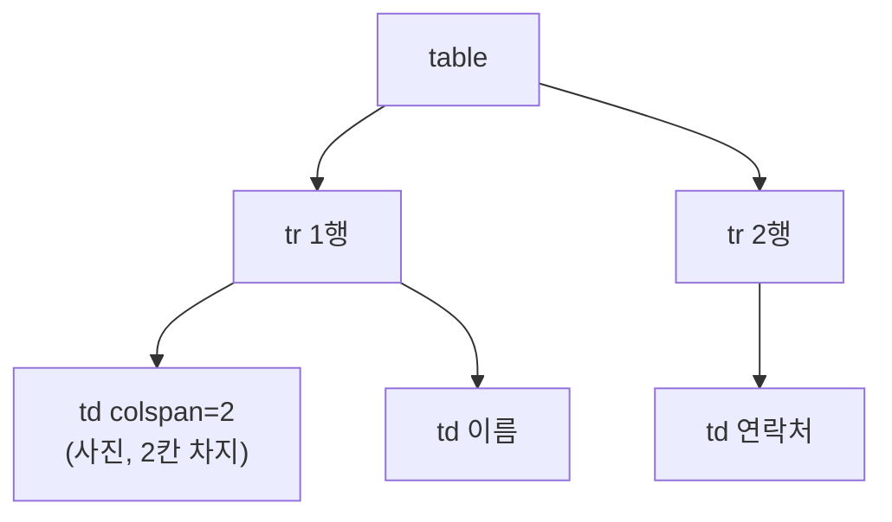

오늘은 HTML의 기본 태그들을 하나씩 실습했다. 글자, 목록, 표, 영역 네 가지를 다뤘는데, 단순히 "태그 이름 외우기"가 아니라 "비슷해 보이는 태그가 왜 따로 있는지"를 중심으로 정리해본다.

## 1. 글자 관련 태그 — 모양이 같아도 의미는 다를 수 있다

```html
<strong>글자를 굵게 표시하는 태그</strong>
<b>글자를 굵게 표시하는 태그</b>
<em>글자를 기울이는 태그</em>
<i>글자를 기울이는 태그</i>
```

`<strong>`과 `<b>`는 화면에서 똑같이 굵게 보이고, `<em>`과 `<i>`도 똑같이 기울어져 보인다. 그런데 왜 각각 두 개씩 있을까?

다섯 살 아이에게 설명한다면: "`<strong>`은 '이거 진짜 중요해!'라는 뜻을 담아서 굵게 쓰는 거고, `<b>`는 그냥 '굵게 써볼까'하고 모양만 바꾸는 거야. 보기엔 똑같아도, 눈이 안 보이는 사람에게 화면을 읽어주는 프로그램은 `<strong>`만 '강조됨'이라고 알려줄 수 있어."


그 밖에도 `<mark>`(형광펜 효과), `<u>`(밑줄), `<small>`(작게), `<sub>`/`<sup>`(아래·위 첨자), `<s>`(취소선) 같은 태그를 익혔다. `<p>`와 `<pre>`의 차이도 짚었는데, `<p>`는 줄바꿈이나 여러 칸 공백을 무시하고 한 칸으로 압축해버리지만, `<pre>`는 작성한 그대로(공백·줄바꿈 포함) 화면에 보여준다.

## 2. 목록 관련 태그 — 순서가 있는가 없는가

```html
<ul> <!-- 순서 없는 목록 -->
  <li>HTML</li>
  <li>CSS</li>
  <li>JS</li>
</ul>

<ol type="A"> <!-- 순서 있는 목록 -->
  <li>HTML</li>
  <li>CSS</li>
  <li>JS</li>
</ol>
```

`<ul>`(unordered list)은 항목 순서가 중요하지 않을 때, `<ol>`(ordered list)은 순서 자체가 의미를 가질 때 쓴다. `<ol>`은 `type` 속성으로 번호 매기는 방식(숫자, 알파벳 등)도 바꿀 수 있다.

## 3. 표 관련 태그 — rowspan·colspan으로 칸 합치기

```html
<table border="2">
  <tr>
    <td colspan="2" rowspan="2">사진</td>
    <td>이름</td>
    <td></td>
  </tr>
  <tr>
    <td>연락처</td>
    <td></td>
  </tr>
</table>
```

표는 `table`(표 전체) → `tr`(행) → `th`/`td`(제목 칸/데이터 칸)로 구성된다. `colspan`(열 합치기), `rowspan`(행 합치기)으로 공연 요금표나 신청서처럼 실제로 쓰이는 복잡한 표를 만들 수 있었다. `<caption>`으로 표 전체의 제목을 붙이는 것도 함께 익혔다.



## 4. 영역 관련 태그 — div는 줄바꿈, span은 안 바뀜

```html
<div style="background: red;">첫 번째 영역</div>
<div style="background: yellow;">두 번째 영역</div>

<span style="background: red;">첫 번째 영역</span>
<span style="background: yellow;">두 번째 영역</span>
```

`div`는 **블록(block) 요소**라서 항상 줄바꿈이 적용되어 아래로 쌓이고, `span`은 **인라인(inline) 요소**라서 줄바꿈 없이 옆으로 이어 붙는다. 둘 다 그 자체로는 아무 의미도 없고, 여러 요소를 하나로 묶어서 공통 스타일을 적용하거나 특정 부분만 강조할 때 쓴다는 공통점이 있다.

## 오늘의 정리

| 태그 | 역할 |
|---|---|
| `strong`/`em` | 의미를 전달하는 강조 (화면 읽기 프로그램도 인식) |
| `b`/`i` | 모양만 바꾸는 강조 |
| `ul`/`ol` | 순서 없는/있는 목록 |
| `table`/`tr`/`th`/`td` | 표, 행, 제목 칸, 데이터 칸 |
| `div`/`span` | 블록(줄바꿈 O)/인라인(줄바꿈 X) 영역 묶음 |

오늘 배운 태그들의 공통점은, 겉보기엔 비슷해 보여도 "컴퓨터(또는 다른 보조 기술)에게 이게 뭔지 알려준다"는 목적이 각각 따로 있다는 것이었다.

## 더 학습하면 좋은 개념

- **시맨틱 태그(semantic tag)** — `div` 대신 `header`, `nav`, `main`, `footer`처럼 의미가 담긴 태그를 쓰는 방법. `div`/`span`의 "의미 없음"을 보완하는 다음 단계다.
- **웹 접근성(Web Accessibility)** — `strong`/`em`이 화면 읽기 프로그램에 다르게 읽히는 것처럼, 모든 사용자가 똑같이 정보를 얻을 수 있게 만드는 원칙.
- **CSS의 display 속성** — 오늘 본 div(block)/span(inline)의 기본값을 CSS로 직접 바꿀 수 있다(`display: inline-block` 등). 내일 CSS 시간에 이어서 다룬다.

## 참고 자료

- [MDN - HTML text fundamentals](https://developer.mozilla.org/en-US/docs/Learn/HTML/Introduction_to_HTML/HTML_text_fundamentals)
- [MDN - HTML table basics](https://developer.mozilla.org/en-US/docs/Learn/HTML/Tables/Basics)
