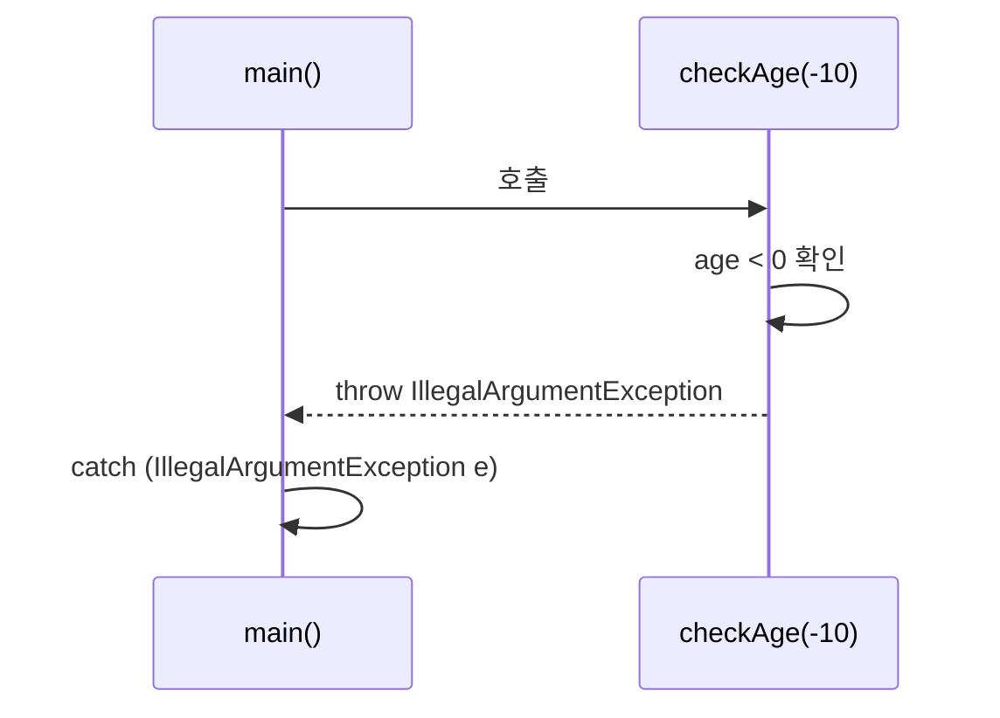

List·Set·TreeSet(10/7)에 이어 오늘은 **Map**을 배웠고, 그 다음 컴파일 오류·런타임 오류 구분부터 `try-catch-finally`로 예외를 다루는 기초까지 이어서 배웠다.

## 1. Map — key와 value를 한 쌍으로

```java
Map map = new HashMap();
map.put("one", new Date());
map.put(12, "apple");
map.put(12, "banana"); // key가 중복되면 나중 값으로 덮어써진다

System.out.println(map.get(12)); // banana
```

`Map`의 특징 두 가지를 배웠다.

1. **key-value**: 값을 한 쌍(key, value)으로 저장한다.
2. **key는 내부적으로 Set 방식**: 그래서 List처럼 중복 저장이 안 되고, 같은 key로 다시 `put()`하면 값이 덮어써진다.

```java
Map<String, String> map2 = new HashMap<>();
map2.put("one", "java");
map2.put("two", "javascript");
map2.remove("three"); // 없는 key를 지워도 에러 없이 그냥 무시된다
```

`Map`도 인터페이스라서 `new Map()`은 안 되고, `HashMap` 같은 구현체로 만들어야 한다는 건 List·Set과 같은 패턴이었다.

실무에서 자주 쓰는 `Properties`도 사실은 Map과 비슷한 구조다.

```java
Properties prop = new Properties();
prop.setProperty("driver", "cj.jdbc.driver.mysql");
prop.setProperty("url", "jdbc:mysql://localhost/menudb");
```

`Properties`는 Map처럼 key-value로 저장하지만, **key와 value가 전부 String**이라는 제약이 있다 — 10/15일 JDBC 접속 정보를 분리할 때 썼던 바로 그 클래스였다.

## 2. 컴파일 오류 vs 런타임 오류

```java
int[] iarr = new int[5];
System.out.println(iarr[6]); // 배열 범위 초과 (런타임에 ArrayIndexOutOfBoundsException)

String str = null;
str.length(); // 런타임에 NullPointerException
```

다섯 살 아이에게 설명한다면: "컴파일 오류는 시험 전에 선생님이 '이 문제는 답안지 형식이 잘못됐어요'라고 미리 알려주는 거고, 런타임 오류는 시험을 보다가 특정 문제를 풀 때 갑자기 터지는 거야. 당연히 미리 알려주는 쪽이 훨씬 반가워."


예외를 처리하지 않으면, 프로그램 실행 중 발생한 예외 때문에 **프로그램이 비정상적으로 종료**될 수 있다는 게 오늘 배운 문제의식이었다.

## 3. try-catch-finally로 처리하기

```java
try {
    String str = null;
    str.length(); // NullPointerException 발생 지점
} catch (ArithmeticException e) {
    System.out.println("예외 메세지 = " + e.getMessage());
} catch (NullPointerException e) {
    System.out.println("예외 메세지 = " + e.getMessage());
} finally {
    System.out.println("예외 발생 여부와 관계없이 실행됨...");
}
```

| 블록 | 역할 |
|---|---|
| `try` | 예외가 발생할 가능성이 있는 코드를 감싼다 |
| `catch` | 특정 예외 타입을 처리하는 코드 (여러 개 가능) |
| `finally` | 예외 발생 여부와 상관없이 항상 실행된다 |

여러 `catch`를 둘 수 있고, 발생한 예외 타입과 일치하는 첫 번째 `catch`가 실행된다는 걸 확인했다.

## 4. throw로 직접 예외를 발생시키기

```java
public static void checkAge(int age) {
    if (age < 0) {
        throw new IllegalArgumentException("나이는 음수일 수 없습니다!");
    }
    System.out.println("전달 받은 " + age + "는 유효한 나이입니다!");
}
```

`checkAge(-10)`을 호출하면 `IllegalArgumentException`이 발생한다. 여기서 핵심은, **예외를 실제로 발생시키는 건 `checkAge()`지만, 그 예외를 처리(`catch`)하는 책임은 `checkAge()`를 호출한 쪽에 있다**는 것이었다 — `throw`는 "나는 문제를 발견만 하고, 처리는 호출한 쪽에 맡길게"라는 뜻이다.



## 오늘의 정리

Map은 key-value 쌍으로 데이터를 저장하고, key가 중복되면 값을 덮어쓴다는 점에서 List·Set과 또 다른 자료구조였다. 예외는 컴파일 타임에 미리 걸러지는 것과 런타임에 실행 중 터지는 것으로 나뉘고, `try-catch-finally`로 감싸서 처리하거나 `throw`로 호출한 쪽에 처리를 위임할 수 있다는 걸 배웠다.

## 더 학습하면 좋은 개념

- **LinkedHashMap / TreeMap** — 오늘 쓴 `HashMap`은 순서를 보장하지 않는다. 입력 순서를 유지하는 `LinkedHashMap`, key를 정렬해주는 `TreeMap`과 비교해보면 좋다.
- **체크 예외(Checked) vs 언체크 예외(Unchecked)** — 오늘 다룬 예외들의 차이를, 내일 사용자 정의 예외를 만들면서 더 깊이 다룬다.
- **멀티 catch(`catch (A | B e)`)** — 오늘은 `ArithmeticException`과 `NullPointerException`을 따로 잡았는데, 처리 코드가 같다면 하나의 catch로 묶는 문법도 있다.

## 참고 자료

- [Oracle Java Tutorials - Lesson: Exceptions](https://docs.oracle.com/javase/tutorial/essential/exceptions/index.html)
- [Oracle Javadoc - Map Interface](https://docs.oracle.com/en/java/javase/21/docs/api/java.base/java/util/Map.html)
