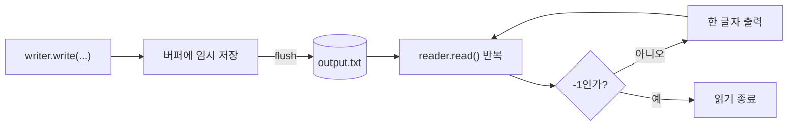

어제 `try-catch`로 예외를 처리하는 기초를 배웠다면, 오늘은 상황에 맞는 **나만의 예외 클래스**를 직접 만드는 법과, 자바로 파일을 읽고 쓰는 법을 배웠다.

## 1. 예외 클래스는 어떻게 만드는가

```java
public class NegativeException extends Exception {
    public NegativeException(String message) {
        super(message);
    }
}
```

예외 클래스를 만드는 방법은 간단했다 — **모든 예외의 부모 클래스인 `Exception`(또는 `RuntimeException`)을 상속**하고, 생성자에서 메시지를 `super()`로 넘기면 끝이다.

오늘 만든 예외 클래스 네 개를 역할별로 정리하면 이렇다.

```java
public class NegativeException extends Exception { ... }                 // 체크 예외
public class MoneyNegativeException extends NegativeException { ... }    // 체크 예외 상속
public class NotEnoughMoneyException extends Exception { ... }           // 체크 예외
public class ProductPriceNegativeException extends RuntimeException { ... } // 언체크 예외
```

## 2. 체크 예외 vs 언체크 예외

`Exception`을 상속하느냐 `RuntimeException`을 상속하느냐에 따라, 컴파일러가 그 예외를 대하는 태도가 완전히 달라진다.

다섯 살 아이에게 설명한다면: "체크 예외는 선생님이 '이 숙제 꼭 챙겼니?' 하고 제출 전에 검사하는 거야. 안 챙기면 아예 제출(컴파일)이 안 돼. 언체크 예외는 검사를 안 해. 숙제를 안 챙기고 가도 되는데, 수업 시간에 그 숙제가 필요한 순간이 오면 그제서야 문제가 터지는 거지."


```java
public void checkMoney(int productPrice, int money)
        throws MoneyNegativeException, NotEnoughMoneyException, ProductPriceNegativeException {

    if (productPrice < 0) {
        throw new ProductPriceNegativeException("상품의 가격은 음수 일 수 없습니다!!");
    }
    if (money < 0) {
        throw new MoneyNegativeException("가진 돈이 음수 일 수 없습니다!!");
    }
    if (money < productPrice) {
        throw new NotEnoughMoneyException("가진 돈 보다 상품의 가격이 더 비싸요..");
    }
    System.out.println("가진 돈이 충분합니다. 즐쇼하세요~~");
}
```

`MoneyNegativeException`과 `NotEnoughMoneyException`은 체크 예외라서, 이 메서드를 호출하는 쪽에서 반드시 `try-catch`로 처리하거나 `throws`로 다시 떠넘겨야 컴파일이 된다. 세 가지 상황(상품 가격 음수, 가진 돈 음수, 돈 부족)을 각각 다른 예외 클래스로 나눠서, 호출하는 쪽이 **어떤 문제인지 정확히 구분해서 대응**할 수 있게 만든 게 오늘 설계의 핵심이었다.

## 3. 파일 쓰기와 읽기

```java
// 쓰기
FileWriter writer = new FileWriter("output.txt");
writer.write("Hello, File IO");
writer.write("File Test");
writer.flush(); // 버퍼에 있던 데이터를 디스크에 실제로 밀어 넣는다
```

```java
// 읽기
FileReader reader = new FileReader("output.txt");
int data;
while ((data = reader.read()) != -1) { // 한 문자씩 읽고, 끝이면 -1
    System.out.print((char) data);
}
```

`FileWriter`로 쓴 내용은 바로 디스크에 저장되는 게 아니라 **버퍼(임시 저장 공간)**에 먼저 쌓인다. `flush()`를 호출해야 그 버퍼의 내용이 실제로 디스크에 반영된다. 읽을 때는 `read()`를 한 글자씩 호출하면서, 더 이상 읽을 게 없으면 `-1`이 반환되는 걸로 끝을 판단했다.



파일 입출력 관련 클래스들은 **객체를 생성할 때부터 예외 처리를 반드시 하도록** 되어 있다는 것도 확인했다 — `FileWriter`, `FileReader` 모두 체크 예외(`IOException`, `FileNotFoundException`)를 던지기 때문에, `try-catch` 없이는 컴파일 자체가 안 된다.

## 오늘의 정리

예외 클래스는 `Exception`(체크) 또는 `RuntimeException`(언체크)을 상속해서 직접 만들 수 있고, 어느 쪽을 상속하느냐에 따라 "컴파일러가 처리를 강제하는지"가 결정된다. 상황별로 예외 클래스를 나눠두면 호출하는 쪽에서 문제를 정확히 구분해 대응할 수 있다. 파일 입출력은 쓰기(`FileWriter`+`flush()`)와 읽기(`FileReader`+`read()` 반복)로 나뉘고, 두 클래스 모두 체크 예외를 강제한다는 공통점이 있었다.

## 더 학습하면 좋은 개념

- **try-with-resources** — 오늘은 `FileWriter`/`FileReader`를 명시적으로 닫지 않았는데(사실 닫아야 한다), 10/15일 JDBC에서 배운 try-with-resources를 쓰면 자동으로 자원을 해제할 수 있다.
- **BufferedReader/BufferedWriter** — 한 글자씩 읽는 `FileReader.read()`보다, 한 줄씩 읽는 `BufferedReader.readLine()`이 실무에서 훨씬 많이 쓰인다.
- **커스텀 예외 설계 원칙** — 오늘처럼 상황별로 예외를 세분화할 때, 언제 체크 예외로 언제 언체크 예외로 설계해야 하는지에 대한 실무 가이드라인을 더 찾아보면 좋다.

## 참고 자료

- [Oracle Java Tutorials - Unchecked Exceptions — The Controversy](https://docs.oracle.com/javase/tutorial/essential/exceptions/runtime.html)
- [Oracle Java Tutorials - Basic I/O](https://docs.oracle.com/javase/tutorial/essential/io/index.html)
