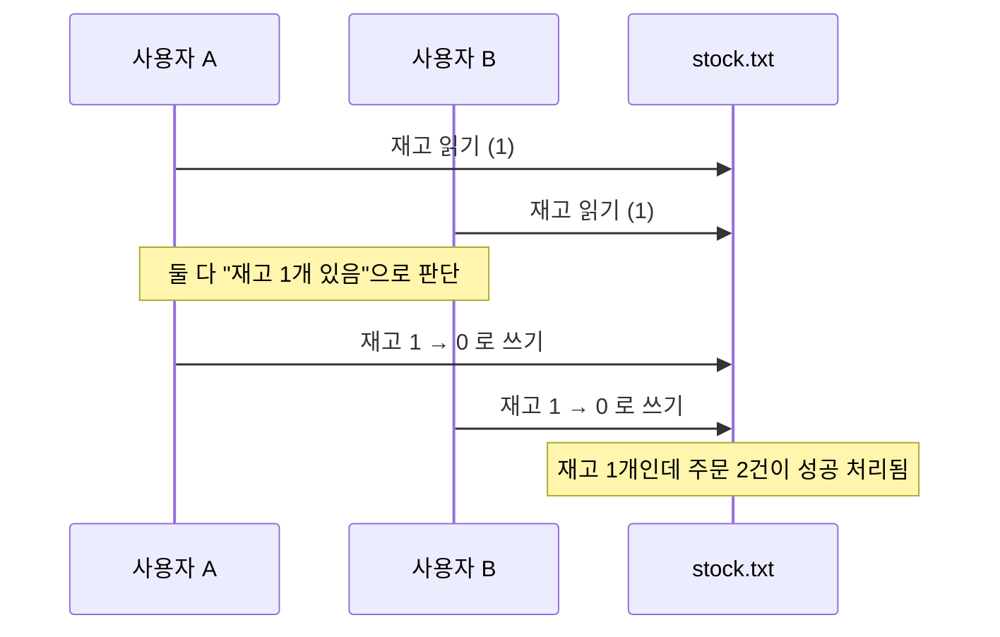
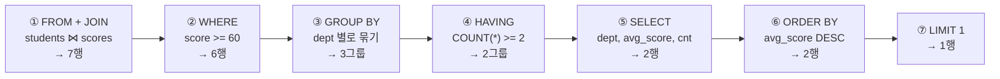

오늘은 데이터베이스 모듈 첫 시간이었다. 크게 두 가지를 배웠다 — (1) 지금까지 Java만으로 만들던 서비스가 왜 한계에 부딪히는지, 그래서 DB가 왜 필요한지, (2) SQL은 우리가 쓰는 순서(SELECT부터)와 실제로 처리되는 순서(FROM부터)가 다르다는 것.

## 1. 실험 — 서버를 재시작하면 회원은 어디로 갈까

지금까지 배운 Java만으로 회원 관리 서비스를 만들었다고 해보자.

```java
public class MemberService {
    // 가입한 회원을 담아 두는 리스트 (Heap에 생성)
    private List<Member> members = new ArrayList<>();

    public void join(String name) {
        members.add(new Member(name));
    }

    public int count() {
        return members.size();
    }
}
```

회원을 몇 명 가입시킨 뒤 새 버전을 배포하려고 서버를 재시작하면, `members`는 다시 빈 리스트(`members.size() == 0`)로 시작한다. 회원 목록이 `new ArrayList<>()`로 만든, 결국 JVM 메모리 안의 객체이기 때문이다.

## 2. 객체는 JVM 메모리 어디에 살고, 언제 사라질까

Java 프로그램을 실행하면 JVM이 OS에게 빌린 메모리를 세 구역으로 나눠 쓴다.

```java
public class Main {
    static int visitCount = 0; // static 변수

    public static void main(String[] args) {
        visitCount++;
        Member m = new Member("김자바");
        m.greet();
        m = null;     // 참조를 끊음
        System.gc();  // GC에 청소 요청
    }
}

class Member {
    String name;
    Member(String name) { this.name = name; }

    void greet() {
        String msg = "안녕, " + name;
        System.out.println(msg);
    }
}
```

| 구역 | 무엇이 사나요? | 언제 생기나요? | 언제 사라지나요? |
|---|---|---|---|
| Stack (스택) | 지역변수, 매개변수, 참조변수 | 메서드가 호출될 때 | 메서드가 끝날 때 |
| Heap (힙) | `new`로 만든 객체 | `new`를 실행할 때 | 아무도 참조하지 않아 GC가 수거할 때 |
| Method Area (메서드 영역) | 클래스 정보, static 변수 | 클래스를 처음 사용할 때 (클래스 로딩) | JVM이 종료될 때 |

**핵심**: 셋 중 가장 오래 사는 static 변수조차 JVM보다 오래 살 수 없다. JVM 프로세스가 끝나면 OS가 메모리를 회수하고, RAM 자체도 전원이 꺼지면 내용이 지워지는 휘발성(Volatile) 메모리이기 때문이다.

> 참고: JDK 8 이후 HotSpot JVM에서는 static 변수의 실제 저장 위치가 Heap(클래스를 나타내는 Class 객체 안)으로 바뀌었다. 다만 클래스마다 하나만 존재하고 JVM이 끝날 때까지 산다는 수명은 같아서, 입문 단계에서는 Method Area로 묶어 설명한다.

## 3. 데이터는 얼마나 오래 살아야 할까

변수·객체의 수명을 서비스 데이터가 실제로 살아야 하는 기간과 나란히 놓아보면 자릿수 자체가 다르다.

| 대상 | 저장 위치 | 살아 있는 기간 |
|---|---|---|
| 지역변수 | Stack | 메서드 한 번 실행 (약 0.001초) |
| 요청 처리용 객체 | Heap | 요청 1건 처리 중 (약 0.2초) |
| 로그인 세션 객체 | Heap | 사용자가 접속해 있는 동안 (약 30분) |
| static 변수 | Method Area | 다음 배포나 재시작까지 (며칠~몇 주) |
| **회원 정보** | *지켜야 할 데이터* | 가입부터 탈퇴까지 (수년) |
| **주문/결제 기록** | *지켜야 할 데이터* | 법령상 보관 기간까지 (5년 이상) |

JVM 안의 어떤 것도 "회원 정보"나 "주문 기록"이 살아야 하는 구간까지 닿지 못한다. 쇼핑몰을 1년 운영한다고 하면, 새 기능 배포·장애·보안 업데이트 때문에 서버는 생각보다 자주 재시작되고, 메모리에만 저장했다면 재시작마다 그 시점까지 쌓인 회원이 전부 증발한다.

## 4. 그럼 파일에 저장하면 되지 않을까

파일 입출력(File I/O)으로 회원을 `members.txt`에 저장하면 JVM이 꺼져도 데이터가 디스크에 남는다. 영속성(Persistence)은 해결된다.

```java
// 회원 한 명을 members.txt 파일 끝에 한 줄로 추가
public void save(Member member) throws IOException {
    try (FileWriter fw = new FileWriter("members.txt", true)) {
        fw.write(member.getId() + "," + member.getName());
        fw.write(System.lineSeparator());
    }
}
```

하지만 여러 사람이 동시에 쓰는 실제 서비스에서는 새 문제가 나타난다. 한정판 굿즈의 남은 재고가 1개인데, 사용자 A와 B가 거의 동시에 주문 버튼을 눌렀다고 하자.



파일은 "읽고 → 판단하고 → 쓰는" 세 단계 사이에 누가 끼어드는지 막을 방법이 없어서, 둘 다 "재고 있음"으로 읽고 둘 다 주문에 성공해버린다. 파일은 영속성만 해결해 줄 뿐, 동시 수정·빠른 검색·여러 서버의 공유·작업 도중의 장애까지 직접 해결하려면 결국 데이터베이스를 직접 만드는 셈이 된다. 그래서 이 일을 전문으로 하는 프로그램인 DBMS(Database Management System)를 쓴다. 앞으로 배울 MySQL이 바로 그 DBMS다.

## 5. 데이터베이스가 해결해주는 것들

| 항목 | Java만으로는 | DB에서는 | 관련 SQL |
|---|---|---|---|
| 영속성 (Persistence) | JVM이 꺼지면 데이터도 사라진다 | 디스크에 저장해 프로그램이 꺼져도 남긴다 | `INSERT`, `SELECT` |
| 공유 (Sharing) | 서버마다 메모리와 파일이 따로 있다 | 모든 서버가 네트워크로 같은 DB에 접속한다 | `CREATE DATABASE`, `USE` |
| 쿼리 (Query) | for문·if문·정렬 코드를 매번 직접 짠다 | 무엇이 필요한지만 적으면 DB가 찾아준다 | `SELECT`, `WHERE`, `ORDER BY`, `JOIN` |
| 빠른 검색 (Index) | 처음부터 끝까지 하나씩 비교한다 | 색인으로 필요한 위치를 바로 찾는다 | `CREATE INDEX` |
| 무결성 (Integrity) | 검사 코드를 하나라도 빠뜨리면 잘못된 데이터가 들어간다 | 테이블에 규칙을 선언하면 DB가 어긴 데이터를 거부한다 | `PRIMARY KEY`, `NOT NULL`, `UNIQUE`, `CHECK` |
| 트랜잭션 (Transaction) | 중간에 멈추면 반쪽짜리 데이터가 남는다 | 전부 성공하거나 전부 취소한다 | `START TRANSACTION`, `COMMIT`, `ROLLBACK` |
| 동시성 제어 | 동시에 고치면 서로 덮어쓴다 | 잠금(Lock)으로 같은 데이터를 차례대로 고친다 | `SELECT ... FOR UPDATE` |
| 보안과 복구 | 파일은 실수로 지우거나 유출되기 쉽다 | 계정별 권한을 나누고, 백업으로 사고에서 복구한다 | `CREATE USER`, `GRANT` |

## 6. Java와 DB는 어떻게 역할을 나눌까

다섯 살 아이에게 설명한다면: "책상(JVM 메모리)에서는 책을 펼쳐 놓고 빠르게 읽고 고칠 수 있지만, 문 닫을 시간이 되면 책상 위는 싹 치워져. 그래서 오래 보관해야 하는 책은 서고(데이터베이스)에 규칙대로 꽂아두고, 필요할 때마다 신청서(SQL)를 내서 사서(DBMS)에게 찾아 달라고 하는 거야."


객체와 테이블은 이렇게 대응한다.

| Java | DB |
|---|---|
| 클래스 | 테이블 |
| 필드 | 컬럼 |
| 객체(인스턴스) | 행(Row) |

```java
class Member {
    Long id;
    String name;
    int age;
}
// 객체 2개
new Member(1L, "김자바", 23);
new Member(2L, "이디비", 31);
```

```
member 테이블 (MySQL, 디스크)
id | name  | age
1  | 김자바 | 23
2  | 이디비 | 31
```

1장의 실험을 MySQL과 함께 다시 해보면 달라진다: 회원을 가입시키고 서버를 재시작한 다음 `SELECT`로 다시 불러오면, Heap의 `List<Member>`는 재시작 직후엔 비어 있지만 JDBC로 DB에서 조회하는 순간 그대로 복원된다. Java는 요청을 받아 데이터를 처리하고, DB는 그 데이터를 안전하게 보관한다는 역할 분리가 이 실험 하나로 확인됐다.

## 7. SQL은 쓴 순서대로 실행되지 않는다

우리는 `SELECT`부터 쓰지만, 데이터베이스는 `FROM`부터 읽는다.

| 작성 순서 | 1 | 2 | 3 | 4 | 5 | 6 | 7 |
|---|---|---|---|---|---|---|---|
| | SELECT | FROM | WHERE | GROUP BY | HAVING | ORDER BY | LIMIT |
| **실행 순서** | **5** | **1** | **2** | **3** | **4** | **6** | **7** |


`SELECT`가 1번(작성)에서 5번(실행)으로 가장 멀리 이동한다. 외우기 어렵다면 **F-W-G-H-S-O-L**(FROM-WHERE-GROUP BY-HAVING-SELECT-ORDER BY-LIMIT)로 기억해두면 된다. (`DISTINCT`를 쓴 경우는 SELECT 바로 다음, ORDER BY 전에 처리된다.)

"응시 건수가 2건 이상인 학과 중 평균 점수 1등"을 찾는 쿼리로 처리 순서를 따라가보자.

```sql
SELECT   s.dept,                          -- ⑤
         ROUND(AVG(sc.score), 1) AS avg_score,
         COUNT(*) AS cnt
FROM     students s                       -- ①
JOIN     scores sc ON s.id = sc.student_id
WHERE    sc.score >= 60                   -- ②
GROUP BY s.dept                           -- ③
HAVING   COUNT(*) >= 2                    -- ④
ORDER BY avg_score DESC                   -- ⑥
LIMIT    1;                               -- ⑦
```



① `students`와 `scores`를 `s.id = sc.student_id`로 JOIN하면(INNER JOIN이라 짝이 없는 학생은 빠진다) 7행이 된다. ② 60점 미만을 거르면 6행. ③ 학과별로 묶으면 3그룹. ④ 응시 2건 미만인 그룹을 거르면 2그룹. ⑤ 그제서야 `SELECT`가 보여줄 열을 뽑고, ⑥ 평균 점수로 정렬한 뒤 ⑦ 1등만 남긴다.

### 실행 순서를 알면 이해되는 에러들

**WHERE에서 SELECT 별칭 쓰기**

```sql
-- 에러
SELECT score * 1.1 AS bonus FROM scores WHERE bonus >= 90;
-- 수정
SELECT score * 1.1 AS bonus FROM scores WHERE score * 1.1 >= 90;
```

`WHERE`(2번)가 처리될 때는 `SELECT`(5번)가 아직 실행되지 않아 `bonus`라는 이름이 존재하지 않는다.

**WHERE에서 집계 함수 쓰기**

```sql
-- 에러
SELECT dept, AVG(score) FROM ... WHERE AVG(score) >= 80 GROUP BY dept;
-- 수정
SELECT dept, AVG(score) FROM ... GROUP BY dept HAVING AVG(score) >= 80;
```

`WHERE`(2번) 시점에는 아직 그룹이 없어서 평균을 낼 수 없다. 그룹이 만들어진 뒤인 `HAVING`(4번)에서 걸러야 한다.

**그룹으로 묶지 않은 열을 SELECT하기**

```sql
-- 에러
SELECT dept, name, AVG(score) FROM ... GROUP BY dept;
-- 수정
SELECT dept, COUNT(name), AVG(score) FROM ... GROUP BY dept;
```

`GROUP BY`(3번) 이후에는 학과마다 한 줄만 남는다. 한 학과에 학생이 여러 명이면 어떤 `name`을 보여줄지 정할 수 없다.

반대로 `ORDER BY`(6번)는 `SELECT`(5번)보다 뒤에 실행되므로, 이미 만들어진 별칭을 그대로 써도 된다(`ORDER BY avg_score DESC`는 정상 동작).

> 여기서 설명한 순서는 SQL 표준이 정한 **논리적** 처리 순서다. 실제 DB는 옵티마이저가 인덱스 등을 활용해 물리적인 작업 순서를 바꾸기도 하지만, 결과는 항상 이 논리적 순서대로 처리한 것과 같아야 한다. DBMS마다 차이도 있다 — MySQL은 `GROUP BY`·`HAVING`에서 SELECT 별칭을 허용하고, 행 개수 제한은 Oracle에서 `FETCH FIRST n ROWS ONLY`, SQL Server에서 `TOP n`으로 쓴다.

## 오늘의 정리

Java는 데이터를 처리하고, 데이터베이스는 데이터를 기억한다. JVM 안의 모든 것은 지역변수든 객체든 static 변수든 JVM이 꺼지면 사라지지만, 서비스의 데이터는 프로그램보다 훨씬 오래 살아야 하고 여러 서버와 여러 사용자가 함께 써야 한다. DB는 영속성·공유·동시성 제어·트랜잭션·무결성·빠른 검색을 한 번에 제공한다. 그리고 SQL을 읽을 때는 내가 쓴 순서가 아니라 FROM부터 시작하는 실행 순서로 생각해야, `WHERE`에서 별칭이 안 되는 이유 같은 "당연한 에러"들이 더 이상 당연하지 않게 된다.

## 더 학습하면 좋은 개념

- **트랜잭션 격리 수준(Isolation Level)** — 오늘은 잠금(Lock)으로 동시 수정을 막는다는 것만 배웠는데, READ COMMITTED·REPEATABLE READ 같은 격리 수준에 따라 "어디까지 허용할지"가 달라진다. 동시성 제어를 한 단계 더 깊이 이해하는 데 필요하다.
- **인덱스의 내부 구조(B-Tree)** — "색인으로 바로 찾는다"고 배웠는데, 실제로 어떻게 트리 구조로 빠른 검색이 가능한지 알아두면 인덱스를 언제 걸어야 할지 판단하는 감각이 생긴다.
- **EXPLAIN과 실행 계획** — 오늘 배운 "논리적 실행 순서"와 별개로, DB가 실제로 어떤 물리적 순서·방법으로 쿼리를 처리하는지 `EXPLAIN`으로 직접 확인해볼 수 있다.
- **커넥션 풀(Connection Pool)** — JDBC로 매번 새 연결을 맺는 대신 연결을 재사용하는 방식. 오늘 배운 JDBC 흐름이 실무에서 어떻게 성능 문제 없이 쓰이는지 이어지는 개념이다.
- **ORM(JPA/Hibernate)** — 오늘 손으로 확인한 "클래스↔테이블, 필드↔컬럼, 객체↔행" 매핑을 자동화해주는 기술. SQL을 직접 쓰지 않고도 객체 중심으로 DB를 다루게 해준다.

## 참고 자료

- [The Java Virtual Machine Specification - Run-Time Data Areas](https://docs.oracle.com/javase/specs/jvms/se8/html/jvms-2.html)
- [MySQL 8.4 Reference Manual - SELECT Statement](https://dev.mysql.com/doc/refman/8.4/en/select.html)
- [Oracle JDBC Basics](https://docs.oracle.com/javase/tutorial/jdbc/basics/index.html)
