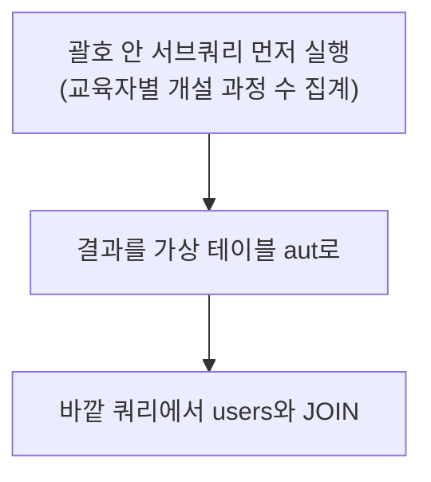

수업 자료에 "✨대박 중요✨"라고 적혀 있을 정도로 강조된 JOIN을 오늘 배웠다. 실제 데이터베이스는 비슷한 의미의 데이터를 여러 테이블에 나눠 저장하고, JOIN은 그 테이블들을 공통 값 기준으로 합치는 역할을 한다.

## 1. INNER JOIN — 양쪽에 짝이 있는 행만

```sql
select title as '과정 제목', u.name as '교육자 이름'
from courses as c
join users as u on c.author_id = u.user_id;
```

`courses.author_id`는 `users.user_id`를 가리키는 **외래키(FK)**다. `join ... on`으로 "어떤 컬럼이 어떤 컬럼과 같을 때 합칠지" 조건을 지정한다.

## 2. LEFT JOIN / RIGHT JOIN — 짝이 없어도 포함하기

```sql
select u.name as '사용자 이름', uap.provider as '소셜 로그인 제공자'
from users as u
left join user_auth_providers as uap on u.user_id = uap.user_id;
```

다섯 살 아이에게 설명한다면: "INNER JOIN은 짝꿍이 있는 사람들끼리만 손을 잡고 나오는 거야. LEFT JOIN은 왼쪽 줄(users)에 있는 사람은 짝꿍이 없어도 무조건 다 나오고, 짝이 없으면 빈손(NULL)으로 나오는 거지."


`LEFT JOIN`은 왼쪽 테이블(`users`) 기준으로 전부 출력하고, 오른쪽(`user_auth_providers`)에 매칭되는 데이터가 없으면 `NULL`로 채운다. `RIGHT JOIN`은 그 반대로 오른쪽 테이블을 기준으로 한다. 어느 쪽이 "왼쪽"인지는 SQL 문장에 **먼저 쓴 테이블**을 기준으로 하기 때문에, `A LEFT JOIN B`와 `B LEFT JOIN A`는 서로 다른 결과를 준다.

```sql
-- 3단 JOIN: 직원 → 부서 → 지역
select emp_name, dept_title, local_name
from tbl_employee as e
inner join tbl_department as d on e.dept_code = d.dept_id
inner join tbl_location as l on l.local_code = d.location_id
where local_name = 'ASIA1';
```

JOIN은 한 번만 쓰는 게 아니라, 필요한 만큼 이어 붙여서 여러 테이블을 한 번에 엮을 수 있다는 것도 확인했다.

## 3. 서브쿼리 — 쿼리 안의 쿼리

**WHERE 절 서브쿼리** — 조건 자체를 또 다른 조회 결과로 채운다.

```sql
-- '홍길동'과 같은 년도에 가입한 사용자 조회
select name, created_at
from users
where year(created_at) = (
    select year(created_at) from users where name = '홍길동'
);
```

"조건에 필요한 값을 아직 모를 때, 그 값을 구하는 쿼리를 조건 자리에 통째로 넣는다"는 게 서브쿼리의 핵심이었다. 괄호 안의 쿼리가 먼저 실행되어 하나의 값(또는 목록)을 만들고, 바깥 쿼리는 그 결과를 조건으로 쓴다.

**FROM 절 서브쿼리** — 조회 결과를 아예 하나의 가상 테이블처럼 쓴다.

```sql
select u.name as '교육자 이름', aut.course_count as '교육자 개설 과정 수'
from users u
join (
    select author_id, count(*) as course_count
    from courses
    group by author_id
) as aut on u.user_id = aut.author_id
order by aut.course_count desc;
```

괄호 안에서 먼저 "교육자별 개설 과정 수"를 집계한 결과를 `aut`라는 이름의 **가상 테이블**로 만들고, 그 가상 테이블을 `users`와 다시 JOIN했다. 복잡한 요구사항을 "먼저 이것부터 구하고 → 그 결과로 다시 조회"하는 단계로 나눠서 풀 수 있다는 게 서브쿼리의 힘이었다.



## 오늘의 정리

JOIN은 공통 값(주로 FK)을 기준으로 여러 테이블을 합치는 방법이고, INNER/LEFT/RIGHT의 차이는 "짝이 없는 데이터를 버리느냐 남기느냐"였다. 서브쿼리는 조건(WHERE)이나 테이블 자체(FROM)를 다른 쿼리의 결과로 채우는 방법으로, 복잡한 요구사항을 "한 단계씩" 풀어나가는 도구였다.

## 더 학습하면 좋은 개념

- **SELF JOIN** — 오늘 다루지 않은 조인 방식으로, 같은 테이블을 자기 자신과 조인한다(예: 직원-상사 관계). JOIN 종류 중 하나로 마저 알아두면 좋다.
- **EXISTS / NOT EXISTS** — 서브쿼리의 결과가 "있는지 없는지"만 확인하는 연산자로, `IN`보다 성능이 좋을 때가 많다.
- **실행 계획(EXPLAIN)으로 JOIN 확인하기** — JOIN이 많아질수록 성능에 미치는 영향이 커진다. `EXPLAIN`으로 실제 JOIN 순서와 방식을 들여다보면 좋다.

## 참고 자료

- [MySQL 8.4 Reference Manual - JOIN Clause](https://dev.mysql.com/doc/refman/8.4/en/join.html)
- [MySQL 8.4 Reference Manual - Subquery Syntax](https://dev.mysql.com/doc/refman/8.4/en/subqueries.html)
