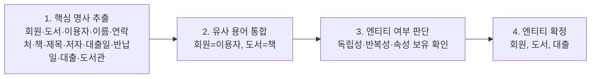
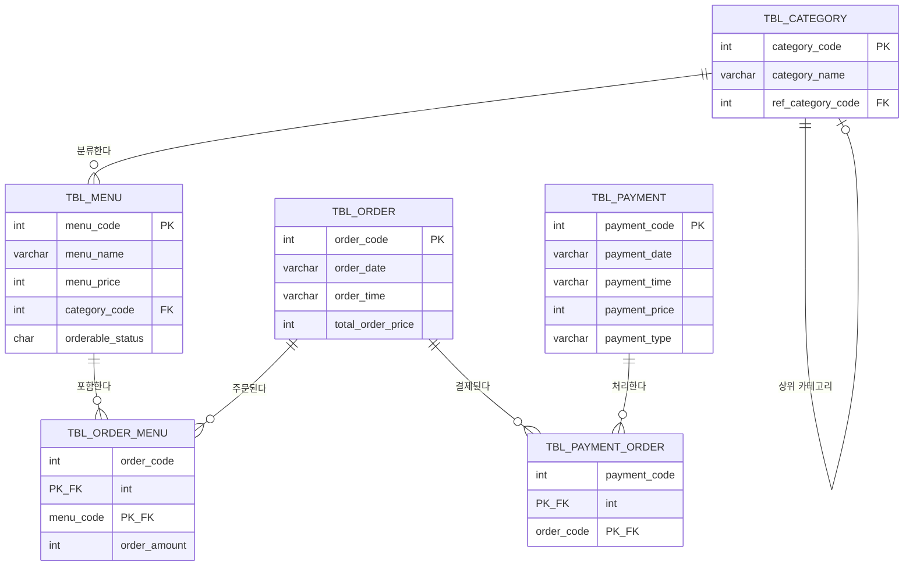

오늘부터 데이터베이스 설계 시리즈를 배운다. 테이블부터 뚝딱 만드는 게 아니라, 현실 세계를 분석해서 단계적으로 구조를 다듬어 간다는 게 핵심이었다. 오늘은 그중 1단계(요구사항 분석)와 2단계(개념적 모델링)까지.

## 설계는 왜 필요한가

잘못 설계된 데이터베이스는 같은 정보를 여러 곳에 흩어 두고, 틀린 값을 막지 못하고, 느려진다. 세 가지 문제를 직접 겪어봤다.

**1) 데이터 중복과 불일치** — 회원 연락처를 `tbl_order`에도 복사해 저장해두면, 회원이 번호를 바꿨을 때 `tbl_member`만 고치고 과거 주문 기록의 연락처는 그대로 남아 서로 값이 달라진다. 해결책은 동일한 데이터를 한 테이블에만 두고, 다른 테이블은 그걸 참조(회원번호로)하게 만드는 것이다.

**2) 정합성과 일관성**

| 구분 | 의미 | 위반 예시 |
|---|---|---|
| 정합성(Consistency) | 모든 테이블 간 데이터가 논리적으로 일치 | 회원 테이블에 없는 회원이 주문 테이블에 등장 → 참조 무결성 위반 |
| 일관성(Integrity) | 입력되는 데이터가 미리 정한 규칙을 만족 | 성별 필드에 '남', '여' 외의 값 입력 → 도메인 무결성 위반 |

**3) 효율적인 접근과 관리** — 인덱스로 검색 성능을, 정규화로 저장 공간을, 명확한 관계 정의로 조인 성능을 챙길 수 있다. 다만 정합성과 성능은 트레이드오프 관계라 균형이 필요하다.

## 4단계 프로세스와 산출물

| 단계 | 핵심 질문 | 참여자/도구 | 산출물 |
|---|---|---|---|
| 1. 요구사항 분석 | 어떤 데이터를 관리해야 하는가 | 기획자, 개발자, 사용자 | 요구사항 정의서 |
| 2. 개념적 모델링 | 무엇이 존재하고 어떻게 연결되는가 | ERD | ERD (개체 관계도) |
| 3. 논리적 모델링 | 어떤 컬럼·키·제약으로 구조화하는가 | 정규화 | 논리 데이터 모델 |
| 4. 물리적 모델링 | 특정 DBMS에서 어떻게 구현하는가 | MySQL 등 | 물리 데이터 모델 + DDL |

설계 단계를 건너뛰고 바로 테이블을 만들면 확장성·정합성·유지보수성에 문제가 생기기 쉽다는 걸 강조했다. 처음엔 코드 레벨을 생각하지 말고, "현실 세계에선 어떤 흐름인가"부터 떠올려야 한다.

## 1. 요구사항 분석 — 기능에서 데이터 찾기

**기능적 요구사항**은 "~할 수 있어야 한다" 형태로 쓴다 (예: "사용자는 주문을 생성하고 내역을 확인할 수 있어야 한다"). 여기서 한 단계 더 들어가 **데이터 요구사항**을 뽑는다 — "무엇을 저장해야 하는가"에 초점을 맞춘다.

예를 들어 "메뉴 조회" 기능을 만들려면 메뉴명(`menu_name`), 가격(`menu_price`), 주문 가능 여부(`orderable_status`), 카테고리 코드(`category_code`)를 저장해야 한다는 식으로 기능 하나하나에서 저장할 항목을 도출한다.

## 2. 제약조건 6종

제약조건(Constraint)은 입력·갱신되는 데이터의 정확성·일관성·신뢰성을 보장하는 규칙이다. 구현 전(설계 단계)에 정해두면 오류를 미리 막을 수 있다.

| 제약조건 | 설명 |
|---|---|
| `NOT NULL` | 해당 컬럼에 NULL 입력을 금지 |
| `UNIQUE` | 중복값 입력을 금지해 유일성 보장 |
| `PRIMARY KEY` | 행을 고유하게 식별. NOT NULL + UNIQUE |
| `FOREIGN KEY` | 다른 테이블의 값을 참조. 참조 무결성 보장 |
| `CHECK` | 값의 허용 범위를 지정 |
| `DEFAULT` | 값을 생략했을 때 적용할 기본값 |

```sql
CREATE TABLE user_grade (
    grade_code INT PRIMARY KEY,
    grade_name VARCHAR(20)
);

CREATE TABLE tbl_user (
    user_no    INT,
    user_id    VARCHAR(255) NOT NULL,
    user_pwd   VARCHAR(255) NOT NULL,
    phone      VARCHAR(20),
    gender     VARCHAR(3)  CHECK (gender IN ('남', '여')),
    age        INT         CHECK (age >= 19),
    grade_code INT,
    country    VARCHAR(20) DEFAULT '한국',
    PRIMARY KEY (user_no),
    UNIQUE (phone),
    FOREIGN KEY (grade_code) REFERENCES user_grade (grade_code)
);
```

여섯 제약조건을 하나씩 깨뜨려보는 실습이 있었는데, 특히 기억에 남는 두 가지:

- **CHECK는 MySQL 8.0.16부터 실제로 강제된다.** 그 이전 버전에서는 문법만 통과하고 조용히 무시되어, 잘못된 값이 그대로 저장된다. 구버전 환경이라면 CHECK를 믿으면 안 된다.
- `DEFAULT`에 `CURRENT_TIMESTAMP` 말고 다른 함수나 수식을 쓰려면 `DEFAULT (CURRENT_DATE)`처럼 괄호로 감싸야 한다 (8.0.13 이상).

## 3. 데이터 사전 작성

데이터 사전(Data Dictionary)은 항목의 의미·형식·제약조건을 정의한 문서다. 용어를 표준화하고(같은 용어가 다른 의미로 쓰이는 걸 방지), 화면/기능 명세에서 필드를 뽑아 속성 후보로 정리한다.

| 분류 | 타입 | 쓰임 |
|---|---|---|
| 문자열 | `VARCHAR(n)` / `CHAR(n)` / `TEXT` | 가변 길이 / 고정 길이 / 긴 문자열 |
| 숫자 | `INT` / `BIGINT` / `DECIMAL(P,S)` | 정수 / 정수 / 금액처럼 소수점·정밀도 필요한 값 |
| 날짜·시간 | `DATE` / `DATETIME` / `TIMESTAMP` | 날짜만 / 입력값 그대로 저장 / UTC 변환 저장 (1970~2038) |
| 상태값 | `BOOLEAN` / `CHAR(1) + CHECK` | MySQL의 BOOLEAN은 TINYINT(1)의 별칭 |

이렇게 정리한 항목이 데이터 정의서가 된다.

| 항목명 | 데이터 타입 | 길이 | NULL | 제약조건 | 예시값 |
|---|---|---|---|---|---|
| `menu_code` | INT AUTO_INCREMENT | - | NO | PRIMARY KEY | 1 |
| `menu_name` | VARCHAR | 30 | NO | - | 불타는 치킨 |
| `menu_price` | INT | - | NO | CHECK (>= 0) | 9900 |
| `orderable_status` | CHAR | 1 | NO | CHECK ('Y','N') | Y |
| `payment_type` | VARCHAR | 6 | NO | '현금','카드','이체' 등 | 카드 |
| `add_time` | DATETIME | - | YES | DEFAULT CURRENT_TIMESTAMP | 2025-05-20 10:32 |

## 4. 개념적 모델링 — 엔티티 도출

엔티티(Entity)는 시스템이 저장·관리해야 할 데이터의 주체다. 네 가지 요건을 만족해야 한다: **식별 가능**(고유 식별자 존재), **여러 인스턴스**(같은 종류가 여러 건 존재), **의미 있는 속성**, **독립적 존재**.

도서관 대출 시스템을 예로 엔티티를 찾는 4단계를 따라가봤다.



이렇게 찾은 엔티티는 성격에 따라 세 가지로 분류한다.

| 분류 | 성격 | menudb 예시 |
|---|---|---|
| 기본 엔티티 (Master) | 다른 데이터의 기준이 되는 고정적 객체. 참조 엔티티라고도 함 | 카테고리, 메뉴 |
| 중심 엔티티 (Core) | 주요 거래·사건의 중심 | 주문, 결제 |
| 행위 엔티티 (Transaction) | 중심 엔티티 간의 관계·발생한 사건 표현 | 주문상세, 결제연결 |

## 5. 엔티티 간 관계 정의

| 유형 | 설명 | 예시 |
|---|---|---|
| 1:1 | 한 인스턴스가 상대 하나와만 연결 (보안 분리, 선택 정보 분리 목적) | 사용자 ↔ 사용자프로필 |
| 1:N | 한 인스턴스가 여러 인스턴스와 연결 (가장 흔함) | 카테고리 ↔ 메뉴 |
| N:M | 여러 개와 여러 개가 연결. 교차 엔티티로 반드시 해소해야 함 | 주문 ↔ 메뉴 |

**N:M을 그대로 두면 왜 안 될까?** 주문 101번에 메뉴 3개를 담는 상황을, `tbl_order`에 `menu_code` 칸 하나만 둬서 처리하면 주문 1건이 3행으로 쪼개진다. `order_code`가 반복되니 기본키로 쓸 수 없고, 주문일자·총금액 같은 값이 메뉴 수만큼 중복 저장된다. 그래서 `tbl_order_menu` 같은 교차 엔티티(행위 엔티티)로 N:M을 1:N + 1:N 두 개로 풀어낸다.

**관계의 필수성과 선택성**은 파일/폴더로 생각하면 이해가 쉽다. 다섯 살 아이에게 설명한다면: "파일은 꼭 어떤 폴더 안에 있어야 해(필수). 그런데 새 폴더를 만들 때 파일을 꼭 하나 넣어야만 만들 수 있는 건 아니야(선택). 같은 관계라도 어느 쪽에서 보느냐에 따라 필수인지 선택인지가 달라져."


| 관계 설명 | 카디널리티 | menudb에서의 구현 |
|---|---|---|
| 하나의 카테고리는 여러 메뉴를 가질 수 있다 | 1:N | `tbl_menu.category_code` → `tbl_category` |
| 한 주문은 여러 메뉴를, 한 메뉴는 여러 주문에 포함 | N:M → 해소 | `tbl_order_menu`로 해소 |
| 한 결제는 여러 주문을, 한 주문도 나눠 결제될 수 있음 | N:M → 해소 | `tbl_payment_order`로 해소 |

카디널리티는 관계의 수치 범위다. **필수성은 최소값**(0이면 선택, 1이면 필수), **관계 유형은 최대값**(1 또는 N)으로 표현한다.

## 6. ERD 작성과 표기법

같은 관계라도 표기법에 따라 모양이 다르다.

| 표기법 | 특징 | 주요 사용처 |
|---|---|---|
| 피터첸 (Peter Chen) | 개념적 모델링 중심의 전통적 E-R 모델 | 정보처리기사 등 시험, 이론 설명 |
| IE (Information Engineering) | 실무에서 가장 널리 쓰임. 속성을 엔티티 안에 적고, 관계선 끝에 Crow's Foot로 범위 표시 | ERwin, PowerDesigner, ERDCloud, dbdiagram.io |
| Barker | IE 계열의 한 분파. 속성 앞에 `#`(PK) `*`(필수) `o`(선택) 기호 사용 | Oracle Designer 등 |

수업에서 쓰는 `menudb`를 ER 다이어그램으로 그리면 이렇다.



ERD를 그렸다고 바로 다음 단계로 넘어가면 안 된다. 품질 검토 체크리스트로 한 번 더 확인한다.

| 검토 항목 | 확인 내용 |
|---|---|
| 엔티티의 명확성 | 모든 엔티티가 고유 식별자를 가지는가 |
| 속성의 완전성 | 주요 속성이 빠짐없이 포함되어 있는가 |
| 관계의 정합성 | 모든 엔티티 간 관계가 정확히 정의되어 있는가 |
| 카디널리티의 명확성 | 1:1, 1:N, N:M 표현이 맞게 적용되었는가 |
| 관계의 필수성 | 선택/필수 관계가 논리적으로 일관되는가 |
| 명명 규칙 | 엔티티·속성 이름이 표준화되어 있는가 |
| 중복 및 유사 항목 제거 | 유사·중복된 엔티티/속성이 통합되었는가 |
| 비즈니스 룰 반영 | 업무 정책이나 제약조건이 설계에 반영되었는가 |

실습에서는 신입 개발자가 그린 menudb 초안에서 문제 4곳을 찾아야 했다. 그중 하나가 "주문 1건은 메뉴 1개를 가리킨다(`tbl_order.menu_code`)"는 관계였는데, 실제로는 한 주문에 메뉴 여러 개가 담길 수 있으니 N:M이고, `tbl_order_menu` 같은 교차 엔티티로 풀어야 맞다 — 2번 섹션에서 짚은 "N:M을 그대로 두면 안 되는 이유"가 그대로 체크리스트의 실전 사례였다.

## 오늘의 정리

설계는 테이블을 만드는 작업이 아니라 현실 세계를 분석하고 구조화하는 과정이었다. 요구사항 정의서에서 "무엇을 저장할지"를 정하고, 그 항목들로 엔티티를 도출하고, 엔티티 사이의 관계를 카디널리티와 필수성으로 정확히 표현해 ERD로 옮긴다. N:M 관계를 교차 엔티티로 풀어내는 것과, 관계의 필수성이 방향에 따라 다르다는 점(폴더-파일 비유)이 오늘 가장 헷갈렸다가 가장 명확해진 부분이었다.

## 더 학습하면 좋은 개념

- **정규화(Normalization)** — 오늘은 N:M을 교차 엔티티로 푸는 것까지만 다뤘는데, 하나의 엔티티 안에서 속성이 중복되는 문제는 정규화로 해결한다. 다음 시간 주제로 이어진다.
- **UML 클래스 다이어그램** — ERD와 비슷하게 구조를 표현하지만, 객체지향 설계(메소드·상속)까지 포함한다는 점에서 ERD가 다루는 범위와 어떻게 다른지 비교해보면 좋다.
- **ERDCloud 같은 협업 모델링 도구** — 오늘은 결과물만 봤는데, 실제로 ERD를 그리고 팀원과 리뷰하는 흐름을 도구로 직접 연습해보면 체크리스트가 왜 필요한지 체감된다.
- **도메인 모델링과 DDD(Domain-Driven Design)** — 엔티티를 "기본/중심/행위"로 나누는 감각이, 더 큰 시스템에서 도메인을 나누는 설계 사고방식과 맞닿아 있다.

## 참고 자료

- [MySQL 8.4 Reference Manual - Constraints and Indexes](https://dev.mysql.com/doc/refman/8.4/en/constraints.html)
- [MySQL 8.4 Reference Manual - CREATE TABLE Statement](https://dev.mysql.com/doc/refman/8.4/en/create-table.html)
