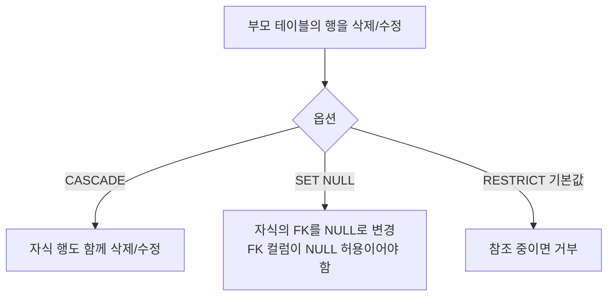

어제 요구사항 분석과 개념적 모델링(ERD)을 배웠다면, 오늘은 그 개념 모델을 실제 테이블에 가깝게 다듬는 논리적 모델링(속성·식별자·정규화)과, MySQL에서 진짜로 동작하는 물리적 모델링까지 배웠다.

용어가 단계마다 바뀌어서 먼저 짝을 정리해두고 시작한다.

| 논리적 모델링 | 물리적 모델링(DB) | 예시 |
|---|---|---|
| 엔티티 (Entity) | 테이블 (Table) | 회원 → `tbl_member` |
| 속성 (Attribute) | 컬럼 (Column) | 회원명 → `member_name` |
| 인스턴스, 튜플 | 행(Row), 레코드 | 회원 한 명의 데이터 |
| 식별자 (Identifier) | 기본키 (Primary Key) | 회원번호 → `member_id` |
| 관계 (Relationship) | 외래키 (Foreign Key) | 주문의 회원번호 → `member_id` FK |

## 1. 속성 정의와 설계

속성(Attribute)은 엔티티의 구성 요소이자 데이터를 저장하는 최소 단위로, 물리 모델에서 컬럼이 된다. 두 가지 기준으로 분류한다.

**분해 여부에 따른 분류**

| 종류 | 설명 | 예시 |
|---|---|---|
| 단일 속성 | 하나의 의미로 구성된 단일 데이터 항목 | 부서명, 상품명, 수량 |
| 복합 속성 | 두 개 이상의 하위 속성으로 나눌 수 있음 | 주소(시/구/동), 전화번호(국번/번호) |
| 다가 속성 | 하나의 속성이 여러 값을 가질 수 있음 (1:N 데이터를 담고 있음) | 연락처 여러 개, 주문 메뉴 목록 |

**특성에 따른 분류**

| 종류 | 설명 | 예시 |
|---|---|---|
| 기초 속성 | 엔티티의 본질적인 속성 | 고객명, 상품명, 수량, 단가 |
| 관계 속성 | 다른 엔티티와의 관계, 보통 FK로 구현 | 주문의 고객번호(FK) |
| 추출 속성 | 다른 속성들의 연산으로 만들어짐 | 주문금액 = 수량 × 단가 |

관계형 모델에서는 제1정규형(1NF)에 따라 한 칸에는 값이 하나만 들어가야 한다. 그래서 복합 속성은 하위 속성으로 쪼개고, 다가 속성은 별도 엔티티로 분리한다 — 이게 바로 아래 정규화에서 할 일이다.

## 2. 도메인과 NULL 허용 여부

도메인(Domain)은 속성이 가질 수 있는 값의 허용 범위다. 타입·길이·허용값·기본값·제약조건을 묶어 일관성을 보장한다.

| 속성 | 타입 | 허용 값 | 기본값 |
|---|---|---|---|
| `orderable_status` | CHAR(1) | 'Y', 'N' | 'N' (등록 직후 실수 노출 방지) |
| `payment_type` | VARCHAR(6) | '현금','카드','이체','기프티콘' | 없음 (반드시 입력) |

NULL은 "값이 없다"는 상태로, 0이나 빈 문자열과는 다르다. 판단 기준은 세 가지다.

| 판단 질문 | 결정 |
|---|---|
| 업무상 반드시 필요한 값인가? | 주문일자, 사용자ID → `NOT NULL` |
| 생성 시점에는 알 수 없는 값인가? | 회원 탈퇴일, 승인일 → `NULL` 허용 |
| 파생·계산 가능한 값인가? | 저장한다면 `NULL` 또는 기본값 설정 |

너무 많은 속성을 NULL 허용으로 두면 해석이 모호해진다. `NOT NULL + DEFAULT` 조합이 값 누락을 막으면서 입력도 편하게 해준다.

## 3. 식별자 설계 — 키의 종류

| 키 | 정의 | 회원 예시 |
|---|---|---|
| 후보키 (Candidate Key) | 행을 유일하게 식별할 최소한의 속성(집합). 여러 개 존재 가능 | 회원번호, 이메일, 전화번호 |
| 기본키 (Primary Key) | 후보키 중 대표로 선택한 하나. NOT NULL + UNIQUE | 회원번호 |
| 대체키 (Alternate Key) | 기본키로 선택되지 않은 나머지 후보키. UNIQUE로 관리 | 이메일, 전화번호 |
| 외래키 (Foreign Key) | 다른 엔티티의 기본키를 참조 | 주문 테이블의 회원번호 |

**후보키는 데이터가 아니라 업무 규칙으로 정한다.** 지금 가진 회원 5건에서 "이름+생년월일"이 우연히 겹치지 않는다고 해서 그 조합이 후보키가 되는 건 아니다. 동명이인이 같은 날 태어나는 일은 언제든 생길 수 있고, 후보키인지 아닌지는 업무 규칙(이메일·전화번호는 가입 시 중복 불가라는 규칙)으로 정해야 한다.

**기본키 선정 기준**

| 기준 | 의미 | 예시 |
|---|---|---|
| 유일성 (Uniqueness) | 모든 행에서 값이 달라야 함 | 학번, 사원번호 |
| 최소성 (Irreducibility) | 꼭 필요한 최소 속성만 | [학번]만으로 충분하면 이름은 뺀다 |
| 불변성 (Stability) | 시간이 지나도 값이 바뀌지 않아야 함 | 전화번호·이메일은 바뀔 수 있어 부적합 |
| 단순성 (Simplicity) | 가능하면 단일 속성으로 | [학번]이 [이름+생년월일+반+번호]보다 낫다 |

개인정보(전화번호, 이메일, 주민등록번호)는 대체키로는 둘 수 있지만, 변경 가능성과 개인정보 보호 문제 때문에 기본키로는 쓰지 않는 게 일반적이다.

**복합키(Composite Key)**는 하나의 속성만으로는 식별이 안 될 때 여러 속성을 묶어 기본키로 쓴다. 장바구니가 대표적이다 — 고객번호만으로도, 상품번호만으로도 행을 구분할 수 없지만 둘을 묶으면 "이 고객이 담은 이 상품"이 하나로 정해진다.

```mermaid
erDiagram
    CUSTOMER ||--o{ CART : "담는다"
    PRODUCT ||--o{ CART : "담긴다"
    CUSTOMER {
        int customer_id PK
        varchar customer_name
        varchar phone AK
    }
    CART {
        int customer_id PK_FK
        int product_id PK_FK
        int amount
    }
    PRODUCT {
        int product_id PK
        varchar product_name
        int price
    }
```

이런 연관 엔티티에서는 외래키 두 개가 묶여 복합 기본키가 되는 경우가 많다.

## 4. 정규화 — 왜 표를 나눠야 할까

수강신청 데이터를 스프레드시트 한 장으로 관리한다고 해보자.

| 학번(PK) | 이름 | 학과 | 학과전화 | 과목코드(PK) | 과목명 | 담당교수 | 성적 |
|---|---|---|---|---|---|---|---|
| 2024001 | 김민수 | 컴퓨터공학 | 02-760-1000 | CS101 | 데이터베이스 | 박교수 | A |
| 2024001 | 김민수 | 컴퓨터공학 | 02-760-1000 | CS102 | 자료구조 | 이교수 | B+ |
| 2024003 | 최현우 | 컴퓨터공학 | 02-760-1000 | CS102 | 자료구조 | 이교수 | B |

이 표 한 장에는 **학생·학과·과목·수강**이라는 네 가지 주제가 섞여 있다. "컴퓨터공학과 사무실 번호가 바뀌었다"는 연락 하나에, 같은 학과 전화번호가 들어간 행을 전부 찾아 고쳐야 한다 — 하나라도 빠뜨리면 갱신 이상이 발생한다.

| 이상 현상 | 설명 |
|---|---|
| 갱신 이상 (Update Anomaly) | 같은 사실이 여러 곳에 있어서, 일부만 고치면 서로 모순된다 |
| 삽입 이상 (Insertion Anomaly) | 넣고 싶은 정보가 있는데 관계없는 정보가 없어서 넣을 수 없다 (수강생 없는 새 과목처럼) |
| 삭제 이상 (Deletion Anomaly) | 하나를 지웠는데 지우려던 적 없는 정보까지 함께 사라진다 (마지막 수강생이 취소하면 과목 정보도 사라짐) |

데이터는 그것을 다루는 프로그램보다 오래 살아남고, 여러 사람이 동시에 손댄다. 정합성을 "모두가 조심한다"는 약속에만 맡기면 언젠가 반드시 깨진다. 정규화는 섞여 있는 대상을 가려내 각자 제자리를 찾아주는 작업이고, 그 판단 기준은 하나 — **어떤 값이 무엇에 의해 정해지는가(함수 종속)** — 다. 오늘은 이 문제의식까지 짚었고, 실제 1NF→2NF→3NF 분해 실습은 다음 시간으로 이어진다.

## 5. 물리적 모델링 — 테이블 설계

### 명명 규칙

| 항목 | 규칙 |
|---|---|
| 소문자 사용 | MySQL은 OS에 따라 테이블명 대소문자 구분이 달라진다(Windows는 구분 안 함, Linux는 구분함). 환경이 바뀌어도 안 깨지게 소문자로 통일 |
| 단어 구분 | snake_case (`order_menu`, `user_info`) |
| 단수형 | 테이블명은 단수형 (`order_detail`, `menu`) |
| 접두어 | `tbl_`, `t_` 등은 팀 컨벤션에 따라 선택 |

단수형 이름을 쓰다 보면 DBMS 예약어와 부딪히는 경우가 있다. MySQL에서는 `order`가 대표적이다(`ORDER BY`의 그 `ORDER`).

```sql
-- 예약어와 충돌 → 문법 오류
CREATE TABLE order ( ... );

-- 백틱으로 감싸면 쓸 수는 있지만, 모든 쿼리에서 매번 감싸야 함
CREATE TABLE `order` ( ... );
SELECT * FROM `order` WHERE `order`.order_id = 1;
```

`tbl_order`, `tbl_user`처럼 접두어를 붙이면 이런 충돌이 원천적으로 사라진다(다만 이름이 길어진다는 반론도 있다). 정답이 있는 영역이 아니라, 프로젝트 안에서 하나의 규칙을 정하고 끝까지 지키는 게 중요하다.

### 데이터 타입과 날짜/시간 타입

| 타입 | 저장 방식 | 표현 범위 | 크기 |
|---|---|---|---|
| `DATE` | 날짜만 | 1000-01-01 ~ 9999-12-31 | 3바이트 |
| `DATETIME` | 입력한 값을 그대로 저장. 타임존 변환 없음 | 1000-01-01 ~ 9999-12-31 | 5바이트 |
| `TIMESTAMP` | 저장 시 UTC로 변환, 조회 시 세션 타임존으로 재변환 | 1970-01-01 ~ 2038-01-19 | 4바이트 |

다섯 살 아이에게 설명한다면: "TIMESTAMP는 1970년부터 초를 세는 숫자 하나에 날짜를 욱여넣는 상자인데, 그 상자가 담을 수 있는 숫자에 한계가 있어서 2038년이 되면 상자가 꽉 차버려. DATETIME은 그냥 '2040-01-01'이라고 쓰인 그대로를 저장하는 쪽지라서, 더 먼 미래도 문제없이 담을 수 있어."


10년 구독 상품의 만료일(`2040-01-01 00:00:00`)을 두 타입에 각각 넣어보면 차이가 바로 드러난다.

```sql
mysql> INSERT INTO subscription (expire_dt) VALUES ('2040-01-01 00:00:00');
Query OK, 1 row affected

mysql> INSERT INTO subscription (expire_ts) VALUES ('2040-01-01 00:00:00');
ERROR 1292 (22007): Incorrect datetime value: '2040-01-01 00:00:00' for column 'expire_ts' at row 1
```

그래서 시간까지 필요한 컬럼이라면 기본값은 `DATETIME`을 권장한다 — 범위 제한이 넓고(2038년 문제 없음), 타임존 설정이 달라져도 값이 조용히 바뀌지 않으며, 저장 공간 차이(5바이트 vs 4바이트)는 단 1바이트라 감수할 이유가 없다. `TIMESTAMP`는 여러 타임존 사용자가 같은 데이터를 보는 글로벌 서비스에서 DB가 알아서 변환해주길 원할 때나 쓸 만하다.

상태값·구분값은 MySQL 네이티브 `ENUM`보다 `CHAR(1)/VARCHAR + CHECK` 조합이나 코드 테이블(참조 테이블)을 권장한다. `ENUM`은 값 하나 추가하려 해도 `ALTER TABLE`로 스키마를 바꿔야 하고, 다른 DBMS로 옮기기 어렵고, 내부적으로 정수 순번이라 정의 순서를 잘못 바꾸면 기존 데이터 의미가 통째로 달라질 수 있다.

### 기본값과 제약조건

```sql
add_date         DATE     DEFAULT (CURRENT_DATE),
created_at       DATETIME DEFAULT CURRENT_TIMESTAMP,
updated_at       DATETIME DEFAULT CURRENT_TIMESTAMP ON UPDATE CURRENT_TIMESTAMP,
orderable_status CHAR(1)  DEFAULT 'Y'
```

`DATETIME`/`TIMESTAMP`의 `DEFAULT CURRENT_TIMESTAMP`만 예외적으로 괄호 없이 쓴다. `ON UPDATE CURRENT_TIMESTAMP`는 행이 수정될 때마다 시각을 자동 갱신하는 MySQL 고유 기능으로 `updated_at`에 유용하다. `TEXT`/`BLOB` 계열 컬럼은 기본값을 가질 수 없다.

## 6. 키와 제약조건 구현 전략

| 기본키 전략 | 설명 | 예시 |
|---|---|---|
| 단일 키 | `AUTO_INCREMENT`로 시스템 내부 식별자 생성 | `user_id INT AUTO_INCREMENT PRIMARY KEY` |
| 복합 키 | 교차 엔티티에서 두 개 이상 컬럼 조합 | `PRIMARY KEY (order_id, menu_id)` |
| UUID | 전역적으로 고유한 식별이 필요할 때. `BINARY(16)`으로 저장 | `user_id BINARY(16) DEFAULT (UUID_TO_BIN(UUID()))` |

UUID를 쓸 때 `CHAR(36)` 문자열보다 `BINARY(16)`을 권장하는데, 저장 공간이 절반 이하이고 `UUID_TO_BIN(UUID(), 1)`처럼 두 번째 인자를 주면 시간 순서로 정렬되도록 바이트를 재배치해 InnoDB 인덱스의 페이지 분할을 줄여준다.

외래키는 즉시 참조(생성 시 `FOREIGN KEY` 명시) 또는 지연 참조(`ALTER TABLE`로 나중에 추가)로 구현하고, `ON DELETE`/`ON UPDATE` 옵션을 지정하며, 이름을 붙여두면(`CONSTRAINT fk_order_menu`) 디버깅이 쉬워진다. UNIQUE도 단일/다중 컬럼 조합으로 대체키 보호나 업무 규칙("같은 카테고리 안에서는 메뉴명 중복 불가")을 구현할 수 있지만, 인덱스가 자동 생성되므로 쓰기 성능에 영향을 준다는 점은 기억해둬야 한다.

## 7. 참조 무결성 — CASCADE, SET NULL, RESTRICT

참조 무결성은 두 테이블 간 관계가 항상 일관되게 유지되도록 보장하는 규칙이다. 외래키 제약조건은 **InnoDB에서만 동작**하고(MyISAM은 문법만 통과하고 조용히 무시), 부모의 값이 바뀌거나 삭제될 때 자식이 어떻게 반응할지를 세 옵션으로 정한다.

| 옵션 | 동작 | 활용 시점과 주의 |
|---|---|---|
| `CASCADE` | 부모가 변경/삭제되면 자식도 함께 변경/삭제 | 게시글 삭제 시 댓글처럼 함께 사라져야 할 때. 대량 유실 주의 |
| `SET NULL` | 부모가 변경/삭제되면 자식의 외래키를 NULL로 | 자식은 남기고 연결만 끊을 때. 외래키 컬럼이 NULL 허용이어야 함 |
| `RESTRICT` | 참조 중인 부모는 변경/삭제 불가 | 기본 안전 설정. 옵션을 안 쓰면 이 동작 |

```sql
CREATE TABLE tbl_user (
    user_no    INT PRIMARY KEY,
    user_name  VARCHAR(20) NOT NULL,
    grade_code INT,
    CONSTRAINT fk_user_grade
        FOREIGN KEY (grade_code) REFERENCES user_grade (grade_code)
        ON DELETE RESTRICT
        ON UPDATE RESTRICT
) ENGINE=InnoDB;
```

MySQL/InnoDB에서 특히 주의할 점 세 가지가 있었다.

- 표준 SQL의 `SET DEFAULT`는 InnoDB에서 **지원하지 않는다**. 문법은 파싱되지만 테이블 생성이 거부된다.
- `NO ACTION`은 표준 SQL에서 "검사를 트랜잭션 끝으로 미룬다"는 뜻이지만, InnoDB는 이를 `RESTRICT`와 똑같이 즉시 검사한다.
- `SET NULL`을 쓰려면 외래키 컬럼이 반드시 NULL 허용이어야 한다. `NOT NULL` 컬럼에 지정하면 테이블 생성 자체가 실패한다.

`CASCADE`로 지울 때는 `START TRANSACTION`과 `COMMIT`으로 묶어서, 결과가 의도와 다르면 `ROLLBACK`으로 되돌릴 수 있게 하는 게 안전하다. 다만 `CREATE`/`ALTER`/`DROP` 같은 DDL은 실행 즉시 진행 중인 트랜잭션을 자동 커밋해버리므로, 보호할 작업은 DML(INSERT/UPDATE/DELETE)로만 구성해야 한다는 점도 짚고 넘어갔다.



## 오늘의 정리

논리적 모델링에서는 속성을 분해 여부·특성으로 나누고, 후보키 중 업무 규칙에 맞는 것을 기본키로 선정하는 법을 배웠다. 정규화는 "표 하나에 여러 주제가 섞이면 갱신·삽입·삭제 이상이 생긴다"는 문제의식에서 출발한다는 것까지 확인했다. 물리적 모델링에서는 그 논리 모델을 MySQL 8.0 문법으로 그대로 옮기되, `TIMESTAMP`의 2038년 한계나 `SET NULL`/`CASCADE`/`RESTRICT`처럼 DBMS별 동작 차이를 알아야 실수 없이 구현할 수 있다는 걸 배웠다.

## 더 학습하면 좋은 개념

- **정규화의 실제 단계(1NF~BCNF)** — 오늘은 "왜 나눠야 하는가"까지만 다뤘다. 함수 종속을 기준으로 실제로 표를 쪼개는 다음 시간 실습이 이어진다.
- **옵티마이저와 실행 계획(EXPLAIN)** — 인덱스·UNIQUE가 쓰기 성능에 영향을 준다고 배웠는데, 실제로 어떤 쿼리가 인덱스를 타는지 `EXPLAIN`으로 확인해보면 설계 선택의 효과가 눈에 보인다.
- **트랜잭션 격리 수준(Isolation Level)** — `START TRANSACTION`/`COMMIT`/`ROLLBACK`을 배웠는데, 동시에 여러 트랜잭션이 실행될 때 서로 얼마나 영향을 주고받을지는 격리 수준이 정한다.
- **ORM과 `@GeneratedValue`** — 오늘 배운 `AUTO_INCREMENT`/UUID 기본키 전략이 JPA의 `GenerationType.IDENTITY`/`UUID`로 그대로 연결된다. 객체와 테이블 매핑을 자동화하는 다음 단계다.

## 참고 자료

- [MySQL 8.4 Reference Manual - Date and Time Types](https://dev.mysql.com/doc/refman/8.4/en/date-and-time-types.html)
- [MySQL 8.4 Reference Manual - FOREIGN KEY Constraints](https://dev.mysql.com/doc/refman/8.4/en/create-table-foreign-keys.html)
- [MySQL 8.4 Reference Manual - The InnoDB Storage Engine](https://dev.mysql.com/doc/refman/8.4/en/innodb-storage-engine.html)
