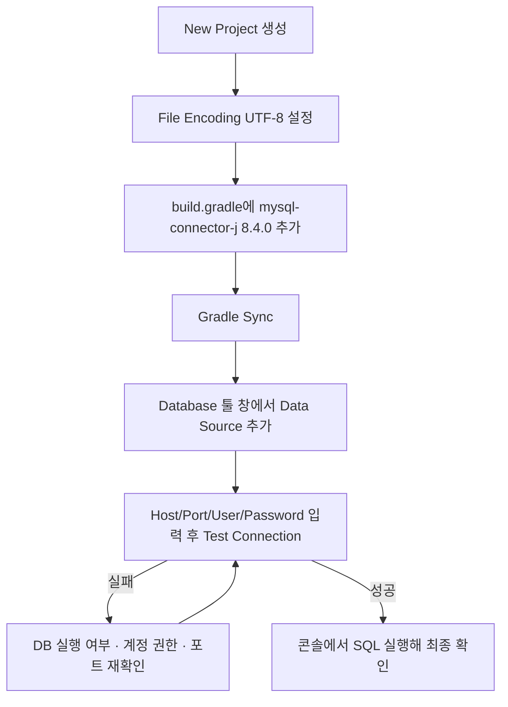

10/12일 "왜 DB가 필요한가" 시간에 "열람실 책상(JVM 메모리)과 서고(DB)를 잇는 JDBC"라는 비유를 배웠다. 오늘은 그 JDBC가 정확히 뭔지, 그리고 실제로 IntelliJ에서 MySQL에 연결하는 개발 환경을 직접 갖췄다.

## JDBC(Java DataBase Connectivity)란

> Java에서 DataBase에 접근 가능하도록 하는 Programming API다.

다섯 살 아이에게 설명한다면: "Java와 MySQL은 서로 다른 나라 말을 써. JDBC는 그 사이에 서 있는 통역사야. Java가 '회원 이름으로 찾아줘'라고 말하면, JDBC가 그걸 MySQL이 알아듣는 말로 바꿔서 전달하고, 돌아온 대답도 다시 Java가 알아듣는 모양으로 바꿔줘."


이 "약속(인터페이스)"들은 `java.sql` 패키지에 모여 있다. [공식 문서(java.sql package summary)](https://docs.oracle.com/javase/8/docs/api/java/sql/package-summary.html)에 `DriverManager`, `Connection`, `Statement`, `ResultSet` 같은 핵심 타입이 정의되어 있는데, 이 패키지 자체는 **"무엇을 할 수 있는지"만 정의한 인터페이스 모음**이고, 실제로 MySQL과 통신하는 번역 작업은 DBMS 제조사가 만든 **드라이버**(오늘 설치한 `mysql-connector-j`)가 구현한다. 그래서 DBMS를 MySQL에서 Oracle로 바꿔도 Java 코드는 거의 그대로 두고 드라이버만 교체하면 되는 구조다.

## 개발 환경 설정 — IntelliJ + MySQL

오늘 실제로 따라 한 설정 순서를 기록해둔다.

| 순서 | 작업 | 주의할 점 |
|---|---|---|
| 1 | IntelliJ에서 New Project 생성 | - |
| 2 | `Settings > Editor > File Encoding`에서 인코딩을 **UTF-8**로 설정 | 한글 데이터를 다루므로 인코딩이 안 맞으면 조회·저장 시 글자가 깨진다 |
| 3 | [mvnrepository.com](https://mvnrepository.com/)에서 `mysql` 검색 → MySQL Connector/J의 Gradle(short) 코드 복사 | 버전은 **8.4.0** 사용 |
| 4 | `build.gradle`의 `dependencies`에 복사한 의존성 추가 | Gradle Sync를 한 번 더 해줘야 라이브러리가 실제로 받아진다 |
| 5 | 상단 메뉴 `View > Tool Windows > Database` 열기 | - |
| 6 | 좌측 상단 **+** → `Data Source > MySQL` 선택 | - |
| 7 | Host, Port, User, Password 입력 후 **Test Connection** | 실패하면 로컬 DB 실행 여부·계정 권한·주소/포트부터 확인 |
| 8 | 연결 성공 후 OK로 저장 | 데이터베이스 탭에서 테이블 목록이 바로 보여야 정상 |
| 9 | Database 콘솔 창에서 간단한 SQL 실행해 확인 | 조회 결과가 돌아오면 Java 코드 작성 전에 연결 자체는 검증된 셈 |



`build.gradle`에 추가하는 의존성은 대략 이런 모양이다 (mvnrepository의 Gradle 탭에서 그대로 복사).

```groovy
dependencies {
    implementation 'com.mysql:mysql-connector-j:8.4.0'
}
```

## 오늘의 정리

JDBC는 Java 코드와 MySQL 사이에서 통역을 맡는 표준 인터페이스 묶음(`java.sql`)이고, 실제 번역 작업은 DBMS별 드라이버가 한다. 오늘은 아직 `Connection`을 코드로 직접 열어보진 않았고, 그 전 단계인 IntelliJ ↔ MySQL 연결 환경부터 갖췄다 — Gradle에 드라이버 의존성을 추가하고, IntelliJ의 Database 툴 창으로 접속 정보를 등록해 Test Connection이 통과하는 것까지 확인했다. 다음 시간에는 이 연결을 Java 코드 안에서 `DriverManager.getConnection()`으로 직접 열어볼 차례다.

## 더 학습하면 좋은 개념

- **DriverManager와 Connection** — 오늘은 IDE의 Database 툴로 연결을 확인했는데, 실제 Java 코드에서는 `DriverManager.getConnection(url, user, password)`로 같은 연결을 맺는다. 다음 시간의 핵심이 될 내용이다.
- **PreparedStatement와 SQL Injection** — `Statement`에 문자열을 그대로 이어붙이면 SQL Injection에 취약해진다. `PreparedStatement`가 왜 기본으로 권장되는지 알아두면 좋다.
- **커넥션 풀(Connection Pool, 예: HikariCP)** — 매번 `DriverManager`로 새 연결을 여는 건 비용이 크다. 실무에서는 연결을 미리 만들어두고 재사용하는 풀을 쓰는데, 오늘 배운 '연결' 개념의 다음 단계다.
- **Gradle 의존성 관리** — `build.gradle`에 한 줄 추가한 것만으로 라이브러리가 받아지는 원리(저장소, 버전 해석)를 알아두면 다른 라이브러리를 추가할 때도 헤매지 않는다.

## 참고 자료

- [java.sql package summary (Java Platform SE 8)](https://docs.oracle.com/javase/8/docs/api/java/sql/package-summary.html)
- [Oracle JDBC Basics](https://docs.oracle.com/javase/tutorial/jdbc/basics/index.html)
- [MySQL :: MySQL Connector/J Developer Guide](https://dev.mysql.com/doc/connector-j/en/)
