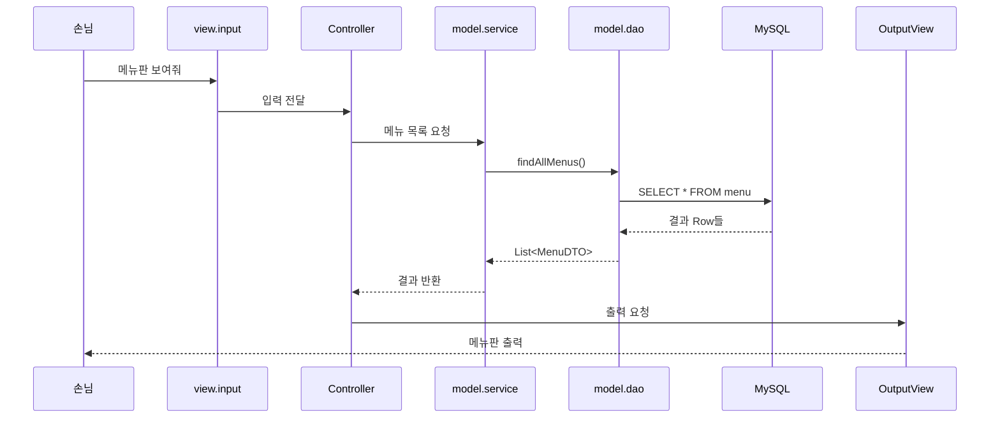

오늘은 지금까지 하나의 `Application` 클래스에 다 몰아 넣던 코드를 **View·Controller·Model·DAO·DTO**로 역할별 패키지에 나누는 MVC 패턴을 배웠다. 수업에서 "자바 프로그램을 식당이라고 생각해 보라"는 비유를 썼는데, 손님이 주문 하나를 넣고 받기까지 여러 직원의 손을 차례로 거친다는 설명이 패키지 구조를 이해하는 데 제일 와닿았다.

## 식당 비유: 패키지마다 맡은 일이 다르다

| 식당 속 역할 | 패키지 | 하는 일 |
|---|---|---|
| 🙋 손님 | (사용자) | 메뉴판을 보여 달라, 주문을 받아 달라고 요청한다 |
| 📋 주문 받는 직원 | `view.input` | 손님의 요청을 받아 적는다 |
| 🍽️ 서빙 직원 | `view.output` | 완성된 결과를 손님 앞에 내어준다 |
| 🧑‍💼 홀 매니저 | `controller` | 누구에게 무엇을 시킬지 흐름을 지휘한다 |
| 👨‍🍳 주방장 | `model.service` | 재고·가격 같은 업무 규칙을 판단한다 |
| 🔑 냉장고 담당 | `model.dao` | DB에서 재료(데이터)를 직접 꺼내온다 |
| 🧊 냉장고 | DB (MySQL) | 자바 프로그램 바깥에 있는 진짜 데이터 저장소 |
| 🧾 주문서·접시 | `model.dto` | 계층 사이로 데이터를 담아 나르는 그릇 |

다섯 살 아이에게 설명한다면: "식당에서 손님이 직접 주방에 들어가서 냉장고를 뒤지진 않잖아. 주문받는 직원한테 말하면, 그 말이 매니저를 거쳐 주방장한테 가고, 주방장이 냉장고 담당한테 재료를 꺼내 오라고 시켜. 완성된 음식은 접시(DTO)에 담겨서 다시 손님 앞까지 돌아오는 거야."


## 홀 매니저(Controller)가 하는 일과 하지 않는 일

가장 헷갈렸던 부분은 "그럼 Controller는 정확히 뭘 하는가"였다. 수업 자료에 하는 일과 하지 않는 일이 명확히 나뉘어 있었다.

**하는 일**
- View에게 입력을 받아 오게 시킨다
- 받은 DTO를 Service에 넘기고, 결과를 OutputView에 넘긴다
- 사용자 선택에 따라 어느 흐름으로 갈지 정한다

**하지 않는 일**
- 재고, 가격 같은 업무 규칙 판단 (이건 Service의 일)
- JDBC로 DB에 직접 접근 (이건 DAO의 일)

이걸 어기면 Controller에 판단용 `if`문과 SQL이 계속 쌓여서, 수백 줄짜리 "만능 매니저" 클래스가 되어버린다. 매니저는 지휘만 하고, 판단은 주방장(Service)에게, 재료 수급은 냉장고 담당(DAO)에게 맡겨야 한다는 역할 분리가 핵심이었다.

## 요청 하나가 실제로 지나가는 길

"메뉴판 보여줘"라는 요청 하나가 코드 안에서 어떤 순서로 지나가는지 시퀀스로 그려보면 이렇다.



실행은 전부 `Application`의 `main()`에서 시작한다.

```java
package com.restaurant;

import com.restaurant.controller.OrderController;

public class Application {
    public static void main(String[] args) {
        // 가게 문을 열고 홀 매니저에게 영업을 맡겨요
        new OrderController().run();
    }
}
```

`main()`은 가게 문을 여는 역할만 하고, 그 다음부터 모든 흐름은 `OrderController`가 지휘한다는 게 인상적이었다. `Application`은 `Car`를 직접 몰랐던 지난번 추상화 예제처럼, 여기서도 `main()`은 `OrderController`의 내부가 어떻게 생겼는지 전혀 몰라도 된다.

## 거절은 누가 판단할까 — 품절 메뉴 시나리오

수업에서 재밌었던 질문이 하나 있었다. "제육볶음을 주문했는데 품절이면, 그걸 거절하는 판단은 어디서 할까?" 처음엔 "Controller가 재고를 확인해서 거절하면 되지 않나" 싶었는데, 틀린 생각이었다.

- Controller는 "주문을 넣어줘"라고 Service에 전달만 한다.
- 재고가 있는지 확인하고, 없으면 거절하는 **업무 규칙 판단은 Service(주방장)의 일**이다.
- DAO(냉장고 담당)는 그저 Service가 시키는 대로 재료를 확인하거나 꺼내올 뿐, 거절할지 말지는 판단하지 않는다.

이 구조 덕분에 "재고 부족 시 거절"이라는 규칙이 바뀌어도 Controller나 View 코드는 전혀 건드릴 필요가 없다. 바뀌는 건 오직 Service 안의 판단 로직뿐이다.

## 코드 한 줄이 어느 패키지 것인지 분류해보기

수업 퀴즈 중에 이런 문제가 있었다.

```java
Scanner sc = new Scanner(System.in);
String menuName = sc.nextLine();
```

이 코드는 어느 패키지에 있어야 할까? 정답은 `view.input`이었다. 사용자로부터 "입력을 받는" 행위이기 때문에, 판단도 출력도 아닌 순수 입력 수집은 View의 입력 담당 몫이라는 것이다. 이렇게 코드 한 줄을 보고 "이건 누구 일이지?"를 따져보는 연습이, 패키지를 왜 나눠야 하는지보다 실제로 나눌 때 훨씬 더 도움이 됐다.

## 오늘의 정리

MVC는 결국 "누가 입력을 받고, 누가 판단하고, 누가 데이터를 직접 만지고, 누가 보여줄지"를 패키지 단위로 분리해 놓은 것이었다. 식당 비유가 좋았던 이유는, 각 역할이 "하지 않는 일"까지 명확해진다는 점이었다 — 홀 매니저는 요리하지 않고, 주방장은 서빙하지 않고, 냉장고 담당은 거절 여부를 판단하지 않는다. DTO는 이 모든 경계를 넘나드는 유일한 운반 그릇이라는 것도 이번에 확실히 잡혔다.

## 더 학습하면 좋은 개념

- **계층형 아키텍처(Layered Architecture)** — MVC의 Model을 다시 Service/DAO로 쪼갠 것처럼, 실무에서는 Presentation-Business-Persistence 계층으로 더 세분화한다. 오늘 배운 구조가 왜 이렇게 생겼는지 이해하는 데 도움이 된다.
- **DAO 패턴(Data Access Object)** — 오늘은 `MenuDAO` 하나만 다뤘는데, DAO가 왜 인터페이스로 많이 설계되는지(DB 종류가 바뀌어도 Service 코드는 그대로 두기 위해)를 더 깊이 보면 좋다.
- **DI(의존성 주입, Dependency Injection)** — 지금은 `OrderController` 안에서 `new OrderService()`처럼 직접 생성하고 있을 텐데, 이 의존 관계를 외부에서 주입하는 방식을 배우면 테스트하기 훨씬 쉬운 구조로 발전한다.
- **JDBC와 커넥션 풀** — DAO가 "냉장고 담당"으로서 실제로 DB에 접근하는 저수준 동작(`Connection`, `PreparedStatement`)을 알아두면, DAO 계층이 왜 따로 분리되어 있는지 체감된다.

## 참고 자료

- [Oracle Java Tutorials - What Is an Object?](https://docs.oracle.com/javase/tutorial/java/concepts/object.html)
- [Oracle Java Tutorials - Lesson: Packages](https://docs.oracle.com/javase/tutorial/java/package/index.html)
- [Oracle JDBC Basics](https://docs.oracle.com/javase/tutorial/jdbc/basics/index.html)
