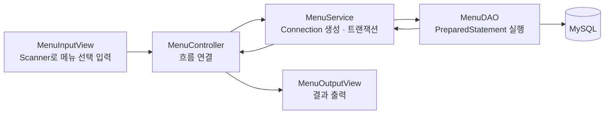

10/15일 `Statement`에 문자열을 이어붙이면 SQL Injection에 취약하다는 문제를 겪었다. 오늘은 그 문제를 `PreparedStatement`로 해결하고, 더 나아가 실제 메뉴 조회 기능을 View→Controller→Service→DAO 계층으로 완성해봤다.

## 1. PreparedStatement 기본

```java
Connection con = getConnection();
PreparedStatement pstmt = con.prepareStatement("SELECT * FROM TBL_MENU");
ResultSet rset = pstmt.executeQuery(); // 이미 컴파일된 SQL을 실행만 한다
```

`Statement`는 쿼리를 실행할 때마다 SQL 구문을 DB에 보내서 매번 파싱·컴파일하는 과정을 거친다. `PreparedStatement`는 최초 1회만 파싱·컴파일하고, 같은 SQL을 다시 쓸 때는 그걸 재사용해서 성능도 더 좋다는 걸 배웠다.

## 2. Placeholder(`?`)로 안전하게 값 바인딩하기

```java
pstmt = con.prepareStatement(
        "SELECT MENU_CODE, MENU_PRICE, ORDERABLE_STATUS FROM TBL_MENU WHERE MENU_NAME = ?"
);
pstmt.setString(1, menuName); // ?의 위치(parameterIndex)에 값을 채워준다

rset = pstmt.executeQuery();
```

`Statement`는 `"'" + menuName + "'"`처럼 문자열을 직접 이어붙여야 해서 번거롭고 위험했다. `PreparedStatement`는 **`?`(placeholder)로 자리를 미리 잡아두고, `setString()` 같은 메서드로 값만 나중에 채운다.**

다섯 살 아이에게 설명한다면: "어제는 빈칸에 이름을 직접 적어서 내는 거라, 이름 칸에 이상한 명령어를 적으면 그걸 진짜 명령으로 착각할 위험이 있었어. 오늘은 양식지(SQL 틀) 자체를 먼저 다 찍어내고, 그 다음에 이름만 정해진 칸에 끼워 넣는 거야. 아무리 이상한 글자를 써도, 그건 그냥 '이름 칸에 적힌 글자'일 뿐 양식지 자체를 바꾸진 못해."


SQL 문법 자체는 `prepareStatement()` 시점에 이미 확정되기 때문에, 그 뒤에 `setString()`으로 끼워 넣는 값이 아무리 따옴표를 포함해도 SQL 구문을 바꿀 수 없다. 이게 `PreparedStatement`가 SQL Injection에 안전한 이유다.

## 3. SQL까지 코드 밖으로 분리하기

```xml
<!-- menu-query.xml -->
<entry key="findMenuByMenuName">
    SELECT MENU_CODE, MENU_NAME, MENU_PRICE, CATEGORY_CODE, ORDERABLE_STATUS
    FROM TBL_MENU WHERE MENU_NAME = ?
</entry>
```

```java
Properties prop = new Properties();
prop.loadFromXML(new FileInputStream("src/main/java/com/wanted/b_preparedstatements/menu-query.xml"));

String query = prop.getProperty("findMenuByMenuName");
pstmt = con.prepareStatement(query);
pstmt.setString(1, menuName);
```

쿼리 하나는 문자열로 적어도 괜찮지만, JOIN이나 WHERE 조건이 길어지면 자바 코드 안에서 문자열을 조립하는 게 점점 복잡해진다. 그래서 SQL 자체를 XML 파일로 따로 빼두고 키(key)로 불러오는 방식을 배웠다 — 이 패턴은 나중에 배울 MyBatis 같은 ORM의 쿼리 관리 방식과 맞닿아 있었다.

## 4. 조회가 아닌 작업은 executeUpdate()

```java
String query = prop.getProperty("modifyMenuPriceByMenuName");
pstmt = con.prepareStatement(query);
pstmt.setInt(1, price);
pstmt.setString(2, menuName);

int result = pstmt.executeUpdate(); // INSERT/UPDATE/DELETE 전용, 영향받은 행 수를 반환
```

**조회(SELECT)**는 `executeQuery()`로 결과를 `ResultSet`으로 받지만, **INSERT·UPDATE·DELETE 같은 DML**은 `executeUpdate()`를 쓴다는 차이를 짚었다. `executeUpdate()`는 조회 결과가 필요 없는 대신, **영향을 받은 행의 개수(int)**를 반환해서 성공 여부를 판단할 수 있다.

## 5. DAO·Service·Controller·View로 정리하기

메뉴 전체 조회 기능 하나를 실제로 계층형 구조로 완성해봤다.



```java
// DAO — SQL 실행 + ResultSet을 Java 객체로 변환
public class MenuDAO {
    private final Connection connection;
    public MenuDAO(Connection connection) { this.connection = connection; }

    public List<MenuDTO> findAll() throws SQLException {
        String query = QueryUtil.getQuery("menu.findAll");
        List<MenuDTO> menus = new ArrayList<>();

        try (PreparedStatement pstmt = connection.prepareStatement(query)) {
            ResultSet rset = pstmt.executeQuery();
            while (rset.next()) {
                menus.add(new MenuDTO(
                        rset.getInt("MENU_CODE"), rset.getString("MENU_NAME"),
                        rset.getInt("MENU_PRICE"), rset.getInt("CATEGORY_CODE"),
                        rset.getString("ORDERABLE_STATUS")
                ));
            }
        }
        return menus;
    }
}
```

```java
// Service — Connection 생성과 트랜잭션, DAO 호출
public class MenuService {
    public List<MenuDTO> findAllMenus() {
        try (Connection con = JDBCTemplate.getConnection()) { // try-with-resources로 자동 close
            return new MenuDAO(con).findAll();
        } catch (SQLException e) {
            throw new RuntimeException(e);
        }
    }
}
```

| 계층 | 책임 | 하면 안 되는 일 |
|---|---|---|
| View (`MenuInputView`/`MenuOutputView`) | Scanner로 입력받기, 결과 출력 | SQL 작성, 비즈니스 로직, commit/rollback |
| Controller (`MenuController`) | View ↔ Service 연결, 필요시 DTO 조립 | Scanner 입력 처리, SQL 작업 |
| Service (`MenuService`) | Connection 생성, 트랜잭션, DAO 호출·조합 | 콘솔 입출력 |
| DAO (`MenuDAO`) | PreparedStatement 실행, ResultSet → 객체 변환 | 콘솔 입출력, commit/rollback |

`MenuService.findAllMenus()`에서 `try (Connection con = JDBCTemplate.getConnection())`처럼 **try-with-resources**를 쓴 것도 눈에 띄었다 — `Connection`이 `AutoCloseable`을 구현하고 있어서, `close()`를 직접 호출하지 않아도 블록이 끝나면 자동으로 닫힌다.

10/19일 배운 "식당 MVC 비유" 글에서 Controller는 지휘만, Service는 판단만, DAO는 접근만 한다고 정리했던 그 역할 분리가, 오늘은 실제로 동작하는 코드로 그대로 구현된 셈이었다.

## 오늘의 정리

`PreparedStatement`는 SQL 틀을 먼저 고정해두고 값은 `?`에 나중에 안전하게 끼워 넣는 방식이라, `Statement`의 SQL Injection 문제를 구조적으로 막아준다. 거기다 SQL을 XML로 분리하고, INSERT/UPDATE/DELETE는 `executeUpdate()`를 쓰고, DAO·Service·Controller·View로 역할을 나누면서, 지금까지 따로 배운 개념들(PreparedStatement, MVC, try-with-resources)이 하나의 동작하는 기능 안에서 전부 맞물리는 걸 확인했다.

## 더 학습하면 좋은 개념

- **커넥션 풀(HikariCP)** — `JDBCTemplate.getConnection()`이 매번 새 연결을 맺는데, 실무에서는 미리 만들어둔 연결을 재사용하는 풀을 쓴다. 오늘 배운 Connection 생성 방식의 다음 단계다.
- **배치(Batch) 처리** — 여러 건의 INSERT를 한 번에 처리할 때 `addBatch()`/`executeBatch()`를 쓰면 매번 `executeUpdate()`를 호출하는 것보다 훨씬 빠르다.
- **MyBatis 같은 SQL 매퍼(ORM)** — 오늘 XML로 쿼리를 분리했던 방식이, MyBatis에서는 더 정교한 매핑 기능과 함께 표준화되어 있다. 오늘 배운 `QueryUtil` 패턴이 왜 필요했는지 이해했다면 MyBatis가 왜 유용한지도 바로 와닿을 것이다.
- **트랜잭션 처리(commit/rollback)** — 오늘은 조회 기능만 완성했는데, 여러 DAO 호출을 하나의 트랜잭션으로 묶어 commit/rollback하는 방법은 다음 단계로 이어진다.

## 참고 자료

- [Oracle JDBC - Using Prepared Statements](https://docs.oracle.com/javase/tutorial/jdbc/basics/prepared.html)
- [OWASP - SQL Injection Prevention Cheat Sheet](https://cheatsheetseries.owasp.org/cheatsheets/SQL_Injection_Prevention_Cheat_Sheet.html)
