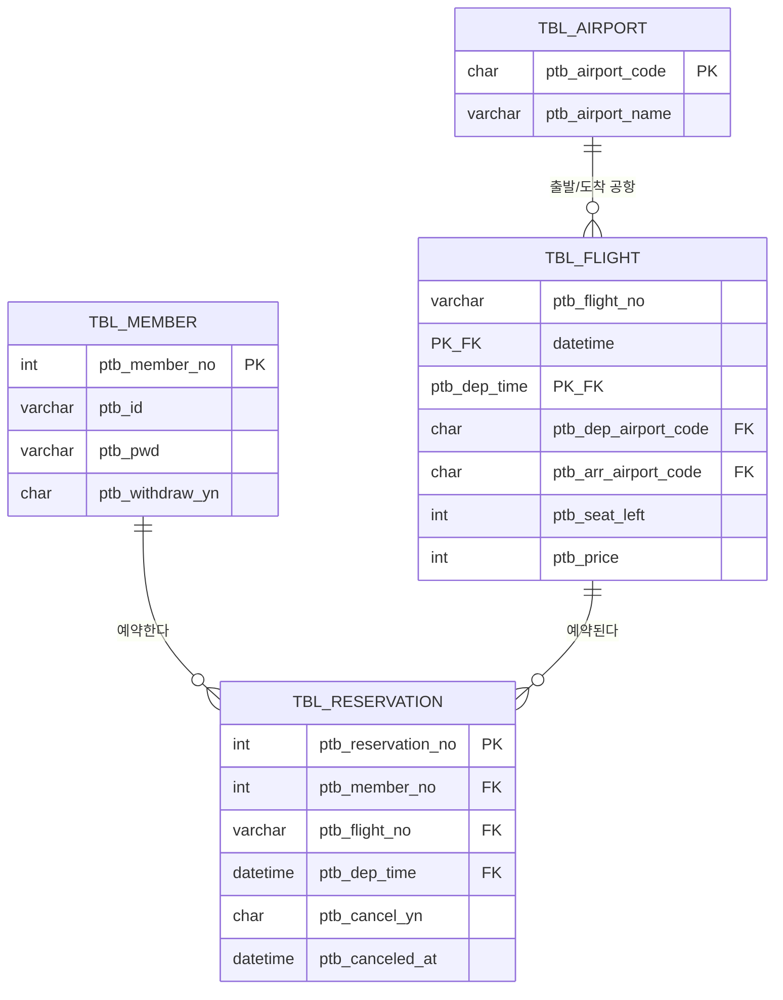
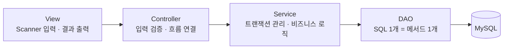

## 들어가며 (Situation)

그동안 따로 배운 **DB 설계(ERD·정규화·제약조건) → JDBC → MVC 패턴**을 하나로 엮어서 써보는 팀 과제가 시작됐다. 콘솔 기반 **항공권 예매 프로그램**을 Java + JDBC + MySQL로 직접 만드는 DB 학습용 팀 실습이고, `eulji-staff-only/plane-ticket-booking` 저장소로 협업한다. 아직 설계 단계만 끝난 **미완성 프로젝트**라, 이 글도 완성 후기가 아니라 킥오프 기록이다.

팀은 승빈·연익·다연·서연 네 명으로 꾸렸고, 나(서연)는 그중 **공항·항공편 조회(`TBL_AIRPORT`, `TBL_FLIGHT`)** 영역을 맡았다.

## 문제 상황 (Task)

요구 기능은 네 갈래였다.

- **회원**: 회원가입(아이디 중복 체크), 로그인/로그아웃, 내 정보 조회·수정, 회원 탈퇴
- **항공편**: 출발·도착 공항과 날짜로 검색, 상세 조회(공항명 JOIN, 잔여좌석, 가격), 공항 목록
- **예매**: 항공편 예매(예약 INSERT + 잔여좌석 -1), 잔여좌석 0이면 예매 불가, 내 예매 내역 조회
- **취소**: 예매 취소(잔여좌석 +1), 취소 이력 기록

핵심 제약은 두 가지였다.

1. **잔여좌석 증감과 예약 저장이 반드시 하나로 묶여야 한다** — 예매 중간에 실패하면 "좌석은 줄었는데 예약 기록은 없는" 상태가 생기면 안 되므로, 트랜잭션(`commit`/`rollback`)이 필수다.
2. **네 명이 같은 파일을 건드리지 않고 병렬로 작업할 수 있어야 한다** — 역할과 폴더 구조, 브랜치 전략을 먼저 정해두지 않으면 merge 충돌로 시간을 더 많이 쓰게 된다.

## 해결 과정 (Action)

### ERD 설계



같은 편명이 매일 운항하기 때문에, 항공편은 **편명 + 출발시각 복합키**로 구분하기로 했다. 처음엔 `ptb_flight_no`만 PK로 두려고 했는데, 그러면 같은 편명의 오늘 운항과 내일 운항을 구분할 수 없다는 걸 ERD를 그리면서 발견했다. 예약 테이블도 이 두 컬럼을 함께 FK로 참조한다. 탈퇴·취소는 행을 지우지 않고 `_yn` 플래그로 처리하는 **논리 삭제**를 쓰기로 했다 — 예약 이력이나 탈퇴 전 기록을 그대로 남겨야 하기 때문이다.

### MVC로 책임 나누기



| 계층 | 하는 일 | 하면 안 되는 일 |
|---|---|---|
| View | `Scanner` 입력, 결과 출력 | SQL 작성, DB 접근 |
| Controller | 입력 검증, 흐름 연결, 결과에 맞는 View 호출 | SQL 작성 |
| Service | 트랜잭션 관리(commit/rollback), 여러 DAO 조합 | 콘솔 입출력 |
| DAO | SQL 1개 = 메서드 1개 | 콘솔 입출력, commit/rollback |

"예매" 기능 하나가 **Service에서 트랜잭션으로 묶여야 한다**는 제약을 이 표로 미리 못 박아뒀다. 예약 INSERT와 잔여좌석 UPDATE를 서로 다른 DAO 메서드로 나누고, 그 둘을 하나의 트랜잭션으로 묶는 역할은 Service만 하도록 합의했다 — Controller나 DAO가 commit을 직접 호출하면 안 된다는 규칙이다.

### 폴더 구조와 코드 컨벤션

```
src/com/ptb/
├── Application.java
├── common/JDBCTemplate.java     # getConnection, close, commit, rollback
├── view/      (MainView, MemberView, FlightView, ReservationView, ResultView)
├── controller/ (MemberController, FlightController, ReservationController)
└── model/
    ├── dto/     (MemberDTO, AirportDTO, FlightDTO, ReservationDTO)
    ├── service/ (MemberService, FlightService, ReservationService)
    └── dao/     (MemberDAO, AirportDAO, FlightDAO, ReservationDAO)
```

처음엔 "그냥 `Application.java` 하나에 다 짜면 안 되나"라는 생각이 들었는데, 파일 하나하나가 왜 따로 있어야 하는지 이유를 따져보니 전부 "같이 두면 안 되는 이유"가 있었다.

| 파일/폴더 | 왜 따로 있어야 할까 |
|---|---|
| `Application.java` | 프로그램의 유일한 입구만 둔다. 여기에 기능 로직까지 섞이기 시작하면, 실행 흐름 하나를 보려고 전체 코드를 다 읽어야 하는 "만능 파일"이 된다 |
| `common/JDBCTemplate.java` | Connection을 열고 닫는 코드는 모든 DAO가 똑같이 필요하다. 각자 복붙해두면, 연결 방식 하나를 바꿀 때 파일 수십 개를 다 고쳐야 한다 |
| `view/*View.java` | 화면 문구와 입력 순서는 자주 바뀐다. 로직과 분리해두면 "출력 문구만 바꾸는" 작업이 DB나 비즈니스 로직 코드를 전혀 건드리지 않는다 |
| `controller/*Controller.java` | "어떤 기능을 어떤 순서로 부를지"는 입력 검증·흐름 제어일 뿐, SQL이나 화면 출력과는 다른 관심사다. 여기 SQL이 섞이면 10/19일 배운 "만능 매니저" 문제가 그대로 재현된다 |
| `model/dto/*DTO.java` | 계층 사이를 오가는 데이터의 "모양"만 정의한다. 데이터 구조가 바뀌면 이 파일 하나만 보면 되고, 로직과 섞이면 어디서 값이 바뀌는지 추적하기 어려워진다 |
| `model/service/*Service.java` | 트랜잭션 경계와 업무 규칙(재고 확인, 좌석 차감)이 모이는 자리. 이 계층이 없으면 판단 로직이 Controller나 DAO 여기저기에 흩어진다 |
| `model/dao/*DAO.java` | SQL 1개 = 메서드 1개로 고정해두면, 쿼리 하나를 고칠 때 그 메서드만 보면 된다. SQL이 Service·Controller에 섞이면 어디서 DB를 건드리는지 찾기 어려워진다 |
| `sql/01_ddl.sql`, `02_dml_sample.sql` | 테이블 구조를 말이 아니라 **실행 가능한 파일**로 남겨두면, 팀원 전체가 같은 모양의 DB에서 출발할 수 있다. 각자 DB를 손으로 만들면 반드시 어긋난다 |
| `resources/config/connection-info.properties(.example)` | DB 비밀번호 같은 민감정보는 커밋하면 안 된다. 실제 파일은 `.gitignore`로 빼고, `.example`만 공유해서 "어떤 값을 넣어야 하는지"는 알려주되 값 자체는 숨긴다 |
| `docs/erd.png` | 테이블 관계를 말로 설명하면 사람마다 다르게 이해한다. 그림 하나로 팀 전체가 같은 구조를 보고 있다는 걸 보장한다 |
| `README.md` / `CONTRIBUTING.md` | 새로 합류한 사람(또는 며칠 뒤의 나 자신)이 "어떻게 실행하지?", "브랜치는 어떻게 나누지?"를 매번 물어보지 않아도 되게 하는 문서. 코드가 아니라 **팀의 약속**을 저장해두는 파일이다 |

| 대상 | 규칙 | 예시 |
|---|---|---|
| 클래스 | PascalCase + 계층 접미사 | `MemberDAO`, `FlightService` |
| 메서드·변수 | camelCase | `selectFlightList()`, `seatLeft` |
| DAO 메서드 | SQL 동사로 시작 | `selectMemberById`, `insertReservation`, `updateSeatLeft` |
| 테이블·컬럼 | `TBL_`/`ptb_` 접두사 + snake_case | `TBL_FLIGHT.ptb_dep_time` |
| SQL | 예약어 대문자, 값은 반드시 `?` 바인딩 | `SELECT * FROM TBL_MEMBER WHERE ptb_id = ?` |

도메인(`model`) 아래를 다시 `dto`/`service`/`dao`로 나눠서, "같은 회원 기능이라도 DTO·Service·DAO는 서로 다른 사람이 동시에 건드릴 수 있게" 구조를 짰다. 10/19일 배운 식당 MVC 비유가 그대로 여기 적용됐다 — Controller는 지휘만, Service는 판단만, DAO는 접근만.

### 협업 규칙

| 항목 | 규칙 |
|---|---|
| 브랜치 | `main`(제출) ← `develop`(통합) ← `타입/#이슈번호-설명` |
| 커밋 | `feat: 항공편 검색 DAO 구현 (#12)` 형태 |
| PR | `develop` 대상, 1명 승인 후 Squash 머지 |
| DB 변경 | 테이블·컬럼을 바꾸면 `sql/01_ddl.sql`과 ERD를 **같은 PR에서** 함께 수정 |
| 접속 정보 | `connection-info.properties`는 `.gitignore`로 제외, `.example` 파일만 커밋 |

마지막 규칙(DB 변경 시 DDL과 ERD를 같은 PR에서)은, 누군가 테이블만 고치고 ERD 문서는 안 고쳐서 생기는 "문서와 실제 스키마가 다른" 문제를 미리 막기 위한 것이다.

## 결과 (Result)

오늘까지 끝난 건 **설계와 협업 규칙**이고, 실제 기능 구현은 아직 전부 체크리스트 상태다.

| 항목 | 상태 |
|---|---|
| 저장소·브랜치 전략·README·CONTRIBUTING | 완료 |
| ERD / DDL 테이블 설계 (4개 테이블, PK·FK·CHECK) | 완료 |
| MVC 폴더 구조와 역할 분리 합의 | 완료 |
| 회원 / 항공편 / 예매 / 취소 기능 구현 | 전부 미착수 |

다음 단계는 각자 담당 영역(승빈·연익·다연은 회원/예매/취소 쪽, 나는 공항·항공편 조회)을 나눠 `PreparedStatement` 기반 CRUD부터 채워 넣는 것이다. 설계를 먼저 끝내놓고 보니, 10/14~10/16에 배운 ERD·제약조건·JDBC가 이 하나의 프로젝트 안에서 왜 필요한지 순서대로 다시 이해가 됐다 — 특히 "편명만으로는 항공편을 구분할 수 없다"는 걸 복합키로 풀어본 게, 내가 맡은 항공편 조회 기능을 설계하면서 가장 크게 와닿은 부분이었다.

## 팀 프로젝트라면 기본적으로 있어야 할 파일들

처음엔 폴더와 파일 수가 너무 많아서 어려웠는데, 하나씩 "왜 있는지"를 따져보고 나니 사실 Java·DB 프로젝트가 아니어도 팀 프로젝트라면 공통으로 필요한 파일들이었다.

| 분류 | 파일 | 역할 |
|---|---|---|
| 실행 진입점 | `Application.java` / `main.py` / `index.js` 등 | "여기서부터 시작한다"는 지점을 한 곳으로 모아둔다 |
| 설정 분리 | `*.properties` / `.env` + `.example` 버전 | 민감정보는 숨기고, 어떤 설정값이 필요한지만 공유한다 |
| 의존성 관리 파일 | `build.gradle` / `package.json` / `requirements.txt` | "이 프로젝트가 뭘 써야 돌아가는지"를 적어두는 명세서 |
| 민감정보·불필요 파일 제외 | `.gitignore` | 비밀번호, 빌드 결과물, IDE 설정 등을 커밋 대상에서 뺀다 |
| DB 스키마 | `*.sql` (DDL/DML) | DB를 쓰는 프로젝트라면, 스키마를 말이 아니라 실행 가능한 파일로 고정해둔다 |
| 설계 산출물 | ERD·아키텍처 다이어그램 등 (`docs/`) | 구조를 그림으로 공유해서 팀 전체의 이해를 맞춘다 |
| 안내 문서 | `README.md` | 프로젝트 개요, 설치·실행 방법 |
| 협업 규칙 문서 | `CONTRIBUTING.md` | 브랜치 전략, 커밋 컨벤션, PR 규칙 |
| 코드 계층 구조 | `view`/`controller`/`service`/`dao` 같은 역할별 폴더 | "어디에 뭘 추가해야 하는지"가 폴더 이름만 보고도 정해지게 한다 |

이 파일들이 전부 공통으로 해결하는 문제는 하나다 — **코드만 봐서는 "왜 이렇게 만들었는지"와 "어떻게 다시 실행하는지"가 전달되지 않는다.** 처음 합류한 사람이 질문하지 않아도 되게 만드는 것, 그게 이 파일들이 존재하는 이유였다.

## 더 학습하면 좋은 개념

- **복합키 설계의 트레이드오프** — 편명+출발시각을 PK로 묶으면 자연키라 읽기는 편하지만, 자식 테이블(예약)의 FK도 두 컬럼이 되어 조인이 복잡해진다. 대신 `flight_id` 같은 대리키(Surrogate Key)를 쓰는 선택지와 비교해볼 만하다.
- **논리 삭제(Soft Delete)와 데이터 정합성** — `_yn` 플래그로 삭제를 흉내 내면 이력은 남지만, 조회 쿼리마다 `WHERE ... _yn = 'N'` 조건을 빠뜨리지 않아야 한다는 책임이 생긴다. 이 트레이드오프를 더 깊이 볼 필요가 있다.
- **트랜잭션 격리 수준과 동시 예매** — 잔여좌석 1석에 두 명이 동시에 예매를 시도하면 어떤 일이 생기는지, `SELECT ... FOR UPDATE` 같은 잠금 없이도 안전한지 직접 실험해볼 가치가 있다.
- **PreparedStatement와 SQL Injection** — 컨벤션에 "값은 반드시 `?` 바인딩"이라고 적어뒀는데, 왜 문자열 이어붙이기가 위험한지 실제 공격 예시로 확인해두면 이 규칙을 지켜야 하는 이유가 명확해진다.

## 참고 자료

- [plane-ticket-booking 저장소 (팀 GitHub)](https://github.com/eulji-staff-only/plane-ticket-booking)
- [Oracle JDBC Basics](https://docs.oracle.com/javase/tutorial/jdbc/basics/index.html)
- [MySQL 8.4 Reference Manual - InnoDB and the ACID Model](https://dev.mysql.com/doc/refman/8.4/en/mysql-acid.html)
