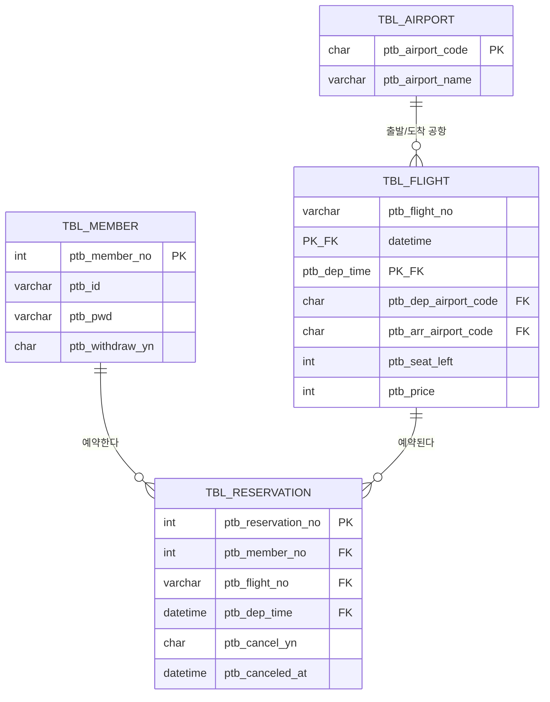
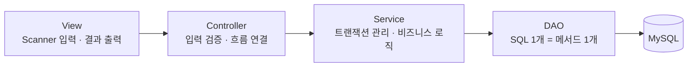

## 들어가며 — 우리 팀 주제

우리 팀(승빈, 연익, 다연, 서연)은 그동안 따로 배운 **DB 설계(ERD·정규화·제약조건) → JDBC → MVC 패턴**을 하나로 엮어보는 미니 프로젝트를 시작했다. 주제는 콘솔 기반 **항공권 예매 프로그램**이고, `eulji-staff-only/plane-ticket-booking` 저장소로 협업한다. 나(서연)는 그중 **공항·항공편 조회(`TBL_AIRPORT`, `TBL_FLIGHT`)** 영역을 맡았다.

> 이 글을 쓰는 지금은 설계만 끝난 **미완성 프로젝트**다. 완성 후기가 아니라, "우리가 왜 이런 파일 구조로 시작했는가"를 남겨두는 킥오프 기록이다.

## 팀 프로젝트에는 왜 이런 파일들이 필요할까

코드를 짜기 전에 "그냥 기능 클래스 몇 개만 있으면 되지 않나"부터 팀끼리 이야기했다. 결론은, Java·DB 프로젝트가 아니어도 팀 프로젝트라면 공통으로 필요한 파일들이 있다는 것이었다.

| 분류 | 파일 | 왜 필요한가 |
|---|---|---|
| 실행 진입점 | `Application.java` 같은 시작점 | "여기서부터 시작한다"는 지점을 한 곳으로 모아두지 않으면, 실행 흐름 하나를 보려고 전체 코드를 다 읽어야 한다 |
| 설정 분리 | `*.properties`/`.env` + `.example` 버전 | DB 비밀번호 같은 민감정보는 커밋하면 안 된다. `.example`만 공유해서 어떤 값이 필요한지는 알려주고 값 자체는 숨긴다 |
| 의존성 관리 파일 | `build.gradle`/`package.json` 등 | "이 프로젝트가 뭘 써야 돌아가는지"를 코드가 아니라 명세로 남겨둬야 팀원 전체가 같은 환경에서 실행된다 |
| `.gitignore` | 민감정보·빌드 결과물 제외 목록 | 이 파일이 없으면 누군가 실수로 비밀번호나 IDE 설정 파일을 커밋해버린다 |
| DB 스키마 | `*.sql` (DDL/DML) | 테이블 구조를 말로 설명하면 사람마다 다르게 이해한다. 실행 가능한 SQL 파일로 고정해야 팀원 전체가 같은 DB에서 출발한다 |
| 설계 산출물 | ERD 등 (`docs/`) | 그림 하나로 "우리가 같은 구조를 보고 있다"는 걸 보장한다 |
| 안내 문서 | `README.md` | 설치·실행 방법, 프로젝트 개요 — 매번 물어보지 않아도 되게 한다 |
| 협업 규칙 문서 | `CONTRIBUTING.md` | 브랜치 전략, 커밋 컨벤션, PR 규칙을 팀의 약속으로 저장해둔다 |
| 코드 계층 구조 | `view`/`controller`/`service`/`dao` 폴더 | "어디에 뭘 추가해야 하는지"가 폴더 이름만 보고도 정해지게 한다 |

공통된 이유는 하나였다 — **코드만 봐서는 "왜 이렇게 만들었는지"와 "어떻게 다시 실행하는지"가 전달되지 않는다.** 네 명이 서로 다른 시간에 작업해도 매번 물어보지 않아도 되도록, 이 파일들로 미리 약속을 남겨두는 것이다.

## 우리 팀은 그래서 이렇게 수행했다

위 원칙을 "항공권 예매"라는 주제에 실제로 적용하면서 정한 것들이다.

### 주제와 요구 기능

- **회원**: 회원가입(아이디 중복 체크), 로그인/로그아웃, 내 정보 조회·수정, 회원 탈퇴
- **항공편** (내 담당): 출발·도착 공항과 날짜로 검색, 상세 조회(공항명 JOIN, 잔여좌석, 가격), 공항 목록
- **예매**: 항공편 예매(예약 INSERT + 잔여좌석 -1), 잔여좌석 0이면 예매 불가, 내 예매 내역 조회
- **취소**: 예매 취소(잔여좌석 +1), 취소 이력 기록

핵심 제약은 두 가지였다.

1. **잔여좌석 증감과 예약 저장이 반드시 하나로 묶여야 한다** — 예매 중간에 실패하면 "좌석은 줄었는데 예약 기록은 없는" 상태가 생기면 안 되므로, 트랜잭션(`commit`/`rollback`)이 필수다.
2. **네 명이 같은 파일을 건드리지 않고 병렬로 작업할 수 있어야 한다** — 역할과 폴더 구조, 브랜치 전략을 먼저 정해두지 않으면 merge 충돌로 시간을 더 많이 쓰게 된다.

### ERD로 데이터 구조부터 정했다



같은 편명이 매일 운항하기 때문에, 항공편은 **편명 + 출발시각 복합키**로 구분하기로 했다. 처음엔 `ptb_flight_no`만 PK로 두려고 했는데, 그러면 같은 편명의 오늘 운항과 내일 운항을 구분할 수 없다는 걸 ERD를 그리면서 발견했다 — 내가 맡은 항공편 조회 기능을 설계하면서 가장 크게 와닿은 부분이었다. 예약 테이블도 이 두 컬럼을 함께 FK로 참조한다. 탈퇴·취소는 행을 지우지 않고 `_yn` 플래그로 처리하는 **논리 삭제**를 쓰기로 했다 — 예약 이력이나 탈퇴 전 기록을 그대로 남겨야 하기 때문이다.

### MVC로 책임을 나눴다



| 계층 | 하는 일 | 하면 안 되는 일 |
|---|---|---|
| View | `Scanner` 입력, 결과 출력 | SQL 작성, DB 접근 |
| Controller | 입력 검증, 흐름 연결, 결과에 맞는 View 호출 | SQL 작성 |
| Service | 트랜잭션 관리(commit/rollback), 여러 DAO 조합 | 콘솔 입출력 |
| DAO | SQL 1개 = 메서드 1개 | 콘솔 입출력, commit/rollback |

"예매" 기능 하나가 **Service에서 트랜잭션으로 묶여야 한다**는 제약을 이 표로 미리 못 박아뒀다. 예약 INSERT와 잔여좌석 UPDATE를 서로 다른 DAO 메서드로 나누고, 그 둘을 하나의 트랜잭션으로 묶는 역할은 Service만 하도록 합의했다 — Controller나 DAO가 commit을 직접 호출하면 안 된다는 규칙이다.

### 일반 원칙을 우리 폴더 구조에 그대로 매핑했다

```
src/com/ptb/
├── Application.java
├── common/JDBCTemplate.java     # getConnection, close, commit, rollback
├── view/      (MainView, MemberView, FlightView, ReservationView, ResultView)
├── controller/ (MemberController, FlightController, ReservationController)
└── model/
    ├── dto/     (MemberDTO, AirportDTO, FlightDTO, ReservationDTO)
    ├── service/ (MemberService, FlightService, ReservationService)
    └── dao/     (MemberDAO, AirportDAO, FlightDAO, ReservationDAO)
```

위에서 정리한 "왜 필요한가"를 그대로 우리 프로젝트 파일에 대응시키면 이렇다.

| 일반 원칙 | 우리 프로젝트에서는 |
|---|---|
| 실행 진입점 | `Application.java` 하나로만 시작 |
| 설정 분리 | `resources/config/connection-info.properties` (실파일은 `.gitignore`), `.example`만 커밋 |
| DB 스키마 | `sql/01_ddl.sql`, `sql/02_dml_sample.sql` |
| 설계 산출물 | `docs/erd.png` |
| 안내/협업 문서 | `README.md`, `CONTRIBUTING.md` |
| 코드 계층 구조 | `view`/`controller`/`model(dto,service,dao)` |

도메인(`model`) 아래를 다시 `dto`/`service`/`dao`로 나눠서, "같은 회원 기능이라도 DTO·Service·DAO는 서로 다른 사람이 동시에 건드릴 수 있게" 구조를 짰다. 10/19일 배운 식당 MVC 비유가 그대로 여기 적용됐다 — Controller는 지휘만, Service는 판단만, DAO는 접근만.

### 컨벤션과 협업 규칙도 코드 짜기 전에 정했다

| 대상 | 규칙 | 예시 |
|---|---|---|
| 클래스 | PascalCase + 계층 접미사 | `MemberDAO`, `FlightService` |
| 메서드·변수 | camelCase | `selectFlightList()`, `seatLeft` |
| DAO 메서드 | SQL 동사로 시작 | `selectMemberById`, `insertReservation`, `updateSeatLeft` |
| 테이블·컬럼 | `TBL_`/`ptb_` 접두사 + snake_case | `TBL_FLIGHT.ptb_dep_time` |
| SQL | 예약어 대문자, 값은 반드시 `?` 바인딩 | `SELECT * FROM TBL_MEMBER WHERE ptb_id = ?` |

| 항목 | 규칙 |
|---|---|
| 브랜치 | `main`(제출) ← `develop`(통합) ← `타입/#이슈번호-설명` |
| 커밋 | `feat: 항공편 검색 DAO 구현 (#12)` 형태 |
| PR | `develop` 대상, 1명 승인 후 Squash 머지 |
| DB 변경 | 테이블·컬럼을 바꾸면 `sql/01_ddl.sql`과 ERD를 **같은 PR에서** 함께 수정 |
| 접속 정보 | `connection-info.properties`는 `.gitignore`로 제외, `.example` 파일만 커밋 |

마지막 규칙(DB 변경 시 DDL과 ERD를 같은 PR에서)은, 누군가 테이블만 고치고 ERD 문서는 안 고쳐서 생기는 "문서와 실제 스키마가 다른" 문제를 미리 막기 위한 것이다.

## 결과 — 지금까지 한 것

오늘까지 끝난 건 **설계와 협업 규칙**이고, 실제 기능 구현은 아직 전부 체크리스트 상태다.

| 항목 | 상태 |
|---|---|
| 저장소·브랜치 전략·README·CONTRIBUTING | 완료 |
| ERD / DDL 테이블 설계 (4개 테이블, PK·FK·CHECK) | 완료 |
| MVC 폴더 구조와 역할 분리 합의 | 완료 |
| 회원 / 항공편(내 담당) / 예매 / 취소 기능 구현 | 전부 미착수 |

다음 단계는 각자 담당 영역(승빈·연익·다연은 회원/예매/취소 쪽, 나는 공항·항공편 조회)을 나눠 `PreparedStatement` 기반 CRUD부터 채워 넣는 것이다.

## 더 학습하면 좋은 개념

- **복합키 설계의 트레이드오프** — 편명+출발시각을 PK로 묶으면 자연키라 읽기는 편하지만, 자식 테이블(예약)의 FK도 두 컬럼이 되어 조인이 복잡해진다. 대신 `flight_id` 같은 대리키(Surrogate Key)를 쓰는 선택지와 비교해볼 만하다.
- **논리 삭제(Soft Delete)와 데이터 정합성** — `_yn` 플래그로 삭제를 흉내 내면 이력은 남지만, 조회 쿼리마다 `WHERE ... _yn = 'N'` 조건을 빠뜨리지 않아야 한다는 책임이 생긴다. 이 트레이드오프를 더 깊이 볼 필요가 있다.
- **트랜잭션 격리 수준과 동시 예매** — 잔여좌석 1석에 두 명이 동시에 예매를 시도하면 어떤 일이 생기는지, `SELECT ... FOR UPDATE` 같은 잠금 없이도 안전한지 직접 실험해볼 가치가 있다.
- **PreparedStatement와 SQL Injection** — 컨벤션에 "값은 반드시 `?` 바인딩"이라고 적어뒀는데, 왜 문자열 이어붙이기가 위험한지 실제 공격 예시로 확인해두면 이 규칙을 지켜야 하는 이유가 명확해진다.

## 참고 자료

- [plane-ticket-booking 저장소 (팀 GitHub)](https://github.com/eulji-staff-only/plane-ticket-booking)
- [Oracle JDBC Basics](https://docs.oracle.com/javase/tutorial/jdbc/basics/index.html)
- [MySQL 8.4 Reference Manual - InnoDB and the ACID Model](https://dev.mysql.com/doc/refman/8.4/en/mysql-acid.html)
