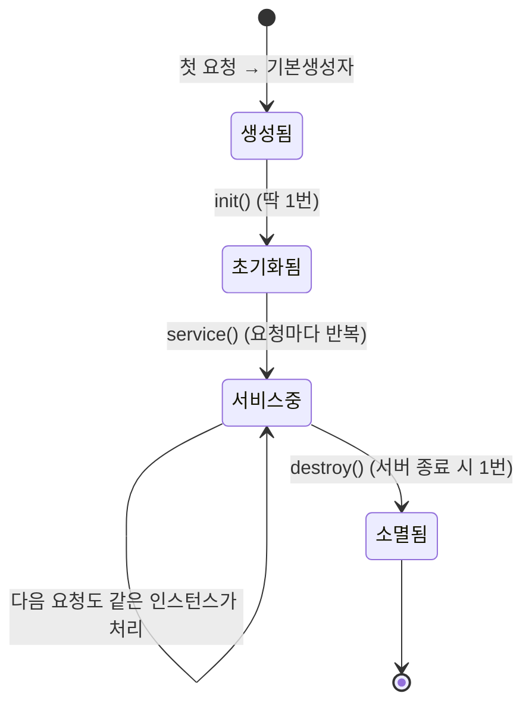

오늘은 Jakarta Servlet의 기초를 배웠다. 서블릿이 어떻게 태어나고 죽는지(생명주기), 요청 방식(GET/POST)에 따라 어떤 메소드가 불리는지, 그리고 그 요청에 담긴 파라미터를 어떻게 꺼내는지까지 세 가지다.

## 1. 서블릿 생명주기 — init, service, destroy

```java
@WebServlet(value = "/life-cycle")
public class LifeCycleServlet extends HttpServlet {

    private int initCount = 1;
    private int serviceCount = 1;
    private int destroyCount = 1;

    public LifeCycleServlet() {
        System.out.println("기본생성자 호출됨...");
    }

    @Override
    public void init(ServletConfig config) throws ServletException {
        System.out.println("init() 호출됨... : " + initCount++);
    }

    @Override
    protected void service(HttpServletRequest req, HttpServletResponse resp) throws ServletException, IOException {
        System.out.println("service() 호출됨... : " + serviceCount++);
    }

    @Override
    public void destroy() {
        System.out.println("destory() 호출됨... : " + destroyCount++);
    }
}
```

`/life-cycle`로 여러 번 요청을 보내 콘솔을 확인해보면, 기본생성자와 `init()`은 **첫 요청에서 딱 한 번만** 찍히고, 요청을 보낼 때마다 찍히는 건 `service()`뿐이었다. 서버를 내릴 때는 `destroy()`가 한 번 찍힌다.

다섯 살 아이에게 설명한다면: "서블릿 하나는 가게 직원 한 명과 같아. 손님이 올 때마다 새 직원을 뽑는 게 아니라, 처음 한 번만 직원을 채용(`init`)해서 그 직원이 손님 한 명 한 명(`service`)을 계속 응대해. 가게 문을 닫을 때가 되어서야 그 직원을 내보내(`destroy`)."




컨테이너(톰캣 등)가 서블릿 인스턴스를 하나만 만들어 재사용한다는 건, 바꿔 말하면 **여러 요청이 같은 인스턴스의 필드를 동시에 건드릴 수 있다**는 뜻이기도 하다. 오늘 코드의 `initCount`, `serviceCount` 같은 인스턴스 필드에 요청별로 다른 값을 담으면 안 되는 이유이기도 하다(동시 요청끼리 서로 덮어쓸 수 있다).

## 2. service() 메소드와 doGet / doPost

`service()`를 직접 오버라이드할 수도 있지만, `HttpServlet`은 이미 `service()` 안에서 HTTP 메소드를 보고 `doGet()`/`doPost()`로 나눠 호출해준다. 그래서 실무에서는 `service()` 대신 `doGet`/`doPost`를 각각 재정의하는 쪽을 쓴다.

```java
@WebServlet(value = "/request-service")
public class ServiceMethodServlet extends HttpServlet {

    @Override
    protected void doGet(HttpServletRequest req, HttpServletResponse resp) throws ServletException, IOException {
        System.out.println("GET 요청을 처리할 메소드 호출됨...");
    }

    @Override
    protected void doPost(HttpServletRequest req, HttpServletResponse resp) throws ServletException, IOException {
        System.out.println("POST 요청을 처리할 메소드 호출됨...");
    }
}
```

`<a href="/request-service">`처럼 `a` 태그의 `href`로 들어오는 요청과, `<form method="get">`으로 들어오는 요청은 둘 다 `doGet()`이 받고, `<form method="post">`는 `doPost()`가 받는다. **URL이 바뀌는 방식의 요청(링크 클릭, 주소창 입력)은 전부 GET**이라는 걸 이 실습으로 확인했다.

## 3. GET과 POST, 뭐가 다른가

| 구분 | GET | POST |
|---|---|---|
| 데이터 위치 | URL(쿼리스트링)에 노출 | Payload(body)에 담겨 전달 |
| 크기 제한 | 대략 200자 내외로 한정적 | 훨씬 큼 |
| 보안 | URL에 그대로 보여 상대적으로 취약 | body에 있어 눈에 직접 안 보임(암호화는 별개) |
| 속도 | 빠름 | 상대적으로 느림 |
| 주 용도 | 조회 | 게시글 등록처럼 데이터 삽입 |

둘 다 데이터를 서버로 보낸다는 점은 같지만, "URL에 실어 보내는가"가 가장 큰 차이였다. 조회처럼 가볍고 반복되는 요청은 GET, 게시글 작성처럼 크고 노출되면 안 되는 데이터는 POST를 쓰는 이유가 여기서 나온다.

## 4. 요청 파라미터 꺼내기

쿼리스트링(GET)으로 들어온 값도, 폼 데이터(POST)로 들어온 값도 받는 방법은 똑같이 `req.getParameter(이름)`이다.

```java
@WebServlet(value = "/querystring")
public class QueryStringServlet extends HttpServlet {

    @Override
    protected void doGet(HttpServletRequest req, HttpServletResponse resp) throws ServletException, IOException {
        // http://localhost:8080/querystring?name=이승빈&age=0&birthday=2026-10-21&gender=M&...
        String name = req.getParameter("name");

        // 모든 URL 파라미터는 String으로 넘어오므로, 다른 타입이 필요하면 직접 파싱해야 한다.
        int age = Integer.parseInt(req.getParameter("age"));
    }
}
```

```java
@WebServlet(value = "/formdata")
public class FormDataServlet extends HttpServlet {
    @Override
    protected void doPost(HttpServletRequest req, HttpServletResponse resp) throws ServletException, IOException {
        String name = req.getParameter("name");
    }
}
```

**`getParameter()`는 타입과 상관없이 전부 `String`을 돌려준다.** `age`처럼 숫자가 필요하면 `Integer.parseInt()`로 직접 바꿔줘야 하고, 값이 아예 없는 파라미터를 파싱하면 `NumberFormatException`이 난다는 점도 실습 중에 확인했다.

```mermaid
flowchart LR
    A["<input name=age>"] --> B["req.getParameter('age')<br/>항상 String"]
    B --> C{"다른 타입이<br/>필요한가?"}
    C -->|예| D["Integer.parseInt()<br/>직접 변환"]
    C -->|아니오| E["String 그대로 사용"]
```



오늘 폼에는 체크박스(`hobbies`)처럼 **같은 이름으로 값이 여러 개 넘어올 수 있는 입력**도 있었다.

```html
<input type="checkbox" name="hobbies" value="movie"> 영화
<input type="checkbox" name="hobbies" value="music"> 음악
<input type="checkbox" name="hobbies" value="sleep"> 취침
```

오늘 코드에서는 `hobbies`를 직접 꺼내보지는 않았는데, `getParameter("hobbies")`로 받으면 **여러 개 중 첫 번째 값 하나만** 돌아온다. 체크박스처럼 값이 여러 개일 수 있는 파라미터는 `req.getParameterValues("hobbies")`로 받아 배열(`String[]`)로 처리해야 한다 — 이 부분은 다음 시간 숙제로 남겨뒀다.

## 오늘의 정리

서블릿은 컨테이너가 인스턴스 하나를 만들어 재사용하면서, `init()`은 처음 한 번, `service()`는 요청마다, `destroy()`는 종료 시 한 번 호출하는 생명주기를 가진다. `service()`는 내부에서 HTTP 메소드를 보고 `doGet`/`doPost`로 나눠주므로 실무에서는 이 둘을 직접 재정의한다. 요청 파라미터는 GET이든 POST든 `getParameter()`로 꺼내지만 항상 `String`이라는 것, 그리고 값이 여러 개일 수 있는 입력(체크박스)은 다른 메소드가 필요하다는 것까지 배웠다.

## 더 학습하면 좋은 개념

- **`getParameterValues()`와 다중값 파라미터** — 오늘 미뤄둔 체크박스 처리. 같은 이름의 값 여러 개를 배열로 받는 법을 다음에 직접 확인해봐야 한다.
- **서블릿의 스레드 안전성(Thread Safety)** — 인스턴스가 하나뿐이라는 것의 위험한 면. 인스턴스 필드에 요청별 상태를 저장하면 안 되는 이유를 동시성 관점에서 더 깊이 볼 필요가 있다.
- **HttpSession** — 한 번의 요청(service 호출 1번)을 넘어서 여러 요청에 걸쳐 사용자 상태를 유지하려면 세션이 필요하다. GET/POST 요청 하나하나는 서로 독립적이라는 오늘 배운 전제와 바로 이어지는 개념이다.
- **web.xml vs `@WebServlet`** — 오늘은 어노테이션으로 URL을 매핑했는데, 어노테이션 없이 배포서술자(`web.xml`)로 매핑하던 방식과 비교해보면 서블릿 컨테이너가 매핑 정보를 읽는 과정이 더 잘 보인다.

## 참고 자료

- [Jakarta Servlet Specification](https://jakarta.ee/specifications/servlet/)
- [Jakarta EE 10 Javadoc - HttpServlet](https://jakarta.ee/specifications/servlet/6.0/apidocs/jakarta/servlet/http/httpservlet)
- [MDN - HTTP request methods: GET](https://developer.mozilla.org/en-US/docs/Web/HTTP/Methods/GET)
- [MDN - HTTP request methods: POST](https://developer.mozilla.org/en-US/docs/Web/HTTP/Methods/POST)
