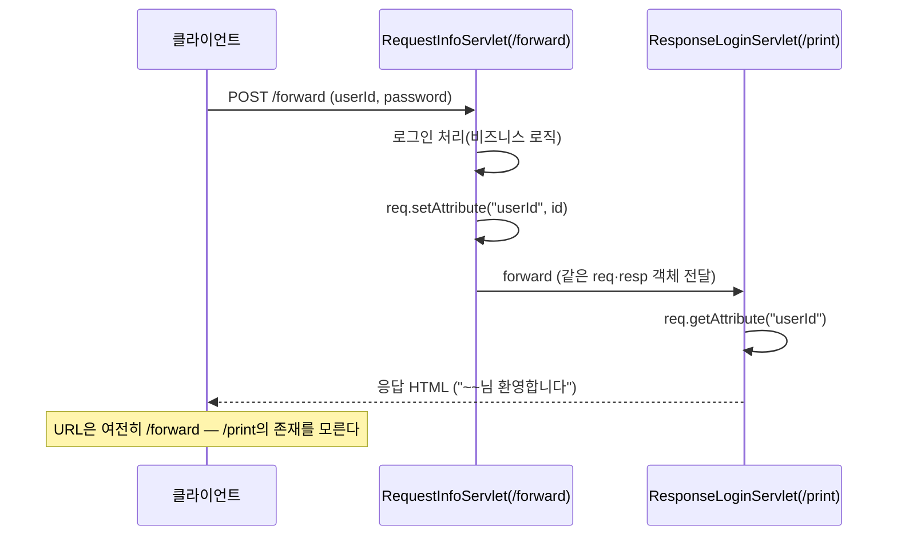

10/21일 서블릿 생명주기와 요청 파라미터를 배웠다면, 오늘은 그 다음 단계 — 응답을 직접 만드는 법, 404·500 에러 페이지를 처리하는 법, 그리고 하나의 서블릿이 너무 많은 책임을 지지 않도록 `forward`로 나누는 법을 배웠다.

## 1. Response로 직접 HTML 만들기

```java
@WebServlet("/response")
public class ResponseServlet extends HttpServlet {
    @Override
    protected void doGet(HttpServletRequest req, HttpServletResponse resp) throws ServletException, IOException {
        StringBuilder response = new StringBuilder();
        response.append("<!doctype html>\n")
                .append("<html>\n<body>\n")
                .append("<h1>Servlet 의 응답 결과!</h1>")
                .append("</body>\n</html>\n");

        PrintWriter out = resp.getWriter();
        out.print(response);
        out.flush();
        out.close();
    }
}
```

서블릿의 역할을 세 가지로 정리했다.

1. **요청 전달받기** — GET/POST에 따라 파라미터로 전달받은 데이터를 꺼낸다.
2. **Controller 역할 수행** — 전달받은 데이터를 Service 계층에 넘긴다.
3. **응답 전달하기** — `HttpServletResponse` 객체로 사용자에게 응답한다.

`resp.setContentType("text/html; charset=UTF-8")`을 매번 서블릿마다 적어야 한글이 안 깨지는데, 이 코드가 "계속 반복되는 코드"라는 주석이 남아 있었다 — 이 반복을 없애는 방법은 다음 시간(필터)에 나온다.

## 2. 예외 처리 — 404·500 에러 페이지

```xml
<!-- WEB-INF/web.xml -->
<error-page>
    <error-code>404</error-code>
    <location>/showerrorpage</location>
</error-page>
<error-page>
    <error-code>500</error-code>
    <location>/showerrorpage</location>
</error-page>
```

```java
@WebServlet("/show404")
public class Show404Servlet extends HttpServlet {
    @Override
    protected void doGet(HttpServletRequest req, HttpServletResponse resp) throws ServletException, IOException {
        resp.sendError(404, "페이지가 없습니다!");
    }
}
```

`resp.sendError(404, ...)`를 호출하면, `web.xml`에 등록해둔 `/showerrorpage`로 요청이 넘어간다. 이때 그 서블릿은 원래 요청 URL과 에러 정보를 속성(attribute)으로 받아서 쓸 수 있었다.

```java
@WebServlet("/showerrorpage")
public class ExceptionServlet extends HttpServlet {
    @Override
    protected void doGet(HttpServletRequest req, HttpServletResponse resp) throws ServletException, IOException {
        String forwardUrl = req.getAttribute("jakarta.servlet.forward.request_uri").toString();
        int statusCode = (int) req.getAttribute("jakarta.servlet.error.status_code");
        String msg = req.getAttribute("jakarta.servlet.error.message").toString();
        // ... statusCode와 msg로 에러 화면을 응답
    }
}
```

이 구조는 사실 **forward 개념 그대로**다. 서블릿 컨테이너가 404/500을 감지하면, 원래 서블릿이 응답한 것처럼 보이게 다른 서블릿(`/showerrorpage`)에게 내부적으로 요청을 넘겨준다. "1개의 서블릿에게 책임이 너무 많아질 때, 다른 서블릿을 만들어서 요청을 받은 서블릿이 응답까지 하는 것처럼 보이게 한다"는 설명이 여기서도 그대로 적용된 것이다.

## 3. Forward로 책임 나누기

로그인 처리를 예로 들어, 비즈니스 로직을 맡는 서블릿과 응답을 맡는 서블릿을 분리했다.

```java
@WebServlet("/forward")
public class RequestInfoServlet extends HttpServlet {
    @Override
    protected void doPost(HttpServletRequest req, HttpServletResponse resp) throws ServletException, IOException {
        String id = req.getParameter("userId");
        // ... 로그인 처리(여기서는 비즈니스 로직만 담당)

        req.setAttribute("userId", id);
        RequestDispatcher rd = req.getRequestDispatcher("/print");
        rd.forward(req, resp);
    }
}
```

```java
@WebServlet("/print")
public class ResponseLoginServlet extends HttpServlet {
    @Override
    protected void doPost(HttpServletRequest req, HttpServletResponse resp) throws ServletException, IOException {
        String id = req.getAttribute("userId").toString();
        // ... "~~님 환영합니다" 라는 HTML 응답
    }
}
```

다섯 살 아이에게 설명한다면: "안내 데스크 직원(RequestInfoServlet)이 손님 응대를 다른 직원(ResponseLoginServlet)에게 몰래 넘기는 거야. 손님은 그 사실을 전혀 몰라. 심지어 메모(요청 정보)까지 그대로 들고 가서 넘겨주니까, 두 번째 직원은 손님이 뭘 원했는지 처음부터 다시 물어볼 필요가 없어."




forward의 핵심 특징 세 가지를 정리했다.

1. **req·resp를 공유한다** — 그래서 `req.setAttribute()`로 넘긴 값을 다음 서블릿이 `req.getAttribute()`로 그대로 받을 수 있다.
2. **클라이언트에게 노출되지 않는다** — URL이 바뀌지 않으므로, 위임받은 서블릿의 존재를 클라이언트는 알 수 없다.
3. **새로고침 시 동일 요청이 반복된다** — 그래서 **조회(SELECT)는 forward로 괜찮지만, DML(INSERT/UPDATE/DELETE)은 forward로 구현하면 안 된다.** 새로고침할 때마다 같은 등록·수정·삭제가 반복 실행될 수 있기 때문이다.

마지막 특징이 오늘 가장 중요한 경고였다 — 이 문제를 어떻게 피하는지는 내일(redirect) 이어진다.

## 오늘의 정리

서블릿의 응답은 결국 `PrintWriter`로 HTML 문자열을 그대로 써서 내려주는 것이었고, 404/500 에러도 사실 컨테이너가 내부적으로 forward를 호출해 처리한다는 걸 알고 나니 forward 개념이 훨씬 명확해졌다. forward는 req·resp를 공유하면서 URL 노출 없이 책임을 나눌 수 있지만, 새로고침 시 요청이 반복된다는 치명적인 단점이 있어서 조회에만 써야 한다는 걸 배웠다.

## 더 학습하면 좋은 개념

- **`RequestDispatcher.include()`** — 오늘 배운 `forward()`는 요청을 완전히 넘기지만, `include()`는 다른 서블릿의 결과를 현재 응답에 포함시키는 방식이다. forward와 무엇이 다른지 비교해보면 좋다.
- **JSP(JavaServerPages)** — 오늘은 `PrintWriter`로 HTML을 문자열로 직접 조립했는데, 실무에서는 HTML과 Java 코드를 섞어 쓰는 JSP나 템플릿 엔진으로 이 부분을 대체한다.
- **HTTP 상태 코드 체계** — 404(Not Found), 500(Internal Server Error) 외에도 4xx/5xx가 의미하는 바가 각각 다르다. 어떤 상황에 어떤 코드를 응답해야 하는지 알아두면 API 설계에도 도움이 된다.
- **서블릿 컨테이너의 에러 핸들링 내부 구현** — `web.xml`의 `<error-page>` 하나로 404/500이 왜 자동으로 forward되는지, 컨테이너(톰캣)가 내부적으로 어떤 디스패처 타입(`ERROR`)을 쓰는지 더 깊이 볼 수 있다.

## 참고 자료

- [Jakarta Servlet Specification](https://jakarta.ee/specifications/servlet/)
- [Jakarta EE 10 Javadoc - RequestDispatcher](https://jakarta.ee/specifications/servlet/6.0/apidocs/jakarta/servlet/requestdispatcher)
- [MDN - HTTP response status codes](https://developer.mozilla.org/en-US/docs/Web/HTTP/Status)
