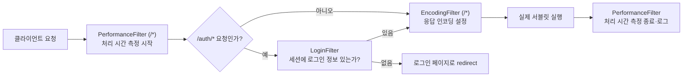

어제(10/22) forward의 가장 큰 단점은 "새로고침하면 같은 요청이 반복돼서 DML이 중복 실행될 수 있다"는 것이었다. 오늘은 그 문제를 redirect로 해결하고, redirect가 잃어버리는 요청 정보를 쿠키·세션으로 보완하고, 마지막으로 필터로 공통 처리를 분리하는 법까지 배웠다.

## 1. Redirect — 새로고침해도 안전하게

```java
@WebServlet("/otherservlet")
public class OtherServlet extends HttpServlet {
    @Override
    protected void doGet(HttpServletRequest req, HttpServletResponse resp) throws ServletException, IOException {
        // 회원가입 로직 동작 (DB에 INSERT)
        System.out.println("회원정보 DB 에 Insert 완료!");
        resp.sendRedirect("/redirect");
    }
}
```

`resp.sendRedirect("/redirect")`는 브라우저에게 "이 주소로 다시 요청해"라고 응답하는 것이다. URL이 강제로 바뀌는 것이라 **a 태그를 클릭하는 것과 같은 효과**를 가지고, 그래서 GET 방식이 된다. 회원가입 같은 INSERT 작업 뒤에 redirect를 하면, 사용자가 결과 화면에서 새로고침을 눌러도 `/redirect`(단순 조회용 주소)만 재요청될 뿐 회원가입 INSERT가 다시 실행되지 않는다.

| 구분 | Forward | Redirect |
|---|---|---|
| req·resp 공유 | 공유한다(같은 객체) | 공유하지 않는다(새 요청) |
| URL 변화 | 없음 (클라이언트가 모름) | 있음 (새 주소로 바뀜) |
| 새로고침 시 | 이전 요청이 반복될 수 있다 | 마지막 요청(GET)만 반복된다 |
| 적합한 상황 | 조회(SELECT), 책임 위임 | INSERT/UPDATE/DELETE 직후 |
| 요청 정보 | 그대로 유지됨 | 사라진다 |

"Redirect는 이전 요청을 아예 모른다는 게 장점이자 단점"이라는 게 핵심이었다. 중복 실행은 막아주지만, 방금 로그인했던 정보조차 다음 요청에서는 사라진다. 이 단점을 보완하려고 등장하는 게 쿠키와 세션이다.

## 2. 쿠키 — 손님이 직접 들고 다니는 메모

```java
@Override
protected void doPost(HttpServletRequest req, HttpServletResponse resp) throws ServletException, IOException {
    String cookieValue = req.getParameter("cookieValue");

    Cookie cookie = new Cookie("userValue", cookieValue);
    cookie.setMaxAge(60 * 60); // 1시간 후 만료

    resp.addCookie(cookie);
    doGet(req, resp);
}

@Override
protected void doGet(HttpServletRequest req, HttpServletResponse resp) throws ServletException, IOException {
    String savedValue = "없음!";
    Cookie[] cookies = req.getCookies();
    if (cookies != null) {
        for (Cookie cookie : cookies) {
            if ("userValue".equals(cookie.getName())) {
                savedValue = cookie.getValue();
                break;
            }
        }
    }
    // savedValue를 화면에 보여주기
}
```

쿠키는 서버가 응답할 때 `resp.addCookie()`로 실어 보내면, 그 이후 같은 브라우저가 보내는 모든 요청에 자동으로 동봉되어 돌아온다. 서버는 `req.getCookies()`로 배열을 받아서 원하는 이름의 값을 직접 찾아야 한다.

## 3. 세션 — 서버가 기억하는 로그인 상태

```java
@Override
protected void doPost(HttpServletRequest req, HttpServletResponse resp) throws ServletException, IOException {
    String userId = req.getParameter("userId");
    String userPwd = req.getParameter("userPwd");

    if (userId != null && !userPwd.isEmpty()) {
        HttpSession session = req.getSession(true); // true: 없으면 새로 생성
        session.setAttribute("loggedInUser", userId);
        session.setAttribute("userPwd", userPwd);
        session.setMaxInactiveInterval(30); // 30초 후 자동 만료
        doGet(req, resp);
    }
}
```

```java
@WebServlet("/expire")
public class ExpireServlet extends HttpServlet {
    @Override
    protected void doGet(HttpServletRequest req, HttpServletResponse resp) throws ServletException, IOException {
        HttpSession session = req.getSession(false); // false: 없으면 null
        if (session != null) {
            session.invalidate(); // 세션 무효화 == 로그아웃
        }
        resp.sendRedirect("/session");
    }
}
```

`req.getSession(true)`는 세션이 없으면 새로 만들고, `req.getSession(false)`는 기존 세션이 없으면 `null`을 돌려준다는 차이를 분명히 짚었다. 로그인처럼 "없으면 만들어야 하는" 상황과, 세션 조회처럼 "있을 때만 꺼내 써야 하는" 상황에서 각각 다르게 써야 한다.

다섯 살 아이에게 설명한다면: "쿠키는 손님이 직접 손에 쥐고 다니는 영수증이야. 가게에 올 때마다 그 영수증을 보여주는 거지. 세션은 달라 — 가게 장부에 손님 정보를 적어두고, 손님한테는 숫자가 적힌 번호표(세션ID)만 줘. 손님은 번호표만 보여주고, 진짜 정보는 가게(서버)만 알고 있어."


| 구분 | 쿠키 | 세션 |
|---|---|---|
| 저장 위치 | 클라이언트(브라우저) | 서버 |
| 보안 | 상대적으로 취약(브라우저에 그대로 노출) | 더 안전(서버에만 실제 값이 있음) |
| 서버 부담 | 거의 없음 | 사용자가 많아지면 서버 메모리 부담 |
| 적합한 용도 | 자동 로그인 체크, 장바구니 등 가벼운 정보 | 로그인 상태처럼 민감하거나 중요한 정보 |

## 4. 필터 — 서블릿에 도달하기 전에 가로채기

어제 반복해서 `resp.setContentType("text/html; charset=UTF-8")`을 적어야 했던 문제가, 오늘 배운 필터로 깔끔하게 해결됐다.

```java
public class EncodingFilter implements Filter {
    private String encodingType;

    @Override
    public void init(FilterConfig filterConfig) {
        encodingType = filterConfig.getInitParameter("encoding-type");
    }

    @Override
    public void doFilter(ServletRequest request, ServletResponse response, FilterChain chain) throws IOException, ServletException {
        response.setContentType(encodingType);
        chain.doFilter(request, response); // 다음 필터 또는 서블릿 호출
    }
}
```

```xml
<filter>
    <filter-name>encoding</filter-name>
    <filter-class>com.wanted.servlet.i_filter.EncodingFilter</filter-class>
    <init-param>
        <param-name>encoding-type</param-name>
        <param-value>text/html; charset=UTF-8</param-value>
    </init-param>
</filter>
<filter-mapping>
    <filter-name>encoding</filter-name>
    <url-pattern>/*</url-pattern>
</filter-mapping>
```

필터는 **HTTP 요청이 서블릿에 도달하기 전에 동작**하고, 등록 방법은 `@WebFilter` 어노테이션 또는 `web.xml` 두 가지다. `/*`로 등록하면 모든 요청에 적용되므로, 어제 서블릿마다 반복하던 인코딩 설정을 한 곳에서 처리할 수 있었다.

```java
@WebFilter("/auth/*")
public class LoginFilter implements Filter {
    @Override
    public void doFilter(ServletRequest request, ServletResponse response, FilterChain chain) throws IOException, ServletException {
        HttpServletRequest req = (HttpServletRequest) request;
        HttpServletResponse resp = (HttpServletResponse) response;

        HttpSession session = req.getSession(false);
        if (session == null || session.getAttribute("loggedInUser") == null) {
            resp.sendRedirect("/h_cookie_session/cookie_session.html");
        } else {
            chain.doFilter(req, resp); // 통과시켜서 서블릿까지 진행
        }
    }
}
```

`LoginFilter`는 `/auth/*`로 시작하는 요청에만 걸려서, 세션에 로그인 정보가 없으면 로그인 페이지로 redirect시키고, 있으면 `chain.doFilter()`로 다음 단계(서블릿)까지 통과시킨다. **`chain.doFilter()`를 호출하지 않으면 요청은 서블릿까지 도달하지 못한다**는 게 핵심이다.



필터 여러 개가 등록되면, 요청이 들어올 때는 등록된 순서대로 하나씩 거치고(`chain.doFilter()`로 다음 필터 호출), 서블릿 처리가 끝나면 그 호출 스택을 역순으로 되감아 나온다 — 그래서 `PerformanceFilter`는 `chain.doFilter()` 앞뒤로 시간을 재서 전체 처리 시간을 측정할 수 있었다.

## 오늘의 정리

Forward의 "새로고침하면 DML이 반복된다"는 문제를 redirect로 해결했고, 그 대신 redirect가 잃어버리는 요청 정보를 쿠키(클라이언트 보관)와 세션(서버 보관)으로 나눠서 보완한다는 걸 배웠다. 그리고 서블릿마다 반복되던 공통 처리(인코딩, 로그인 체크, 처리 시간 측정)는 필터로 빼서, 서블릿에 도달하기 전/후에 한 번에 처리할 수 있다는 것까지 이어졌다. 결국 오늘 배운 네 가지(redirect·쿠키·세션·필터)는 전부 "forward 하나로는 부족했던 부분"을 각자 다른 방식으로 채워주는 도구들이었다.

## 더 학습하면 좋은 개념

- **PRG 패턴(Post-Redirect-Get)** — 오늘 배운 "INSERT 후 redirect"가 바로 이 패턴의 정석적인 사례다. 공식 이름과 함께 왜 이 패턴이 표준으로 자리잡았는지 찾아보면 좋다.
- **쿠키의 보안 옵션(`HttpOnly`, `Secure`, `SameSite`)** — 오늘은 `setMaxAge()`만 다뤘는데, 쿠키가 탈취당하는 걸 막는 추가 옵션들이 있다. 자동 로그인 기능을 만든다면 꼭 알아야 하는 내용이다.
- **세션과 확장성(Scale-out)** — 세션은 서버 메모리에 저장되는데, 서버가 여러 대로 늘어나면 어느 서버에 세션이 있는지가 문제가 된다. Redis 같은 외부 저장소로 세션을 공유하는 방식(Session Clustering)으로 이어지는 주제다.
- **JWT(JSON Web Token)와 Stateless 인증** — 세션은 서버가 상태를 "기억"해야 하는데, JWT는 토큰 자체에 정보를 담아 서버가 아무것도 기억하지 않아도 되게 한다. 세션 방식과의 차이를 비교해보면 좋다.
- **필터 vs 인터셉터(Interceptor)** — 오늘 배운 필터는 서블릿 컨테이너 레벨의 공통 처리였는데, Spring에는 더 세밀하게 제어할 수 있는 인터셉터라는 비슷한 개념이 따로 있다. 10/26일 배운 Spring과 이어지는 다음 주제다.

## 참고 자료

- [Jakarta Servlet Specification](https://jakarta.ee/specifications/servlet/)
- [MDN - Using HTTP cookies](https://developer.mozilla.org/en-US/docs/Web/HTTP/Cookies)
- [Jakarta EE 10 Javadoc - Filter](https://jakarta.ee/specifications/servlet/6.0/apidocs/jakarta/servlet/filter)
