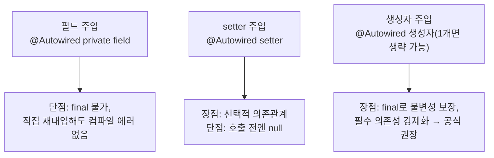

오늘부터 Spring을 배우기 시작했다. 결제 시스템(카카오페이/네이버페이) 예제 하나로 "왜 IoC 컨테이너가 필요한지"부터 "의존성 주입(DI) 세 가지 방법"까지 한 번에 이어서 배웠다.

## 1. 문제 상황 — new로 직접 객체를 만들면

```java
public class PaymentService {
    private KakaoPayGateway kakaoPayGateway;

    public PaymentService() {
        this.kakaoPayGateway = new KakaoPayGateway();
    }

    public boolean processPay(String orderId, int amount) {
        boolean result = kakaoPayGateway.pay(orderId, amount);
        // ...
        return result;
    }
}
```

`PaymentService`가 생성자 안에서 `KakaoPayGateway`를 직접 `new`한다. 여기서 두 가지 문제가 바로 드러났다.

1. **요구사항이 바뀌면 구현체를 직접 고쳐야 한다** — 네이버페이로 바꾸려면 `PaymentService` 코드 자체를 수정해야 한다.
2. **메소드 이름이나 매개변수가 다르면 전부 수정해야 한다** — 실제로 `KakaoPayGateway.pay(String, int)`와 `NaverPayGateway.pay(String, double)`은 매개변수 타입부터 다르다.

이 두 문제는 SOLID 원칙 중 **"개방-폐쇄 원칙(OCP)"** 위반이라고 부른다 — 소프트웨어는 확장에는 열려 있어야 하고, 변경에는 닫혀 있어야 하는데, 지금은 구현체 하나를 바꾸는 데 여러 코드를 고쳐야 하는 상태다.

## 2. IoC 컨테이너로 해결하기

가장 먼저 한 일은 `PaymentInterface`를 만들어 "메소드 이름·매개변수가 다른" 문제부터 없애는 것이었다.

```java
public interface PaymentInterface {
    boolean processPay(String orderId, int amount);
}
```

그 다음, `PaymentService`가 더 이상 구현체를 직접 `new`하지 않고 **생성자로 받도록** 바꿨다.

```java
public class PaymentService {
    private final PaymentInterface paymentInterface;

    public PaymentService(PaymentInterface paymentInterface) {
        this.paymentInterface = paymentInterface;
    }
    // ...
}
```

그런데 이러면 "그럼 누가 `new PaymentService(new KakaoPayGateway())`를 해주는가"라는 질문이 남는다. 그 역할을 **Spring의 IoC 컨테이너**가 대신한다.

```java
@Configuration
public class AppConfig {
    @Bean
    public KakaoPayGateway kakaoPayGateway() {
        return new KakaoPayGateway();
    }

    @Bean
    public PaymentService paymentService() {
        return new PaymentService(naverPayGateway());
    }
}
```

```java
ApplicationContext context = new AnnotationConfigApplicationContext(AppConfig.class);
PaymentService paymentService = context.getBean("paymentService", PaymentService.class);
```

**IoC Container == ApplicationContext == BeanFactory, 셋 다 같은 말**이라는 걸 먼저 짚었다. `AppConfig`에 `@Bean`으로 등록해둔 객체(Bean)들을 컨테이너가 미리 만들어서 가지고 있다가, `getBean()`을 호출하면 이미 조립이 끝난 객체를 꺼내준다.

다섯 살 아이에게 설명한다면: "예전에는 내가 직접 장을 봐서 요리를 했어(`new`). 이제는 주방장(스프링 컨테이너)이 미리 요리를 다 만들어서 선반에 올려두고, 나는 '그 요리 주세요(`getBean`)'라고만 하면 돼. 어떤 재료로 만들었는지는 더 이상 내가 신경 쓸 필요가 없어."


객체를 생성하고 연결하는 **제어권이 개발자에서 컨테이너로 넘어간다**는 뜻에서 이걸 **제어의 역전(IoC, Inversion of Control)**이라고 부른다는 것도 이제 이름과 실체가 맞춰졌다.

## 3. Bean은 기본적으로 Singleton이다

```java
@Bean("single")
@Scope("singleton")
public PaymentService paymentService() { return new PaymentService(naverPayGateway()); }

@Bean("proto")
@Scope("prototype")
public PaymentService paymentService2() { return new PaymentService(naverPayGateway()); }
```

```java
PaymentService single = context.getBean("single", PaymentService.class);
single.processPay("order-001", 3);
PaymentService single2 = context.getBean("single", PaymentService.class);
// single과 single2는 orderId가 같다 — 같은 인스턴스를 공유하기 때문
```

| Scope | 특징 |
|---|---|
| singleton (기본값) | 컨테이너 안에 **동일한 Bean 인스턴스 1개**만 존재, 여러 곳에서 공유 |
| prototype | `getBean()`을 호출할 때마다 **새 인스턴스**를 생성 |

여기서 수업이 강하게 경고한 부분이 있었다. **Bean이 상태(필드값)를 가지면, 그 필드를 모든 요청이 공유하게 된다.** 그래서 Service·DAO 같은 Bean에는 행위(메소드)만 담당하게 하고, 요청별로 달라지는 데이터는 필드가 아니라 DTO로 주고받아야 한다. 10/21일 배운 "서블릿 인스턴스는 하나만 만들어져 모든 요청이 재사용한다"는 것과 정확히 같은 구조였다 — Spring Bean도 기본적으로 싱글톤이라, 똑같은 이유로 인스턴스 필드에 요청별 상태를 저장하면 안 된다.

## 4. Bean이 100개라면? — 컴포넌트 스캔

`AppConfig`에 `@Bean` 메소드를 하나씩 적는 방식은 Bean이 몇 개 안 될 땐 괜찮지만, **"Bean이 100개라면?"**이라는 질문 앞에서 한계가 드러났다. 해결책은 `@Component` 계열 어노테이션 + `@ComponentScan`이다.

```java
@Service
public class PaymentService { /* ... */ }

@Component
public class NaverPayGateway implements PaymentInterface { /* ... */ }
```

```java
@Configuration
@ComponentScan(basePackages = "com.wanted.di.section01")
public class AppConfig { }
```

`@ComponentScan`은 지정한 패키지에서 `@Component` 계열 어노테이션이 붙은 클래스를 전부 찾아 자동으로 Bean으로 등록해준다. `basePackages`를 지정하지 않으면 `@ComponentScan`이 붙은 클래스와 같은 패키지 레벨까지만 스캔하고, 특정 클래스·어노테이션·정규표현식으로 스캔 대상에서 **제외**하고 싶을 땐 `excludeFilters`를 쓸 수 있다는 것도 확인했다.

## 5. 의존성 주입(DI), 세 가지 방법

DI(Dependency Injection)는 "개발자가 직접 객체 간 결합을 관리하는 게 아니라, IoC 컨테이너가 자동으로 의존성을 주입해주는 것"이다. 오늘은 같은 결제 로직을 세 가지 주입 방식으로 각각 짜봤다.



| 방식 | 코드 | 장점 | 단점 |
|---|---|---|---|
| 필드 주입 | `@Autowired private PaymentInterface paymentInterface;` | 코드가 짧다 | `final` 불가, 필드에 직접 `new`를 대입해도 컴파일 에러가 안 남 |
| setter 주입 | `@Autowired public void setPaymentInterface(...)` | 선택적 의존관계를 가질 수 있다 | `final` 불가, setter가 호출되지 않으면 `null`인 상태로 남는다 |
| 생성자 주입 | `@Autowired public PaymentServiceConstructor(PaymentInterface p) { this.paymentInterface = p; }` | `final`로 불변성 보장, 필수 의존성을 생성 시점에 강제화 | 생성자 매개변수가 많아지면 코드가 길어 보일 수 있다 |

생성자 주입은 생성자가 하나뿐이면 `@Autowired`를 생략해도 자동으로 주입된다는 점도 눈에 띄었다. 세 방식 중 **생성자 주입이 Spring 공식 권장 방식**이라고 배웠는데, `final` 필드는 선언과 동시에(또는 생성자에서) 반드시 초기화해야 하므로 "이 의존성이 없으면 아예 객체를 만들 수 없다"는 걸 컴파일 시점에 강제할 수 있기 때문이다.

## 오늘의 정리

문제는 `new`로 직접 객체를 만들면 구현체를 바꿀 때마다 코드를 고쳐야 한다는 것(OCP 위반)이었고, 해결은 인터페이스로 "무엇을 할 수 있는지"만 약속해두고, 객체를 만들고 연결하는 일 자체를 IoC 컨테이너에게 넘기는 것이었다. Bean은 기본적으로 싱글톤이라 상태를 필드에 두면 안 된다는 것, Bean이 많아지면 `@ComponentScan`으로 자동 등록한다는 것, 그리고 의존성을 주입하는 세 가지 방법 중 생성자 주입이 왜 권장되는지까지 — 전부 "객체를 누가, 언제, 어떻게 만드는가"라는 하나의 질문에서 출발한 내용들이었다.

## 더 학습하면 좋은 개념

- **`@Component`, `@Service`, `@Repository`, `@Controller`의 차이** — 오늘은 기능적으로 전부 같은 `@Component`의 특수한 형태라고만 배웠는데, 계층별로 이름을 다르게 붙이는 관례적 의미와 각 어노테이션에 붙은 부가 기능(예: `@Repository`의 예외 변환)을 더 깊이 볼 필요가 있다.
- **Bean 생명주기 콜백 (`@PostConstruct`/`@PreDestroy`)** — 10/21일 배운 서블릿의 `init()`/`destroy()`와 정확히 대응되는 개념이다. Bean이 생성된 직후와 소멸되기 직전에 실행할 코드를 어떻게 지정하는지 알아두면 좋다.
- **순환 참조(Circular Dependency)** — 생성자 주입은 안전하지만, A가 B를 주입받고 B가 다시 A를 주입받는 구조에서는 오히려 에러로 바로 드러난다는 점이 필드 주입과 다르다. 왜 그런지 직접 겪어보면 생성자 주입의 장점이 더 명확해진다.
- **Spring Boot의 자동 설정** — 오늘은 `AppConfig`에 `@ComponentScan`을 직접 선언했는데, Spring Boot에서는 `@SpringBootApplication` 하나로 이 설정이 자동으로 켜진다. 그 안에서 실제로 무슨 일이 일어나는지 알아두면 "마법처럼" 느껴지던 부분이 풀린다.

## 참고 자료

- [Spring Framework Reference - The IoC Container](https://docs.spring.io/spring-framework/reference/core/beans.html)
- [Spring Framework Reference - Dependency Injection](https://docs.spring.io/spring-framework/reference/core/beans/dependencies.html)
- [Spring Framework Reference - Bean Scopes](https://docs.spring.io/spring-framework/reference/core/beans/factory-scopes.html)
