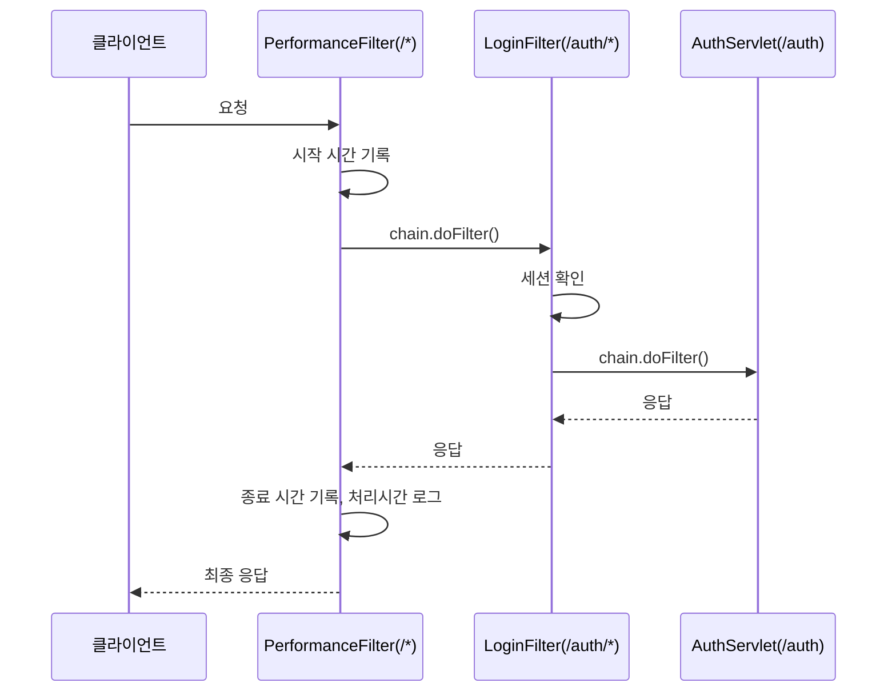

서블릿·필터 수업(10/21~10/23)을 들으면서 그 자리에서는 넘어갔지만 계속 걸렸던 부분들이 있었다. 메모해뒀던 질문 8개를 순서대로 다시 짚어본다.

## Q1. 요청 하나가 들어오면 어떤 일이 순차적으로 일어나는 거지?

필터가 여러 개 등록되어 있으면, 요청은 등록된 순서대로 필터를 하나씩 통과한 다음에야 서블릿에 도달한다. 그리고 서블릿 처리가 끝나면, 그 필터들을 역순으로 다시 거쳐서 응답이 되돌아간다.



이 "순서"가 바로 Q4~Q6의 NPE 문제, Q7~Q8의 필터 등록과 전부 연결된다.

## Q2. GET 방식의 /cookie는 뭘 하는 거지?

```java
@Override
protected void doPost(HttpServletRequest req, HttpServletResponse resp) throws ServletException, IOException {
    String cookieValue = req.getParameter("cookieValue");
    Cookie cookie = new Cookie("userValue", cookieValue);
    cookie.setMaxAge(60 * 60);
    resp.addCookie(cookie);
    doGet(req, resp); // POST 처리 후 doGet을 그대로 호출!
}

@Override
protected void doGet(HttpServletRequest req, HttpServletResponse resp) throws ServletException, IOException {
    // 저장된 쿠키 값을 찾아서 화면에 보여주기
}
```

폼(`<form method="post">`)을 제출하면 POST로 `/cookie`에 요청이 가서 `doPost()`가 쿠키를 새로 설정한다. 그런데 그 안에서 `doGet(req, resp)`를 **직접 호출**해서, 쿠키를 보여주는 화면 로직을 재사용하고 있었다. 반대로 주소창에 `/cookie`를 직접 입력해서 들어가면(=GET 요청) `doPost()`를 거치지 않고 `doGet()`만 바로 호출되어서, **새로 설정하지 않고 이미 저장되어 있던 쿠키 값만 보여준다.** 같은 화면을 두 가지 경로(POST 후, 또는 GET 직접 방문)로 모두 보여주기 위한 구조였다.

## Q3. doGet이 정확히 뭐였지?

10/21일 배운 내용과 이어진다. `HttpServlet`의 `service()`는 요청이 GET인지 POST인지를 보고 내부에서 `doGet()` 또는 `doPost()`를 자동으로 호출해준다. 즉 `doGet()`은 **"GET 요청이 들어왔을 때 실행될 코드"**를 적어두는 자리이고, 우리가 직접 호출할 필요 없이 컨테이너가 알아서 불러준다. (다만 Q2처럼, 코드 안에서 개발자가 직접 `doGet(req, resp)`를 호출해서 재사용하는 것도 가능하다 — 이건 컨테이너가 호출하는 것과 별개로, 그냥 일반 메서드 호출일 뿐이다.)

## Q4. "널 포인트 인셉션"이 뭐야?

**NullPointerException(NPE)**을 말하는 거였다. 참조 변수가 `null`인 상태에서 그 변수의 메서드나 필드에 접근하려고 할 때 발생하는 대표적인 런타임 예외다. 컴파일 타임에는 안 걸러지고, 실제로 그 코드가 실행되는 순간에만 터진다는 게 핵심이다.

## Q5. 명시적 형변환은 왜 하는 거지?

```java
// 캐스트 연산자(형변환 연산자)를 사용하는 것이 안정적
String existUser = (String) session.getAttribute("loggedInUser");
```

`session.getAttribute()`는 어떤 타입이든 담을 수 있도록 `Object` 타입을 반환한다. 우리는 그 값이 실제로는 `String`이라는 걸 알고 있으니, `(String)`으로 명시적 형변환을 해줘야 `String`의 메서드(`.equals()` 등)를 바로 쓸 수 있다. 형변환을 안 하면 컴파일 에러가 나므로, 이건 "안 해도 되는데 안정성을 위해 하는 것"이 아니라 **Object로 저장된 값을 원래 타입으로 꺼내 쓰기 위해 반드시 필요한 과정**이었다.

## Q6. 널포인터를 참조하면 왜 500번이 뜨는 거야?

```java
@WebServlet("/auth")
public class AuthServlet extends HttpServlet {
    @Override
    protected void doGet(HttpServletRequest req, HttpServletResponse resp) throws ServletException, IOException {
        HttpSession session = req.getSession(false); // 세션 없으면 null
        String existUser = (String) session.getAttribute("loggedInUser"); // session이 null이면 바로 NPE!
        // ...
    }
}
```

`req.getSession(false)`는 세션이 없으면 **새로 만들지 않고 그냥 `null`을 돌려준다.** 만약 로그인하지 않은 상태로 이 코드에 도달하면, `session` 변수 자체가 `null`이 되고, 그 다음 줄 `session.getAttribute(...)`가 "null인 변수의 메서드를 호출"하려다 **NullPointerException**이 터진다. 서블릿 코드 안에서 예외가 처리되지 않고 그대로 터지면, 서블릿 컨테이너는 이걸 **500 Internal Server Error**로 변환해서 클라이언트에게 응답한다.


10/22일 배운 `Show500Servlet`의 `resp.sendError(500, ...)`은 **의도적으로** 500을 응답한 경우였다면, 이건 **의도치 않은** 예외가 결과적으로 500으로 이어진 경우라는 차이가 있다. 그리고 이 문제를 막는 역할이 바로 다음 질문(Q7, Q8)의 필터다.

## Q7. 필터는 어떻게 등록하는 거였지?

두 가지 방법이 있었다.

```java
// 1. 어노테이션 방식
@WebFilter("/auth/*")
public class LoginFilter implements Filter { ... }
```

```xml
<!-- 2. web.xml 방식 -->
<filter>
    <filter-name>encoding</filter-name>
    <filter-class>com.wanted.servlet.i_filter.EncodingFilter</filter-class>
</filter>
<filter-mapping>
    <filter-name>encoding</filter-name>
    <url-pattern>/*</url-pattern>
</filter-mapping>
```

`@WebFilter`가 더 간단하지만, 초기화 파라미터(`init-param`)처럼 외부에서 값을 주입해야 하는 경우엔 `web.xml` 방식을 쓰기도 한다(실제로 `EncodingFilter`는 `encoding-type` 값을 `web.xml`의 `init-param`으로 받고 있었다).

## Q8. 필터가 가장 먼저 시작한다는 게 무슨 말이야?

필터는 **HTTP 요청이 서블릿에 도달하기 전에** 동작한다. `PerformanceFilter`는 `/*`로 등록되어 있어서 모든 요청에 대해 서블릿보다 먼저 실행되고, `LoginFilter`는 `/auth/*`로 등록되어 있어서 `/auth`로 시작하는 요청에서만 서블릿보다 먼저 실행된다.

```java
@WebFilter("/auth/*")
public class LoginFilter implements Filter {
    @Override
    public void doFilter(ServletRequest request, ServletResponse response, FilterChain chain) throws IOException, ServletException {
        HttpServletRequest req = (HttpServletRequest) request;
        HttpServletResponse resp = (HttpServletResponse) response;

        HttpSession session = req.getSession(false);
        if (session == null || session.getAttribute("loggedInUser") == null) {
            resp.sendRedirect("/h_cookie_session/cookie_session.html"); // 서블릿까지 가지 못함
        } else {
            chain.doFilter(req, resp); // 통과해야만 AuthServlet에 도달
        }
    }
}
```

바로 이 필터가 "세션이 없거나 로그인 정보가 없으면" 아예 `AuthServlet`까지 가지도 못하게 중간에서 걸러준다. 다시 말해 **Q6의 NPE는, 만약 LoginFilter가 먼저 걸러주지 않았다면 실제로 터졌을 상황**이다. 필터가 "가장 먼저 시작한다"는 말은, 서블릿이 위험한 코드를 실행하기 전에 미리 안전 장치를 걸어둔다는 뜻이었다.

## 오늘의 정리

여덟 개 질문이 전부 하나로 이어져 있었다. 요청은 필터들을 순서대로 통과한 뒤에야 서블릿에 도달하고(Q1, Q7, Q8), `doGet`/`doPost`는 그 요청 방식에 따라 자동으로 호출되는 메서드다(Q2, Q3). 그리고 `session.getAttribute()`처럼 `Object`를 돌려주는 메서드는 명시적 형변환이 필요하고(Q5), 그 값을 돌려줄 변수 자체가 `null`일 수 있다는 걸 놓치면 NullPointerException이 터지고(Q4, Q6), 그 예외가 처리되지 않으면 500 에러로 이어진다. 결국 `LoginFilter`가 서블릿보다 먼저 실행되며 그 위험한 상황 자체를 차단해주고 있었던 것이다.

## 더 학습하면 좋은 개념

- **`Optional<T>`** — `getAttribute()`처럼 값이 없을 수도 있는 메서드를 다룰 때, `null` 체크 대신 `Optional`로 감싸서 더 안전하게 처리하는 방법을 배워두면 좋다.
- **체크 예외(Checked) vs 언체크 예외(Unchecked)** — `NullPointerException`은 언체크 예외라 컴파일러가 처리를 강제하지 않는다. `IOException` 같은 체크 예외와 무엇이 다른지 비교해보면 좋다.
- **스택 트레이스(Stack Trace) 읽는 법** — NPE가 터졌을 때 콘솔에 찍히는 긴 에러 로그에서, 실제로 문제가 발생한 줄을 빠르게 찾는 법을 익혀두면 디버깅 속도가 크게 빨라진다.
- **HTTP 상태 코드 체계 전체** — 오늘 다룬 500 말고도 4xx(클라이언트 잘못)와 5xx(서버 잘못)의 구분, 그리고 각 코드가 어떤 상황에 쓰이는지 정리해두면 API를 만들 때 바로 쓸 수 있다.

## 참고 자료

- [Oracle Javadoc - NullPointerException](https://docs.oracle.com/en/java/javase/21/docs/api/java.base/java/lang/NullPointerException.html)
- [Jakarta EE 10 Javadoc - HttpSession](https://jakarta.ee/specifications/servlet/6.0/apidocs/jakarta/servlet/http/httpsession)
- [MDN - 500 Internal Server Error](https://developer.mozilla.org/en-US/docs/Web/HTTP/Status/500)
