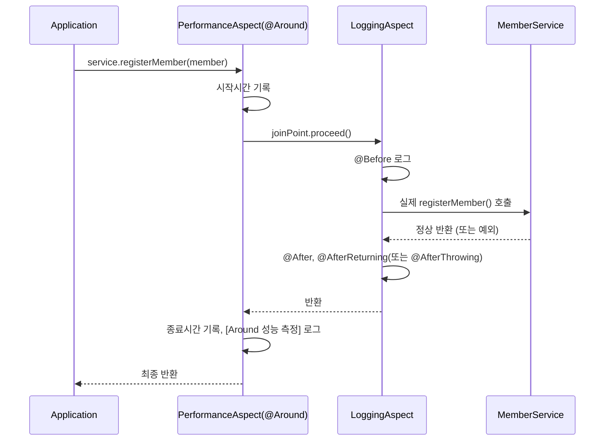

10/26일 IoC·DI를 배우면서 "다음 단계로 AOP를 보면 좋다"고 메모해뒀는데, 오늘 바로 AOP를 배웠다. 회원 관리 프로그램(가입·조회·비밀번호 변경·탈퇴) 예제로, 모든 메서드에 반복되던 로깅·성능측정 코드를 어떻게 분리하는지 봤다.

## 1. 문제 상황 — 모든 메서드에 반복되는 코드

```java
public void registerMember(MemberDTO member) {
    // 성능 측정 시작 - 횡단 관심사 #1
    long startTime = System.currentTimeMillis();
    try {
        // 로깅 - 횡단 관심사 #2
        System.out.println("[로그] 회원 가입 시작: " + member.getEmail());
        // 트랜잭션 시작 (의사코드) - 횡단 관심사 #3

        // ----- 핵심 비즈니스 로직 시작 -----
        if (member.getEmail() == null || member.getEmail().isEmpty()) {
            throw new IllegalArgumentException("이메일은 필수입니다.");
        }
        // ... 유효성 검증, 중복 확인, 저장
        // ----- 핵심 비즈니스 로직 종료 -----

        System.out.println("[로그] 회원 가입 성공: " + member.getEmail());
    } catch (Exception e) {
        System.out.println("[로그] 회원 가입 실패: " + e.getMessage());
        throw e;
    } finally {
        long endTime = System.currentTimeMillis();
        System.out.println("[성능] 회원 가입 처리 시간: " + (endTime - startTime) + "ms");
    }
}
```

회원가입·조회·비밀번호변경·탈퇴 **네 메소드 전부**에 성능측정·로깅·트랜잭션(의사코드) 코드가 똑같이 반복돼 있었다. 세 가지 문제로 정리됐다.

1. **코드 중복** — 모든 메소드마다 로깅·성능측정·트랜잭션 관리 코드가 반복된다.
2. **낮은 응집도** — 각 메소드가 핵심 비즈니스 로직 외의 다른 일까지 함께 처리한다.
3. **유지보수의 어려움** — 로그 양식이나 성능 측정 기준이 바뀌면, 여러 메소드 내부를 전부 고쳐야 한다.

이렇게 여러 곳에 걸쳐 반복되는, 핵심 로직과는 무관한 코드를 **횡단 관심사(Cross-cutting Concern)**라고 부른다는 걸 오늘 처음 배웠다.

## 2. AOP로 관심사 분리하기

**AOP(Aspect-Oriented Programming, 관점 지향 프로그래밍)**는 이 횡단 관심사를 핵심 비즈니스 로직에서 떼어내, 별도의 클래스(Aspect)로 모아두고 필요한 시점에 자동으로 "끼워 넣는" 방식이다.

```java
// AOP 적용 후 — 핵심 로직만 남는다
public void registerMember(MemberDTO member) {
    if (member.getEmail() == null || member.getEmail().isEmpty()) {
        throw new IllegalArgumentException("이메일은 필수입니다.");
    }
    if (member.getPassword() == null || member.getPassword().length() < 8) {
        throw new IllegalArgumentException("비밀번호는 8자 이상이어야 합니다.");
    }
    if (memberRepository.containsKey(member.getEmail())) {
        throw new IllegalArgumentException("이미 등록된 이메일입니다: " + member.getEmail());
    }
    memberRepository.put(member.getEmail(), member);
    System.out.println("회원 정보 저장 완료: " + member.getEmail());
}
```

로깅·성능측정 코드가 전부 사라지고, 회원가입이라는 본래 목적에만 집중하는 코드만 남았다.

다섯 살 아이에게 설명한다면: "요리사(`MemberService`)는 요리(비즈니스 로직)만 하면 돼. 손 씻기, 타이머 재기, 뒷정리 같은 건 요리사가 매번 직접 안 해도, 옆에서 도와주는 보조(Aspect)가 요리 앞뒤로 알아서 해줘. 요리사는 '내가 손 씻었나' 신경 쓸 필요가 없어."


## 3. AOP 핵심 용어

| 용어 | 의미 |
|---|---|
| Aspect | 횡단 관심사를 모듈화한 것. `@Aspect`가 붙은 클래스 |
| Advice | **언제, 무엇을** 할지. `@Before`, `@After`, `@AfterReturning`, `@AfterThrowing`, `@Around` |
| PointCut | **어디에** 적용할지. `execution(...)` 표현식으로 지정 |
| JoinPoint | Advice가 적용되는 지점(대상 메소드)에 대한 정보를 담은 객체 |

## 4. Advice 다섯 가지

```java
@Component
@Aspect
public class LoggingAspect {

    @Before("execution(* com.wanted.aop.section02.MemberService.*(..))")
    public void logBefore(JoinPoint joinPoint) {
        String methodName = joinPoint.getSignature().getName();
        System.out.println("[Before 로그] " + methodName + " 메서드 실행 시작됨, 매개변수: " + joinPoint.getArgs());
    }

    @After("execution(* com.wanted.aop.section02.MemberService.*(..))")
    public void logAfter(JoinPoint joinPoint) {
        System.out.println("[After 로그] " + joinPoint.getSignature().getName() + " 메서드 실행 완료!");
    }

    @AfterReturning(pointcut = "execution(* com.wanted.aop.section02.MemberService.*(..))", returning = "result")
    public void logAfterReturning(JoinPoint joinPoint, Object result) {
        System.out.println("[AfterReturn 로그] " + joinPoint.getSignature().getName() + " 정상 종료, 반환값: " + result);
    }

    @AfterThrowing(pointcut = "execution(* com.wanted.aop.section02.MemberService.*(..))", throwing = "exception")
    public void logAfterThrowing(JoinPoint joinPoint, Exception exception) {
        System.out.println("[AfterThrowing 로그] " + joinPoint.getSignature().getName() + " 실행 중 예외 발생: " + exception.getMessage());
    }
}
```

```java
@Component
@Aspect
@Order(1)
public class PerformanceAspect {

    @Around("execution(* com.wanted.aop.section02.MemberService.*(..))")
    public Object performance(ProceedingJoinPoint joinPoint) {
        long startTime = System.currentTimeMillis();
        try {
            return joinPoint.proceed(); // 이걸 호출해야 실제 대상 메서드가 실행된다!
        } catch (Throwable e) {
            throw new RuntimeException(e);
        } finally {
            long endTime = System.currentTimeMillis();
            System.out.println("[Around 성능 측정] " + joinPoint.getSignature().getName() + " 실행 시간: " + (endTime - startTime) + "(ms)");
        }
    }
}
```

| Advice | 실행 시점 |
|---|---|
| `@Before` | 대상 메소드 실행 **전** |
| `@After` | 대상 메소드 실행 **후** (성공·실패 상관없이) |
| `@AfterReturning` | 정상적으로 **값을 반환한 후** |
| `@AfterThrowing` | **예외가 발생했을 때** |
| `@Around` | 실행 전/후를 **직접 제어** — 가장 강력한 Advice |

`@Around`는 `ProceedingJoinPoint.proceed()`를 직접 호출해야 그 안쪽의 실제 대상 메소드가 실행된다는 게 중요했다 — `proceed()`를 안 부르면 `MemberService`의 메소드 자체가 아예 실행되지 않는다. `PerformanceAspect`에 붙은 `@Order(1)`은, 여러 Aspect가 같은 메소드에 동시에 적용될 때 **어떤 Aspect가 가장 바깥쪽을 감싸는지(먼저 시작하고 나중에 끝나는지)** 순서를 정하는 어노테이션이다.

## 5. PointCut 표현식 뜯어보기

```
execution(* com.wanted.aop.section02.MemberService.*(..))
```

```
execution( 접근제어자 반환타입 패키지.클래스.메서드(파라미터) )
```

| 문법 | 의미 |
|---|---|
| `*` | 반환 타입·메소드 이름 등 아무 값이나 허용 |
| `클래스.*(..)` | 그 클래스 내부의 **모든 메소드** |
| `(..)` | 매개변수 0개 이상(아무 매개변수) |
| `()` | 매개변수가 없는 메소드 |
| `(String)` | 매개변수가 `String` 1개인 메소드 |
| `(String, ..)` | 첫 번째 매개변수는 `String`, 나머지는 무관 |

오늘 쓴 `execution(* com.wanted.aop.section02.MemberService.*(..))`는 "`MemberService` 안의 모든 메소드"에 적용하라는 뜻이었다.

## 6. AOP를 켜는 설정

```java
@Configuration
@ComponentScan("com.wanted.aop.section02")
@EnableAspectJAutoProxy
public class AppConfig {
}
```

`@EnableAspectJAutoProxy`를 빼먹으면, 클래스에 `@Aspect`를 붙여도 **아무 일도 일어나지 않는다.** 이 설정이 있어야 Spring이 대상 Bean을 프록시로 감싸서 Aspect를 실제로 적용해준다.

## 7. 실행 흐름



| 구분 | AOP 적용 전 | AOP 적용 후 |
|---|---|---|
| `MemberService`의 메소드 | 로깅·성능측정·트랜잭션 코드까지 전부 포함 | 핵심 비즈니스 로직만 |
| 로그 양식을 바꿔야 할 때 | 메소드마다 전부 수정 | `LoggingAspect` 하나만 수정 |
| 존재하지 않는 회원 조회(예외 상황) | `catch` 블록 안에 로깅이 비즈니스 로직과 섞여 있음 | `@AfterThrowing`이 자동으로 예외 로그를 처리 |

## 오늘의 정리

여러 메소드에 똑같이 반복되던 로깅·성능측정 코드는 **횡단 관심사**였고, AOP는 이걸 `@Aspect` 클래스로 뽑아내 `PointCut`(어디에)과 `Advice`(언제·무엇을)로 선언해두면 Spring이 알아서 핵심 로직 앞뒤로 끼워 넣어준다는 걸 배웠다. `@Around`가 `proceed()`를 직접 호출해야 한다는 점과, `@EnableAspectJAutoProxy` 없이는 `@Aspect`가 아예 동작하지 않는다는 점이 오늘 가장 헷갈렸다가 가장 명확해진 부분이었다.

## 더 학습하면 좋은 개념

- **프록시 패턴(Proxy Pattern)** — AOP가 내부적으로 어떻게 동작하는지 이해하려면 프록시 패턴을 먼저 알아야 한다. Spring이 JDK 동적 프록시와 CGLIB 중 무엇을 쓰는지, 그 차이도 함께 보면 좋다.
- **`@Transactional`** — 오늘 의사코드(`beginTransaction()`, `commitTransaction()`)로만 표시했던 트랜잭션 처리가, 실제 Spring에서는 `@Transactional` 어노테이션 하나로 AOP처럼 적용된다. 오늘 배운 개념이 실무에서 바로 쓰이는 사례다.
- **PointCut 표현식 심화(`within`, `@annotation` 등)** — 오늘은 `execution`만 다뤘는데, 특정 어노테이션이 붙은 메소드에만 적용하는 `@annotation` 같은 다른 지정자도 있다.
- **필터(Filter)와 AOP의 차이** — 10/23일 배운 서블릿 필터도 "공통 관심사를 분리한다"는 점에서 비슷하지만, 필터는 서블릿 컨테이너 레벨(HTTP 요청·응답)에서 동작하고 AOP는 메소드 호출 레벨에서 동작한다는 차이가 있다. 둘을 나란히 비교해보면 좋다.

## 참고 자료

- [Spring Framework Reference - Aspect Oriented Programming with Spring](https://docs.spring.io/spring-framework/reference/core/aop.html)
- [AspectJ Documentation](https://www.eclipse.org/aspectj/doc/released/progguide/index.html)
