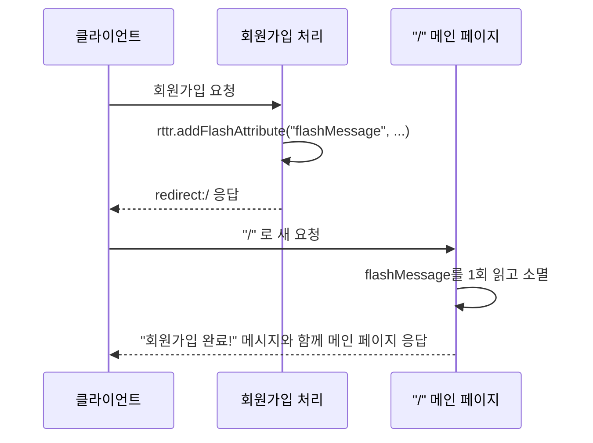

IoC·DI·AOP로 스프링의 핵심 원리를 배웠다면, 오늘부터는 **Spring Web MVC**로 실제 웹 요청을 처리하는 법을 배우기 시작했다. 첫날은 요청을 컨트롤러로 연결하는 매핑, 핸들러 메서드가 값을 받는 방법, 그리고 결과를 어떤 화면으로 보여줄지 정하는 뷰 리졸버까지 이어졌다.

## 1. @RequestMapping — 클래스와 메서드를 합쳐서 경로 완성하기

```java
@Controller
@RequestMapping("/order/*")
public class ClassController {

    @GetMapping("/regist")
    public String registOrder(Model model) {
        model.addAttribute("message", "Get 방식의 주문 등록 핸들러 메서드 동작");
        return "mappingResult";
    }

    @GetMapping("/detail/{orderNo}")
    public String pathVariable(Model model, @PathVariable("orderNo") int no) {
        model.addAttribute("message", no + "번 주문 상세조회!!");
        return "mappingResult";
    }
}
```

클래스에 붙인 `@RequestMapping("/order/*")`와 메서드에 붙인 `@GetMapping("/regist")`가 합쳐져서 최종 경로(`/order/regist`)가 된다. `/order/detail/{orderNo}`처럼 중괄호로 표시한 부분은 **PathVariable**이라고 부르며, 실제 요청 URL(`/order/detail/3`)을 타고 넘어온 값(`3`)을 `@PathVariable`로 그대로 꺼내 쓸 수 있었다.

```java
@RequestMapping(value = "/menu/regist", method = RequestMethod.POST)
public String PostregistMenu(Model model) { ... }

// 위와 완전히 같은 뜻
@PostMapping("/menu/regist")
public String postRegistMenu(Model model) { ... }
```

`@GetMapping`/`@PostMapping`은 `@RequestMapping(method = ...)`을 짧게 줄인 표현이라는 것도 확인했다. 같은 경로(`/menu/regist`)라도 GET으로 오면 조회용 메서드가, POST로 오면 등록용 메서드가 각각 따로 호출된다.

Spring Boot 앱에는 **Tomcat이 내장**되어 있어서, 사용자의 요청이 오면 Servlet이 그 요청을 받는 즉시 `@Controller`가 붙은 클래스에게 넘겨준다는 것도 짚었다 — 10월 내내 배운 서블릿이 결국 이 Spring MVC의 배경에 그대로 깔려 있는 셈이다.

## 2. 핸들러 메서드가 값을 받는 세 가지 방법

```java
@PostMapping("regist")
public String registMenu(Model model, WebRequest request) {
    // WebRequest는 Servlet의 HttpServletRequest 역할을 한다
    String menuName = request.getParameter("name");
    int menuPrice = Integer.parseInt(request.getParameter("price"));
    ...
}
```

```java
@PostMapping("modify")
public String modifyMenu(Model model,
                          @RequestParam("modifyName") String name,
                          @RequestParam int modifyPrice) {
    ...
}
```

```java
@PostMapping("search")
public String searchMenu(@ModelAttribute("menu") MenuDTO menu) {
    System.out.println("menu = " + menu);
    return "request/searchResult";
}
```

| 방법 | 특징 |
|---|---|
| `WebRequest` | 10월에 배운 `HttpServletRequest`와 똑같이 `getParameter()`로 하나씩 꺼낸다 |
| `@RequestParam` | 파라미터 하나하나를 변수로 바로 받는다. **View의 input `name` 속성과 변수명이 다르면 400 Bad Request**가 난다 |
| `@ModelAttribute` | 여러 입력값을 `MenuDTO` 같은 클래스 하나로 한 번에 묶어서 받는다 |

세 가지 모두 결국 하는 일은 같지만(사용자 입력을 꺼내는 것), 입력값이 많아질수록 `@ModelAttribute`로 DTO 하나에 묶는 쪽이 코드가 훨씬 깔끔해진다는 걸 체감했다.

## 3. View를 반환하는 세 가지 방법

```java
@GetMapping("/string")
public String stringView(Model model) {
    model.addAttribute("forwardMessage", "문자열로 View 반환");
    return "result"; // resources/templates/result.html 로 자동 완성
}

@GetMapping("modelAndView")
public ModelAndView modelAndView(ModelAndView mv) {
    mv.addObject("forwardMessage", "MV 활용 뷰와 데이터!");
    mv.setViewName("result");
    return mv;
}
```

| 반환 타입 | 동작 |
|---|---|
| `void` | 요청 URL 자체가 그대로 View 경로가 된다 |
| `String` | 반환한 문자열에 `resources/templates/`(접두사)와 `.html`(접미사)이 자동으로 붙는다 |
| `ModelAndView` | `setViewName()`으로 View 이름을, `addObject()`로 데이터를 한 객체에 함께 담는다 |

`@Controller`의 마지막 임무가 "사용자에게 어떤 화면을 보여줄지 정하는 것"이라는 설명이 와닿았다 — 뷰 리졸버(ViewResolver)가 그 문자열을 실제 파일 경로로 바꿔주는 역할을 한다.

## 4. redirect 시 사라지는 값, Flash Attribute로 넘기기

```java
@GetMapping("/string-redirect")
public String redirect(RedirectAttributes rttr) {
    System.out.println("회원가입 완료!!!!");
    rttr.addFlashAttribute("flashMessage", "리다이랙트 된 페이지에서도 유지되는 값!");
    return "redirect:/"; // 접두사 redirect: 를 붙이면 리다이렉트
}
```

Spring에서 View를 반환하는 기본 방식은 **forward**다. 10/22일 배운 forward처럼 서버 안에서 요청을 그대로 넘기는 것이다. redirect가 필요하면 문자열 앞에 `redirect:`를 붙여야 한다.

그런데 10/23일 배운 것처럼, **redirect는 완전히 새로운 요청**이라서 이전 요청에서 `model.addAttribute()`로 담아둔 값은 다음 요청에서 사라져버린다. 이 문제를 해결하려고 Servlet의 세션·쿠키를 직접 쓰는 대신, Spring은 `RedirectAttributes.addFlashAttribute()`라는 편한 방법을 제공한다.

다섯 살 아이에게 설명한다면: "친구에게 쪽지를 건네는데, 그 쪽지는 친구가 한 번 읽으면 바로 사라지는 마법 쪽지야. redirect로 새 페이지에 갔을 때 딱 한 번만 보여주고 싶은 메시지('회원가입 완료!' 같은)에 딱 맞아."


Flash Attribute는 내부적으로 세션을 활용해서, "리다이렉트된 바로 다음 요청에서만" 유효한 1회용 값을 전달해준다 — 10/23일 배운 세션 개념이 Spring에서 더 편리한 형태로 재등장한 셈이었다.



## 오늘의 정리

`@RequestMapping` 계열 어노테이션으로 URL과 HTTP 메소드를 컨트롤러 메소드에 매핑하고, `@RequestParam`/`@ModelAttribute`로 사용자 입력을 받고, `String`/`void`/`ModelAndView`로 어떤 화면을 보여줄지 정한다는 Spring MVC의 기본 뼈대를 잡았다. 특히 redirect 시 값이 사라지는 문제는 10월에 배운 서블릿 개념(forward/redirect/session)이 그대로 깔려 있고, Spring이 그 위에 `RedirectAttributes` 같은 편의 기능을 얹어둔 것뿐이라는 걸 느낀 하루였다.

## 더 학습하면 좋은 개념

- **DispatcherServlet** — 오늘 "Servlet이 요청을 받아 @Controller에게 넘긴다"고 배웠는데, 그 중간에서 실제로 라우팅을 담당하는 것이 DispatcherServlet이다. Spring MVC의 진짜 진입점이다.
- **Thymeleaf 템플릿 엔진** — 오늘 뷰로 반환한 `.html` 파일들이 실제로는 Thymeleaf 문법으로 Model 데이터를 화면에 뿌려준다. 다음 단계로 바로 이어지는 내용이다.
- **`@RestController`와 `@ResponseBody`** — 오늘은 화면(View)을 반환하는 `@Controller`만 다뤘는데, JSON 같은 데이터 자체를 반환하는 `@RestController`도 있다.

## 참고 자료

- [Spring Framework Reference - Web MVC framework](https://docs.spring.io/spring-framework/reference/web/webmvc.html)
- [Spring Framework Reference - Redirecting with RedirectAttributes](https://docs.spring.io/spring-framework/reference/web/webmvc/mvc-controller/ann-methods/redirecting-passing-data.html)
