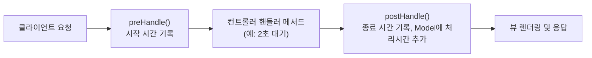

어제 요청 매핑과 뷰 리졸버를 배웠다면, 오늘은 컨트롤러에서 발생한 예외를 깔끔하게 처리하는 법과, 컨트롤러 실행 전후로 끼어드는 인터셉터를 배웠다.

## 1. @ExceptionHandler — 컨트롤러 안에서 예외 가로채기

```java
@Controller
public class ExceptionTestController {

    @GetMapping("nullpointer")
    public String nullPointer() {
        String str = null;
        System.out.println(str.toUpperCase(Locale.ROOT)); // 고의로 NullPointerException 발생
        return "/";
    }

    @ExceptionHandler(NullPointerException.class)
    public String nullHandler(Model model, NullPointerException e) {
        model.addAttribute("key", e.getMessage());
        return "error/nullPointer";
    }
}
```

`@ExceptionHandler(처리할 예외 클래스)`를 메서드에 붙여두면, 그 예외가 발생했을 때 **예외 핸들러가 컨트롤러의 흐름을 가로채서** 대신 처리해준다. 10/26일 "여니의 셀프 의문 타임"에서 NPE가 처리되지 않으면 500 에러로 이어진다고 배웠는데, 오늘은 그 NPE를 직접 붙잡아서 원하는 에러 화면으로 바꿔주는 방법을 배운 셈이다.

## 2. 문제 — 핸들러는 그 컨트롤러 안에서만 보인다

```java
@Controller
public class GlobalTestController {

    // ExceptionTestController에 만들어둔 nullHandler()가 여기서는 동작하지 않는다!
    @GetMapping("golbal-nullpointer")
    public String globalNull() {
        String str = null;
        System.out.println(str.toLowerCase(Locale.ROOT));
        return "/";
    }
}
```

`GlobalTestController`에서 똑같이 NPE를 터뜨려도, `ExceptionTestController` 안에 만들어둔 `@ExceptionHandler`는 호출되지 않는다. **이유는 간단했다 — 다른 클래스 내부에 있는 메서드는 서로 알 수 없기 때문**이다. `@ExceptionHandler`는 기본적으로 **자기가 속한 컨트롤러 안에서 발생한 예외만** 처리한다.

다섯 살 아이에게 설명한다면: "각 반 선생님(컨트롤러)이 자기 반 안에서 일어난 문제만 해결해줄 수 있어. 옆 반에서 문제가 생겨도 우리 반 선생님은 몰라. 그래서 학교 전체를 보는 경비 아저씨(`@ControllerAdvice`)가 따로 필요한 거야."


## 3. @ControllerAdvice — 모든 컨트롤러를 감시하기

```java
/* comment.
*  Advice는 AOP 챕터에서 반복적으로 동작해야 하는 코드를 뭉쳐둔
*  메서드를 지칭하는 단어였다.
*  @ControllerAdvice는 공통으로 발생할 수 있는 예외처리 핸들러를
*  묶어둔 클래스를 지칭한다.
* */
@ControllerAdvice
public class GlobalExceptionHandler {
    // 오늘은 틀만 만들어뒀고, 안에 @ExceptionHandler 메서드를
    // 채워 넣는 건 다음 시간 과제로 남겨뒀다.
}
```

10/27일 배운 AOP의 "Advice"(반복되는 관심사를 한 곳에 모아 끼워 넣는 것) 개념이 그대로 이름에 들어 있었다 — `@ControllerAdvice`는 "모든 컨트롤러에 공통으로 적용되는 예외 처리를 한 곳에 모아두는 클래스"라는 뜻이다. 오늘은 빈 틀만 만들어뒀고, 그 안에 `@ExceptionHandler` 메서드를 채워 넣으면 **어떤 컨트롤러에서 발생한 예외든** 전부 이 클래스가 가로채게 된다.

## 4. 사용자 정의 예외와 함께 쓰기

```java
public class MemberNotFoundException extends Throwable {
    public MemberNotFoundException(String message) {
        super(message);
    }
}
```

```java
@GetMapping("userexception")
public String userException() throws MemberNotFoundException {
    boolean check = true;
    if (check) {
        throw new MemberNotFoundException("아프지 말자 우리");
    }
    return "/";
}
```

10/9일 배운 "사용자 정의 예외 만들기"가 Spring MVC에서도 똑같이 쓰였다 — 상황에 맞는 예외 클래스를 만들고, 그걸 `@ExceptionHandler`로 붙잡아 처리하는 흐름이다.

## 5. Interceptor — 컨트롤러 전후로 끼어들기

```java
@Component
public class TimerInterceptor implements HandlerInterceptor {

    @Override // 컨트롤러 도달 전
    public boolean preHandle(HttpServletRequest request, HttpServletResponse response, Object handler) {
        long startTime = System.currentTimeMillis();
        request.setAttribute("startTime", startTime);
        return true; // true면 다음 인터셉터 또는 컨트롤러로 진행
    }

    @Override // 컨트롤러 실행 후
    public void postHandle(HttpServletRequest request, HttpServletResponse response, Object handler, ModelAndView modelAndView) {
        long endTime = System.currentTimeMillis();
        long startTime = (long) request.getAttribute("startTime");
        modelAndView.addObject("interval", endTime - startTime);
    }
}
```

`HandlerInterceptor`는 **컨트롤러의 핸들러 메서드 전(`preHandle`)과 후(`postHandle`)**에 끼어드는 기능이다. 10/23일 배운 서블릿 **필터**와 역할이 비슷해 보이지만 차이가 있었다.

| 구분 | 필터(Filter) | 인터셉터(Interceptor) |
|---|---|---|
| 동작 레벨 | 서블릿 컨테이너 (Spring 밖) | Spring MVC 내부 |
| 접근 가능한 정보 | HTTP 요청·응답만 | 어떤 컨트롤러·핸들러가 호출될지까지 |
| 등록 방법 | `@WebFilter` / `web.xml` | `WebMvcConfigurer`에 등록 |

```java
@Configuration
public class WebConfig implements WebMvcConfigurer {
    // WebMvcConfigurer: Spring MVC 기본 설정은 유지하면서
    // 인터셉터 추가, CORS 설정 등을 커스터마이징하는 인터페이스
    // 오늘은 아직 addInterceptors()를 오버라이드해서
    // TimerInterceptor를 실제로 등록하는 코드는 작성하지 않았다 — 다음 단계로 남겨뒀다.
}
```



## 오늘의 정리

`@ExceptionHandler`는 그 컨트롤러 안에서 발생한 예외만 가로채고, 모든 컨트롤러에 공통으로 적용하려면 `@ControllerAdvice`로 묶어야 한다는 걸 직접 실패 사례(GlobalTestController)로 확인했다. 인터셉터는 서블릿 필터와 비슷하게 요청 전후로 끼어들지만, Spring MVC 안에서 동작해서 어떤 핸들러가 호출되는지까지 알 수 있다는 차이가 있었다. 둘 다 "핵심 로직과 별개로 반복되는 관심사를 따로 뽑아둔다"는 점에서, 10/27일 배운 AOP와 같은 철학을 공유하고 있었다.

## 더 학습하면 좋은 개념

- **@ExceptionHandler의 우선순위** — 같은 컨트롤러 안의 핸들러와 `@ControllerAdvice`의 전역 핸들러가 동시에 있으면 어떤 게 먼저 적용되는지(더 구체적인 쪽이 우선). 오늘 다루지 않은 세부 규칙이다.
- **`@RestControllerAdvice`** — View 대신 JSON 형태의 에러 응답을 주고 싶을 때 쓰는, `@ControllerAdvice` + `@ResponseBody`가 합쳐진 어노테이션.
- **`afterCompletion()`** — `HandlerInterceptor`의 세 번째 메서드로, 뷰 렌더링까지 전부 끝난 뒤에 호출된다. 자원 정리 등에 쓰인다.
- **인터셉터 등록과 경로 제한** — `addInterceptors()`에서 `addPathPatterns()`/`excludePathPatterns()`로 특정 경로에만 인터셉터를 적용하는 법. 10/23일 배운 필터의 `@WebFilter("/auth/*")`와 비슷한 역할이다.

## 참고 자료

- [Spring Framework Reference - Exception Handling](https://docs.spring.io/spring-framework/reference/web/webmvc/mvc-controller/ann-exceptionhandler.html)
- [Spring Framework Reference - Interceptors](https://docs.spring.io/spring-framework/reference/web/webmvc/mvc-config/interceptors.html)
