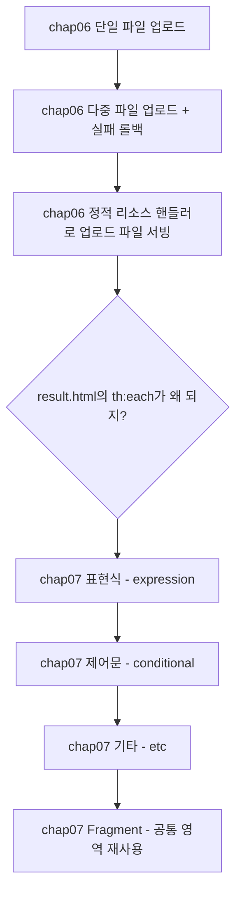
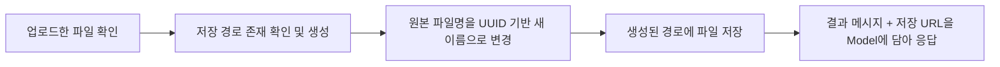
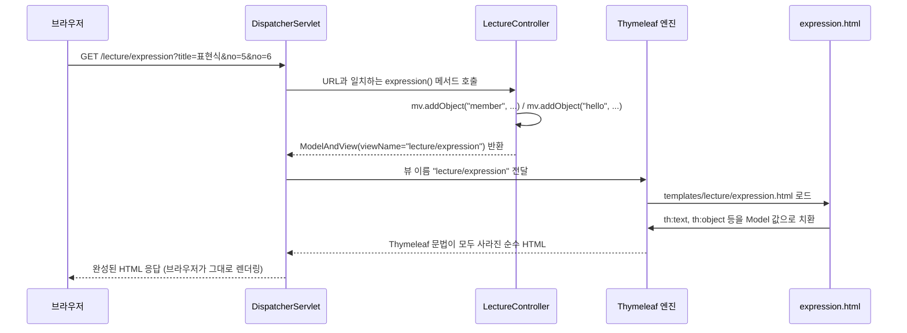
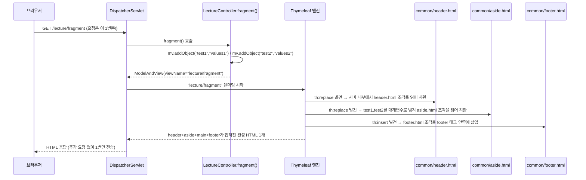

어제까지 요청 매핑, 예외 처리, 인터셉터로 "요청이 들어오고 나가는 흐름"을 잡았다면, 오늘은 두 갈래로 이어졌다. 먼저 사용자가 올린 **파일을 서버에 저장하고 다시 보여주는 법**(`chap06-file-upload`)을 실습했고, 그 결과 화면(`result.html`)을 만들다가 이미 쓰고 있던 `th:each`, `th:text` 같은 문법이 사실 뭔지 제대로 모른다는 걸 깨달아서, 바로 이어서 **Thymeleaf 자체**(`chap07-thymeleaf`)를 표현식 → 제어문 → 기타 → Fragment 순서로 처음부터 배웠다. 오늘은 특히 이 순서를 헷갈리지 않게 정리해두고 싶었다.



## 1. 단일 파일 업로드 — save()가 하는 일의 순서

파일을 받는 폼은 `enctype="multipart/form-data"`로 인코딩을 맞춰야 스프링이 파일로 인식한다.

```html
<form action="single-file" method="post" enctype="multipart/form-data">
    파일 : <input type="file" name="singleFile"> <br>
    파일 설명 : <input type="text" name="description"><br>
    <input type="submit">
</form>
```

컨트롤러는 `MultipartFile` 타입으로 파일을 그대로 받는다.

```java
@Value("${file.upload-dir}")
private String uploadDir;

@PostMapping("single-file")
public ModelAndView single(
        @RequestParam MultipartFile singleFile,
        @RequestParam String description,
        ModelAndView mv) {

    try {
        String savedName = save(singleFile);
        mv.addObject("message", "파일 업로드 성공!!");
        mv.addObject("files", "/uploads/" + savedName);
    } catch (IOException e) {
        mv.addObject("message", "파일 업로드 실패.." + e.getMessage());
    }

    mv.setViewName("result");
    return mv;
}

private String save(MultipartFile file) throws IOException {
    String originName = file.getOriginalFilename();
    String ext = originName.substring(originName.lastIndexOf(".")).toLowerCase();
    String savedName = UUID.randomUUID().toString() + ext;

    File dir = new File(uploadDir).getAbsoluteFile();
    dir.mkdirs();

    file.transferTo(new File(dir, savedName));
    return savedName;
}
```

`save()`가 하는 일은 정확히 아래 순서를 따른다.



원본 파일명을 그대로 쓰지 않고 `UUID.randomUUID()`로 이름을 바꾸는 이유는 **같은 이름의 파일이 올라왔을 때 덮어써버리는 충돌을 막기 위해서**다. `스크린샷.png`가 수백 번 올라와도 서버에는 매번 다른 이름으로 저장된다.

업로드 용량도 `application.yaml`에서 미리 제한해뒀다.

```yaml
spring:
  servlet:
    multipart:
      max-file-size: 200MB      # 파일 1개의 최대 크기
      max-request-size: 1000MB  # 1개의 요청 시 여러 파일의 합계 최대 크기

file:
  upload-dir: ./uploads
```

## 2. 다중 파일 업로드 — 하나라도 실패하면 전부 되돌리기

여러 파일을 받을 때는 `List<MultipartFile>`로 받고 반복문으로 하나씩 저장한다.

```java
@PostMapping("multi-file")
public ModelAndView multiFileUpload(
        @RequestParam("multiFile") List<MultipartFile> multipartFile,
        String description, ModelAndView mv) {

    List<FileDTO> files = new ArrayList<>();
    List<String> savedFiles = new ArrayList<>();

    try {
        for (MultipartFile file : multipartFile) {
            String savedName = save(file);
            files.add(new FileDTO(file.getOriginalFilename(), savedName, uploadDir, description));
            savedFiles.add("/uploads/" + savedName);
        }
        mv.addObject("message", "멀티 파일 업로드 성공!");
        mv.addObject("files", savedFiles);
    } catch (Exception e) {
        // 예를 들어 5개 파일 중 4개는 저장되고 1개만 실패하면?
        // Transaction의 rollback처럼 동작하도록, 실패 시 이전에 저장된 파일을 모두 삭제한다.
        for (FileDTO file : files) {
            new File(new File(uploadDir).getAbsoluteFile(), file.getSavedName()).delete();
        }
        mv.addObject("message", "멀티 파일 업로드 실패!");
    }

    mv.setViewName("result");
    return mv;
}
```

5개 중 1개만 실패했을 때 4개만 저장된 채로 남으면, 사용자 입장에서는 "분명 업로드 실패라고 떴는데 파일 4개는 서버에 남아있는" 이상한 상태가 된다. 그래서 DB 트랜잭션의 롤백처럼, 하나라도 실패하면 지금까지 저장했던 파일을 전부 지워서 **"성공 아니면 전부 실패"** 상태를 만든다.

## 3. 저장한 파일을 다시 보여주기 — 정적 리소스 핸들러 등록

파일을 디스크에 저장했다고 끝이 아니다. ``로 요청이 오면 스프링이 그 경로를 실제 저장 폴더와 연결해줘야 한다.

```java
@Configuration
public class WebConfig implements WebMvcConfigurer {

    @Value("${file.upload-dir}")
    private String uploadDir;

    @Override
    public void addResourceHandlers(ResourceHandlerRegistry registry) {
        // /uploads/** 요청 URL과 실제 저장 폴더 경로를 연결한다.
        registry.addResourceHandler("/uploads/**")
                .addResourceLocations("file:" + uploadDir + "/");
    }
}
```

`WebMvcConfigurer`는 어제 배운 인터셉터를 등록하는 곳이기도 했는데, 정적 리소스를 어디서 가져올지 지정하는 역할도 겸한다는 걸 오늘 알았다.

## 4. 결과 화면에서 걸려 넘어진 지점 — th:each가 왜 되지?

결과를 보여주는 `result.html`은 이렇게 생겼다.

```html
<h3 th:text="${message}"></h3>
<div th:each="file : ${files}">
    
</div>
```

다중 파일일 때 `files`는 `List<String>`이라 `th:each`로 반복하는 게 당연한데, 단일 파일일 때는 `files`에 `String` 하나(`"/uploads/abc.png"`)만 담아서 보냈는데도 똑같이 `th:each`가 잘 동작했다. 왜 리스트가 아닌데 반복문이 되는지 궁금해서 찾아보니, Thymeleaf의 `th:each`는 반복 가능한 값(`Iterable`, `Map`, 배열 등)이 아니면 **그 값 하나만 담긴 리스트인 것처럼 취급해서 한 번만 반복**한다는 공식 문서 내용을 확인할 수 있었다. 그래서 단일 파일이든 다중 파일이든 같은 `result.html` 하나로 처리할 수 있었던 것이다.

이 순간이 "Thymeleaf 문법을 제대로 모르고 쓰고 있었다"는 걸 깨달은 계기였고, 그래서 바로 이어서 `chap07-thymeleaf`로 넘어가 표현식부터 다시 배웠다.

## 5. 요청이 들어와서 화면이 그려지기까지 — 전체 실행 흐름

문법을 하나씩 보기 전에, 버튼을 눌렀을 때 **코드가 실제로 어떤 순서로 실행되는지**부터 끝까지 따라가봤다. `chap07-thymeleaf`의 인덱스 페이지(`index.html`)에는 버튼이 4개 있다.

```html
<button onclick="location.href='/lecture/expression?title=표현식&no=5&no=6'">표현식</button>
<button onclick="location.href='/lecture/conditional'">제어문</button>
<button onclick="location.href='/lecture/etc'">기타</button>
<button onclick="location.href='/lecture/fragment'">fragment</button>
```

| 버튼 | 요청 URL | 호출되는 컨트롤러 메서드 | 반환하는 뷰 파일 |
|---|---|---|---|
| 표현식 | `GET /lecture/expression?title=표현식&no=5&no=6` | `LectureController.expression()` | `templates/lecture/expression.html` |
| 제어문 | `GET /lecture/conditional` | `LectureController.conditional()` | `templates/lecture/conditional.html` |
| 기타 | `GET /lecture/etc` | `LectureController.etc()` | `templates/lecture/etc.html` |
| fragment | `GET /lecture/fragment` | `LectureController.fragment()` | `templates/lecture/fragment.html` |

클래스 위에 붙은 `@RequestMapping("/lecture")`와 메서드 위에 붙은 `@GetMapping("/expression")`이 합쳐져서 `/lecture/expression`이라는 최종 경로가 된다 — 지난주 배운 "클래스+메서드 매핑 합치기"가 여기서도 그대로 쓰인다.

"표현식" 버튼을 누른 순간부터 화면에 글자가 찍히기까지, 코드가 실행되는 순서를 한 단계씩 풀어보면 이렇다.

1. 브라우저가 `GET /lecture/expression?title=표현식&no=5&no=6` 요청을 서버로 보낸다.
2. 스프링의 `DispatcherServlet`이 이 요청을 받고, URL과 일치하는 컨트롤러 메서드를 찾는다 → `LectureController.expression()`이 호출된다.
3. `expression()` 메서드 안에서 `mv.addObject("member", new MemberDTO(...))`, `mv.addObject("hello", "hello!<h3>Thymeleaf</h3>")`로, 화면에 넘겨줄 데이터를 `ModelAndView`에 담는다. 이 시점까지는 HTML이 전혀 등장하지 않는다 — 순수하게 자바 객체만 다루는 단계다.
4. `mv.setViewName("lecture/expression")`으로 "어떤 화면을 보여줄지"를 **문자열**로만 지정하고, 이 `ModelAndView`를 반환한다.
5. `DispatcherServlet`은 돌려받은 뷰 이름 `"lecture/expression"` 앞뒤에 `classpath:/templates/`(접두사)와 `.html`(접미사)을 붙여서 실제 파일 `templates/lecture/expression.html`을 찾아낸다.
6. 이제부터 **Thymeleaf 엔진**이 이 HTML 파일을 한 줄씩 읽으면서, `th:text="${ param.title }"`, `th:object="${ member }"` 같은 Thymeleaf 문법을 만날 때마다 3번에서 담아둔 Model 데이터(또는 URL의 쿼리스트링)로 바꿔치운다.
7. 치환이 모두 끝나서 Thymeleaf 문법이 하나도 남지 않은, **완성된 순수 HTML**을 서버가 브라우저에 응답으로 돌려준다.
8. 브라우저는 그 HTML을 받아서 그대로 화면에 그린다.



여기서 가장 중요한 포인트 하나: **Thymeleaf는 서버에서만 동작한다.** 브라우저는 `th:text`, `th:if` 같은 속성을 전혀 모른다. 서버가 그 속성들을 전부 읽어서 진짜 값으로 바꾼 "완성된 HTML"만 브라우저로 보내주기 때문에, 브라우저에서 "페이지 소스 보기"를 해봐도 `th:` 속성은 하나도 보이지 않고 실제 값만 보인다. (반대로 `.html` 파일을 서버 없이 그냥 더블클릭해서 열면, 치환이 전혀 안 된 `${...}` 글자 그대로가 보인다 — Thymeleaf 엔진을 거치지 않았기 때문이다.)

`conditional()`, `etc()` 메서드도 정확히 같은 패턴(① 요청 → ② 컨트롤러 메서드 호출 → ③ Model에 데이터 담기 → ④ 뷰 이름 반환 → ⑤ Thymeleaf가 템플릿을 Model 값으로 치환 → ⑥ 완성된 HTML 응답)을 그대로 따라간다. 다만 `fragment()`만 6번 단계에서 한 가지 일이 더 일어나는데, 이건 Fragment를 다루는 8번 섹션에서 바로 이어서 설명한다.

## 6. Thymeleaf 표현식 — 값을 어디서 어떻게 꺼내는가

오늘 수업은 `/lecture/expression` → `/lecture/conditional` → `/lecture/etc` → `/lecture/fragment` 순서로 진행됐다.

| 표현식 | 문법 | 꺼내는 대상 |
|---|---|---|
| 변수 표현식 | `${...}` | Model에 담은 값, `param.이름`(쿼리스트링), `session.이름` |
| 선택 변수 표현식 | `*{...}` | `th:object`로 선택해둔 객체의 필드 |
| 메시지 표현식 | `#{...}` | `messages.properties`의 key-value (다국어 처리용) |
| 링크 표현식 | `@{...}` | URL. `/`로 시작하면 context path가 자동으로 붙는다 |
| 인라인 표현식 | `[[...]]`, `[(...)]` | 태그 안이 아니라 텍스트/JS 안에서 변수 값을 직접 출력 |

```java
mv.addObject("member", new MemberDTO("홍길동", 20, '남', "서울시 서초구"));
```

```html
<p th:text="${ member.name }"></p>

<!-- th:object로 객체를 선택해두면 *{필드명}으로 바로 꺼낼 수 있다 -->
<p th:object="${ member }" th:text="*{ age }"></p>
```

`th:text`와 `th:utext`의 차이도 중요했다. `th:text`는 태그를 이스케이프해서 순수 문자열로 보여주지만, `th:utext`는 이스케이프하지 않아서 문자열 안의 `<h3>` 같은 태그가 실제로 렌더링된다.

```html
<li th:text="${ hello }"></li>   <!-- hello!&lt;h3&gt;Thymeleaf&lt;/h3&gt; 그대로 글자로 출력 -->
<li th:utext="${ hello }"></li>  <!-- hello! 뒤에 진짜 <h3>Thymeleaf</h3> 가 렌더링됨 -->
```

사용자가 입력한 값을 `th:utext`로 그대로 출력하면 `<script>` 같은 악성 코드가 실행될 수 있는 **XSS 공격**에 노출된다는 주의사항도 짚었다. 그래서 신뢰할 수 있는 값이 아니라면 기본은 항상 `th:text`다.

## 7. 제어문 — th:if / th:switch / th:each

```html
<p th:if="${ num > 0 and num <= 10 }">1부터 10까지의 양수</p>

<th:block th:switch="${ str }">
    <span th:case="사과">사과가 선택되었습니다</span>
    <span th:case="바나나">바나나가 선택되었습니다</span>
    <span th:case="*">사과도 바나나도 아닙니다</span>
</th:block>

<tr th:each="member, stat : ${ memberList }">
    <td th:text="${ member.name }"></td>
    <td th:text="${ stat.count }"></td>
    <td th:text="${ stat.even }"></td>
</tr>
```

`th:each="member, stat : ${ memberList }"`처럼 상태 변수(`stat`)를 따로 안 적어도, 반복 변수명 뒤에 `Stat`을 붙인 `memberStat`으로 `index`/`count`/`even`/`odd`/`first`/`last` 같은 반복 상태를 그대로 꺼내 쓸 수 있다는 것도 오늘 처음 알았다.

## 8. 기타 — SpringEL로 객체·List·Map 꺼내기

```html
<!-- Object: .필드명, ['필드명'], .getter() 세 가지 모두 내부적으로 getter를 호출한다 -->
<li th:text="${ member.name }"></li>
<li th:text="${ member['age'] }"></li>
<li th:text="${ member.getGender() }"></li>

<!-- Map을 th:each로 반복하면 각 요소는 Map.Entry다 -->
<li th:each="entry : ${ memberMap }" th:text="|${ entry.key } : ${ entry.value.name }|"></li>
```

세 가지 방식(`.필드명`, `['필드명']`, `.getter()`) 모두 결국 getter를 호출하는 거라서, 필드가 `private`인데 getter가 없으면 셋 다 에러가 난다는 설명이 변수 표현식이 단순 치환이 아니라 **SpringEL(Spring Expression Language)**이라는 걸 체감하게 했다.

## 9. Fragment — 반복되는 header/footer를 한 곳에서 관리하기

페이지마다 header, footer, aside를 매번 복사-붙여넣기하면 나중에 메뉴 하나만 바뀌어도 모든 페이지를 다 고쳐야 한다. Thymeleaf는 이 공통 영역을 `th:fragment`로 한 곳에 정의해두고, 필요한 페이지에서 불러다 쓰는 방식으로 이 문제를 푼다.

```html
<!-- common/header.html -->
<header th:fragment="headerFragment" class="header">
  <h1> header Fragment</h1>
</header>
```

```html
<!-- fragment.html -->
<header th:replace="~{common/header :: headerFragment}">
    <h1>나는 header</h1>
</header>

<aside th:replace="~{common/aside :: asideFragment(${test1}, ${test2})}"></aside>

<footer th:insert="~{common/footer :: footerFragment}">
    <h2>나는 footer</h2>
</footer>
```

여기서 헷갈렸던 건 `th:replace`와 `th:insert`의 차이였다. 다섯 살 아이에게 설명한다면: "`th:replace`는 이삿짐 상자를 통째로 바꾸는 거야. 원래 있던 상자(태그)까지 다 치우고 새 상자를 가져다 놓는 거지. `th:insert`는 상자(태그)는 그대로 두고 안에 든 물건만 꺼내서 바꿔 넣는 거야."


| | `th:replace` | `th:insert` |
|---|---|---|
| 바뀌는 범위 | 태그 자체 + 내용 전체 | 태그 안쪽 내용만 |
| 바깥 태그(`<header>`, `<footer>`) | 사라지고 불러온 조각의 태그로 교체 | 그대로 유지, 안에 불러온 태그가 한 겹 더 들어감 |
| 결과 예시 | `<header class="header"><h1>header Fragment</h1></header>` | `<footer><footer class="footer"><h1>footer Fragment</h1></footer></footer>` |

`asideFragment(${test1}, ${test2})`처럼 fragment에 매개변수를 넘길 수도 있다는 것도 확인했다. 컨트롤러가 `mv.addObject("test1", "values1")`로 담은 값이 `common/aside.html`의 `th:fragment="asideFragment(parameter, parameter1)"` 매개변수로 그대로 전달된다.

### Fragment가 실행될 때, 화면 뒤에서 실제로 일어나는 일

처음 봤을 때 가장 헷갈렸던 부분: `th:replace`로 다른 파일(`common/header.html`)을 불러오는 거면, 혹시 브라우저가 그 파일을 또 요청하는 걸까? **아니다.** 5번 섹션에서 본 실행 흐름의 "⑥ Thymeleaf가 템플릿을 치환하는 단계" 안에서, 서버가 끝날 때까지 전부 처리하고 **완성된 HTML 1개만** 브라우저로 보낸다. 과정을 그대로 풀면 이렇다.

1. 브라우저가 `GET /lecture/fragment` 요청을 보낸다.
2. `DispatcherServlet`이 `LectureController.fragment()`를 호출한다.
3. 컨트롤러가 `mv.addObject("test1", "values1")`, `mv.addObject("test2", "values2")`를 담고, `viewName`을 `"lecture/fragment"`로 설정해 반환한다. (여기까지는 다른 메서드들과 완전히 동일하다.)
4. Thymeleaf 엔진이 `templates/lecture/fragment.html`을 읽다가 `<header th:replace="~{common/header :: headerFragment}">`를 만난다.
5. 엔진은 이걸 "네트워크 요청"이 아니라 "**클래스패스 안에서 다른 템플릿 파일을 찾아 읽어오는 것**"으로 처리한다. `templates/common/header.html` 파일을 열어서, 그 안의 `th:fragment="headerFragment"`가 붙은 `<header>` 태그 부분만 오려낸다.
6. 오려낸 `<header>` 조각으로, `fragment.html`에 원래 있던 `<header>...나는 header...</header>` 전체를 통째로 바꿔치운다 (`th:replace`니까 태그 자체가 교체된다).
7. `<aside th:replace="~{common/aside :: asideFragment(${test1}, ${test2})}">`도 같은 방식인데, 이번엔 3번에서 컨트롤러가 담아둔 `test1`, `test2` 값을 매개변수로 `aside.html`에 건네주면서 그 조각을 렌더링한 뒤 끼워넣는다.
8. `<footer th:insert="~{common/footer :: footerFragment}">`는 `th:insert`라서, 바깥 `<footer>` 태그는 그대로 두고 그 안쪽에만 `footer.html`의 조각을 삽입한다.
9. header, aside, main, footer 조각이 전부 하나로 합쳐진, **이제 더 이상 고칠 게 없는 완성된 HTML 한 장**이 만들어진다.
10. 이 완성된 HTML 한 장만 서버가 브라우저에 응답으로 보낸다.

즉 `header.html`, `aside.html`, `footer.html` 세 개의 파일을 따로따로 불러쓰는데도, 브라우저가 실제로 받는 HTTP 응답은 **단 1번**이다. 파일이 3개로 나뉘어 있는 건 어디까지나 "서버 안에서 코드를 정리해둔 방식"일 뿐, 브라우저와 서버 사이의 네트워크 통신 횟수와는 아무 상관이 없다.



## 오늘의 정리

파일을 업로드할 땐 "확인 → 경로 생성 → UUID로 이름 바꾸기 → 저장 → 응답"이라는 순서를 지켜야 하고, 여러 파일을 다룰 때는 하나라도 실패하면 전체를 되돌리는 처리가 필요하다는 걸 배웠다. 그리고 저장한 파일을 보여주려면 정적 리소스 핸들러로 URL과 실제 폴더를 연결해줘야 한다는 것도 확인했다. 그 과정에서 이미 쓰고 있던 `th:each`가 사실 Thymeleaf 문법이라는 걸 깨닫고, 표현식 → 제어문 → 기타 → Fragment 순서로 Thymeleaf를 처음부터 제대로 배웠다.

특히 중요했던 건 코드가 실제로 실행되는 순서였다 — 브라우저 요청 → `DispatcherServlet`이 컨트롤러 메서드를 찾아 호출 → 컨트롤러가 `ModelAndView`에 데이터와 뷰 이름만 담아 반환 → Thymeleaf 엔진이 그 뷰 이름에 해당하는 HTML 파일을 Model 값으로 치환 → 완성된 HTML 1장만 브라우저로 응답. Fragment도 이 흐름 안에서 서버가 여러 템플릿 조각을 미리 다 합친 뒤 **한 번에** 응답할 뿐, 브라우저가 header/aside/footer를 따로 요청하는 게 아니라는 걸 끝까지 따라가 보고서야 확실히 이해됐다.

## 더 학습하면 좋은 개념

- **MultipartResolver와 Servlet 3.0 Part** — `MultipartFile`은 내부적으로 서블릿 표준의 Part를 스프링이 감싼 것이다. 업로드 요청이 실제로 어떻게 파싱되는지 이해하면 용량 제한이나 임시 파일 저장 위치 같은 설정의 의미가 명확해진다.
- **파일 스토리지 전략 (로컬 디스크 vs 오브젝트 스토리지)** — 오늘은 `./uploads` 로컬 폴더에 저장했지만, 실제 서비스에서는 서버 디스크 대신 S3 같은 오브젝트 스토리지를 쓰는 경우가 많다. 왜 로컬 저장이 확장에 불리한지 알아두면 좋다.
- **Thymeleaf Layout Dialect** — 오늘 배운 Fragment보다 한 단계 더 나아가, 레이아웃 자체를 상속처럼 구성할 수 있는 확장 라이브러리다. 공통 레이아웃이 복잡해질수록 Fragment 여러 개를 매번 조합하는 것보다 유리하다.
- **OGNL과 SpringEL** — 오늘 `${member['age']}`, `${memberMap['m03'].name}`처럼 썼던 표현식 문법의 근간이 되는 언어다. 더 복잡한 표현식을 다루려면 OGNL 문법을 따로 익히는 게 도움이 된다.
- **Context-aware escaping과 XSS 방어** — `th:text`/`th:utext`에서 짚은 이스케이프 문제는 Thymeleaf만의 이야기가 아니라 모든 템플릿 엔진이 공통으로 신경 써야 하는 보안 주제다.

## 참고 자료

- [Spring Framework Reference - Multipart Resolver](https://docs.spring.io/spring-framework/reference/web/webmvc/mvc-servlet/multipart.html)
- [Spring Framework Reference - WebMvcConfigurer](https://docs.spring.io/spring-framework/reference/web/webmvc/mvc-config/customize.html)
- [Thymeleaf - Using Thymeleaf (공식 튜토리얼, 표현식·반복·Fragment 포함)](https://www.thymeleaf.org/doc/tutorials/3.1/usingthymeleaf.html)
- [OWASP - Cross Site Scripting (XSS)](https://owasp.org/www-community/attacks/xss/)
