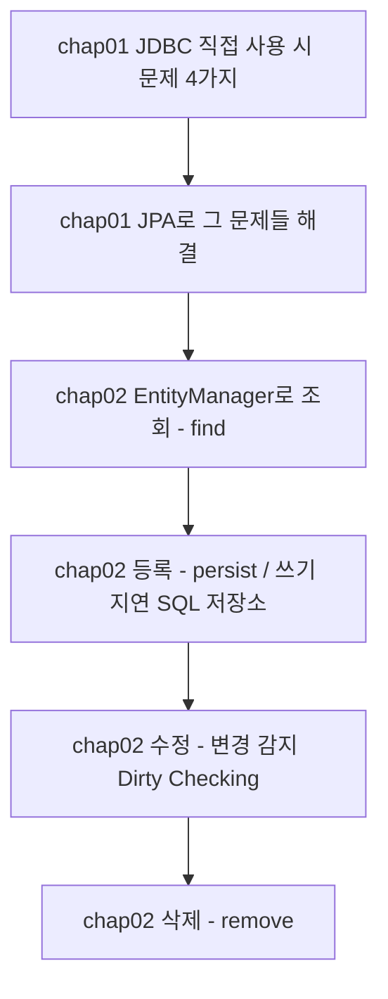
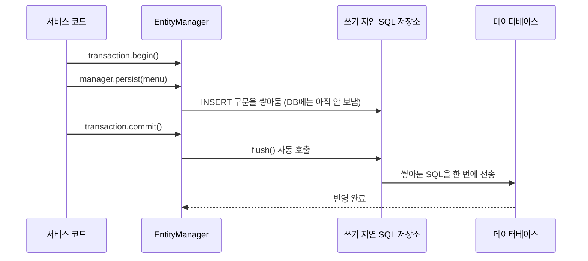

지난주까지는 Spring MVC로 요청을 받아서 화면을 그리는 법을 배웠다면, 오늘부터는 그 안쪽 — **데이터베이스와 자바 객체를 어떻게 연결할 것인가**로 넘어갔다. 10월 내내 JDBC로 직접 SQL을 짜고 `ResultSet`을 객체에 옮겨 담아왔는데, 오늘은 그 방식이 정확히 어떤 문제를 가지고 있었는지부터 짚고, **JPA**가 그 문제들을 어떻게 풀어내는지, 그리고 JPA의 핵심인 **영속성 컨텍스트**가 조회·등록·수정·삭제를 실제로 어떻게 처리하는지까지 순서대로 배웠다.



## 1. JDBC를 직접 썼을 때 생기는 4가지 문제

오늘 수업은 먼저 "집사 없이 창고를 직접 뒤지면 어떤 문제가 생기는지"부터 코드로 확인하는 것으로 시작했다.

```java
public void findAllMenu() {
    String query = "SELECT menu_code, menu_name, menu_price, category_code, orderable_status FROM tbl_menu";

    List<Menu> menuList = new ArrayList<>();

    try (Connection con = dataSource.getConnection();
         Statement stmt = con.createStatement();
         ResultSet rset = stmt.executeQuery(query)) {

        while (rset.next()) {
            Menu menu = new Menu();
            menu.setMenuCode(rset.getInt("menu_code"));
            menu.setMenuName(rset.getString("menu_name"));
            menu.setMenuPrice(rset.getInt("menu_price"));
            menu.setCategoryCode(rset.getInt("category_code"));
            menu.setOrderableStatus(rset.getString("orderable_status"));
            menuList.add(menu);
        }
    } catch (SQLException e) {
        throw new RuntimeException(e);
    }
}
```

| 번호 | 문제 | 구체적으로 |
|---|---|---|
| 1 | 코드 반복 | `Connection`/`Statement`/`ResultSet`을 열고 닫는 코드, `ResultSet` 컬럼을 객체 필드에 옮겨 담는 코드를 조회할 때마다 거의 똑같이 반복 작성 |
| 2 | SQL에 의존적인 개발 | "카테고리 이름도 같이 보여주세요" 같은 요구사항이 생기면 SQL을 JOIN으로 바꾸고, 새 DTO(`MenuCategoryDTO`)를 만들고, 매핑 코드도 다시 작성해야 함 |
| 3 | 패러다임 불일치 | DB에서는 `tbl_menu`가 `category_code`라는 FK "값"만 가지지만, 객체지향에서는 연관된 객체(Category)를 필드로 직접 가지는 게 자연스러움. `Menu`가 `categoryCode`값만 들고 있으면 `menu.getCategory()`처럼 바로 탐색할 수 없음 |
| 4 | 동일성 보장 문제 | 같은 메뉴를 두 번 조회(`findMenuByMenuCode`)하면 `menu1 == menu2`가 `false` — 서로 다른 객체라서 한쪽을 수정해도 다른 쪽은 모름 |

```java
// 4번 문제를 보여주는 코드
Menu menu1 = findMenuByMenuCode(menuCode);
Menu menu2 = findMenuByMenuCode(menuCode);

System.out.println("menu1 == menu2 : " + (menu1 == menu2)); // false

menu1.setMenuName("이름 변경 테스트");
System.out.println("menu2.getMenuName() = " + menu2.getMenuName()); // 그대로 — menu1의 변경을 모른다
```

## 2. JPA란 — 자바 객체와 테이블을 자동으로 연결하는 ORM

**JPA(Java Persistence API)**는 자바 진영의 **ORM(Object Relational Mapping)** 기술 표준이다. 자바 객체를 데이터베이스 테이블과 매핑해서, 위 4가지 문제를 사람이 직접 처리하지 않도록 대신해준다.

```java
@Entity
@Table(name = "tbl_menu")
public class Menu {

    @Id
    @Column(name = "menu_code")
    private int menuCode;

    @Column(name = "menu_name")
    private String menuName;

    @ManyToOne
    @Column(name = "category_code")
    private Category category;

    @Column(name = "orderable_status")
    private String orderableStatus;
}
```

| 애너테이션 | 역할 |
|---|---|
| `@Entity` | 이 클래스가 JPA(영속성 컨텍스트)가 관리하는 객체임을 표시 |
| `@Table(name=...)` | 어떤 테이블과 매핑되는지 지정 |
| `@Id` | 테이블의 기본 키(PK)에 해당하는 필드 지정 |
| `@Column(name=...)` | 어떤 컬럼과 매핑되는지 지정 |
| `@ManyToOne` | FK로 연관된 엔티티를 "값"이 아니라 "객체"로 필드에 직접 가짐 |

문제를 처리하는 주체는 `EntityManager`다. 컨트롤러나 서비스에서는 `@PersistenceContext`로 주입받아 쓴다.

```java
@PersistenceContext
private EntityManager manager;
```

`EntityManager`는 **영속성 컨텍스트(Persistence Context)**라는, 엔티티 객체를 관리하는 공간을 다루는 창구 역할을 한다. 애플리케이션에서 만든 엔티티 객체를 이 `EntityManager`를 통해 영속성 컨텍스트에 넣거나 꺼낼 수 있다.

## 3. 4가지 문제가 JPA에서는 어떻게 해결되는가

```java
public void findMenu(int menuCode) {
    Menu foundMenu = manager.find(Menu.class, menuCode);
    System.out.println(foundMenu);
}
```

| JDBC의 문제 | JPA에서의 해결 |
|---|---|
| 1. 코드 반복 | `manager.find(Menu.class, menuCode)` 한 줄로 SQL 작성·실행·매핑이 전부 처리됨 |
| 2. SQL 의존적 개발 | 요구사항이 바뀌어도 메서드 시그니처를 바꿀 필요 없이, 엔티티의 연관관계(`@ManyToOne`)만 추가하면 됨 |
| 3. 패러다임 불일치 | `foundMenu.getCategory()`처럼 객체 그래프를 그대로 탐색할 수 있음 (객체 중심 개발) |
| 4. 동일성 보장 | 같은 트랜잭션 안에서 같은 PK로 조회한 엔티티는 항상 같은 객체를 반환 |

3번이 실제로 되는 이유를 좀 더 파보면, `@ManyToOne`은 기본 페치 전략이 **즉시 로딩(EAGER)**이다. 그래서 `manager.find(Menu.class, menuCode)`로 메뉴를 조회하는 순간, 연관된 `Category`까지 한 번에 함께 로딩된다 — 그래서 `foundMenu`를 출력하면 카테고리 정보까지 같이 나온다.

```java
@Transactional(readOnly = true)
public void compareSameMenu(int menuCode) {
    Menu menu1 = manager.find(Menu.class, menuCode);
    Menu menu2 = manager.find(Menu.class, menuCode);

    System.out.println("menu1 == menu2 : " + (menu1 == menu2)); // true!
}
```

`@Transactional` 애너테이션을 메서드에 붙이면, 메서드가 실행될 때 트랜잭션이 자동으로 시작되고, 에러 없이 끝나면 `commit`, 에러가 나면 `rollback`을 스프링이 대신 처리해준다. `readOnly = true`는 조회 전용 트랜잭션이라는 뜻이다.

## 4. 영속성 컨텍스트로 CRUD — 엔티티 매니저 하나의 규칙

JPA의 각 기능이 실제로 어떻게 동작하는지 더 깊이 보려고, 이번엔 `EntityManagerFactory`에서 직접 `EntityManager`를 만들어 CRUD를 실습했다.

```java
private final EntityManagerFactory factory;

public void findMenuByMenuCode(int menuCode) {
    // 엔티티 매니저는 기능 1개(요청 1개)당 1개씩 새로 생성한다.
    // 필드로 공유하지 않는다.
    EntityManager manager = factory.createEntityManager();

    Menu foundMenu = manager.find(Menu.class, menuCode);
    System.out.println("foundMenu = " + foundMenu);
    manager.close();
}
```

엔티티 매니저를 필드에 두고 여러 요청이 공유하는 게 아니라, **요청 1번에 매니저 1개**를 새로 만들고 끝나면 닫는다는 규칙이 중요했다. 지금까지 봐온 `@PersistenceContext`로 주입받는 방식은 스프링이 이 규칙을 알아서 지켜주는 버전이고, 지금은 그 안에서 실제로 무슨 일이 일어나는지 직접 만들어본 것이다.

## 5. 등록(persist) — 결재가 끝나야 창고에 반영된다

```java
public void registMenu(Menu menu) {
    EntityManager manager = factory.createEntityManager();
    EntityTransaction transaction = manager.getTransaction();
    transaction.begin();

    try {
        // 엔티티 매니저는 CUD 작업 시 SQL을 DB에 바로 반영하지 않는다.
        // "쓰기 지연 SQL 저장소"에 SQL을 모아두었다가 flush() 시점에 DB로 보낸다.
        manager.persist(menu);
        // commit()이 호출되면 flush가 자동 실행된다.
        transaction.commit();
    } catch (Exception e) {
        transaction.rollback();
    } finally {
        manager.close();
    }
}
```



`persist()`를 호출해도 DB에 바로 `INSERT`가 나가지 않는다는 점이 오늘 가장 낯설었다. DML(Insert/Update/Delete)은 트랜잭션이 중요해서 롤백이 가능해야 하기 때문에, 커밋 시점까지 모아뒀다가 한 번에 보내는 구조다.

## 6. 수정 — update() 메서드가 없는 이유 (변경 감지)

```java
public void modifyMenuName(int menuCode, String menuName) {
    EntityManager manager = factory.createEntityManager();
    Menu foundMenu = manager.find(Menu.class, menuCode);

    EntityTransaction transaction = manager.getTransaction();
    transaction.begin();

    try {
        // setter로 값만 바꾼다. update() 같은 메서드를 호출하지 않는다.
        foundMenu.setMenuName(menuName);
        transaction.commit();
    } catch (Exception e) {
        transaction.rollback();
    }

    manager.close();
}
```

`EntityManager`에는 `update()` 관련 메서드가 존재하지 않는다. 대신 영속성 컨텍스트는 엔티티를 처음 조회(`find`)하는 순간 그 엔티티의 상태(스냅샷)를 보관해두고, `commit` 시점에 보관된 스냅샷과 지금 엔티티를 비교한다. 달라진 부분이 있으면 `UPDATE` 쿼리를 만들어 쓰기 지연 저장소에 등록한 뒤 DB로 보낸다. 이 과정을 **변경 감지(Dirty Checking)**라고 부른다.

다섯 살 아이에게 설명한다면: "집사는 물건을 처음 꺼내올 때 몰래 사진을 찍어둬. 나중에 '결재 끝!' 하는 순간, 지금 물건 모습이랑 아까 찍은 사진을 비교해서 달라진 부분이 있으면 자동으로 '이거 바꿔주세요' 쪽지를 만들어 창고에 보내는 거야. 그래서 '수정해줘'라는 버튼을 따로 누를 필요가 없어."


## 7. 삭제(remove) — 삭제도 commit 시점에

```java
public void removeMenu(int menuCode) {
    EntityManager manager = factory.createEntityManager();
    Menu removeMenu = manager.find(Menu.class, menuCode);

    EntityTransaction transaction = manager.getTransaction();
    transaction.begin();

    try {
        manager.remove(removeMenu);
        transaction.commit();
    } catch (Exception e) {
        transaction.rollback();
    }

    manager.close();
}
```

삭제할 엔티티도 먼저 조회해서 영속성 컨텍스트가 관리하는 상태로 만든 다음에 `remove()`를 호출해야 한다. 등록과 마찬가지로 `remove()`를 호출한 순간이 아니라 `commit()`이 되는 시점에 실제 `DELETE` 쿼리가 DB로 전송된다.

## 8. 오늘 눈여겨본 설정 — show-sql과 ddl-auto

```yaml
spring:
  jpa:
    show-sql: true  # JPA가 만들어주는 SQL을 콘솔에서 확인
    hibernate:
      ddl-auto: none
    properties:
      hibernate:
        format_sql: true  # SQL을 보기 좋게 줄바꿈
```

| `ddl-auto` 값 | 동작 |
|---|---|
| `create` | 애플리케이션 실행 시 테이블을 새로 생성 |
| `create-drop` | 실행 시 생성, 종료 시 삭제 |
| `update` | 개발 중 변경된 테이블 구조를 반영 |
| `none` | 자동으로 아무것도 하지 않음 — 미리 준비된 DDL 스크립트로만 테이블을 관리 |

`show-sql: true`로 켜두면 `manager.find()`, `persist()`가 실제로 어떤 SQL을 만들어서 보내는지 콘솔에서 바로 확인할 수 있어서, 오늘 배운 쓰기 지연·변경 감지가 "진짜로 commit 시점에만" 실행되는지 직접 눈으로 확인하면서 공부했다.

## 오늘의 정리

JDBC를 직접 쓸 때는 코드 반복, SQL 의존적 개발, 패러다임 불일치, 동일성 보장 문제라는 4가지 벽이 있었다. JPA는 `@Entity`로 자바 객체와 테이블을 자동으로 연결해주고, 그 중심에 있는 영속성 컨텍스트가 조회한 엔티티를 기억해서(1차 캐시) 동일성을 보장하고, 등록·삭제는 쓰기 지연 SQL 저장소에 모았다가 커밋 시점에 한 번에 반영하며, 수정은 스냅샷과 현재 상태를 비교하는 변경 감지로 처리한다는 걸 배웠다. `update()` 메서드가 아예 없다는 게 가장 신기했던 부분이었다.

## 더 학습하면 좋은 개념

- **엔티티의 생명주기 (비영속·영속·준영속·삭제)** — 오늘은 "영속성 컨텍스트가 관리하는" 상태만 다뤘는데, `new`로 막 만든 객체(비영속)나 `detach()`된 객체(준영속)는 변경 감지가 적용되지 않는다. 이 상태 전환을 알아야 오늘 배운 CRUD가 왜 되고 안 되는지 완전히 이해할 수 있다.
- **영속성 컨텍스트의 생명주기와 1차 캐시가 사라지는 시점** — 오늘 본 동일성 보장은 "같은 영속성 컨텍스트 안에서만" 유효했다. 트랜잭션이 끝나면 컨텍스트도 함께 끝난다는 점을 더 깊이 알아둘 필요가 있다.
- **지연 로딩(LAZY)과 N+1 문제** — 오늘은 `@ManyToOne`의 기본값인 즉시 로딩(EAGER)만 다뤘는데, 연관관계가 많아지면 즉시 로딩이 오히려 불필요한 조회를 늘리는 N+1 문제로 이어질 수 있다.
- **JPQL과 영속성 컨텍스트의 관계** — `manager.find()`는 PK로 1건만 조회했는데, 여러 건을 조건으로 조회하려면 JPQL(또는 Spring Data JPA)을 써야 한다. 이때도 영속성 컨텍스트의 동작 원리가 그대로 적용된다.

## 참고 자료

- [Jakarta Persistence — EntityManager](https://jakarta.ee/specifications/persistence/3.1/apidocs/jakarta.persistence/jakarta/persistence/entitymanager)
- [Jakarta Persistence — ManyToOne (fetch 기본값 EAGER)](https://jakarta.ee/specifications/persistence/3.1/apidocs/jakarta.persistence/jakarta/persistence/manytoone)
- [Hibernate ORM User Guide — Flushing](https://docs.jboss.org/hibernate/orm/6.4/userguide/html_single/Hibernate_User_Guide.html#flushing)
- [Spring Framework Reference — Transaction Management](https://docs.spring.io/spring-framework/reference/data-access/transaction.html)
