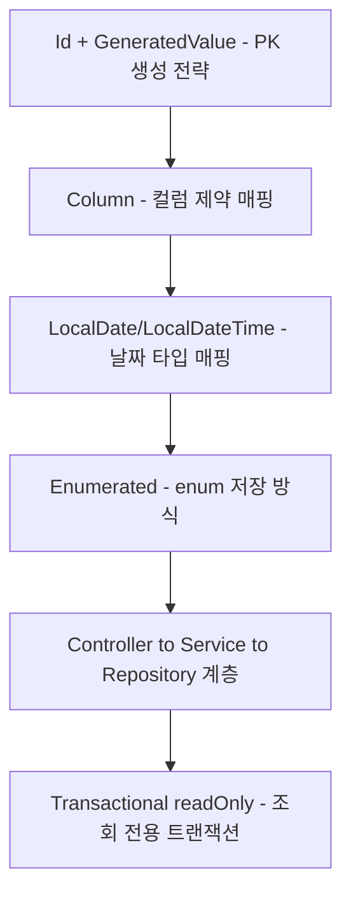
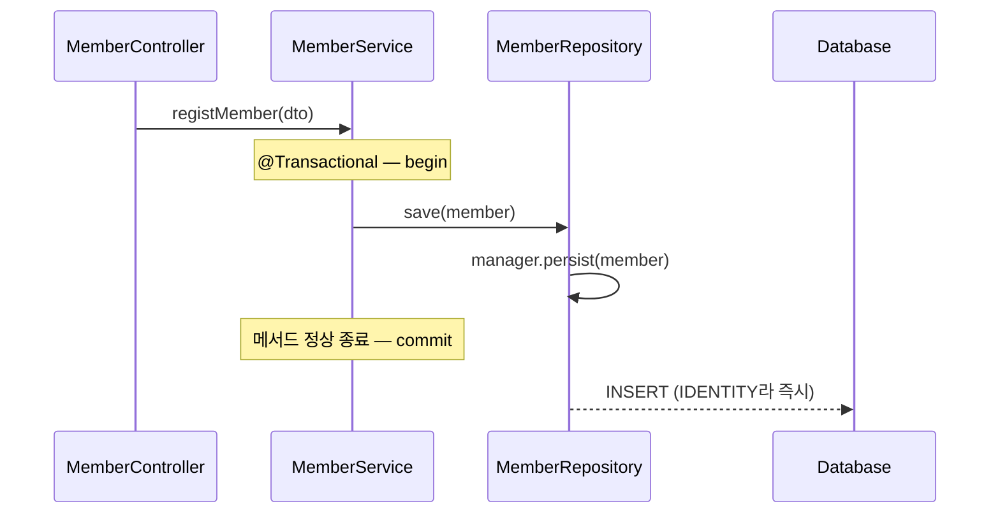

어제는 JDBC의 문제를 JPA의 영속성 컨텍스트가 어떻게 해결하는지 배웠다. 오늘은 한 단계 더 들어가서, `Member` 엔티티 하나를 만들며 **자바 필드를 테이블 컬럼에 정확히 매핑하는 방법**을 배웠다. PK를 누가·언제 만드는지, 컬럼 제약을 어떻게 선언하는지, enum을 어떤 방식으로 저장해야 안전한지, 그리고 Controller-Service-Repository 계층에서 각자 어떤 책임을 지는지까지 순서대로 정리한다.



## 1. `@Id` + `@GeneratedValue` — PK를 누가, 언제 만드는가

```java
@Id
@Column(name = "member_no")
@GeneratedValue(strategy = GenerationType.IDENTITY)
private int memberNo;
```

`@GeneratedValue`의 `strategy`는 4가지인데, 단순히 "자동 생성 방식"이 다른 게 아니라 **PK를 언제 알 수 있는지**가 달라서 어제 배운 "쓰기 지연 SQL 저장소"에도 영향을 준다.

| 전략 | 동작 | PK를 아는 시점 |
|---|---|---|
| `IDENTITY` | DB의 AUTO_INCREMENT에 PK 생성을 위임 | `persist()` 즉시 — INSERT를 실행해야만 PK를 알 수 있어서 **쓰기 지연이 적용되지 않는다** |
| `SEQUENCE` | DB의 시퀀스 객체(Oracle, PostgreSQL 등)에서 값을 가져옴 | `persist()` 시점에 시퀀스에서 PK만 먼저 받아오고, 실제 INSERT는 `flush()`(commit) 시점 — **쓰기 지연이 적용된다** |
| `TABLE` | 키 생성 전용 테이블을 별도로 두고 사용 | 테이블 조회로 미리 확보 |
| `AUTO` | DB 종류에 맞춰 적절한 전략을 자동 선택 (기본값) | 전략에 따라 다름 |


MySQL을 쓰는 이번 프로젝트는 `IDENTITY`를 썼는데, 그래서 `persist()`를 호출하는 즉시 INSERT 쿼리가 나간다 — 어제 봤던 "결재가 끝나야 반영된다"는 설명이 PK 생성 전략에 따라 예외가 될 수 있다는 걸 오늘 처음 확인했다.

## 2. `@Column` — 컬럼 제약을 선언하는 속성들

```java
@Column(name = "member_id", nullable = false,
        unique = true, columnDefinition = "varchar(10)")
private String memberId;

@Column(name = "address", length = 900)
private String address;
```

| 속성 | 역할 | 기본값 |
|---|---|---|
| `name` | 매핑할 컬럼 이름 | 필드 이름 |
| `nullable` | `false`면 NOT NULL 제약 추가 | `true` |
| `unique` | UNIQUE 제약 추가 | `false` |
| `columnDefinition` | 컬럼 정의(자료형, 기본값 등)를 직접 작성 | — |
| `length` | 문자열 컬럼의 길이 | `255` |

이 속성들은 코드를 실행할 때가 아니라, **JPA가 테이블을 생성(DDL)할 때** 사용된다. 즉 `ddl-auto: create`로 테이블을 새로 만드는 순간 이 제약이 그대로 `CREATE TABLE` 구문에 반영된다는 뜻이다.

## 3. 날짜 타입 매핑 — `LocalDate` vs `LocalDateTime`

```java
@Column(name = "enroll_date")
private LocalDateTime enrollDate;
```

`LocalDate`는 날짜만(`yyyy-MM-dd`), `LocalDateTime`은 날짜와 시간(`yyyy-MM-dd HH:mm:ss`)을 저장한다. Hibernate 5 이상에서는 `java.time` 패키지를 별도 설정 없이 자동으로 지원한다.

## 4. `@Enumerated` — enum을 어떻게 저장할 것인가

```java
public enum MemberRole {
    ROLE_MEMBER, ROLE_ADMIN;
}
```

```java
@Column(name = "member_role")
@Enumerated(EnumType.STRING)
private MemberRole memberRole;
```

enum은 "성별, 권한처럼 정해진 값만 쓰도록 강제하는 타입"인데, 이걸 DB에 저장하는 방식이 두 가지다.

| 방식 | 저장 값 | 장점 | 단점 |
|---|---|---|---|
| `ORDINAL` | enum 필드 순서(0, 1, 2...) | 숫자라 메모리 효율이 좋음 | 가독성이 떨어지고, 필드 추가·순서 변경 시 저장된 숫자의 의미가 틀어질 수 있음 |
| `STRING` | enum 이름 그대로(`"ROLE_MEMBER"`) | 가독성이 좋고 순서 변경에 안전함 | 데이터 크기가 숫자보다 크지만, 큰 단점은 아님 |

실무에서는 `STRING`을 권장한다. Hibernate 6 + MySQL 조합에서 `STRING`으로 매핑하면 컬럼이 MySQL의 `enum('ROLE_ADMIN','ROLE_MEMBER')` 타입으로 생성되는데, 일반 `varchar`로 만들고 싶다면 `columnDefinition = "varchar(20)"`을 직접 지정해야 한다.

## 5. Controller → Service → Repository — 계층별 책임 복습



`MemberRepository`는 JDBC 때 "DAO"라고 부르던 역할과 같지만, Spring + JPA 환경에서는 `Repository`라고 부른다. 내부는 `@PersistenceContext`로 주입받은 `EntityManager`를 직접 사용한다.

```java
@Repository
public class MemberRepository {

    @PersistenceContext
    private EntityManager manager;

    public void save(Member member) {
        manager.persist(member);
    }

    public Member findByMemberNo(int memberNo) {
        return manager.find(Member.class, memberNo);
    }
}
```

`MemberService`는 DTO를 Entity로 변환하고, 트랜잭션 경계를 정하고, `Repository`를 호출하는 "흐름"만 책임진다.

```java
@Service
public class MemberService {

    private final MemberRepository memberRepository;

    @Transactional
    public int registMember(MemberRegistDTO dto) {
        Member member = new Member(
                dto.getMemberId(), dto.getMemberPwd(), dto.getMemberName(),
                dto.getPhone(), dto.getAddress(), dto.getEnrollDate(),
                dto.getMemberRole(), dto.getStatus()
        );
        memberRepository.save(member);
        return member.getMemberNo();
    }
}
```

`@Transactional`이 붙은 메서드는 실행될 때 트랜잭션이 `begin()`되고, 정상 종료되면 `commit()`, 예외가 발생하면 `rollback()`된다.

## 6. `@Transactional(readOnly = true)` — 조회 전용은 왜 더 가벼운가

```java
@Transactional(readOnly = true)
public MemberRegistDTO findByMemberNo(int memberNo) {
    Member foundMember = memberRepository.findByMemberNo(memberNo);
    return new MemberRegistDTO(
            foundMember.getMemberId(), foundMember.getMemberPwd(),
            foundMember.getMemberName(), foundMember.getPhone()
    );
}
```

어제 [영속성 컨텍스트는 조회 시점에 스냅샷을 찍어두고 commit 시점에 비교해서 변경 감지(Dirty Checking)를 수행한다]()고 배웠다. 조회만 하고 끝낼 메서드라면 애초에 값이 바뀔 일이 없으니, 이 변경 감지 자체가 불필요한 비용이다. `readOnly = true`를 붙이면 이 불필요한 변경 감지를 생략해서 더 가볍게 동작한다.

## 7. 오늘 사용한 설정 — `ddl-auto: create`

```yaml
spring:
  jpa:
    show-sql: true
    hibernate:
      ddl-auto: create
    properties:
      hibernate:
        format_sql: true
```

`create`는 애플리케이션을 실행할 때마다 테이블을 새로 만드는 설정이라, `@Column`과 `@Enumerated`로 선언한 제약이 바로 반영되는지 매번 DDL 로그로 확인하면서 공부했다.

## 오늘의 정리

`@GeneratedValue`의 전략에 따라 PK를 언제 알 수 있는지가 달라지고, 이게 어제 배운 쓰기 지연에도 영향을 준다는 게 오늘 가장 새로웠다. `@Column`의 제약 속성들은 테이블을 생성하는 시점에만 쓰인다는 것, enum은 `ORDINAL`보다 `STRING`이 안전하다는 것, 그리고 JDBC의 DAO가 JPA에서는 Repository로 이름이 바뀌었을 뿐 EntityManager를 직접 다루는 계층이라는 것도 정리됐다. 마지막으로 조회 전용 메서드에는 `readOnly = true`를 붙여 변경 감지를 생략하는 습관을 들여야겠다.

## 더 학습하면 좋은 개념

- **연관관계 매핑(`@ManyToOne`, `@OneToMany`)** — 오늘은 `Member` 엔티티 하나만 다뤘는데, 실제로는 다른 엔티티와 연결된 테이블이 훨씬 많다. 오늘 배운 `@Column`/`@Enumerated`가 연관관계 매핑에서는 어떻게 확장되는지 이어서 봐야 한다.
- **복합키 매핑(`@EmbeddedId`, `@IdClass`)** — PK가 여러 컬럼으로 구성된 경우, 오늘 배운 단일 `@Id`만으로는 표현할 수 없어서 별도의 매핑 방식이 필요하다.
- **Bean Validation(`@NotNull`, `@Size`)과 `@Column` 제약의 차이** — `@Column(nullable=false)`는 DB 제약이고, `@NotNull`은 애플리케이션 레벨 검증이다. 둘의 책임이 겹치는 듯 보이지만 동작 시점이 다르다는 걸 정확히 구분해둘 필요가 있다.
- **JPA Auditing(`@CreatedDate`, `@LastModifiedDate`)** — 오늘은 `enrollDate`를 수동으로 넣었는데, 생성·수정 시각을 자동으로 채워주는 기능이 있다는 것도 알아두면 반복 코드를 줄일 수 있다.

## 참고 자료

- [Jakarta Persistence — GenerationType](https://jakarta.ee/specifications/platform/11/apidocs/jakarta/persistence/generationtype)
- [Jakarta Persistence — EnumType](https://jakarta.ee/specifications/platform/11/apidocs/jakarta/persistence/enumtype)
- [Jakarta Persistence — Column](https://jakarta.ee/specifications/platform/11/apidocs/jakarta/persistence/column)
