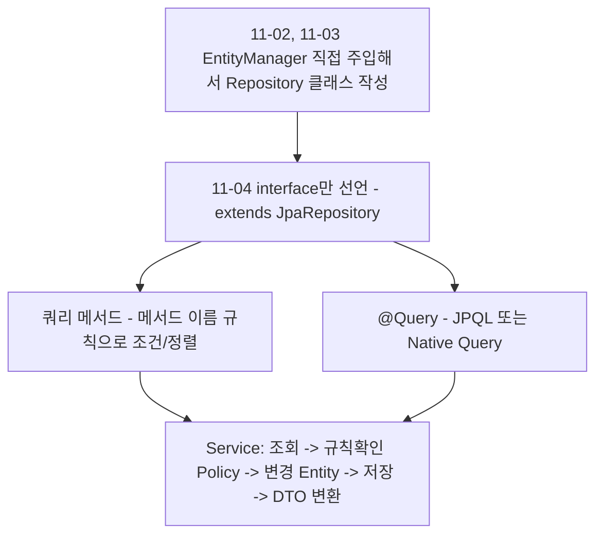
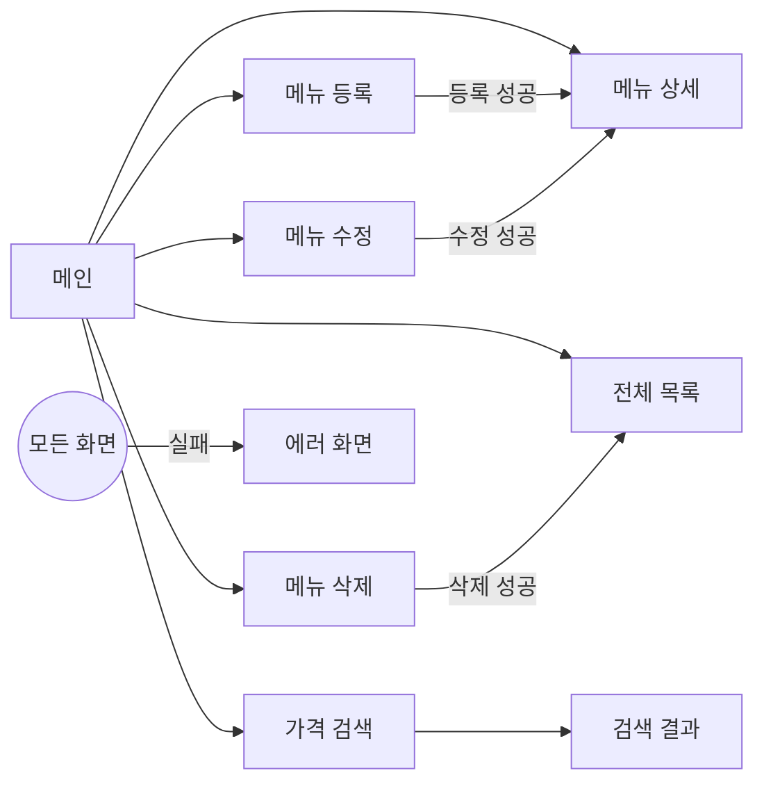

어제(11/3)는 `@Id`의 `@GeneratedValue` 전략, `@Column`·`@Enumerated` 매핑을 배우며 "엔티티를 어떻게 테이블에 매핑하는가"를 다졌다. 오늘(11/4)은 그 엔티티를 가지고 실제로 동작하는 작은 프로젝트 — "원티드 메뉴 레스토랑" PRD(제품 요구사항 문서) 기반 미니 프로젝트를 시작했다. 가장 크게 달라진 점은, 지금까지 직접 작성해온 Repository 클래스를 더 이상 손으로 구현하지 않는다는 것이다. **Spring Data JPA**가 인터페이스 선언만으로 구현체를 대신 만들어준다.

> 이 글은 아직 TODO가 많이 남은 실습 프로젝트를 다룬다. 오늘은 완성한 기능보다 **Spring Data JPA가 왜/어떻게 Repository를 자동으로 만들어주는지**를 이해하는 데 집중했다.



## 1. PRD 한 장이 코드 구조를 결정한다

오늘 받은 프로젝트는 README에 적힌 PRD를 "이 문서 하나만 보고 개발할 수 있어야 한다"는 원칙으로 설계되어 있었다. 문서의 각 장(章)이 코드의 어느 위치로 옮겨지는지가 표로 미리 정의되어 있다.

| 문서 | 코드로 옮겨지는 곳 |
|---|---|
| 화면 설계서 | `templates/**.html`, Controller의 View 이름 |
| API 명세서 | `MenuController`의 `@GetMapping` / `@PostMapping` |
| 정책 정의서 | `MenuDTO`(입력 검증), `Menu`(도메인 규칙), `policy` 패키지(비즈니스 규칙) |
| 에러 정의 | `ErrorCode`, `GlobalExceptionHandler` |
| 데이터베이스 설계 | `Menu`, `Category` Entity 매핑, Repository |



지금까지는 "일단 코드를 짜고 돌려보면서" 배웠다면, 오늘은 코드를 짜기 전에 **문서부터 읽고 구조를 파악**하는 순서를 먼저 경험했다는 점이 새로웠다.

## 2. Repository를 더 이상 손으로 구현하지 않는다

11/2~11/3까지는 Repository 클래스를 직접 만들고, 그 안에서 `@PersistenceContext`로 주입받은 `EntityManager`를 수동으로 호출했다.

```java
// 11/3까지 쓰던 방식
@Repository
public class MemberRepository {

    @PersistenceContext
    private EntityManager manager;

    public void save(Member member) {
        manager.persist(member);
    }

    public Member findByMemberNo(int memberNo) {
        return manager.find(Member.class, memberNo);
    }
}
```

오늘 배운 **Spring Data JPA**를 쓰면 이 클래스 전체가 인터페이스 선언 한 줄로 바뀐다.

```java
@Repository
public interface MenuRepository extends JpaRepository<Menu, Integer> {
    List<Menu> findByMenuPriceGreaterThanOrderByMenuPrice(int menuPrice);
}
```

| 방식 | Repository를 누가 구현하는가 | 코드량 |
|---|---|---|
| 11/2~11/3 (직접 구현) | 내가 클래스를 만들고 `EntityManager`를 직접 호출 | CRUD 메서드마다 직접 작성 |
| 11/4 (Spring Data JPA) | `JpaRepository<엔티티, @Id 타입>`을 상속하면 Spring Data JPA가 구현체를 생성 | 인터페이스 선언 + 필요한 메서드 시그니처만 |

`JpaRepository<Menu, Integer>`는 "관리할 엔티티는 `Menu`이고, 그 `@Id` 컬럼의 타입은 `Integer`다"라는 뜻이다. 이 인터페이스를 상속하는 순간, 영속성 컨텍스트와 엔티티 매니저를 사용하는 기본 CRUD 구현체(`findById`, `save`, `findAll` 등)를 Spring Data JPA가 런타임에 만들어 등록한다.

## 3. 쿼리 메서드 — 메서드 이름이 곧 SQL 조건이 된다

`findByMenuPriceGreaterThanOrderByMenuPrice(int menuPrice)`처럼, Entity 필드 이름과 정해진 키워드(`GreaterThan`, `OrderBy` 등)를 조합해서 메서드 이름을 지으면 Spring Data JPA가 메서드 이름을 분석해서 쿼리를 자동으로 생성한다. 이를 **쿼리 메서드(Query Method)**라고 부른다.

```java
Menu foundMenu = menurepository.findById(menuCode)
        .orElseThrow(() -> new BusinessException(ErrorCode.MENU_NOT_FOUND));
```

`findById()`는 `JpaRepository`가 이미 구현해둔 메서드로, 반환 타입이 `Optional<Menu>`다. 없는 PK를 조회해도 곧바로 예외가 터지며 서버가 죽는 대신 `Optional`로 안전하게 감싸져서 돌아오기 때문에, `orElseThrow()`로 원하는 예외를 직접 지정할 수 있다.

```java
List<Menu> menuList = menurepository.findByMenuPriceGreaterThanOrderByMenuPrice(menuPrice);
List<MenuDTO> dtos = menuList.stream()
        .map(MenuDTO::from)
        .toList();
```

| 장점 | 단점 |
|---|---|
| 조건이 적으면 메서드 선언 한 줄로 끝 | 조건이 많아지거나 JOIN이 들어가면 메서드 이름이 과도하게 길어짐 |
| SQL을 몰라도 조건/정렬을 표현 가능 | 복잡한 쿼리는 오히려 가독성과 정확성이 떨어짐 |

## 4. 쿼리 메서드로 안 되면 `@Query`로 직접 쓴다

하위 카테고리만 골라 조회하는 기능처럼 쿼리 메서드 이름으로 표현하기 애매한 경우, `@Query`로 직접 SQL을 적는다.

```java
@Query(value = "select * from tbl_Category m where ref_category_code is not null order by category_code",
       nativeQuery = true)
List<Category> findSubCategory();
```

| 종류 | 기본값 여부 | 작성 대상 |
|---|---|---|
| JPQL | `@Query`의 기본값 (`nativeQuery` 생략 시) | 엔티티와 엔티티의 필드를 대상으로 작성 |
| Native Query | `nativeQuery = true` 명시 | 실제 사용 중인 DB의 SQL 문법 그대로 작성 |

## 5. Entity가 스스로 규칙을 책임진다

`Menu` 엔티티는 전체 필드 생성자를 `private`으로 막고(`@AllArgsConstructor(access = AccessLevel.PRIVATE)`), setter를 아예 열어두지 않았다. 대신 정적 팩토리 메서드와 이름이 있는 메서드로만 생성·변경하도록 설계되어 있다.

```java
@AllArgsConstructor(access = AccessLevel.PRIVATE)
@Entity
@Table(name = "tbl_menu")
public class Menu {

    @Id
    @Column(name = "menu_code")
    @GeneratedValue(strategy = GenerationType.IDENTITY)
    private int menuCode;

    @Column(name = "menu_name")
    private String menuName;

    // ...

    public static Menu create(String menuName, int menuPrice, int categoryCode) {
        // TODO: 구현 예정
        return null;
    }

    public void changeMenuName(String newMenuName) { /* TODO */ }
    public void stopSelling() { /* TODO: 이미 판매중지면 BusinessException */ }
    public void resumeSelling() { /* TODO: 이미 판매중이면 BusinessException */ }
    public void validateDeletable() { /* TODO: 판매중이면 삭제 불가 */ }
}
```

코드 주석에 설계 의도가 그대로 적혀 있었는데, "자신의 현재 상태에 따라 허용 여부가 달라지는 도메인 규칙(예: 이미 판매중지된 메뉴는 다시 판매중지할 수 없다)은 Entity 스스로 판단한다. DTO는 화면값만 알고 DB의 현재 상태는 모르기 때문에 `@Valid`로는 검사할 수 없다"는 설명이 특히 와닿았다. 지금까지 DTO의 `@Valid`로만 검증을 생각했는데, "현재 상태를 알아야 판단할 수 있는 규칙"은 애초에 DTO가 검사할 수 있는 영역이 아니라는 걸 오늘 처음 구분해서 이해했다.

이 책임 구분은 `MenuService`의 클래스 주석에도 명확히 정리되어 있었다.

| 규칙의 종류 | 판단 주체 | 기준 |
|---|---|---|
| 도메인 규칙 | `Entity` (`Menu`) | 자기 자신의 값만으로 판단 가능 |
| 비즈니스 규칙 | `Policy` 패키지 | DB 조회나 다른 도메인이 필요 |
| 흐름 조립 | `Service` | 조회 → 규칙 확인(Policy) → 변경(Entity) → 저장 → DTO 변환의 "순서"만 책임 |

Service는 Controller에 Entity를 절대 넘기지 않고 DTO로만 응답한다는 규칙도 오늘 처음 코드 주석으로 명시된 걸 확인했다.

## 6. 백엔드 검증이 필요한 이유 — `@Min`으로 가격 검증

`MenuController`의 가격 검색 API에는 `@RequestParam`에 `@Min` 검증이 붙어 있었다.

```java
@GetMapping("/search")
public ModelAndView findByMenuPrice(@RequestParam
                                    @Min(value = 0, message = "가격은 0이상입니다.") int menuPrice,
                                    ModelAndView mv) {
    List<MenuDTO> menuList = menuService.findByMenuPrice(menuPrice);
    mv.addObject("menuList", menuList);
    mv.addObject("price", menuPrice);
    mv.setViewName("menu/searchResult");
    return mv;
}
```

주석에 적힌 이유를 그대로 옮기면: "유효성 검사는 프론트(JS)에서도 할 수 있지만, 프론트에서만 진행하면 URL 조작이나 요청 body 조작을 막을 방법이 없다. 따라서 백엔드에서도 반드시 유효성 검사를 해야 한다." 프론트 검증만으로 충분하다고 생각한 적은 없었지만, "URL을 직접 조작하면 프론트 검증을 그냥 건너뛸 수 있다"는 구체적인 공격 경로를 짚어주니 왜 두 군데 다 검증해야 하는지가 더 명확해졌다.

카테고리 목록 조회 API는 `@ResponseBody`로 View 대신 데이터(JSON)를 반환한다.

```java
@GetMapping("/category")
@ResponseBody
public List<CategoryDTO> findCategoryList() {
    return menuService.findSubCategories();
}
```

이 API는 메뉴 등록 화면(`regist.html`)에서 `fetch`로 호출해서 카테고리 목록을 채우는 데 쓰인다. `@ResponseBody`를 쓰면 Controller가 View를 리턴하는 책임 없이 데이터만 응답할 수 있어서, 여러 화면이 같은 데이터를 중복 조회해야 할 때 유용하다는 걸 오늘 처음 코드로 확인했다.

## 오늘의 정리

오늘은 완성된 기능보다 **구조를 이해하는 데 집중한 날**이었다. 지금까지 직접 작성해온 Repository 클래스가 `JpaRepository` 인터페이스 상속만으로 대체된다는 것, 쿼리 메서드와 `@Query`로 조회를 표현하는 두 가지 방법, 그리고 Entity·Policy·Service·Controller의 책임이 PRD 문서 단계에서부터 명확히 나뉘어 설계된다는 것을 배웠다. 메뉴 등록·수정·삭제·판매중지 같은 나머지 기능은 아직 TODO로 남아있어서, 다음 공부 때 직접 채워볼 예정이다.

## 더 학습하면 좋은 개념

- **`SimpleJpaRepository`의 내부 동작** — `JpaRepository`를 상속하면 실제로는 `SimpleJpaRepository`라는 기본 구현체가 뜬다. 이 클래스를 열어보면 내부적으로 결국 `EntityManager`를 어떻게 사용하는지 확인할 수 있어서, 11/2~11/3에 배운 영속성 컨텍스트 지식과 바로 연결된다.
- **`@Query`의 파라미터 바인딩 (`:파라미터명`, `?1`)** — 오늘은 파라미터가 없는 Native Query만 써봤는데, 조건이 들어가는 `@Query`를 쓰려면 파라미터 바인딩 문법을 알아야 한다.
- **`Specification`과 `QueryDSL`** — 쿼리 메서드 이름이 길어지는 문제(오늘 배운 단점)를 해결하는 대안으로, 동적 쿼리를 타입 안전하게 작성하는 방법이다.
- **Bean Validation 그룹(`@Validated` groups)** — 오늘 `@Min`으로 단일 값을 검증했는데, 등록/수정처럼 상황별로 다른 검증 규칙이 필요할 때 그룹을 나누는 방법을 더 배워야 한다.

## 참고 자료

- [Spring Data JPA Reference — Query Methods](https://docs.spring.io/spring-data/jpa/reference/jpa/query-methods.html)
- [Spring Data Commons Reference — Repository Core Concepts](https://docs.spring.io/spring-data/commons/reference/repositories/core-concepts.html)
- [Jakarta Bean Validation — Constraints (@Min 등)](https://jakarta.ee/specifications/bean-validation/3.0/jakarta-bean-validation-spec-3.0.html)
