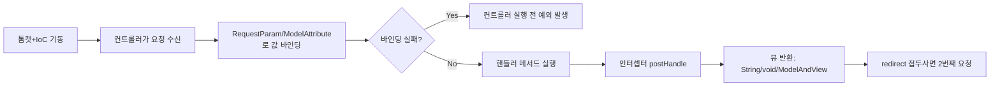

메모장에 날짜도 없이 흩어져 있던 키워드들을 다시 열어봤다 — "톰캣 켜지고 ioc", "포스트 리다이렉트 차이", "롱타임으로 형변환"처럼 그때는 알아들었지만 지금 보면 암호 같은 메모들. 정리하면서 보니 전부 10/28~10/30(Spring MVC)과 11/2~11/4(JPA)에 이미 글로 쓴 내용이었다. 새 내용을 추가하는 글이 아니라, **흩어진 키워드를 다시 흐름에 꿰어보는 복습 글**이다.



## 1. "톰캣 켜지고, ioc" / "컨트롤러 요청 젤 먼저 받음"

Spring Boot는 내장 톰캣을 띄우면서 동시에 IoC 컨테이너를 올려 빈(Bean)들을 등록해둔다. 그 상태에서 HTTP 요청이 들어오면, Servlet이 요청을 받는 즉시 `@Controller`가 붙은 클래스에 처리를 위임한다.

```java
@Controller
public class MethodController {
    @RequestMapping("/menu/regist")
    public String registMenu(Model model) {
        model.addAttribute("message", "Get 방식의 메뉴 등록 핸들러 메서드 동작함..");
        return "mappingResult";
    }

    @RequestMapping(value = "/menu/regist", method = RequestMethod.POST)
    public String PostregistMenu(Model model) {
        model.addAttribute("message", "POST 방식의 메뉴 등록 핸들러 메서드 동작함..");
        return "mappingResult";
    }
}
```

같은 URL(`/menu/regist`)이라도 `method` 속성으로 GET/POST를 구분해서 서로 다른 핸들러 메서드로 나눌 수 있다는 게 이 메모의 핵심이었다. 더 자세한 흐름은 [Spring MVC — 요청 매핑부터 뷰 리졸버까지]()에 정리해뒀다.

## 2. "requestparam 많이 쓰임" / "클래스 같은 자료형 여러개 담기 가능"

값 하나를 꺼낼 때는 `@RequestParam`, 여러 값을 객체 하나로 묶어서 받고 싶을 때는 `@ModelAttribute`를 쓴다.

```java
@PostMapping("modify")
public String modifyMenu(Model model,
                         @RequestParam("modifyName") String name,
                         @RequestParam int modifyPrice) { ... }

@PostMapping("search")
public String searchMenu(@ModelAttribute("menu") MenuDTO menu) {
    // 화면의 input name="name", name="price" ... 값들이
    // MenuDTO 필드에 자동으로 묶여서 들어온다
    System.out.println("menu = " + menu);
    return "request/searchResult";
}
```

여기서 주의할 점도 메모에 없던 걸 코드 주석에서 다시 확인했다: **`@RequestParam`의 변수명이 화면 input의 `name` 속성과 정확히 일치하지 않으면 400 Bad Request가 난다.** "클래스 같은 자료형으로 여러 개 담기 가능"은 `@ModelAttribute`가 여러 입력값을 DTO 하나로 묶어주는 걸 말한 메모였다.

## 3. "화면 보여주는 방법" / "포스트 리다이렉트 차이"

컨트롤러가 뷰를 돌려주는 방법은 3가지다.

| 반환 타입 | 의미 |
|---|---|
| `void` | 요청 URL 자체가 곧 view 경로 |
| `String` | 리턴한 문자열이 view 경로 (`templates/` 접두사 + `.html` 접미사 자동) |
| `ModelAndView` | `setViewName()`으로 지정한 문자열이 view 경로 |

그리고 **forward와 redirect는 기본값부터 다르다.** 아무 접두사 없이 문자열만 리턴하면 기본값은 forward이고, `redirect:` 접두사를 붙여야만 리다이렉트가 된다.

```java
@GetMapping("/string-redirect")
public String redirect(RedirectAttributes rttr) {
    rttr.addFlashAttribute("flashMessage", "리다이렉트 된 페이지에서도 유지되는 값!");
    return "redirect:/";
}
```

redirect는 브라우저가 요청을 **두 번** 보내는 셈이라서(처음 응답 → 브라우저가 새 URL로 재요청), 첫 요청에서 `Model`에 담아둔 값은 두 번째 요청에서는 사라진다. 그래서 리다이렉트 후에도 값을 유지하려면 `RedirectAttributes.addFlashAttribute()`를 따로 써야 한다.

## 4. "컨트롤러 전에 유효성 에러 발생"

`@RequestParam`/`@ModelAttribute`로 값을 바인딩하는 과정은 컨트롤러 메서드의 **본문이 실행되기 전에** 먼저 일어난다. 바인딩 자체가 실패하면(타입이 안 맞거나, 이름이 안 맞거나) 메서드 코드는 한 줄도 실행되지 않은 채로 예외부터 발생한다. 이 예외를 깔끔하게 처리하는 게 바로 다음 메모인 예외 처리다.

```java
@ExceptionHandler(NullPointerException.class)
public String nullHandler(Model model, NullPointerException e) {
    model.addAttribute("key", e.getMessage());
    return "error/nullPointer";
}
```

컨트롤러 하나에만 적용하려면 `@ExceptionHandler`를, 앱 전체 공통 예외 처리를 모아두려면 `@ControllerAdvice`가 붙은 별도 클래스를 쓴다. 자세한 내용은 [Spring MVC 예외 처리와 인터셉터]()에 있다.

## 5. "인터셉터" / "롱타임으로 형변환"

인터셉터는 컨트롤러 핸들러 메서드의 **앞뒤**에 끼어든다.

```java
@Component
public class TimerInterceptor implements HandlerInterceptor {

    @Override
    public boolean preHandle(HttpServletRequest request, HttpServletResponse response, Object handler) {
        long startTime = System.currentTimeMillis();
        request.setAttribute("startTime", startTime);
        return true; // false면 컨트롤러까지 도달하지 못한다
    }

    @Override
    public void postHandle(HttpServletRequest request, HttpServletResponse response, Object handler, ModelAndView modelAndView) {
        long endTime = System.currentTimeMillis();
        long startTime = (long) request.getAttribute("startTime"); // ← 이 부분!
        modelAndView.addObject("interval", endTime - startTime);
    }
}
```

"롱타임으로 형변환"은 바로 `(long) request.getAttribute("startTime")` 이 줄을 적어둔 메모였다. `request.getAttribute()`는 반환 타입이 `Object`라서, `preHandle`에서 저장해둔 시작 시각을 `postHandle`에서 다시 꺼낼 때는 원래 타입(`long`)으로 명시적 형변환을 해줘야 한다.

인터셉터는 `WebMvcConfigurer`를 구현한 설정 클래스에 등록하고, 정적 리소스 경로는 제외해준다.

```java
@Override
public void addInterceptors(InterceptorRegistry registry) {
    registry.addInterceptor(timerInterceptor)
            .addPathPatterns("/*")
            .excludePathPatterns("/css/**", "/images/**", "/js/**");
}
```

## 6. "multipart로 받음" / "파일 업로드 시 필수"

파일을 업로드하는 폼은 일반 텍스트 폼과 다르게 `enctype="multipart/form-data"`로 보내야 하고, 컨트롤러도 `MultipartFile` 타입으로 받아야 한다. 이 부분은 이미 [파일 업로드부터 Thymeleaf Fragment까지]()에서 `MultipartResolver` 설정부터 `transferTo()`로 실제 저장하는 과정까지 자세히 다뤘다.

## 7. "변환 과정" / "필드 컬럼과 매칭" / "클래스명 테이블과 매칭" / "jpa 불필요한 코드 없애줌"

이건 JPA 3일치(11/2~11/4) 메모가 섞인 것 같다.

| 메모 | 정체 |
|---|---|
| 클래스명 ↔ 테이블과 매칭 | `@Entity` + `@Table(name = "tbl_member")` |
| 필드 ↔ 컬럼과 매칭 | `@Id`, `@Column(name = "...")` |
| 변환 과정 | 조회한 `Entity` → 화면에 돌려줄 `DTO`로 바꾸는 과정 (`MenuDTO.from(entity)` 같은 정적 팩토리) |
| jpa 불필요한 코드 없애줌 | JDBC 때는 `ResultSet`을 직접 객체에 옮겨 담아야 했는데, JPA는 이 매핑을 자동화한다. 11/4에는 한 걸음 더 나아가 Spring Data JPA가 `Repository` 클래스 자체(EntityManager 호출 코드)까지 없애준다는 걸 배웠다 |

자세한 내용은 [JPA 입문부터 영속성 컨텍스트 CRUD까지](), [엔티티 매핑으로 회원 테이블 만들기](), [Spring Data JPA로 레포지토리 자동 구현받기]()에 이미 정리되어 있다.

## 8. "바텀업 방식 -" (메모가 끊긴 부분)

이 메모는 뒤가 끊겨 있어서 100% 확신하기는 어렵지만, 11/4에 PRD 문서를 먼저 읽고 설계 구조를 파악한 다음 코드를 채워나간 경험과 연결되는 메모로 보인다. 지금까지는 일단 코드를 짜고 돌려보면서 배우는 **바텀업**에 가까웠다면, PRD처럼 문서에서 화면·API·정책을 먼저 정의해두고 그걸 코드로 옮기는 건 **탑다운**에 가깝다. 다음에 이 메모를 다시 보게 되면 어떤 맥락이었는지 더 적어두면 좋을 것 같다.

## 오늘의 정리

메모 하나하나는 암호 같았지만 순서대로 꿰어보니 결국 "요청이 컨트롤러에 도달하고 → 값이 바인딩되고(실패하면 컨트롤러 전에 예외) → 인터셉터가 앞뒤로 끼어들고 → 뷰가 반환되는" 하나의 흐름이었다. JPA 메모들도 마찬가지로 "클래스/필드를 테이블/컬럼에 매핑해서 반복 코드를 없앤다"는 하나의 맥락으로 이어졌다. 앞으로는 메모를 남길 때 어떤 날짜·어떤 코드를 보다가 적었는지 한 줄이라도 같이 적어두면 복습이 훨씬 수월할 것 같다.

## 더 학습하면 좋은 개념

- **`BindingResult`** — 오늘 "컨트롤러 전에 유효성 에러 발생"에서 다룬 바인딩 실패를 예외로 던지는 대신, 컨트롤러 메서드 파라미터에 `BindingResult`를 추가해서 직접 받아 처리하는 방법도 있다. 예외 처리와 비교해서 언제 어떤 걸 쓰는 게 나을지 정리해두면 좋다.
- **인터셉터 vs AOP** — 10/27에 배운 AOP의 `@Around`와 오늘 복습한 `HandlerInterceptor`의 `preHandle`/`postHandle`은 "메서드 실행 전후에 끼어든다"는 점에서 닮아 보인다. 어떤 상황에 뭘 써야 하는지 구분해두면 좋다.
- **Spring의 타입 변환(Converter/PropertyEditor)** — `@RequestParam`으로 문자열을 숫자·날짜 타입으로 자동 변환해주는 게 내부적으로 어떻게 동작하는지 알아두면, 커스텀 타입을 바인딩할 때 직접 컨버터를 만들 수 있다.
- **`@Valid` + `MethodArgumentNotValidException`** — DTO 필드에 Bean Validation을 걸었을 때, 검증 실패가 정확히 어느 예외로 던져지고 어떤 `@ExceptionHandler`로 잡히는지 한 번 추적해보면 좋다.

## 참고 자료

- [Spring Framework Reference — @RequestParam](https://docs.spring.io/spring-framework/reference/web/webmvc/mvc-controller/ann-methods/requestparam.html)
- [Spring Framework Reference — Interceptors](https://docs.spring.io/spring-framework/reference/web/webmvc/mvc-config/interceptors.html)
- [Spring Framework Reference — @ExceptionHandler](https://docs.spring.io/spring-framework/reference/web/webmvc/mvc-controller/ann-exceptionhandler.html)
