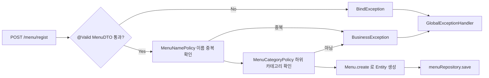
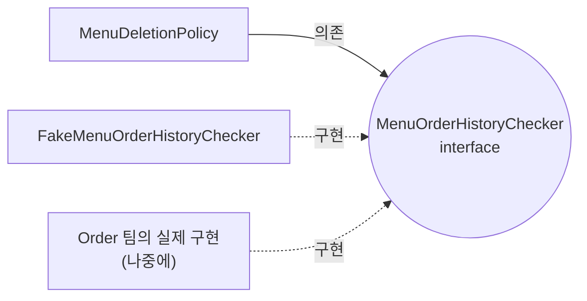
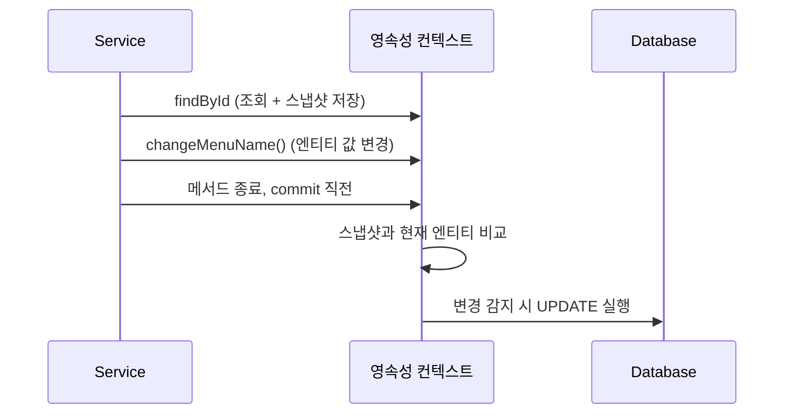

어제(11/4)는 "원티드 메뉴 레스토랑" 미니 프로젝트의 뼈대와 `JpaRepository`를 배웠다. 오늘(11/5)은 어제 비워뒀던 TODO를 채우는 날이었다. 그런데 채워 넣고 보니 코드 양보다 **"이 규칙은 어디에 둘 것인가"** 가 오늘의 진짜 주제였다. 메뉴 이름이 중복이면 안 되고, 상위 카테고리에는 메뉴를 등록할 수 없고, 판매중이거나 주문 이력이 있는 메뉴는 지울 수 없다. 이 규칙들을 전부 `MenuService`에 `if`문으로 쓰면 되는데, 프로젝트는 일부러 그렇게 쓰지 않게 만들어져 있었다.

> 이 글은 아직 TODO가 남은 실습 프로젝트(`module07-jpa-mini-project`)의 **오늘까지 채운 부분**을 다룬다. 목록 조회, 판매중지/재개, 이름 수정 시 중복 검사, 일부 예외 핸들러는 아직 비어 있다.

## 문제 상황 (Task)

프로젝트 주석에는 "Before" 코드가 그대로 남아 있다. 규칙을 Service가 직접 판단하면 이런 모양이 된다.

```java
// 예시 코드 (프로젝트 주석의 Before 구조)
@Transactional
public int registNewMenu(MenuDTO registMenu) {
    if (menuRepository.existsByMenuName(registMenu.getMenuName())) {          // ① 이름 중복
        throw new BusinessException(ErrorCode.DUPLICATE_MENU_NAME);
    }
    Category category = categoryRepository.findById(registMenu.getCategoryCode())
            .orElseThrow(() -> new BusinessException(ErrorCode.CATEGORY_NOT_FOUND));
    if (category.getRefCategoryCode() == null) {                               // ② 하위 카테고리만
        throw new BusinessException(ErrorCode.NOT_SUB_CATEGORY);
    }
    Menu menu = Menu.create(...);                                              // ③ 진짜 할 일
    menuRepository.save(menu);
    return menu.getMenuCode();
}
```

주석이 지적하는 문제점은 4가지다.

1. ①의 중복 규칙이 `modifyMenuName()`에도 복사된다. 한쪽만 고치면 등록과 수정의 규칙이 달라진다.
2. ②에서 Service가 "`refCategoryCode`가 null이면 상위 카테고리"라는 Category의 내부 사정을 알아야 한다.
3. 규칙이 늘수록 `if`문이 쌓여서 ③ "흐름"이 묻힌다.
4. 규칙 하나만 테스트하려 해도 Service 전체를 준비해야 한다.

## 해결 과정 (Action)

### 1. 규칙에도 종류가 있다 — 누가 판단할 수 있는가로 나눈다

오늘 배운 핵심 기준은 **"그 규칙을 판단하는 데 무엇이 필요한가"** 였다.

다섯 살 아이에게 설명한다면 이렇게 말할 수 있다. 식당에 들어가려면 문이 세 개 있다. 첫 번째 문 지기는 **입장권만 보고** 판단한다("이름이 비어 있네, 못 들어가"). 두 번째 문은 **손님 자신의 상태**를 본다("너 지금 영업 중인 메뉴지? 그럼 지울 수 없어"). 세 번째 문은 **장부를 뒤져봐야** 안다("같은 이름의 메뉴가 벌써 있네, 못 들어가"). 질문의 종류가 다르니 문 지기도 다르게 둔다.


| 규칙 종류 | 판단에 필요한 것 | 담당 | 이 프로젝트의 예 |
|---|---|---|---|
| 입력 형식 | 입력값 자체 | `MenuDTO` + `@Valid` | 이름 필수·30자 이하, 가격 0 이상, 카테고리 1 이상 |
| 도메인 규칙 | 객체 자신의 현재 상태 | `Entity` | 판매중인 메뉴는 삭제 불가, 하위 카테고리인가? |
| 비즈니스 규칙 | DB 조회 / 다른 도메인 | `Policy` | 이름 중복 금지, 하위 카테고리에만 등록, 주문 이력 있으면 삭제 불가 |



### 2. DTO는 형식만 검사한다

`MenuDTO`에 검증 어노테이션을 선언하고, 컨트롤러 파라미터에 `@Valid`를 붙여서 실행한다. 선언과 실행이 분리되어 있다는 점이 중요했다.

```java
@NotBlank(message = "메뉴 이름은 필수입니다")
@Size(max = 30, message = "메뉴 이름은 30자 이하입니다")
private String menuName;

@Min(value = 0, message = "메뉴 가격은 0 원 이상입력")
private int menuPrice;

@Positive(message = "카테고리를 선택 해주세요")
private int categoryCode;
```

`@Size(max = 30)`의 30은 `tbl_menu.menu_name`이 `VARCHAR(30)`이기 때문이다. DTO는 **DB에 저장된 현재 상태를 모른다.** 그래서 "이미 판매중지된 메뉴를 또 판매중지"처럼 상태에 따라 달라지는 규칙은 `@Valid`로 막을 수 없다. 이 규칙은 Entity의 몫이다.

### 3. Entity는 자기 상태로 답할 수 있는 질문에 스스로 답한다

`Category`에는 `isSubCategory()`가 있다. 최상위 카테고리는 `ref_category_code`가 NULL이라서 필드 타입도 `int`가 아니라 `Integer`다.

```java
@Column(name = "ref_category_code")
private Integer refCategoryCode;    // 최상위 카테고리는 NULL 이므로 int 가 아닌 Integer

public boolean isSubCategory() {
    return refCategoryCode != null;
}
```

이렇게 하면 `MenuCategoryPolicy`가 `getRefCategoryCode() == null` 같은 내부 구조를 해석하지 않고 Entity에게 **물어보기만** 하면 된다.

```java
public void validateRegistrable(int categoryCode) {
    Category category = categoryRepository.findById(categoryCode)
            .orElseThrow(() -> new BusinessException(ErrorCode.CATEGORY_NOT_FOUND));

    if (!category.isSubCategory()) {
        throw new BusinessException(ErrorCode.NOT_SUB_CATEGORY);
    }
}
```

`Menu`도 같은 방식이다. 전체 필드 생성자는 `private`이고 setter는 없다. 새 메뉴는 `Menu.create()`로만 만들고(판매상태는 항상 `"Y"`로 시작), `"Y"`/`"N"`이라는 의미 없는 값은 `ON_SALE`/`STOPPED` 상수로 이름을 붙였다. 삭제 가능 여부는 Entity 자신이 판단한다.

```java
public void validateDeletable() {
    if (this.orderableStatus.equals(ON_SALE)) {
        throw new BusinessException(ErrorCode.ON_SALE_MENU_CANNOT_DELETE);
    }
}
```

### 4. Policy는 "된다/안 된다"만 판단한다

`MenuNamePolicy`는 `MenuRepository`를 주입받아 쿼리 메서드 `existsByMenuName()`으로 중복을 확인한다. Policy는 판단만 하고 `save`, 값 변경, DTO 반환은 하지 않는다. 그건 Service의 일이다. 이 설계를 적용하고 나니 Service의 등록 메서드는 정말 흐름만 남았다.

```java
@Transactional
public int registNewMenu(MenuDTO registMenu) {
    menuNamePolicy.validateNewName(registMenu.getMenuName());          // 1-1. 이름 중복
    menuCategoryPolicy.validateRegistrable(registMenu.getCategoryCode()); // 1-2. 하위 카테고리

    Menu menu = Menu.create(registMenu.getMenuName(),
            registMenu.getMenuPrice(), registMenu.getCategoryCode());   // 2. Entity 생성
    menurepository.save(menu);                                          // 3. 영속성 컨텍스트에 저장
    return menu.getMenuCode();
}
```

### 5. 다른 팀의 정보는 인터페이스로 묻는다 (의존성 역전)

삭제 규칙 중 "주문 이력이 있는 메뉴는 삭제할 수 없다"는 Order 팀의 데이터가 필요하다. 이 프로젝트는 Menu 팀이 `MenuOrderHistoryChecker` 인터페이스를 **정의**하고, 정보를 가진 Order 팀이 **구현**하는 구조다.

| 방식 | 장점 | 단점 |
|---|---|---|
| Menu가 Order의 Repository를 직접 주입 | 당장 쓰기 쉽다 | Order 내부 구현에 의존, 주문이 메뉴 가격 때문에 Menu에 의존하면 순환 의존 발생 |
| **Menu가 인터페이스를 정의, Order가 구현** | 의존 방향이 Order → Menu 한 방향, Order 구현 전에도 개발 가능 | 인터페이스를 먼저 합의해야 한다 |



Order 팀 구현이 아직 없어서 `FakeMenuOrderHistoryChecker`가 1, 2, 3번 메뉴는 주문 이력이 있다고 가정해 대신 답한다. 나중에 진짜 구현이 생기면 Fake만 지우면 되고 `MenuDeletionPolicy`는 **한 줄도 바뀌지 않는다.** 주입받는 타입이 구현 클래스가 아니라 인터페이스이기 때문이다.

### 6. 삭제는 두 종류의 규칙이 한 유스케이스에 같이 나온다

```java
@Transactional
public void deleteMenu(int menuCode) {
    Menu found = menurepository.findById(menuCode)
            .orElseThrow(() -> new BusinessException(ErrorCode.MENU_NOT_FOUND));

    found.validateDeletable();                          // 도메인 규칙 (Y/N 판단)
    menuDeletionPolicy.validateDeletable(menuCode);     // 비즈니스 규칙 (주문 이력)
    menurepository.delete(found);
}
```

Service는 `"Y"`가 무엇을 뜻하는지도, Order 팀이 존재하는지도 모른다. 순서만 조립한다.

### 7. 수정에는 `save()`가 없다 — 변경 감지

`modifyMenuName()`은 `findById`로 조회하고 `changeMenuName()`을 호출하는 것이 전부다. UPDATE 쿼리를 직접 호출하는 코드가 없다.



프로젝트 주석의 설명대로, `@Transactional` 메서드가 끝나 commit이 일어나기 직전에 스냅샷과 엔티티를 비교해서 달라졌으면 UPDATE를 알아서 실행한다. 11/2에 배운 영속성 컨텍스트의 Dirty Checking이 실제 서비스 코드에서 쓰이는 모습이다.

### 8. 예외는 한 곳에서 에러 화면으로 모은다

규칙을 어기면 `BusinessException`을 던지는데, 컨트롤러에는 `try-catch`가 없다. `@ControllerAdvice`가 붙은 `GlobalExceptionHandler`가 전부 받는다. 오늘 구현한 핸들러는 3개다.

| 예외 | 발생 상황 | 응답 |
|---|---|---|
| `BusinessException` | Entity·Policy 규칙 위반 | `ErrorCode`에 정의된 상태코드(404, 409, 400)와 메시지 |
| `BindException` | `@Valid` DTO 검증 실패 | 400 + 첫 번째 필드 에러 메시지 |
| `HandlerMethodValidationException` | `@RequestParam`에 붙인 `@Min` 위반 | 400 |

`BindException` 핸들러에는 구분해야 할 케이스가 하나 있다. 숫자 칸에 문자를 넣으면 검증 규칙 위반이 아니라 **바인딩 자체의 실패**다. 이때는 `FieldError.isBindingFailure()`가 `true`라서 "입력 형식이 올바르지 않습니다" 메시지를 따로 보여준다.

```java
FieldError filedError = e.getFieldError();

String message = filedError.isBindingFailure()
        ? filedError.getField() + "의 형식이 올바르지 않습니다."
        : filedError.getDefaultMessage();
```

이건 10/29에 배운 `@ExceptionHandler`가 컨트롤러 하나가 아니라 앱 전체로 확장된 모습이다. 가격 검색(`/menu/search`)에서 `@RequestParam @Min(0)`을 백엔드에서도 다시 검증하는 이유는 프론트 검증만으로는 URL이나 body를 직접 조작하는 요청을 막을 수 없기 때문이다. 같은 이유로 화면에서 하위 카테고리만 보여주더라도 서버에서 `MenuCategoryPolicy`로 다시 검증한다.

### 9. 화면은 데이터만 받아간다 — `@ResponseBody`

메뉴 등록 화면의 카테고리 목록은 `fetch`로 `/menu/category`를 호출해서 가져온다. 이 메서드는 View 이름 대신 `List<CategoryDTO>`를 그대로 돌려준다.

```java
@GetMapping("/category")
@ResponseBody
public List<CategoryDTO> findCategoryList() {
    return menuService.findSubCategories();
}
```

`@ResponseBody`는 컨트롤러의 "View를 리턴하는 책임"을 없애고 데이터만 응답하게 한다. 메인 페이지에 메뉴·주문·회원 목록을 한꺼번에 보여준다면, 여러 사람이 만든 결과물을 화면마다 반복해서 만드는 대신 각 데이터 API를 가져다 쓸 수 있다.

### 겪은 한계와 남은 숙제

- **동시성**: `MenuNamePolicy`의 주석에 한계가 적혀 있다. 두 사람이 동시에 같은 이름을 등록하면 조회와 저장 사이의 간격 때문에 **둘 다 통과할 수 있다.** 운영 환경에서는 `menu_name` 컬럼에 unique 제약조건까지 걸어야 한다. 정책 검사는 사용자에게 친절한 메시지를 주는 1차 방어선이고, DB 제약은 마지막 방어선이다.
- 아직 비어 있는 것: `validateRename()`, 전체 목록 조회, 판매중지/재개, 핸들러 4~7번(필수 파라미터 누락, DB 제약 위반, 404, 그 외 500).

## 결과 (Result)

수치로 잴 수 있는 지표(응답 시간 등)는 오늘 다루지 않았고, 실행 결과도 이 글에서 확인하지 않았다. 구조적으로 달라진 점은 다음과 같다.

| 항목 | Before (Service에 if문) | After |
|---|---|---|
| 이름 중복 규칙 위치 | 등록, 수정 메서드에 복사 | `MenuNamePolicy` 한 곳 |
| 하위 카테고리 판단 | Service가 `refCategoryCode == null` 해석 | `Category.isSubCategory()`에 질문 |
| 삭제 가능 판단 | Service가 `"Y"`를 직접 비교 | `Menu.validateDeletable()` |
| 주문 이력 확인 | Order Repository 직접 의존 | `MenuOrderHistoryChecker` 인터페이스 |
| 예외 처리 | 메서드마다 try-catch | `GlobalExceptionHandler` 한 곳 |
| `registNewMenu()` | 규칙 + 흐름이 섞임 | 정책 호출 2줄 + 생성 + 저장 |

**배운 점**: 규칙을 쓰기 전에 "이 규칙을 판단하는 데 무엇이 필요한가?"를 먼저 묻는다. 입력값만이면 DTO, 자기 상태면 Entity, DB나 다른 팀이면 Policy다.

## 더 학습하면 좋은 개념

- **Bean Validation (`@Valid`와 제약 어노테이션)** — 오늘은 `@NotBlank`, `@Size`, `@Min`, `@Positive`만 썼다. `@Valid`가 어떤 시점에 어떤 예외로 이어지는지(`BindException` vs `HandlerMethodValidationException`)를 구분해두면 에러 응답을 설계하기 쉬워진다.
- **의존성 역전 원칙(DIP)** — 상위 모듈이 하위 구현이 아니라 추상(인터페이스)에 의존하게 만드는 원칙이다. `MenuOrderHistoryChecker` 구조가 왜 순환 의존을 막는지 설명할 수 있게 된다.
- **DB 제약조건(unique, FK)과 동시성 제어** — Policy의 한계로 남은 "동시에 같은 이름 등록" 문제를 `unique` 제약, 낙관적/비관적 락으로 어떻게 푸는지 알아야 운영 환경 코드가 된다.
- **`@Transactional`의 롤백 규칙** — 오늘은 예외를 던지면 트랜잭션이 끝나는 흐름을 썼다. 어떤 예외에서 롤백되는지(언체크 예외 기본)를 알아두면 `BusinessException`의 부모 클래스를 고르는 기준이 생긴다.
- **테스트 더블(Fake, Stub, Mock)** — `FakeMenuOrderHistoryChecker`는 Fake의 예다. Fake와 Mock의 차이를 알면 Policy 단위 테스트를 어떻게 쓸지 정할 수 있다.

## 참고 자료

- [Spring Data JPA Reference — Query Methods](https://docs.spring.io/spring-data/jpa/reference/jpa/query-methods.html)
- [Spring Framework Reference — @ExceptionHandler](https://docs.spring.io/spring-framework/reference/web/webmvc/mvc-controller/ann-exceptionhandler.html)
- [Spring Framework Reference — Bean Validation](https://docs.spring.io/spring-framework/reference/core/validation/beanvalidation.html)
- [Spring Framework Reference — @Transactional](https://docs.spring.io/spring-framework/reference/data-access/transaction/declarative/annotations.html)
