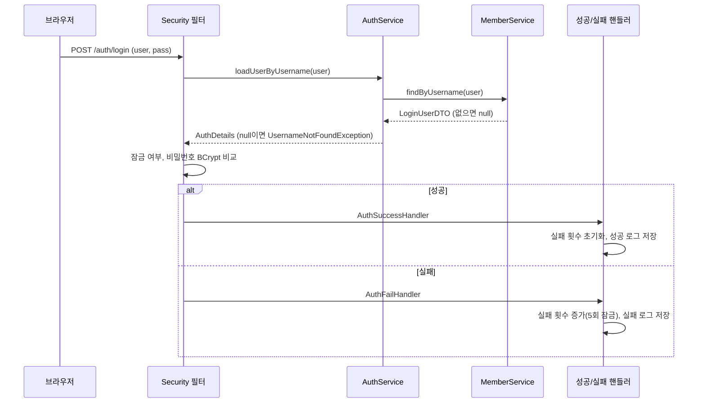

어제(11/5)까지는 JPA 미니 프로젝트에서 "규칙을 어디에 둘 것인가"를 다뤘다. 이번에는 `10_Spring-Security`의 `module01-security-session` 프로젝트로 **회원가입과 로그인, 권한별 접근 제한**을 만든다. 직접 로그인 컨트롤러를 짜지 않는데도 로그인이 동작한다는 점이 가장 신기했다. 로그인 `POST /auth/login`을 처리하는 컨트롤러는 우리가 만들지 않고, **Security 필터가 요청을 가로채서** 처리한다.

> 이 글은 프로젝트에서 **채운 부분**(SecurityConfig, AuthService, 성공/실패 핸들러, 회원가입)을 중심으로 정리한다. 아직 `TODO`가 남은 부분(`AuthDetails`의 일부, `@PreAuthorize`)은 글 끝에 따로 적었다.

## 1. 전체 흐름: 경비실을 지나야 건물에 들어간다

다섯 살 아이에게 설명한다면 이렇게 말할 수 있다. 건물 입구에 **경비실**이 있다. 방문자가 이름과 비밀번호를 내밀면 경비 아저씨는 먼저 **명부를 찾아오라고** 시킨다(UserDetailsService). 명부가 도착하면 비밀번호는 **경비 아저씨가 직접** 맞춰본다. 맞으면 **출입증**(세션)을 주고, 다음부터는 출입증만 보여주면 된다. 층마다 갈 수 있는 사람이 다르고(권한), 비밀번호를 5번 틀리면 계정이 잠긴다.




핵심은 **우리가 하는 일과 Security가 하는 일을 나누는 것**이다.

| 우리가 하는 일 | Security가 하는 일 |
|---|---|
| 아이디로 회원 조회 (`AuthService`) | 로그인 요청 가로채기 (`POST /auth/login`) |
| 조회한 회원을 `AuthDetails`로 감싸 반환 | 계정 잠금 여부 검사 (`isAccountNonLocked`) |
| 성공/실패 후 로그 저장, 횟수 관리 (핸들러) | **비밀번호 일치 검사** (`PasswordEncoder.matches`) |
| 로그인 화면 보여주기 (`GET /auth/login`) | 세션에 인증 정보 저장, 로그아웃 처리 |

## 2. 회원가입: 비밀번호는 절대 그대로 저장하지 않는다

회원가입은 평범한 MVC 흐름이다. 달라지는 지점은 **비밀번호를 `BCryptPasswordEncoder`로 암호화해서 `User` 엔티티를 만든다**는 것이다.

```java
User user = User.create(
        signupDTO.getUserId(),
        signupDTO.getUserName(),
        encoder.encode(signupDTO.getUserPass()),   // BCrypt 로 암호화
        signupDTO.getRole()
);
userRepository.save(user);
```

`User` 엔티티는 어제 배운 방식 그대로다. 전체 필드 생성자는 `private`이고, 새 회원은 `User.create()`로만 만든다. 아이디가 이미 있으면 `existsByUserId()`로 걸러서 `null`을 반환하고, 서버 오류는 `0`, 성공은 생성된 회원 번호로 컨트롤러가 결과를 구분한다. 테이블에는 `USER_ID`에 `unique` 제약(`uk_user_id`)도 걸려 있다. 11/5에 배운 "Policy가 놓치는 동시 요청은 DB 제약이 마지막 방어선"과 같은 이유다.

BCrypt를 쓰는 이유는 프로젝트 주석에 4가지로 적혀 있다.

| 이유 | 설명 |
|---|---|
| 보안성 | 무작위 솔트를 적용해서 해시를 만든다 |
| 비용 증가 | 매개변수로 암호 생성 시간을 조절해 무차별 대입 공격을 어렵게 한다 |
| 호환성 | 보안 수준이 높고 DB에 저장하기 쉽다 |
| 알고리즘 신뢰성 | 검증과 평가를 거쳐 계속 쓰이고 있다 |

## 3. SecurityConfig: 보안 규칙을 한곳에 모은다

`SecurityFilterChain`은 **요청이 컨트롤러에 도착하기 전에 거치는 보안 규칙 모음**이다. 오늘 채운 설정은 다섯 가지다.

| 설정 | 내용 |
|---|---|
| 접근 권한 | `/auth/login`, `/user/signup`, `/auth/fail`, `/`는 누구나. `/admin/*`는 ADMIN만. `/user/*`는 USER, ADMIN. 나머지는 로그인만 하면 가능 |
| 로그인 | 로그인 페이지 `/auth/login`, 입력 이름 `user`/`pass`, 성공/실패 핸들러 연결 |
| Remember Me | 체크박스 `remember-me`, 유효 기간 24시간(86400초) |
| 로그아웃 | `/auth/logout`, `JSESSIONID`와 `remember-me` 쿠키 삭제, 세션 소멸, 이후 `/`로 이동 |
| 세션 | 한 계정당 동시 접속 세션 1개로 제한, 세션 만료 시 `/`로 이동 |

```java
http.authorizeHttpRequests(auth -> {
    auth.requestMatchers("/auth/login", "/user/signup", "/auth/fail", "/").permitAll();
    auth.requestMatchers("/admin/*").hasAnyAuthority("ADMIN");
    auth.requestMatchers("/user/*").hasAnyAuthority("USER", "ADMIN");
    auth.anyRequest().authenticated();
})
```

규칙은 **위에서부터 순서대로** 검사한다. 그래서 가장 구체적인 규칙을 위에 두고, 나머지를 한꺼번에 받는 `anyRequest()`를 맨 아래에 둔다. `permitAll()`을 `anyRequest().authenticated()` 아래에 쓰면 로그인 화면조차 로그인해야 열리는 상황이 생긴다.

폼의 `input`의 `name`(`user`, `pass`, `remember-me`)과 설정의 파라미터 이름이 **정확히 일치해야** 한다. 11/2~11/3에 배운 "이름이 안 맞으면 값이 안 들어온다"와 같은 종류의 실수 포인트다.

## 4. UserDetailsService와 UserDetails: Security가 이해하는 말로 바꿔주기

Security는 우리의 `User`나 `LoginUserDTO`를 모른다. 그래서 두 가지를 구현해서 번역해줘야 한다.

| 인터페이스 | 우리 구현 | 역할 |
|---|---|---|
| `UserDetailsService` | `AuthService` | "이 아이디의 회원 정보를 가져와줘"에 답한다. 없으면 `UsernameNotFoundException` |
| `UserDetails` | `AuthDetails` | 조회한 `LoginUserDTO`를 Security가 이해하는 형태로 감싼다 |

```java
@Override
public UserDetails loadUserByUsername(String username) throws UsernameNotFoundException {
    LoginUserDTO loginUser = memberService.findByUsername(username);

    if (Objects.isNull(loginUser)) {
        throw new UsernameNotFoundException("회원정보가 존재하지 않습니다.");
    }
    return new AuthDetails(loginUser);   // 이 객체가 곧 세션에 저장되는 객체
}
```

`AuthDetails`가 돌려주는 값들을 Security가 직접 읽어서 로그인 가능 여부를 판단한다.

| 메서드 | Security가 어디에 쓰나 |
|---|---|
| `getAuthorities()` | `hasAnyAuthority(...)` 권한 검사 (권한 문자열 `"USER,ADMIN"`을 쪼갠 목록) |
| `getPassword()` | 입력한 비밀번호와 비교할 DB의 암호화된 비밀번호 |
| `isAccountNonLocked()` | 잠긴 계정이면 `false` → 로그인 거부 |
| `isAccountNonExpired` 등 3개 | 이번 수업에서는 `true`로 고정 |

`getAuthorities()`가 `Collection`을 돌려주는 이유는 **한 사용자가 여러 권한을 가질 수 있기 때문**이다. `GrantedAuthority`는 메서드가 하나뿐인 인터페이스라서 `() -> role` 같은 람다로 만들 수 있다.

### equals()와 hashCode()를 왜 오버라이딩할까

로그인할 때마다 같은 사용자라도 새 `AuthDetails` 객체가 만들어진다. 기본 `equals()`는 주소를 비교하므로 서로 다른 사용자로 인식하고, 그러면 `SessionRegistry`(내부적으로 Map)가 같은 사람을 다른 사람으로 센다. **동시 접속 제한과 활성 사용자 수 계산이 틀어진다.** 그래서 `userId` 기준으로 `equals()`와 `hashCode()`를 **같은 기준으로 함께** 오버라이딩해야 한다.

## 5. 성공/실패 핸들러: 로그인 전후에 끼어드는 코드

| 핸들러 | 호출 시점 | 하는 일 |
|---|---|---|
| `AuthSuccessHandler` | 아이디/비밀번호 검사를 통과한 직후 | 실패 횟수 초기화, 성공 로그 저장, 부모의 `onAuthenticationSuccess()`로 이동(가려던 페이지 또는 `/`) |
| `AuthFailHandler` | 인증 과정 어디서든 실패 | 예외 **타입**별 메시지 만들기, 비밀번호 오류면 실패 횟수 증가, 실패 로그 저장, `/auth/fail?message=...`로 이동 |

두 핸들러는 인터페이스를 직접 구현하지 않고 `SimpleUrl...Handler`를 **상속**해서, 필요한 기능만 추가하고 이동은 부모에게 맡긴다. 실패 원인은 `exception`의 타입으로 구분한다.

| 예외 | 의미 |
|---|---|
| `BadCredentialsException` | 아이디가 없거나 비밀번호 불일치 → 실패 횟수 증가 |
| `LockedException` | 계정이 잠김 (`isAccountNonLocked()`가 false) |
| `UsernameNotFoundException` | `AuthService`가 던진 "없는 아이디" |
| `InternalAuthenticationServiceException` | 사용자 정보를 검증하다 서버 오류 |
| `AuthenticationCredentialsNotFoundException` | 인증 정보 없이 보안 리소스에 접근 |

실패 횟수는 `User` 엔티티의 도메인 메서드가 관리한다. 11/5에 배운 구조 그대로다.

```java
public void increaseLoginFailCount() {
    this.loginFailCount++;
    if (this.loginFailCount >= 5) {
        this.isAccountLocked = true;   // 5회 이상이면 잠금
    }
}
```

`save()`는 부르지 않는다. 영속 상태의 엔티티 값만 바꾸면 `@Transactional` 커밋 시 **변경 감지로 UPDATE**가 실행되기 때문이다. 한글 메시지는 URL에 그대로 넣을 수 없어서 `URLEncoder.encode(errorMessage, "UTF-8")`로 인코딩해서 넘긴다.

## 6. 세션과 활성 사용자 수

`SessionRegistry`와 `HttpSessionEventPublisher`를 Bean으로 등록하면, 세션이 생기고 사라질 때마다 레지스트리가 알아서 갱신된다. 관리자 로그 페이지(`/admin/logs`)는 이 정보로 **현재 활성 사용자 수**를 계산한다.

```java
for (Object principal : sessionRegistry.getAllPrincipals()) {
    List<SessionInformation> sessions = sessionRegistry.getAllSessions(principal, false);  // false: 만료 세션 제외
    if (!sessions.isEmpty()) {
        activeUserCount++;
    }
}
```

`size()`만 쓰면 이미 로그아웃했거나 세션이 만료된 사용자도 센다. 그래서 만료되지 않은 세션이 하나라도 있는 사용자만 센다. 이 메서드가 실행됐다는 것 자체가 이미 "로그인 + ADMIN 권한" 검사를 통과했다는 뜻이다.

## 7. 권한 검사는 두 가지 방법이 있다

| 방법 | 위치 | 장점 |
|---|---|---|
| URL 단위 | `SecurityConfig`의 `authorizeHttpRequests` | 경로 규칙을 한 곳에서 관리하기 편하다 |
| 메서드 단위 | 핸들러 메서드의 `@PreAuthorize` | 같은 컨트롤러 안에서도 메서드마다 권한을 다르게 줄 수 있다 |

URL 규칙은 컨트롤러보다 **먼저** 검사된다. 미로그인이면 로그인 페이지로, 권한이 부족하면 403이 되고, 메서드는 실행조차 되지 않는다. 메서드 방식은 설정 클래스에 `@EnableMethodSecurity`가 있어야 동작한다.

## 8. CSRF는 학습용으로만 껐다

설정 마지막에 `csrf.disable()`이 있다. 프로젝트 주석의 설명은 이렇다. CSRF는 로그인한 사용자의 권한을 악용해 악성 사이트가 자동으로 요청을 보내게 하는 공격이고, **이번 수업에서는 학습 목적으로 비활성화**했다. 세션 기반 인증에서는 CSRF 보호가 필수이고, JWT 같은 토큰 방식(Stateless)에서는 필요하지 않다고 적혀 있다. 운영 환경에서는 반드시 켜야 한다.

## 아직 비어 있는 곳 (TODO)

프로젝트를 읽다가 눈에 띈 것들이다. 아직 채우지 않았다면 로그인 동작 전에 확인이 필요하다.

- `AuthDetails.getPassword()`가 아직 `null`을 반환한다. Security가 이 값을 DB의 암호화된 비밀번호와 비교하므로, 이대로면 올바른 비밀번호로도 로그인이 실패할 것으로 보인다(`loginUserDTO.getPassword()`를 반환해야 한다).
- `AuthDetails`의 `equals()`와 `hashCode()`가 TODO로 남아 있다.
- `SecurityConfig`의 `@EnableMethodSecurity`와 `IndexController`의 `@PreAuthorize`(`/method/admin`, `/method/user`)가 TODO로 남아 있다.
- 코드를 실행해서 확인한 결과는 이 글에 없다.

## 정리

| 영역 | 오늘 배운 것 | 한 줄 요약 |
|---|---|---|
| 로그인 | 컨트롤러 없이 필터가 처리 | 우리는 "조회"와 "전후 처리"만 맡는다 |
| 비밀번호 | `BCryptPasswordEncoder` | 저장은 암호화로, 비교는 Security가 |
| 권한 | `hasAnyAuthority` + 규칙 순서 | 위에서부터 검사, `anyRequest()`는 맨 아래 |
| 핸들러 | 성공/실패 상속 | 로그 저장, 실패 5회 시 잠금 |
| 세션 | `SessionRegistry` | `equals/hashCode`가 맞아야 동시 접속 제한이 맞는다 |
| CSRF | 학습용 비활성화 | 운영에서는 켜야 한다 |

이번에는 실행 결과나 수치를 측정한 내용이 없어서 Before/After 지표는 쓰지 않았다.

## 더 학습하면 좋은 개념

- **`hasRole`과 `hasAuthority`의 차이** — `hasRole("ADMIN")`은 내부적으로 `ROLE_ADMIN`이라는 접두사를 붙여 비교하고, `hasAuthority("ADMIN")`은 문자열을 그대로 비교한다. 이번 프로젝트가 후자를 쓰는 이유를 이해해야 권한 문자열 설계를 헷갈리지 않는다.
- **PasswordEncoder와 비밀번호 저장 방식** — BCrypt가 솔트와 비용(work factor)을 어떻게 다루는지, 해시를 저장하는 것과 암호화의 차이를 알아야 "왜 비밀번호 비교를 Security가 직접 하는지" 설명할 수 있다.
- **세션 고정 공격과 세션 관리 옵션** — 동시 접속 제한, 세션 만료 처리 외에 로그인 시 세션 ID를 바꾸는 보호 기능이 있다. 세션 기반 인증을 쓸 때 알아야 할 위험이다.
- **CSRF 토큰 동작 방식** — 오늘은 껐지만 실제로 켜면 폼마다 토큰이 필요하다. 왜 세션 인증에서 필수이고 JWT 방식에서는 불필요한지 원리를 알아야 한다.
- **JWT와 Stateless 인증** — 세션 방식과 비교해서 서버가 상태를 갖지 않는 인증이 어떻게 다른지 알면 다음 단계를 이해하기 쉽다.

## 참고 자료

- [Spring Security Reference — Password Storage](https://docs.spring.io/spring-security/reference/features/authentication/password-storage.html)
- [Spring Security Reference — Authorize HttpServletRequests](https://docs.spring.io/spring-security/reference/servlet/authorization/authorize-http-requests.html)
- [Spring Security Reference — Session Management](https://docs.spring.io/spring-security/reference/servlet/authentication/session-management.html)
- [Spring Security Reference — Cross Site Request Forgery (CSRF)](https://docs.spring.io/spring-security/reference/servlet/exploits/csrf.html)
