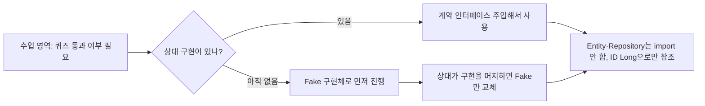
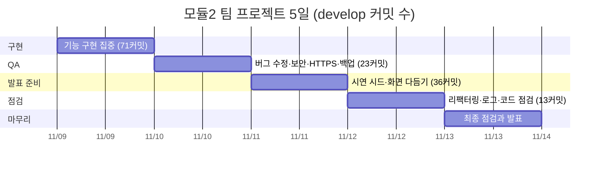

## 들어가며 — 5일, 4명, 서비스 하나

모듈 2 팀 프로젝트(2026.11.09 ~ 11.13)에서 우리 팀(승빈, 다연, 서연, 연익)은 **바이브코딩 학습 플랫폼 「바이브로그」**를 만들었다. Java 21, Spring Boot 3.5, Spring Data JPA, Thymeleaf, MySQL 8.0, Gradle을 썼다.

서비스는 이런 흐름이다. 진단 설문으로 수준을 확인하고 트랙을 추천받는다. 코스를 수강하면서 수업·퀴즈·모의고사를 풀고, 오답 리포트로 약한 개념을 확인한다. 만든 작품은 포트폴리오로 올려 동료 리뷰를 받고, 매달 콘테스트에 낸다. 쪽지·알림·신고·공지와 운영자 백오피스도 있다.

모듈 1(항공권 예매 콘솔 프로그램)과 가장 크게 달라진 점은 **4명이 모두 Claude Code를 켜고 동시에 일했다**는 것이다. 이 글은 Claude에게 코드를 시켜 본 후기가 아니라, **같은 Claude 4개가 한 저장소에서 서로 안 부딪히려고 정한 약속**의 기록이다.

## 문제 상황 — 같은 AI를 4명이 따로 쓰면 생기는 일

- 사람마다 프롬프트가 다르면 같은 기능도 코드 스타일이 달라진다.
- Claude는 "필요하면" 옆 영역의 코드나 테이블도 고친다. 4명이 동시에 그러면 서로의 코드가 꼬인다.
- 상대 영역의 기능이 아직 없으면 멈추거나, 그럴듯한 임시 코드를 지어낸다.
- 문서에 없는 정책(숫자, 문구)을 Claude가 그럴듯하게 만들어 낸다.

기간이 5일이라 한 명이 막히면 전체가 늦어진다. 그래서 코드를 짜기 전에 **규칙부터 정했다.**

## 해결 과정 (Action)

### 1. 담당을 작업량 점수로 나눴다

기능마다 단순 1점, 보통 2점, 복잡(채점·잠금·진행률 계산) 3점을 매겨 4묶음의 합이 22~23점으로 비슷하게 맞췄다. 영역은 쪼개지 않았다.

| 이름 | 묶음 | 맡은 영역 | 추가 역할 |
|---|---|---|---|
| 승빈 | A | 회원(auth), 커뮤니티(community) + 쪽지·신고·알림(message), 콘테스트(contest) | 형상관리: 저장소·빌드 검사·공통 설정·협업/Claude 규칙, 운영 서버(HTTPS·DB 백업) |
| 서연(나) | B | 진단·트랙·코스(course), 퀴즈(quiz) | DB 담당: `sql/` 스크립트와 시드 데이터 |
| 다연 | C | 수강·수업(lesson), 백오피스(admin) | PM: 일정·마일스톤·회의 정리, QA 가이드 |
| 연익 | D | 모의고사·리포트(exam), 포트폴리오(portfolio) | DB 담당: `sql/` 스크립트와 시드 데이터 |

### 2. 규칙 파일 하나를 4명이 같이 읽게 했다 (`CLAUDE.md`)

저장소 맨 위의 `CLAUDE.md`를 Claude가 작업 전에 매번 읽는다. 이 파일을 고치는 것도 이슈 → PR로만 한다. 핵심 규칙은 네 가지다.

**① 작업 전에 저장소 상황부터 확인한다.** 코드를 읽기 전에 읽기 전용 명령으로 확인하고 3~5줄로 알려 준다.
- 내 브랜치가 최신 `develop`보다 뒤처졌는지 (`git fetch`, `git status`)
- 맡은 이슈가 열려 있는지, 같은 파일을 건드리는 열린 PR이 있는지 (`gh issue view`, `gh pr list`)
- 지금이 어느 마일스톤(DB 설계 → API 명세 → P1 → P2 → P3)인지

`develop`에 새 커밋이 올라오면 알려 주는 훅도 붙였다. PR이 계속 머지되는 5일 동안 **내 브랜치만 뒤처지는 일**을 줄여 줬다.

**② 다른 영역을 기다리지 않는다.** 수업(lesson)은 퀴즈 통과 여부를 알아야 하고, 퀴즈(quiz)는 수업을 열고 잠가야 한다. 서로 기다리면 5일은 금방 간다.

- 다른 영역의 Entity·Repository는 import 하지 않는다. 다른 영역 데이터는 ID(`Long`)로만 참조한다.
- 필요한 기능은 받는 쪽 `model/policy/`의 **계약 인터페이스**를 주입해서 쓴다. 상대 구현이 없으면 `Fake`를 두고 먼저 진행한다.
- 읽기 전용 값(닉네임·코스명)은 받는 쪽 `<영역>Reader`를 쓴다.

**③ 멈춰야 할 때는 사람에게 넘긴다.** 다른 사람 담당(`sql/`, `build.gradle`, `global/`)을 바꿔야 하거나, 문서에 답이 없거나, API 명세와 다르게 만들어야 하면 Claude는 임시 코드로 우회하지 않는다. 대신 아래 둘 중 하나를 붙여넣기용 마크다운으로 만들어 준다.

| 양식 | 쓰는 때 | 담긴 것 |
|---|---|---|
| A. 다른 팀 요청서 | 남의 담당 범위를 바꿔야 할 때 | 받는 사람, 왜 필요한지, 요청 내용, **받는 분의 Claude에 붙여넣을 프롬프트** |
| B. 팀 상의 안건 | 문서에 답이 없거나 정책·테이블 결정이 필요할 때 | 선택지 표, Claude 추천, 결정 뒤 할 일 |

문서에 없는 규칙(숫자, 문구, 동작)은 지어내지 않고 사용자에게 묻는다. 이 한 줄이 "Claude가 지어낸 정책"을 막아 줬다.

**④ 금지선.**
- **PL-CST-001**: 서비스 기능에서 사용량 과금 AI API를 부르지 않는다. 채점·리포트·랭킹은 전부 규칙 기반이다.
- `ddl-auto: none`. 테이블은 `sql/01-schema.sql`이 기준이고 Entity로 테이블을 바꾸지 않는다.
- 규칙 위반은 `BusinessException`을 던지고, 화면은 `GlobalExceptionHandler`가 만든다. `null` 반환이나 `try-catch`로 처리하지 않는다.
- 커밋·push는 사용자가 요청할 때만 한다. PR 양식의 "🤖 AI 활용" 칸에 Claude로 만든 부분을 적는다.

### 3. 내가 맡은 일 (course · quiz · DB)

- **course**: 진단 설문·제출·건너뛰기·결과와 트랙 추천, 진단 다시 하기, 트랙 소개·코스 목록·상세, 코스 검색과 카테고리 탐색, 운영자 트랙·카테고리 관리(드래그로 순서 바꾸기), 코스 공개·비공개
- **quiz**: 퀴즈 풀이·채점, 틀린 문제 모아보기, 개념 태그별 오답 비율과 약한 개념 표시, 약한 개념에서 개념 글로 바로 가기, 운영자 문항 관리
- **화면 선행**: DB·API 명세가 확정되기 전에 진단·코스·퀴즈 화면을 먼저 마크업해 두고, 나중에 데이터를 연결했다.
- **DB 담당**: 코스 완료 상태, 공지·배너, 쪽지·알림·신고, 동료 리뷰·금칙어 시연 시드를 추가했다.
- **리팩터링**: 진단 답 검사를 `DiagnosisAnswerPolicy` 하나로 합쳤다.

### 4. 팀 전체 5일 타임라인

- **11/09 (71커밋)**: 진단·코스·퀴즈, 수업·백오피스, 모의고사·포트폴리오, 쪽지·알림·콘테스트까지 P1·P2 기능이 한꺼번에 머지됐다.
- **11/10 (23커밋)**: QA에서 찾은 문제를 고쳤다. 비공개 포트폴리오 파일이 주소로 열리던 문제 차단, 세션이 끊겨도 작성 중인 글 복원, 운영 HTTPS와 DB 매일 백업.
- **11/11 (36커밋)**: 발표 시연 준비. 시드 회원 30명, 시연 계정 13개, 회원 1만 명 규모의 실제 같은 데이터, 트랙별 코스·공지·쪽지·신고 시연 데이터.
- **11/12 (13커밋)**: 리팩터링. N+1 쿼리 줄이기, 모의고사 평균 점수를 집계 쿼리로 바꾸기, 공지 알림 1,000명씩 묶어 넣기, 업무 흐름 로그 추가.

QA 때는 다연이 만든 **QA 따라하기 스킬**이 도움이 됐다. "U-12 화면 어떻게 눌러봐?"라고 물으면 정상 흐름 → 예외 흐름 → 아쉬운 점 → 기록 순서로 눌러 볼 순서를 만들어 준다.

### 5. 팀원별 작업 한눈에 보기

| 이름 | 커밋 | 대표 작업 |
|---|---|---|
| 승빈 | 64 | 공개 프로필·팔로우, 동료 리뷰, 쪽지·알림·신고, 콘테스트 출품·투표·결과 발표 배치, 운영 HTTPS·DB 백업, 요청 로그 필터 |
| 다연 | 40 | 수강 포기·다시 시작, 운영자 수업·활동 관리, 개념 북마크, 기본·확장 대시보드, 회원 목록 필터, QA 가이드 |
| 서연(나) | 32 | 진단·트랙 추천, 코스 목록·상세·검색, 운영자 코스·카테고리 관리, 퀴즈 채점·약한 개념, 시연 시드 |
| 연익 | 32 | 모의고사 응시·자동 채점·오답 리포트, 포트폴리오 제출·수정·템플릿 관리, 과제 FAQ, 시드, 메인 디자인 |

## 결과 (Result)

| 지표 | 값 |
|---|---|
| 기간 | 2026.11.09 ~ 11.13 (5일) |
| develop 커밋 | 168개 (승빈 64, 다연 40, 서연 32, 연익 32) |
| 변경 규모 | 633개 파일, 약 4만 3천 줄 증가 (11/09 이전 대비) |
| 테스트 파일 | 130개 |
| 테이블 / Entity / Repository | 52개 / 53개 / 54개 |

**배운 점**
1. **Claude는 규칙이 있을 때 팀 도구가 된다.** 클래스 작성 방식(생성자 주입, 정적 팩토리, 변경 감지)과 예외 처리 방식을 `CLAUDE.md`에 적어 두니, 4명이 짠 코드가 한 사람이 짠 것처럼 읽혔다.
2. **"멈추는 규칙"이 "하는 규칙"만큼 중요했다.** 영역 침범과 문서에 없는 정책은 Claude가 임의로 처리하지 않게 했다. 요청서·안건 양식 덕분에 팀 채팅에 그대로 붙여 넣고 바로 결정할 수 있었다.
3. **계약 인터페이스와 `Fake`는 병렬 개발의 전제 조건이다.** 그 규칙이 없었다면 "수업이 끝나야 퀴즈를 만든다" 같은 순서 의존이 생겼을 것이다.
4. **아쉬운 점.** P3까지는 다 가져가지 못했다. 리팩터링(N+1, 로그, 인덱스)을 마지막 날에야 시작한 것도 아쉽다. 다음에는 중간에 코드 점검 시간을 한 번 넣고 싶다. 강사님이 공유해 주신 코드 검증 리포트는 [여니의 프로젝트2 회고]({{ site.baseurl }}/project/)에 따로 정리했다.

## 더 학습하면 좋은 개념

- **의존성 역전 원칙(DIP)** — 계약 인터페이스와 `Fake`가 바로 이 원칙의 적용이다. 구현이 아니라 인터페이스에 의존하면 상대 영역이 아직 없어도 개발할 수 있다.
- **ArchUnit · Spring Modulith** — "다른 영역의 Entity를 import 하지 않는다"를 문서가 아니라 테스트로 강제하는 도구다. 규칙을 어기면 빌드가 실패한다.
- **N+1 문제와 쿼리 수 테스트** — 쿼리 수를 세는 테스트로 화면별 쿼리 수를 고정해 두면, 데이터가 늘어도 성능이 갑자기 나빠지는 일을 미리 잡을 수 있다.
- **동시성 제어(Unique 제약, 낙관적·비관적 락)** — 같은 닉네임 동시 가입이나 하루 횟수 제한은 "확인하고 저장하는 사이"에 다른 요청이 끼어들 수 있다. DB 제약으로 막는 방법을 알아 두면 좋다.
- **프롬프트가 아닌 컨텍스트 관리** — 매번 지시하는 대신 `CLAUDE.md`, 훅, 스킬로 규칙을 저장소에 남기는 방식이 팀 작업에서 왜 더 안정적인지 비교해 보면 좋다.

## 참고 자료

- [Spring Boot 공식 문서](https://docs.spring.io/spring-boot/index.html)
- [Spring Data JPA 공식 문서](https://docs.spring.io/spring-data/jpa/reference/)
- [Spring Modulith 공식 문서](https://docs.spring.io/spring-modulith/reference/)
- [ArchUnit User Guide](https://www.archunit.org/userguide/html/000_Index.html)
- [Claude Code 공식 문서 - 메모리(CLAUDE.md)](https://docs.claude.com/en/docs/claude-code/memory)
