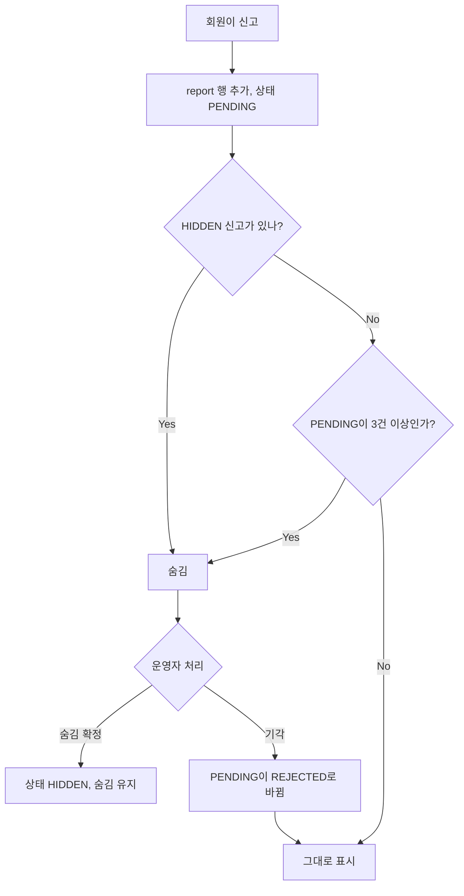

## 들어가며 — 발표에서 답하지 못한 질문

프로젝트 발표 때 내 PPT에 이런 코드를 넣었다.

```java
/* 서로 다른 회원의 처리 대기 신고가 이만큼 쌓이면 자동 숨김 (PL-RPT-002) */
static final int AUTO_HIDE_COUNT = 3;
```

강사님이 물으셨다.

> "숨김 여부를 신고 **행(row)을 세어서** 계산하네요. 왜 행으로 처리했죠?"

나는 "원래 그렇게 만들었다" 정도로밖에 답하지 못했다. 이유를 모르고 쓴 것과 같았다. 발표가 끝나고 코드와 설계 문서를 다시 읽으며 답을 찾았고, 같은 질문을 받을 때를 위해 정리해 둔다. 뒤쪽에는 강사님이 해 주신 피드백도 같이 정리했다.

## 문제 상황 — 숨김 여부를 어디에 둘 것인가

게시글·포트폴리오·댓글·리뷰는 신고를 **서로 다른 3명**이 하면 자동으로 숨겨지고 운영자 확인을 기다린다 (PL-RPT-002). 이 "숨김 여부"를 저장하는 방법은 두 가지다.

| | A. 컬럼으로 저장 | B. 행으로 계산 (우리 선택) |
|---|---|---|
| 방법 | 대상 테이블에 `is_hidden` 또는 `report_count` 컬럼 | `report` 테이블의 행을 읽어 매번 계산 |
| 같은 사실을 두는 곳 | 신고 행 + 컬럼, 2곳 | 신고 행, 1곳 |
| 기각 처리 | 컬럼도 되돌려야 함 | 상태만 바꾸면 숨김이 저절로 풀림 |
| 동시 신고 | 두 요청이 같은 숫자를 읽고 +1 하면 하나가 사라질 수 있음 | 행이 각각 저장되어 사라지지 않음 |
| 읽을 때 | 컬럼 한 번 읽음 | 행을 읽어 세어야 함 |

## 해결 과정 (Action) — 코드를 읽고 찾은 이유 4가지

숨김 판단은 `MessageReader`에 있다.

```java
// 숨김 = 운영자가 숨김으로 확정한 신고가 있거나, 처리 대기(PENDING) 신고가 3건 이상
private static final Predicate<List<Report>> HIDDEN_RULE =
        reports -> hasHidden(reports) || pendingCount(reports) >= AUTO_HIDE_COUNT;
```

`report` 한 줄은 "누가 어떤 대상을 신고했다"는 기록이고, 상태는 `PENDING`(대기) · `HIDDEN`(운영자가 숨김) · `REJECTED`(기각) 셋이다.



### 이유 1. 정책이 "서로 다른 3명"인데, 행 수가 곧 사람 수다

- PL-RPT-002: **서로 다른 3명**이 신고하면 자동으로 숨긴다.
- PL-RPT-003: 같은 대상은 **1인 1회**만 신고한다.

이 규칙을 DB에서 막아 뒀다.

```sql
CONSTRAINT uk_report_reporter_target UNIQUE (reporter_member_id, target_type, target_id)
```

같은 사람이 같은 대상을 두 번 신고하는 행은 DB가 만들지 못한다. 그래서 대상 하나의 PENDING 행이 3개라면 **신고한 사람은 정확히 3명**이다. "서로 다른 사람인지"를 따로 검사하지 않아도 되고, 행을 세는 것이 정책을 그대로 옮긴 계산이 된다. API 명세에도 "1인 1회라 PENDING 3건은 서로 다른 3명"이라고 적혀 있다.

### 이유 2. 같은 정보를 두 번 저장하지 않으려고 컬럼을 안 만들었다

DB 설계서에는 이렇게 적혀 있다.

> 같은 정보를 두 번 저장하지 않으려고 컬럼을 만들지 않았다: 진행률, 모의고사 열림, 약한 개념, … 정지 여부, 신고 숨김 여부.

`report_count` 컬럼을 두면 "신고 행"과 "컬럼 숫자"에 같은 사실이 생긴다. 운영자가 **기각**하면 컬럼도 되돌려야 하는데 잊으면 숨김이 안 풀린다. 행으로 계산하면 기각하는 순간 `PENDING`이 `REJECTED`로 바뀌어 숨김이 저절로 풀리고, 그 뒤에 들어오는 새 신고는 0건부터 다시 센다.

### 이유 3. 신고 대상이 5종류라서 컬럼을 두면 여러 영역 테이블을 바꿔야 한다

신고 대상은 게시글·포트폴리오·댓글·리뷰·쪽지로, 서로 다른 영역의 테이블이다. 우리 팀 규칙은 다른 영역의 코드와 테이블을 마음대로 고치지 않는 것이다. 컬럼 방식이었다면 5개 테이블을 바꾸고 5개 영역과 합의해야 했다. 행 방식은 `report` 한 테이블만 보면 된다. 다른 영역은 `MessageReader`에 "이 ID들 중 숨겨진 것"만 물어본다. (이 이유는 문서에 한 줄로 적혀 있지는 않고, 팀 규칙에서 내가 이어서 정리한 것이다.)

### 이유 4. 행은 이력이기도 하다

한 줄에는 신고자, 사유, 상태, 처리한 운영자(`handler_member_id`), 처리 시각(`handled_at`)이 같이 있다. 숫자 컬럼 하나였다면 "누가, 왜, 언제"를 잃는다. 백오피스 회원 상세의 신고 이력(대기·숨김·기각 건수)도 같은 행에서 바로 나온다.

### 대신 치르는 값 — 시행착오가 아니라 알고 쓴 단점

장점만 있는 방식은 아니다. 코드에도 그 부분이 적혀 있다.

```java
// ponytail: 처리 대기·숨김 신고를 모두 읽어 Java 로 센다. 신고가 수만 건 규모가 되면 group by 쿼리로 옮긴다
```

- 목록이나 상세를 열 때마다 신고 행을 읽어 세어야 한다. `(target_type, target_id)` 인덱스가 있어서 지금 규모는 괜찮다.
- 신고가 수만 건이 되면 DB에서 `group by`로 세게 바꿔야 한다. 지금은 Java 메모리에서 센다.
- "숨김인가?" 판정이 여러 곳에서 쓰인다. 강사님이 공유해 주신 검증 리포트도 "보여도 되는 콘텐츠" 판정이 19곳에 흩어진 점을 지적했다. 규칙의 정본을 한 곳에 두는 것이 다음 숙제다.
- 쪽지는 받는 사람이 한 명이라 PENDING이 1건을 넘지 않는다. 그래서 쪽지에는 자동 숨김이 없고 운영자 숨김만 있다.

### 발표 때 이렇게 답했으면 좋았을 것

> "신고 정책이 '서로 다른 3명'이고 같은 사람은 한 대상을 한 번만 신고할 수 있게 DB에 UNIQUE를 걸어서, 대기 중인 신고 행의 수가 곧 신고한 사람 수입니다. 그래서 숨김 여부를 컬럼으로 따로 저장하지 않고 행에서 계산했습니다. 컬럼을 두면 기각할 때 되돌리는 처리와 동시 신고 때 숫자가 어긋나는 문제를 따로 막아야 하는데, 행으로 세면 기각하는 순간 숨김이 자동으로 풀립니다. 단점은 읽을 때마다 세야 한다는 것이고, 신고가 많아지면 group by 쿼리로 옮길 계획입니다."

## 결과 (Result)

| 항목 | 값 |
|---|---|
| 숨김 판정 기준 | HIDDEN 신고 1건 이상 또는 PENDING 3건 이상 |
| 숨김 여부 컬럼 | 0개 (행에서 계산) |
| 중복 신고 방어 | DB `UNIQUE` 제약 1개 |
| 기각 시 숨김 해제 | 별도 코드 없이 상태 변경만으로 해제 |

한 줄로 정리하면, **값을 저장할지 계산할지는 "정책이 무엇을 세는지"와 "같은 사실을 몇 군데에 두게 되는지"로 정한다.** 우리는 "서로 다른 3명"이라는 정책을 UNIQUE 제약이 이미 지켜 주고 있어서 행을 세는 것이 가장 단순하고 틀릴 곳이 적었다.

## 강사님 피드백 정리 (2026.11.16)

강사님이 구두로 해 주신 말씀을 풀어 쓰고, 우리 코드는 `develop`에서 직접 센 값을 옆에 적었다. 뜻이 분명하지 않은 줄은 추측하지 않고 확인 필요로 남겼다. 전체 표는 프로젝트의 `docs/retrospective/2026-11-16-module2-instructor-feedback.md`에 있다.

| 주제 | 강사님 말씀 | 우리 프로젝트 현황 |
|---|---|---|
| 책임 분배 | 갓 클래스(책임이 너무 많아 하나를 고치면 다 망가지는 클래스)를 만들지 않는다 | 리포트가 Service 한 클래스가 화면 주소·문구·업무 규칙을 같이 맡는 곳을 지적 |
| 엔티티 | 상태 변경은 Entity 안에서, 규칙을 어기면 던지고, Service에서 정책을 조립한다 | Entity 안의 `throw`가 0개 |
| Repository | ERD 52엔티티라고 Repository가 52개일 필요는 없다. 읽기만 하면 필요 없고, 핵심은 루트다 | 테이블 52 / `@Entity` 53 / Repository 54 |
| 연관관계 | ERD와 코드의 ERD는 다르다. 연관관계를 맺지 않는 쪽이 N+1 위험이 적다. 요구사항에 따라 달라진다 | 연관관계 어노테이션 4개, `cascade` 0건 |
| 인덱스 | 조회에 쓰는 컬럼은 인덱스를 해 주는 게 좋다. Entity에서 설정할 수도 있고 DB에서 설정할 수도 있다 | SQL에만 설정, Entity의 `@Index`는 0개 |
| 페이지 | 처음·끝으로 가기가 필요하고, 지금은 모든 페이지가 로딩되어 있다 | 리포트: 쪽 번호 상한 없음 |
| 비동기 | 회원가입 환영 메일은 비동기로 처리한다 | 지금은 요청 안에서 바로 발송, 코드에 "느려지면 `@Async`" 주석 |
| 계정 | 탈퇴·비밀번호 변경 시 다른 기기 로그인이 안 되어야 한다 | 리포트가 실행으로 확인: 다른 기기 세션이 살아 있음 |
| 신고 | 신고 시점의 악플을 유지해야 한다. 수업 진행률이 100으로 바뀌는 것과 같다 | 뜻 확인 필요. 내가 이해한 건 "계산값은 재료가 바뀌면 결과도 바뀐다"는 경고 |
| 기타 | 생산성, 시큐리티, 트랜잭션, 글로벌 공간, "우리의 하네스" | 메모만 있어 뜻 확인 필요 |

신고 시점에 대한 말씀은 이번 글의 주제와 이어진다. 행으로 세는 방식이라 "신고 당시의 상태"는 행이 남아 있는 동안만 유지된다. 이 부분은 강사님께 다시 여쭤봐야 한다.

## 더 학습하면 좋은 개념

- **파생 데이터 vs 저장 데이터(Derived vs Stored)** — 계산으로 구할 수 있는 값을 저장하면 두 곳이 어긋날 수 있다. 반대로 매번 계산하면 읽기 비용이 든다. 어느 쪽을 고를지의 기준을 알아 두면 설계가 빨라진다.
- **UNIQUE 제약과 동시성** — 애플리케이션에서 "이미 신고했는지" 검사만 하면 동시 요청이 둘 다 통과한다. DB UNIQUE 제약이 마지막 방어선이 되는 이유를 이해하자.
- **집계 쿼리(`GROUP BY`, `HAVING`)** — `ponytail` 주석의 다음 단계다. Java에서 세던 것을 DB에서 세면 무엇이 달라지는지 직접 비교해 보자.
- **복합 인덱스의 컬럼 순서** — `(target_type, target_id)` 인덱스가 왜 이 순서여야 조회에 쓰이는지, 앞 컬럼 규칙을 함께 확인하자.
- **Aggregate Root** — 강사님이 말씀하신 "핵심은 루트"와 직접 연결되는 개념이다. Repository를 몇 개 두는지가 이 개념에서 결정된다.

## 참고 자료

- [MySQL 8.0 공식 문서 - CREATE TABLE (UNIQUE 제약)](https://dev.mysql.com/doc/refman/8.0/en/create-table.html)
- [Spring Data JPA 공식 문서 - 쿼리 메서드](https://docs.spring.io/spring-data/jpa/reference/jpa/query-methods.html)
- [Spring Framework 공식 문서 - @Async](https://docs.spring.io/spring-framework/reference/integration/scheduling.html)
- [Spring Security 공식 문서 - 세션 관리](https://docs.spring.io/spring-security/reference/servlet/authentication/session-management.html)
