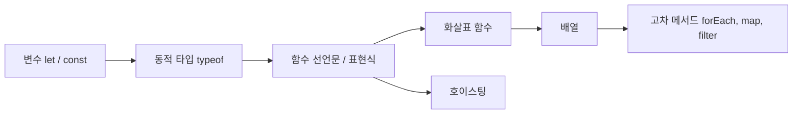

오늘(11/17)부터 `11_JavaScript` 수업이 시작됐다. Java만 쓰다가 JavaScript를 처음 만나서, 모든 문법을 "Java로 치면 뭐지?"로 번역하면서 정리했다. 오늘 배운 것은 변수(`var`, `let`, `const`), 함수(선언문, 표현식, 호이스팅), 화살표 함수, 배열, 그리고 배열의 고차 메서드(`forEach`, `map`, `filter`)다.

> 이 글의 코드는 모두 오늘 수업 실습 파일(`01_Core/01_variable.js`, `03_function.js`, `04_arrow-function.js`, `05_array.js`, `06_higher-order-method.js`)에서 가져왔다. 개념 정리가 목적이라서 문제 해결 과정(STAR)이 아닌 개념 설명 중심으로 썼다.



## 1. 변수: 타입이 변수가 아니라 값에 붙는다

Java는 `String str = "문자열";`처럼 변수에 타입을 적는다. JavaScript는 `let`, `const` 같은 **변수 표현식**만 적고, 타입은 **값을 할당하는 시점**에 정해진다.

| 키워드 | 의미 | Java로 치면 |
|---|---|---|
| `const` | 재할당 불가, 상수의 의미 | `final` |
| `let` | 재할당 가능 | 일반 변수 |

```javascript
const shop = "원티드 식당";
// shop = 1;            // 재할당하면 에러

let test = 1;
test = "문자열";         // 타입이 달라져도 에러가 나지 않는다
```

이것을 **동적 타입**이라고 한다. 프로젝트 주석이 정리한 장단점은 이렇다.

| | 내용 |
|---|---|
| 장점 | 자료형을 신경 쓰지 않고 변수를 선언할 수 있다 |
| 단점 | 값이 언제든 다른 타입으로 바뀔 수 있어서, 값을 확인하기 전에는 타입을 확신할 수 없다. `test.length`를 쓰려는데 그 사이에 `test = 10`이 되어 있으면 코드가 끝까지 잘 동작할 거라고 보장할 수 없다 |

현재 타입은 `typeof` 연산자로 확인한다. 실습에서 값을 바꿔가며 찍어본 결과를 표로 정리하면 이렇다.

| 값 | `typeof` 결과 |
|---|---|
| 선언만 하고 값이 없음 (`let test1;`) | `undefined` |
| `1` | `number` |
| `"java"` | `string` |
| `true` | `boolean` |
| `null` | **`object`** |
| `{}` | `object` |
| `[]` | **`object`** |
| `function(){}` | `function` |

`null`과 배열이 모두 `"object"`로 나오는 것이 헷갈렸다. 배열인지 확인하려면 `typeof`가 아니라 다른 방법이 필요하다는 뜻이다(아래 "더 학습하면 좋은 개념"에 적어 두었다).

## 2. 함수: Java가 클래스 기반이면 JS는 함수 기반

수업에서 가장 강조한 말은 이것이다. **Java는 클래스 기반의 객체지향 언어이고, JavaScript는 function 기반의 객체지향 언어라고 할 수 있다.** 함수가 값처럼 변수에 담기고, 다른 함수에 전달되기 때문이다.

함수를 만드는 방법이 두 가지다.

| 방식 | 코드 | 특징 |
|---|---|---|
| 함수 선언문 | `function welcome(name) { ... }` | 호이스팅 된다 |
| 함수 표현식 | `const welcome2 = function (name) { ... }` | 변수에 함수를 담는다 |

```javascript
// 함수 표현식. 이름은 붙여도 되고 생략해도 된다
const welcome1 = function welcome1(name) { return `${name} 님 , 반갑습니다~~!` }
const welcome2 = function (name) { return `${name} 님 , 반갑습니다~~!` }
const welcome3 = function hello(name) { return `${name} 님 , 반갑습니다~~!` }

console.log(welcome3("여니"));    // 변수 이름으로 호출한다
// console.log(hello("여니"));    // 에러. 함수 표현식에 붙인 이름 hello는 밖에서 부를 수 없다
```

백틱(`` ` ``)으로 감싼 **템플릿 리터럴**의 `${}`로 변수를 문자열 안에 끼워 넣는다. Java의 `String.format()`이나 문자열 연결을 쓰던 자리를 대신한다.

### 호이스팅: 차림표에 미리 인쇄된 요리

다섯 살 아이에게 설명한다면 이렇게 말할 수 있다. 식당 **차림표**에는 두 종류의 요리가 있다. 하나는 차림표를 인쇄할 때부터 **미리 적혀 있는 요리**(함수 선언문)라서, 손님이 주문 전에 불러도 주방장이 안다. 다른 하나는 **주문을 받은 뒤에야 적는 요리**(함수 표현식)라서, 아직 적기 전에 부르면 "그런 요리는 없는데요?" 하고 에러가 난다.


```javascript
console.log(cook('떡볶이'));          // 정상 동작. 선언문은 실행 전에 JS 엔진이 먼저 읽는다
function cook(menuName) {
    return `${menuName} 조리 시작`
}

console.log(test1("떡볶이"))          // 에러. 표현식은 이 줄에 도착하기 전에는 쓸 수 없다
const test1 = function (menuName) {
    return `${menuName} 조리 시작`
}
```

함수 선언문은 **런타임 이전에 JS 엔진이 먼저 인식**하기 때문에, 선언문보다 앞에서 호출할 수 있다. 이것을 호이스팅이라고 한다. 반면 `const test1 = function...`은 변수에 값이 **할당되는 줄에 도달해야** 사용할 수 있다. 두 줄의 순서만 바꿔도 결과가 달라지는 것이 오늘 실습의 핵심이었다.

## 3. 화살표 함수: function과 return을 생략한다

화살표 함수는 `function` 키워드와 중괄호 블록, `return`을 줄인 문법이다.

```javascript
message = function() { return '주문 접수 OK!💗' }
message = () => { return '주문 접수 OK!💗' }
message = () => '주문 접수 OK!💗'                              // 중괄호와 return 생략

message = (menuName, menuPrice) => `${menuName} 의 가격 ${menuPrice}`
message = (menuName) => `${menuName} !!`                      // 매개변수가 1개면 소괄호도 생략 가능
```

| 상황 | 쓰는 법 |
|---|---|
| 본문이 식 하나 | `() => 값` (중괄호, `return` 생략) |
| 본문이 여러 줄 | `() => { ...; return 값 }` (**생략할 수 없다**) |
| 매개변수 1개 | `x => ...` (소괄호 생략 가능) |
| 매개변수 0개 또는 2개 이상 | `() => ...`, `(a, b) => ...` (소괄호 필수) |

수업에서는 화살표 함수가 뒤에서 배울 고차 함수에 굉장히 많이 쓰이고, **Java의 람다 표현식도 이 화살표 함수를 본따서 등장했다**고 설명했다. 실제로 메뉴 가격 10% 할인을 `map`으로 처리하는 두 코드를 비교하면 줄어든 정도가 한눈에 보인다.

```javascript
const menuPriceList = [4000, 5000, 140000];
menuPriceList.map(function(price){ return price * 0.9 })   // 함수 표현식
menuPriceList.map(price => price * 0.9)                    // 화살표 함수
```

## 4. 배열: 어떤 타입이든 들어간다

Java의 배열은 한 가지 타입만 담지만, JavaScript의 배열은 **타입을 명시하지 않기 때문에 무엇이든** 들어갈 수 있다. 실습에서도 문자열, 숫자, 객체, 함수를 한 배열에 같이 넣었다.

```javascript
const menus = ['제육', '떡볶이', '순대', 1, {name : 'hi'}, function() {}];
for(let i = 0; i < menus.length; i++) {
    console.log(menus[i]);
}
```

실습 파일의 첫 주석에는 "같은 자료형만 들어갈 수 있다"라고 적혀 있는데, 바로 아래 코드가 보여주듯 **실제로는 반대**다(타입 제한이 없다). 이 글에서는 코드가 보여주는 동작을 기준으로 정리했다.

## 5. 고차 메서드: 함수를 받아서 배열을 처리한다

**고차 함수**는 함수를 인자로 전달받거나, 함수를 반환하는 함수다. 배열의 고차 메서드는 **콜백 함수**를 받아서 배열 요소를 하나씩 돌며 처리한다. 3가지를 배웠다.

| 메서드 | 콜백이 하는 일 | 반환 |
|---|---|---|
| `forEach` | 각 요소마다 실행 | 없음 |
| `map` | 각 요소를 변환 | 변환된 값으로 만든 **새 배열** |
| `filter` | 조건 판단 (`true`/`false`) | 조건이 `true`인 요소만 모은 **새 배열** |

```javascript
const menus = [
    {name : '치즈 떡볶이',      category : '분식', price : 14000},
    {name : '순대',            category : '분식', price : 5000},
    {name : '3X트러플 파스타',  category : '양식', price : 31000},
    {name : '제육 볶음',        category : '한식', price : 8000},
    {name : '김찌찜',          category : '한식', price : 9000},
];

menus.forEach(menu => console.log(menu));
const names  = menus.map(menu => menu.name);                          // 이름만 모은 배열
const snacks = menus.filter(menu => menu.category === '분식');        // 분식만
const cheap  = menus.filter(menu => menu.price < 10000);              // 1만원 미만만
```

`filter`와 `map`은 이어서 쓸 수 있다. 각 단계가 **새 배열**을 만들기 때문이다. "분식 중에서 1만원 미만인 메뉴의 이름 목록"은 이렇게 나온다.

```javascript
const result = menus
    .filter(menu => menu.category === '분식')   // 분식만 모인 배열
    .filter(menu => menu.price < 10000)         // 그중 1만원 미만만 모인 배열
    .map(menu => menu.name)                     // 이름만 모은 배열
console.log(result);                            // ['순대']
```

### `==`와 `===`

`filter`의 조건에서 `===`를 쓴 이유도 배웠다.

| 연산자 | 비교 방식 | 예 |
|---|---|---|
| `==` | 동등 비교. 암묵적으로 **타입을 변환**해서 값이 같은지 비교 | `1 == '1'` → `true` |
| `===` | 일치 비교. **타입과 값이 모두** 일치해야 함 | `1 === '1'` → `false` |

동적 타입 언어에서는 `==`가 예상 밖의 `true`를 만들 수 있어서, 비교는 `===`를 쓰는 것이 안전하다고 이해했다.

## 정리

| 영역 | 오늘 배운 것 | 한 줄 요약 |
|---|---|---|
| 변수 | `let` / `const`, 동적 타입 | 타입은 값에 붙고, 확인은 `typeof` |
| 함수 | 선언문 vs 표현식 | 선언문만 호이스팅 된다 |
| 화살표 함수 | `() => 값` | 한 줄이면 중괄호와 `return` 생략 |
| 배열 | 어떤 타입이든 | Java 배열과 달리 타입 제한 없음 |
| 고차 메서드 | `forEach`, `map`, `filter` | 콜백을 받아 새 배열을 만든다 |
| 비교 | `==` vs `===` | 비교는 `===` |

오늘은 실행 결과나 수치를 측정한 내용이 없어서 Before/After 지표는 쓰지 않았다.

## 더 학습하면 좋은 개념

- **`var`와 호이스팅, TDZ(일시적 사각지대)** — 오늘 `let`과 `const`만 배웠지만, `var`로 선언한 변수도 호이스팅되며 동작이 다르다. `const test1`을 선언 전에 쓰면 에러가 나는 정확한 이유가 TDZ라서, 이 개념을 알아야 호이스팅을 제대로 설명할 수 있다.
- **원시 타입과 `null` vs `undefined`** — `typeof null`이 `"object"`로 나오는 이유와 두 값의 차이를 알아야 동적 타입의 함정을 피할 수 있다. 배열 여부는 `Array.isArray()`로 확인한다.
- **`reduce`와 그 밖의 배열 메서드** — `forEach`, `map`, `filter` 다음으로 자주 쓰는 `reduce`, `find`, `some`, `every`를 알면 반복문 없이 대부분의 배열 처리를 표현할 수 있다.
- **화살표 함수와 일반 함수의 `this` 차이** — 오늘은 화살표 함수의 문법만 다뤘지만, `this`를 다루는 방식이 달라서 객체의 메서드나 이벤트 핸들러에서 선택 기준이 된다.
- **Java 람다와 스트림(`Stream`)** — 수업에서 "화살표 함수를 본따 람다가 나왔다"고 한 것처럼, `filter`와 `map`은 Java 스트림의 `filter`, `map`과 거의 같은 개념이다. 두 언어를 비교하면 둘 다 더 깊이 이해된다.

## 참고 자료

- [MDN — 호이스팅(Hoisting)](https://developer.mozilla.org/ko/docs/Glossary/Hoisting)
- [MDN — 화살표 함수 표현식](https://developer.mozilla.org/ko/docs/Web/JavaScript/Reference/Functions/Arrow_functions)
- [MDN — Array.prototype.map()](https://developer.mozilla.org/ko/docs/Web/JavaScript/Reference/Global_Objects/Array/map)
- [MDN — Array.prototype.filter()](https://developer.mozilla.org/ko/docs/Web/JavaScript/Reference/Global_Objects/Array/filter)
- [MDN — typeof](https://developer.mozilla.org/ko/docs/Web/JavaScript/Reference/Operators/typeof)
