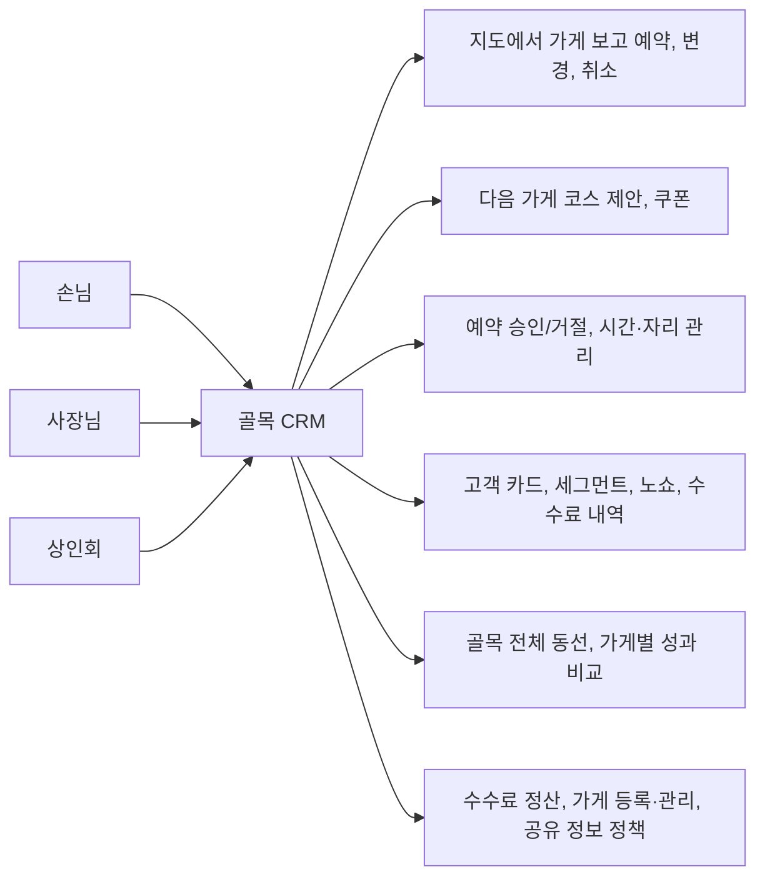
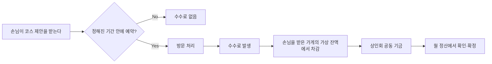

## 들어가며 — 프로젝트3을 시작했다

오늘(11/18) 프로젝트3을 시작했다. 팀은 석민, 연익, 하윤, 서연, 주희 다섯 명이다. 오늘 한 일은 **주제를 정하고, 만들기 전에 정해야 할 것들을 안건으로 나눠 하나씩 결정**한 것이다. 코드는 아직 한 줄도 없다.

주제는 **골목 상권 공동 CRM**이다. 가게마다 따로 관리하던 손님 정보와 예약을 골목 단위로 묶어서, 손님에게는 "다음에 갈 가게"를 제안하고, 사장님에게는 고객 카드와 예약 관리를, 상인회에는 골목 전체의 동선과 정산을 보여주는 시스템이다.

> 이 글은 완성 후기가 아니라 **킥오프 결정 기록**이다. 안건 49개 중 30개만 확정했고, 나머지는 미결로 남겨뒀다. 결정의 "왜"는 팀 결정표의 메모에 적힌 만큼만 옮겼고, 메모가 없는 결정은 이유를 적지 않았다.

## 문제 상황 (Task)

만들 것이 정해지지 않은 상태에서 코드부터 짜면 다섯 명이 서로 다른 시스템을 만들게 된다. 그래서 오늘의 과제는 두 가지였다.

1. **역할(손님, 사장님, 상인회)별로 시스템이 무엇을 해야 하는지** 정한다.
2. **돈(수수료), 정보 공유, 개인정보처럼 나중에 바꾸기 비싼 규칙**을 먼저 정한다.

## 해결 과정 (Action)

### 1. 안건을 49개로 쪼개고, 상태를 네 가지로 나눴다

기존 안건에 하윤이 정리한 정책 결정 목록을 병합했고, 겹치는 항목은 기존 안건으로 통합했다. 안건마다 상태를 붙여서 **"결정"만 확정으로 반영**하고, 나머지는 미결로 유지하는 규칙을 세웠다.

| 상태 | 의미 | 개수 |
|---|---|---|
| 결정 | 확정으로 반영 | 30 |
| 보류 | 방향은 있지만 더 고민 | 9 |
| 다음 회의 | 안건 자체를 다시 다듬어야 함 | 1 |
| 미정 | 아직 논의 전 | 9 |
| 합계 | | 49 |

보류와 미정을 섞어서 "대충 정했다"고 넘기지 않고 상태를 분리한 것이 오늘 가장 큰 수확이라고 생각한다. 이렇게 하면 나중에 "이거 정했었나?"를 다시 논쟁하지 않아도 된다.

### 2. 역할별로 시스템이 하는 일

| 역할 | 결정한 기능 |
|---|---|
| 손님 | 골목 지도에서 가게 보고 예약, 예약 변경·취소, 다음 가게 코스 제안 받기, 쿠폰 받기·사용 (필수만 넣고 나머지는 생략) |
| 사장님 | 예약 확인·승인/거절, 예약 가능 시간·자리 관리, 고객 카드(방문 이력·메모), 고객 세그먼트 만들기, 노쇼 관리, 소개 수수료 내역, 우리 가게로 들어오고 나가는 손님 흐름 |
| 상인회 | 골목 전체 손님 동선, 가게별 성과 비교, 수수료 정산 확인·확정, 가게 등록·관리, 가게 간 공유 정보 정책 |

직원 계정은 만들지 않기로 했다. **사장만 있는 구조**다(H3). 권한 모델이 단순해진다.

### 3. 손님을 어떻게 알아보고, 무엇을 공유할까

가게가 달라도 같은 손님임을 알아야 코스 제안과 공동 CRM이 성립한다. 그래서 식별과 공유 규칙을 먼저 정했다.

| 안건 | 결정 |
|---|---|
| B1 같은 손님 식별 | 비회원은 **전화번호**, 회원은 **계정**. 비회원은 이름과 전화번호만 받는다 |
| B2 가게끼리 공유할 항목 | 이름, 연락처, 인원, 방문 일시, 방문한 가게 목록, 노쇼 이력, 성별·연령대 |
| B3 공유 동의 | 예약할 때 **공유 동의 체크**. 체크하지 않으면 예약할 수 없다 |
| H2 역할별 볼 수 있는 데이터 | 사장님은 "제안으로 온 손님인지" 확인 가능, 상인회는 **집계 단위만**(가게별·골목 전체), 손님은 권한 없음 |

### 4. 돈이 오가는 규칙: 소개 수수료

코스 제안으로 손님이 온 가게가 상인회에 수수료를 내는 구조다. 실제 결제는 하지 않고 **가상 잔액·포인트로 차감하는 가상 거래 내역**을 구현하기로 했다.

| 안건 | 결정 |
|---|---|
| C1 수수료가 생기는 경우 | 제안 후 정해진 기간 안에 예약하면 |
| C2 받는 쪽 | 상인회(공동 기금) |
| C3 내는 쪽 | 손님을 받은 가게 |
| C4 정산 방식 | 가상 잔액·포인트 차감 (실제 결제 아님) |
| C5 상인회 요금 구조 | 시스템에서 다루지 않음(기획 설명만) |
| C7 발생 시점 | **방문 처리 시점** |
| C9 정산 주기, 취소 시 처리 | 월 정산에 취소 수수료가 포함되므로 별도로 고민하지 않는다 |

F1 메모에는 흐름이 이렇게 적혀 있다. 제안을 받아서 온 손님이 결제하면 사장이 완료를 입력하고, 정산 때 모아서 보내는 방식이다.

### 5. 코스 제안과 알림

| 안건 | 결정 |
|---|---|
| D1 제안 개수 | 최대 3곳 (2~3곳으로 결정) |
| D2 제안 시점 | 예약 완료 직후, 방문 당일 알림, 손님이 지도를 볼 때 |
| D3 제안 기준 | 손님 동선 데이터로 자동 (카테고리를 여러 개 추가해서 결정) |
| D4 앞 가게가 늦어지면 | 다음 가게에 지연 알림만. 시간 변경은 손님이 알아서 한다. 다음 일정 30분 전에 알림을 띄워 입력하는 방식 |
| E3 사장님이 새 예약을 아는 시점 | 즉시(실시간) |
| E6 알림 종류 | 예약 확정, 예약 변경, 예약 취소, 리마인드(30분 전) |

### 6. 예약 운영 규칙과 고객 분류

| 안건 | 결정 |
|---|---|
| G1 예약 상태와 취소 | 상태는 **신청, 확정, 방문, 취소** 4가지. 예약금 100% 환불은 하루 전까지. 나머지 세부 기준은 가게 재량 |
| G2 예약 슬롯 규칙 | 가게 재량 |
| G3 노쇼 페널티 | 예약금으로 대체 |
| H1 세그먼트 기준 | 손님의 전체 이용 가게 중 **특정 가게 이용 횟수 비율**로 나눈다 |
| H5 가게 가입·탈퇴 | 가입 승인 주체와 탈퇴 시 방문 이력·미정산 수수료 처리를 정한다. 탈퇴 후 그 가게는 사라진다 |

### 7. 성공 지표

F1에서 성공 지표 3개를 정했다. **코스 제안 수락률, 재방문율, 소개 수수료 총액**이다. 가상 데이터에는 노쇼·취소 데이터를 **제외**하기로 했다(F6).

## 아직 정하지 않은 것 (19개)

| 상태 | 안건 |
|---|---|
| 다음 회의 | A5 시연의 중심 이야기 (질문이 이상하다는 메모가 있어 안건부터 다듬는다) |
| 보류 | A4 고객 카드·세그먼트·캠페인의 소유(가게별만 / 상인회 집계는 비중을 줄임), E4 손님이 알림 보는 곳, F2 발표에서 앞세울 지표, F3 가상 손님 수, F4 가상 데이터 기간, F5 가상 손님 성향 나누는 방식, F7 지표 계산 기준, F8 시뮬레이션 데이터 표기, H4 개인정보 보관·파기 |
| 미정 | C6 소개 수수료율, C8 쿠폰 여러 장 받은 손님의 수수료 몫, D5 지연 시 변경 제안의 세부 규칙, D6 거절한 제안의 재노출(리롤, 거절 사유 선택지 아이디어가 메모에 있음), E1 캠페인 혜택 형태, E2 캠페인 대상, E5 캠페인 발송 제한·공동 캠페인, E7 쿠폰 조건·비용 부담, E8 쿠폰 발급 조건 |

## 정리하면서 눈에 띈 점 (다음 회의 전에 확인할 것)

결정표를 글로 옮기면서 맞춰봐야 할 것들이 보였다. 확정이 아니라 **확인 질문**이다.

- **개인정보 보관·파기(H4)**: 메모에는 "개인정보가 드러나지 않으니 보관기간이 필요 없다"고 적혀 있다. 그런데 B1과 B2에서는 이름, 전화번호, 성별·연령대를 받고 가게끼리 공유한다. 이 정보가 개인정보에 해당하는지 보관기간 없이 괜찮은지 다시 확인이 필요해 보인다.
- **수수료율(C6)이 미정**이다. 수수료 발생 시점(C7), 정산(C4)은 정해졌는데 얼마를 차감할지 없으면 가상 정산을 계산할 수 없다. 구현 전에 정해야 하는 안건으로 보인다.
- **서비스 이름(I2)과 지도 표현 수준(I1)**은 상태가 "결정"인데 결정표에 선택 내용이 적혀 있지 않다. 어떤 값으로 정했는지 문서에 남겨야 한다.
- **C8(쿠폰 여러 장)과 E7·E8(쿠폰 조건)**이 모두 미정이라, 손님의 "쿠폰 받기·사용"(A1) 기능은 규칙이 비어 있는 상태다.

## 결과 (Result)

| 항목 | 오늘 결과 |
|---|---|
| 전체 안건 | 49개 |
| 확정 | 30개 (약 61%) |
| 미결 | 19개 (보류 9, 다음 회의 1, 미정 9) |
| 역할 | 손님, 사장님, 상인회 3개로 확정. 직원 계정은 없음 |
| 코드 | 아직 없음 |

**배운 점**: 코드를 짜기 전에 "무엇을 만들지"를 안건으로 쪼개서 상태를 붙이면, 정해진 것과 안 정해진 것이 분리된다. 그리고 돈(수수료)과 개인정보 같은 규칙은 바꾸기 비싸서 먼저 정해야 한다. 이건 11/5에 배운 "규칙을 쓰기 전에 어디에 둘지 먼저 묻는다"와도 이어진다. 수수료나 노쇼 같은 규칙은 나중에 Entity나 Policy에 들어갈 후보들이기 때문이다.

## 더 학습하면 좋은 개념

- **개인정보 보호 원칙(수집 최소화, 동의, 보관·파기)** — B3의 공유 동의와 H4의 보관기간은 개인정보 보호법의 기본 원칙과 직접 연결된다. 어떤 정보가 개인정보인지, 동의를 어떻게 받아야 하는지 기준을 알아야 결정을 정당화할 수 있다.
- **RFM 분석과 고객 세그먼테이션** — H1에서 "특정 가게 이용 비율"로 세그먼트를 나누기로 했는데, 최근성·빈도·금액으로 고객을 나누는 전통적인 방법과 비교하면 기준을 고르는 근거가 생긴다.
- **상태 머신(State Machine)으로 예약 상태 모델링** — G1의 신청, 확정, 방문, 취소는 어떤 상태에서 어떤 상태로만 이동할 수 있는지를 정의해야 코드에서 규칙이 새지 않는다. Entity가 자기 상태로 규칙을 판단하는 방식과 잘 맞는다.
- **실시간 알림 방식(SSE, WebSocket, 폴링)** — E3의 "즉시(실시간)" 알림을 구현하려면 서버가 브라우저에 먼저 데이터를 보내는 방법을 골라야 한다. 각 방식의 장단점을 알아야 한다.
- **시뮬레이션(가상) 데이터 설계** — F 안건이 대부분 보류인 이유와 이어진다. 지표를 보여주려면 현실적인 가상 데이터의 규모, 기간, 분포를 어떻게 잡을지가 시연 품질을 좌우한다.

## 참고 자료

- [개인정보보호위원회](https://www.pipc.go.kr)
- [MDN — Server-sent events 사용하기](https://developer.mozilla.org/ko/docs/Web/API/Server-sent_events/Using_server-sent_events)
