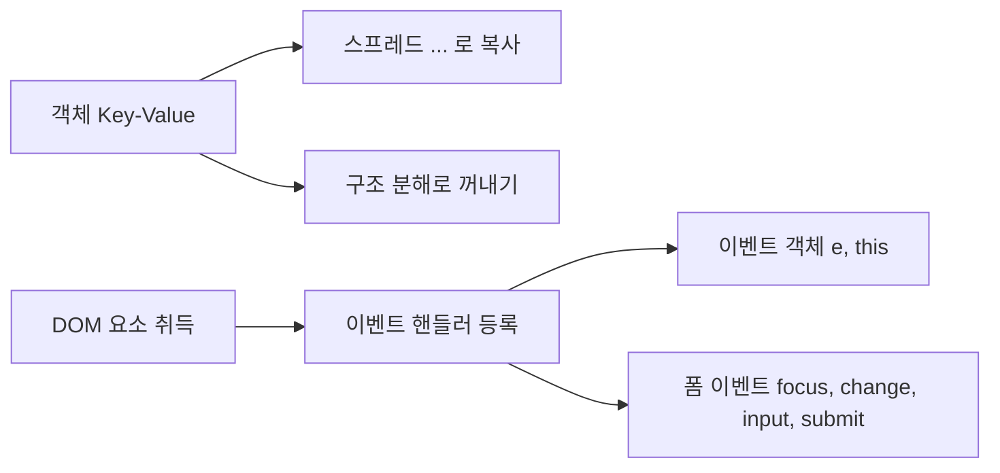

어제(11/17)는 변수, 함수, 화살표 함수, 배열, 고차 메서드를 배웠다. 오늘(11/18)은 두 덩어리였다. 오전에는 **객체를 다루는 문법**(객체, 스프레드, 구조 분해 할당), 오후에는 **브라우저 화면을 JavaScript로 움직이는 법**(DOM 요소 취득, 이벤트 핸들러, 이벤트 객체, 폼 이벤트)을 배웠다. Java로 Spring을 하다가 처음으로 "브라우저 안에서 도는 코드"를 쓴 날이라서, Java와 비교하면서 정리했다.

> 이 글의 코드는 모두 오늘 수업 실습 파일(`01_Core/02_object.js`, `07_spread-syntax.js`, `08_destructuring.js`, `02_Web/01 DOM/01_get-element.html`, `02_EVENT/01~03`)에서 가져왔다. 오늘 배운 개념 정리가 목적이라서 문제 해결 과정(STAR)이 아니라 개념 설명 중심으로 썼다.



## 1. 객체: 프로퍼티의 집합

JavaScript에서 중괄호 `{}`는 객체다. Key-Value 쌍(프로퍼티)으로 구성하고, Value에는 어떤 타입이든 들어갈 수 있다. 함수도 들어갈 수 있어서 Java 클래스에 비유하면 이렇게 대응된다.

| JavaScript | Java로 치면 |
|---|---|
| 객체 `store` | 클래스(+인스턴스) |
| `name`, `category` | 필드 |
| `getInfo : function() {...}` | 메서드 |

```javascript
const store = {
    name : '원티드 식당',
    category : '분식',
    getInfo : function() {
        return `${this.name}은 ${this.category} 전문점 입니다!`
    }
};
```

Java와 가장 크게 다른 점은 **객체를 만든 뒤에도 프로퍼티를 동적으로 추가하고 수정할 수 있다**는 것이다.

```javascript
const order = {menuName : '치킨'}
order.sauce = "뿌링클 시즈닝";   // 동적 추가
order.sauce = '맛초킹 시즈닝';   // 수정
```

`const`로 선언해도 프로퍼티는 바뀐다. `const`가 막는 것은 변수에 다른 값을 다시 대입하는 것이지, 객체 내부를 바꾸는 것이 아니다.

## 2. 스프레드 문법: 같은 상자를 쓸 것인가, 새 상자를 만들 것인가

다섯 살 아이에게 설명한다면 이렇게 말할 수 있다. 장난감 상자가 하나 있다. 친구가 "나도 그 상자 쓸래" 하고 **같은 상자를 같이 쓰면**, 친구가 로봇을 넣었을 때 내 상자에도 로봇이 들어 있다. 반대로 "네 장난감을 **새 상자에 똑같이 옮겨 담아줄게**" 하면 친구가 뭘 넣어도 내 상자는 그대로다.


```javascript
const cart = ['치킨', '피자'];
const cartRef = cart;        // 같은 배열을 가리킨다 (주소를 복사)
const cartCopy = [...cart];  // 새 배열을 만든다

cartRef.push('파스타');       // cart 도 ['치킨','피자','파스타'] 가 된다
cartCopy.push('빠네파스타');   // cart 는 그대로
```

수업 코드의 주석에는 `cartRef = cart`를 "깊은 복사", `[...cart]`를 "얕은 복사"라고 적어 두었는데, 용어를 정확히 하면 이렇다.

| 방식 | 실제로 일어나는 일 | 정확한 이름 |
|---|---|---|
| `const b = a` | 같은 객체의 **주소만** 복사. 객체는 하나뿐 | 참조 복사(같은 객체를 공유) |
| `const b = [...a]`, `{...a}` | 새 객체를 만들고 **1단계 값만** 복사 | 얕은 복사(shallow copy) |

수업에서 말한 "참조를 공유하면 한 군데에서 수정했을 때 다른 곳이 영문도 모른 채 바뀐다"는 단점이 이 글의 핵심 이유다. 메뉴 데이터를 여러 화면에서 쓴다면 스프레드로 복사해서 써야 한다. 객체도 같은 방식이다.

```javascript
const order = { menuName : '뿌링클', qty : 2 }
const orderRef  = order;
const orderCopy = {...order};

console.log(order === orderRef);   // true  (같은 객체)
console.log(order === orderCopy);  // false (새 객체)
```

스프레드의 얕은 복사는 **한 단계까지만** 새로 만든다. 객체 안에 또 객체나 배열이 있으면 그 안쪽은 여전히 같은 것을 공유한다(오늘 실습에서는 다루지 않았고, 아래 "더 학습하면 좋은 개념"에 적어 두었다).

## 3. 구조 분해 할당: 꺼내면서 이름 붙이기

배열이나 객체에서 값을 하나씩 변수로 꺼내려면 매번 `menuArr[0]`, `menu.name`처럼 써야 한다. 구조 분해 할당은 이것을 한 줄로 줄인다.

```javascript
const menuArr = ['치킨','피자'];
const [chi1, piz1] = menuArr;      // 순서대로 꺼낸다

const menu = { name : '치즈알밥', price : 7500, category : '퓨전한식' };
const {name, price, category} = menu;   // 같은 이름의 key 로 꺼낸다
```

| 대상 | 꺼내는 기준 | 주의 |
|---|---|---|
| 배열 `[a, b]` | **순서**(인덱스) | 변수 이름은 마음대로 |
| 객체 `{a, b}` | **프로퍼티 key 이름** | 변수명이 key와 일치해야 한다 |

객체 쪽이 중요하다. `const {name1} = menu`처럼 key에 없는 이름을 쓰면 `undefined`가 된다. 그리고 `const {...rest} = menu`처럼 스프레드와 결합하면 객체의 복사에도 쓸 수 있다.

## 4. DOM: JavaScript가 HTML 문서에 접근하는 길

JavaScript는 `html + css`로 이루어진 문서(Document)에 접근할 수 있는 언어다. 먼저 조작할 요소를 가져와야 하는데(요소 노드 취득), 방법이 4가지다.

| 방법 | 반환 | 특징 |
|---|---|---|
| `getElementById('store')` | 요소 1개 | id는 문서에서 하나여야 한다 (실습에서는 중복 id를 일부러 만들어 첫 번째 요소만 가져오는 것을 확인) |
| `getElementsByTagName('li')` | `HTMLCollection` | 유사 배열이라 배열 메서드를 바로 못 쓴다 |
| `getElementsByClassName('menu')` | `HTMLCollection` | 같은 이유 |
| `querySelector('.box')` / `querySelectorAll` | 첫 1개 / 전부 | CSS 선택자를 그대로 쓴다. **권장** |

```javascript
const $store = document.getElementById('store');
$store.style.backgroundColor = 'yellow';

const $snackliList = $snack.getElementsByTagName('li');   // HTMLCollection
const liList = Array.from($snackliList);                   // 배열로 변환
liList.forEach(li => li.style.color = 'red');
```

변수 앞의 `$`는 "이 변수는 DOM 요소를 담고 있다"는 표시용 관례다. `HTMLCollection`은 `forEach`, `filter`, `map` 같은 배열 전용 메서드를 쓸 수 없으므로 `Array.from()`으로 먼저 배열로 바꿔야 한다. 이 불편함 때문에 CSS 선택자로 가져오는 `querySelector`가 권장된다고 이해했다.

## 5. 이벤트 핸들러: 브라우저에게 "이 일이 생기면 이 함수를 불러줘"

이벤트 핸들러는 이벤트가 발생했을 때 브라우저에게 호출을 위임한 함수다. 등록 방법은 3가지다.

| 방식 | 코드 | 한계 |
|---|---|---|
| 어트리뷰트 | `<button onclick="recommend('김자바')">` | HTML과 JS가 섞인다. 함수 **참조가 아니라 호출문**을 쓴다 |
| 프로퍼티 | `$btn.onclick = function(){...}` | 한 이벤트에 **핸들러 하나만**. 다시 대입하면 덮어쓴다 |
| `addEventListener` (**권장**) | `$btn.addEventListener('click', fn)` | 같은 이벤트에 **여러 개** 등록 가능 |

```javascript
$btnProp.onclick = function() { alert("프로퍼티 방식으로 이벤트 핸들러 등록!!") }
$btnProp.onclick = () => alert("두번째 이벤트 핸들러 등록!!");   // 첫 번째가 덮어써진다

$btnListener.addEventListener('click', function(){ alert('결제 완료!') });
$btnListener.addEventListener('click', function(){ alert('2번째 addEvent 동작!') });  // 둘 다 실행
```

핸들러를 제거하려면 등록할 때 쓴 **같은 함수 참조**를 `removeEventListener`에 넘겨야 한다. 그래서 외부에 이름 있는 함수로 정의해 두어야 한다.

```javascript
const handleMouseOver = () => alert('결제 버튼에 마우스 호버!');
$btnRemove.addEventListener('mouseover', handleMouseOver);
$btnRemove.removeEventListener('mouseover', handleMouseOver);   // 같은 참조여야 제거된다
```

익명 함수로 등록하면 나중에 같은 함수를 다시 만들 수 없으니 제거할 방법이 없다. 이것이 "조건에 따라 제거해야 할 때는 이름 있는 함수로"라는 이유다.

## 6. 이벤트 객체와 `this`

이벤트를 등록하면 이벤트가 발생할 때 브라우저가 **이벤트 객체**를 만들어 핸들러의 매개변수로 넘겨준다. 좌표, 대상 요소 같은 정보가 들어 있다.

```javascript
function showMapCoords(e) {
    $map.textContent = `배달 위치 : ${e.clientX}, ${e.clientY}`;
}
```

`this`는 어떻게 호출했느냐에 따라 달라진다.

| 상황 | `this` |
|---|---|
| 어트리뷰트에서 `onclick="handleClick1()"`로 일반 함수 호출 | 전역 객체 `window` |
| 어트리뷰트에서 `onclick="handleClick2(this)"`처럼 `this`를 인자로 전달 | 이벤트를 가진 **DOM 요소** |

이벤트가 발생한 요소를 알면 그 요소를 없애거나 동작을 추가할 수 있다. Java의 `this`는 항상 현재 객체인데, JavaScript의 `this`는 호출 방식에 따라 달라진다는 점이 가장 낯설었다.

## 7. 폼 이벤트

폼 요소의 값을 읽고 바꾸는 방법과, 사용자의 입력에 반응하는 이벤트를 배웠다.

| 대상 | 값을 다루는 방법 |
|---|---|
| `input`, `textarea` | `value` (checkbox/radio는 `checked`) |
| `select` | `value`, `selectedIndex`, `options` |
| 폼 취득 | `document.forms.orderForm`(name), `document.forms[0]`(인덱스) |

| 이벤트 | 발생 시점 | 메모 |
|---|---|---|
| `focus` / `blur` | 요소에 들어올 때 / 나갈 때 | **버블링되지 않는다** |
| `focusin` / `focusout` | 위와 같음 | 버블링이 필요할 때 사용 |
| `change` | 값 변경이 **끝났을 때** | 텍스트 입력은 포커스를 잃어야 발생, select/radio는 선택 직후 |
| `input` | 값이 바뀌는 **즉시** | 붙여넣기, 음성 입력에도 반응 |
| `submit` | 폼 제출 시 | 서버 전송 전 검증, 전송 취소에 사용 |

`input`과 `change`의 차이가 가장 헷갈렸는데, 요청사항 글자 수를 실시간으로 세는 실습에서 이유가 보였다.

```javascript
$request.addEventListener('input', (e) => {
    let len = e.target.value.trim().length;
    $form.querySelector('span').textContent = len;   // 입력할 때마다 즉시 갱신
});
```

`change`로 썼다면 텍스트 칸에서 포커스를 잃기 전까지 숫자가 갱신되지 않았을 것이다.

폼 제출은 검증 후 전송을 취소하는 용도로 쓴다.

```javascript
$searchForm.onsubmit = function() {
    let keyword = this.querySelector('input[name=query]').value;
    if(!keyword) {
        alert('검색할 메뉴를 입력하지 않았습니다!');
        return false;   // 폼 전송 취소 (addEventListener 방식에서는 e.preventDefault() 사용)
    }
};
```

프로퍼티 방식에서는 `return false`로, `addEventListener` 방식에서는 `e.preventDefault()`로 막는다. 이것은 Spring MVC에서 `@Valid`로 서버에서도 검증한다는 11/5 내용과 이어진다. 프론트에서만 검증하면 URL이나 요청 body를 직접 조작해서 건너뛸 수 있으므로, 브라우저 검증은 편의 기능이고 서버 검증이 필수다.

## 정리

| 영역 | 오늘 배운 것 | 한 줄 요약 |
|---|---|---|
| 객체 | 프로퍼티 동적 추가/수정 | 만든 뒤에도 바꿀 수 있다 |
| 스프레드 | `[...a]`, `{...a}` | 새 객체를 만들어 참조 공유를 피한다 |
| 구조 분해 | `[a,b]`, `{a,b}` | 배열은 순서, 객체는 key 이름 |
| DOM 취득 | `querySelector` 권장 | `HTMLCollection`은 `Array.from`으로 변환 |
| 이벤트 | `addEventListener` 권장 | 여러 개 등록, 제거는 같은 참조로 |
| `this` | 호출 방식에 따라 달라짐 | 어트리뷰트 호출은 `window`, `this`를 넘기면 요소 |
| 폼 | `input` vs `change` | 즉시 vs 변경이 끝났을 때 |

오늘은 실행 결과나 수치를 측정한 내용이 없어서 Before/After 지표는 따로 쓰지 않았다.

## 더 학습하면 좋은 개념

- **깊은 복사와 `structuredClone`** — 스프레드는 1단계만 복사하는 얕은 복사다. 객체 안에 배열이나 객체가 중첩되어 있으면 안쪽은 여전히 공유되므로, 중첩 데이터를 완전히 분리하려면 어떻게 하는지 알아야 한다.
- **이벤트 버블링, 캡처링, 이벤트 위임** — `focus`가 버블링되지 않아서 `focusin`이 따로 있다는 것은 이벤트가 위로 전파된다는 개념이 바탕에 있다. 요소마다 핸들러를 다는 대신 부모에 하나만 달아 처리하는 이벤트 위임도 여기서 나온다.
- **`this` 바인딩과 화살표 함수** — 오늘 `this`가 호출 방식에 따라 `window`가 되기도 하고 요소가 되기도 했다. 화살표 함수의 `this`는 어떻게 다른지 알아야 이벤트 핸들러에서 실수하지 않는다.
- **`HTMLCollection`과 `NodeList`** — `getElementsBy...`와 `querySelectorAll`이 돌려주는 타입이 다르고, 문서가 바뀔 때 반영되는 방식(live/static)이 다르다. 취득 방법을 고르는 기준이 된다.
- **Constraint Validation API (`required`, `pattern`, `checkValidity()`)** — 오늘은 `submit`에서 직접 `if`문으로 검증했지만, HTML 속성과 브라우저 내장 검증으로 같은 일을 하는 방법도 있다.

## 참고 자료

- [MDN — 전개 구문(Spread syntax)](https://developer.mozilla.org/ko/docs/Web/JavaScript/Reference/Operators/Spread_syntax)
- [MDN — 구조 분해 할당](https://developer.mozilla.org/ko/docs/Web/JavaScript/Reference/Operators/Destructuring_assignment)
- [MDN — Document.querySelector()](https://developer.mozilla.org/ko/docs/Web/API/Document/querySelector)
- [MDN — EventTarget.addEventListener()](https://developer.mozilla.org/ko/docs/Web/API/EventTarget/addEventListener)
- [MDN — HTMLFormElement: submit 이벤트](https://developer.mozilla.org/ko/docs/Web/API/HTMLFormElement/submit_event)
