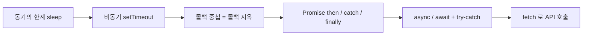

11/18에는 DOM과 이벤트로 화면을 움직이는 법을 배웠다. 이번 `03_Async(비동기)` 수업의 주제는 **오래 걸리는 일을 기다리지 않고 다른 일을 이어가는 방법**이다. 타이머(`setTimeout`, `setInterval`)에서 시작해서, 콜백 지옥, `Promise`, `async/await`, 마지막으로 실제 외부 API를 호출하는 `fetch`까지 한 줄로 이어졌다.

> 이 글의 코드는 수업 실습 파일 4개(`01_timer.html`, `02_asynchronous.html`, `03_promise-async-await.html`, `04_fetch.html`)에서 가져왔다. 개념 정리가 목적이라서 문제 해결 과정(STAR)이 아닌 개념 설명 중심으로 썼다.



## 1. 동기와 비동기: 떡볶이 3초를 기다릴까

다섯 살 아이에게 설명한다면 이렇게 말할 수 있다. 분식집에서 떡볶이를 만드는 데 3초가 걸린다. **동기**는 떡볶이가 다 될 때까지 서서 기다리느라 다음 손님의 주문을 못 받는 것이다. **비동기**는 떡볶이를 불에 올려놓고, 그동안 다음 손님 주문을 먼저 받는 것이다.


실습에서는 동기 처리의 한계를 일부러 만들어 보았다. `sleep()`은 정해진 시간이 지날 때까지 반복문을 돌며 **스레드를 점유**한다.

```javascript
function sleep(func, delay) {
    const delayUntill = Date.now() + delay;
    while(Date.now() < delayUntill);     // 3초 동안 이 줄에 갇힌다
    func();
}

// sleep(cook, 3000);       // 동기: 주문은 3초 뒤에만 받을 수 있다
// takeOrder();
setTimeout(cook, 3000);     // 비동기: 3초 뒤 실행을 예약만 하고 넘어간다
takeOrder();                // 바로 실행된다
```

`setTimeout`을 쓰면 `takeOrder()` 일곱 번이 먼저 출력되고, 3초 뒤에 `cook`의 메시지가 나온다. 코드는 위에서 아래로 쓰여 있는데 실행 순서는 그렇지 않다는 점이 처음에는 낯설었다.

## 2. 타이머: 지연과 반복

두 함수 모두 코드 진행에 **간극(지연)**을 만든다.

| 함수 | 동작 | 인자 |
|---|---|---|
| `setTimeout(함수, 지연시간, [매개변수])` | 지연 시간 뒤 **한 번** 실행 | 세 번째 인자부터 콜백에 전달 |
| `setInterval(함수, 간격)` | 간격마다 **반복** 실행 | 멈추려면 `clearInterval(변수)` |

```javascript
setTimeout(() => console.log('5초 경과! 피자 조리 완룡'), 5000);
console.log("주문 하실 분?!")                      // 먼저 출력된다

setTimeout((menuName) => console.log(`3초 경과! ${menuName} 조리 완룡`), 3000, "치킨");

let count = 1;
const interval = setInterval(() => {
    console.log(`배달 도착까지 ${5-count} 초`);
    count++;
    if(count == 5){
        clearInterval(interval);                   // 종료 조건이 없으면 영원히 반복된다
        console.log('배달 완료!');
    }
}, 1000);
```

`setInterval`은 1초 간격으로 계속 실행되므로 **종료 조건을 달아주는 것이 중요**하다. 반환값(`interval`)을 `clearInterval`에 넘겨서 멈춘다. 이 코드는 `4, 3, 2, 1`초를 출력한 뒤 "배달 완료!"를 찍는다.

## 3. 동작 원리: 태스크 큐와 이벤트 루프

비동기가 어떻게 가능한지는 수업에서 CS 지식으로 정리했다.

| 개념 | 설명 |
|---|---|
| 태스크 큐(task queue) | 비동기 함수의 콜백이나 이벤트 핸들러가 **일시적으로 보관되는 영역** |
| 이벤트 루프(event loop) | 콜 스택에 실행 중인 것이 있는지, 태스크 큐에 대기 중인 함수가 있는지를 **반복 확인**. 콜 스택이 비어 있고 큐에 대기 중인 함수가 있으면 **FIFO(선입선출)**로 콜 스택에 옮긴다 |

그래서 `setTimeout(..., 0)`처럼 지연이 0이어도 콜백은 현재 실행 중인 코드가 모두 끝난 뒤에 실행된다. 타이머의 시간이 지나면 콜백이 큐에 들어가고, 콜 스택이 비어야 이벤트 루프가 꺼내 가기 때문이다.

수업에서는 비동기가 필요한 이유도 짚었다. 프론트 서버는 화면을 구성하고, 백엔드 서버는 화면에 표시될 데이터를 돌려준다. 프론트가 데이터를 요청하는데 백엔드 응답이 느리면 사용자는 영문도 모른 채 화면이 멈추는 경험을 한다. **그래서 JS 기반 프론트의 API 호출은 모두 비동기 방식으로 한다.**

## 4. 콜백 지옥: 순서를 지키려다 함수 안에 함수 안에 함수

요구사항은 이렇다. 주문할 때마다 1초 뒤에 포인트가 10P씩 적립되고, 한도는 50P다. 각 적립이 **이전 적립이 끝난 뒤에** 실행되어야 순서가 맞는다. 비동기 함수의 순서를 지키려면 다음 작업을 콜백 안에 넣어야 한다.

```javascript
function pointCallback(point, func) {
    setTimeout(() => {
        const result = point + 10;
        if (func) func(result);
    }, 1000);
}

pointCallback(0, point => {
    console.log(`${point}P`);                     // 10P
    pointCallback(point, point => {
        console.log(`${point}P`);                 // 20P
        pointCallback(point, point => {
            console.log(`${point}P`);             // 30P
            pointCallback(point, point => {
                console.log(`${point}P`);         // 40P
                pointCallback(point, point => {
                    console.log(`${point}P`);     // 50P
                })
            });
        });
    });
});
```

다섯 번만 적립해도 들여쓰기가 계단처럼 깊어진다. 수업에서는 이것을 **콜백 지옥**이라 부르고, 작성하면 안 되는 코드의 예시라고 정리했다. 한 단계가 늘수록 읽기도, 에러를 잡기도 어려워진다.

## 5. Promise: 성공과 실패를 약속으로 포장하기

`Promise`는 비동기 처리의 **성공/실패를 다루기 쉽게** `resolve`(성공)와 `reject`(거부)를 제공한다. 비동기 결과값을 가진 객체이기도 하다.

```javascript
function earnPoint(point) {
    return new Promise((resolve, reject) => {
        setTimeout(() => {
            const result = point + 10;
            if (result > 50) {
                return reject(new Error("적립 한도 초과"));   // 거부
            }
            return resolve(result);                          // 성공
        }, 1000);
    });
}

earnPoint(0)
    .then(point => { console.log(`${point}P`); return earnPoint(point); })
    .then(point => { console.log(`${point}P`); return earnPoint(point); })
    // ... 같은 패턴 반복
    .catch(e => console.log(e, '발생~!!!'))
    .finally(() => console.log("포인트 적립 종료"));
```

| 메서드 | 실행 시점 |
|---|---|
| `then()` | 성공(`resolve`)했을 때. 다음 `then`으로 값을 이어준다 |
| `catch()` | 어느 단계에서든 실패(`reject`)했을 때 |
| `finally()` | 성공이든 실패든 마지막에 항상 |

콜백 지옥과 달리 **들여쓰기가 깊어지지 않고 위에서 아래로 한 줄로** 읽힌다. 이 실습에서 적립 한도 50P를 넘는 순간 `reject`가 일어나고, 그 아래 남은 `then`들은 건너뛰고 곧바로 `catch`와 `finally`가 실행된다.

## 6. async/await: 비동기를 동기처럼 읽히게

`await`는 `Promise`가 `resolve`한 결과를 꺼내준다. `.then()`을 대신하는 방법이고, `await`를 쓰는 함수 앞에는 `async`를 붙인다.

```javascript
async function runAsync() {
    try {
        let point = await earnPoint(0);
        console.log(`${point}P`);
        point = await earnPoint(point);
        console.log(`${point}P`);
        // ...
    } catch (e) {
        console.log(e, '발생!!')
    }
}
```

| 비교 | `then` 체이닝 | `async/await` |
|---|---|---|
| 결과 꺼내기 | `.then(point => ...)` | `await`로 변수에 바로 받는다 |
| 예외 처리 | `.catch()` (메서드 체이닝) | **`try-catch`로 감싼다** (체이닝이 아니기 때문) |
| 읽는 느낌 | 점으로 이어진 체인 | 위에서 아래로 쓰는 순차 코드 |

세 방식의 흐름은 같은 결과(10P → 50P)를 낸다. 수업에서는 `Promise`, `async`, `await`가 **어느 시점에 실행될지 모르는 비동기의 단점을 해결하는 문법**이라고 정리했다. 다만 `await`를 써도 코드가 실제로 멈춰서 기다리는 것이 아니다. 그 함수의 이어지는 실행만 미뤄질 뿐, 그동안 다른 코드는 계속 실행된다. "비동기를 동기처럼 **읽히게** 만든다"가 더 정확한 표현이라고 이해했다.

## 7. fetch: 실제 외부 API 호출

비동기의 가장 대표적인 사례는 외부 서버의 API 호출이다. `fetch`가 그 도구이고(수업에서는 `fetch`, `ajax`, `axios`를 언급했다), **`Promise`를 반환한다.**

```javascript
async function getReviews(){
    const data = fetch('https://jsonplaceholder.typicode.com/posts?_limit=5');
    console.log(data);                 // Promise 객체. 바로 값을 읽을 수 없다

    const res = await data;            // 응답 객체
    const reviews = await res.json();  // 문자열 JSON → JS 객체로 변환
    console.log(reviews[0].title);
}
```

`then` 방식으로 쓰면 `fetch(...).then(res => res.json()).then(json => ...)`이다. 응답을 한 번 받고(`res`), 본문을 JS 객체로 바꾸는 `res.json()`도 비동기라서 `await`가 **두 번** 필요하다는 점이 중요하다. API가 돌려주는 JSON은 문자열 형태이고, `json()`으로 변환해야 `reviews[0].title`처럼 쓸 수 있다.

## 정리

| 단계 | 문법 | 한 줄 요약 |
|---|---|---|
| 지연 | `setTimeout`, `setInterval` | 실행을 예약하고 흐름은 계속 간다 |
| 원리 | 태스크 큐 + 이벤트 루프 | 콜 스택이 비면 큐에서 FIFO로 꺼낸다 |
| 순서 지키기 1 | 콜백 중첩 | 작동하지만 읽기 어렵다 (콜백 지옥) |
| 순서 지키기 2 | `Promise` + `then/catch/finally` | 한 줄로 읽히고 에러를 한곳에서 처리 |
| 순서 지키기 3 | `async/await` + `try-catch` | 순차 코드처럼 읽힌다 |
| 실전 | `fetch` | `Promise`를 반환, `await`를 두 번 |

오늘은 실행 결과나 수치를 측정한 내용이 없어서 Before/After 지표는 쓰지 않았다.

## 더 학습하면 좋은 개념

- **마이크로태스크 큐와 매크로태스크 큐** — 오늘 태스크 큐 하나로 설명했지만, `Promise`의 `then` 콜백과 `setTimeout` 콜백은 서로 다른 큐에 들어가서 실행 순서가 다르다. 이걸 알아야 비동기 코드의 출력 순서를 정확히 예측할 수 있다.
- **`fetch`의 에러 처리(`res.ok`)** — `fetch`는 서버가 404나 500을 응답해도 `reject`하지 않고 네트워크 자체가 실패할 때만 `reject`한다. 오늘 실습에는 응답 상태를 확인하는 코드가 없어서, 실전에서 반드시 필요한 부분이다.
- **`Promise.all`과 병렬 처리** — 오늘은 순서가 중요한 작업을 차례로 처리했다. 서로 관계없는 요청 여러 개를 동시에 보내고 모두 끝나길 기다리는 방법을 알면 속도가 크게 달라진다.
- **`axios`와 `fetch` 비교** — 수업에서 언급된 `axios`는 `fetch`와 어떤 점이 다른지(자동 JSON 변환, 에러 처리 등)를 알아야 프로젝트에서 선택할 기준이 생긴다.
- **CORS** — 브라우저에서 다른 도메인의 API를 호출할 때 막히는 이유다. 프론트와 백엔드를 따로 개발하는 프로젝트에서 반드시 만나게 된다.

## 참고 자료

- [MDN — 비동기 JavaScript 학습하기](https://developer.mozilla.org/ko/docs/Learn_web_development/Core/Scripting/Asynchronous_JavaScript)
- [MDN — Promise](https://developer.mozilla.org/ko/docs/Web/JavaScript/Reference/Global_Objects/Promise)
- [MDN — async function](https://developer.mozilla.org/ko/docs/Web/JavaScript/Reference/Statements/async_function)
- [MDN — Fetch API 사용하기](https://developer.mozilla.org/ko/docs/Web/API/Fetch_API/Using_Fetch)
- [MDN — 동시성 모델과 이벤트 루프](https://developer.mozilla.org/ko/docs/Web/JavaScript/Event_loop)
