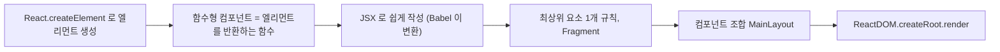

오늘(11/23)부터 `12_React` 수업이 시작됐다. 앞서 배운 JavaScript 위에서 "화면을 조각(컴포넌트)으로 나눠 조립한다"는 React의 방식을 처음 만났다. 오늘 배운 것은 `React.createElement`로 엘리먼트 만들기, 엘리먼트와 컴포넌트의 차이, JSX 문법, 최상위 요소 규칙과 Fragment, 그리고 컴포넌트를 조합해서 화면 하나 만들기까지다.

> 이 글의 코드는 오늘 수업 실습 파일 6개(`01_intro` 2개, `02_component` 4개)에서 가져왔다. 개념 정리가 목적이라서 문제 해결 과정(STAR)이 아닌 개념 설명 중심으로 썼다. 코드 속 사용자 예시 값은 일반적인 값으로 바꿨다.



## 1. 시작하기: 라이브러리를 어떻게 가져올까

React를 쓰는 방법은 크게 두 가지라고 배웠다.

| 방법 | 설명 |
|---|---|
| React 앱 생성 | 프로젝트를 만들어 빌드 도구로 관리 |
| `script` 태그로 라이브러리 임포트 | HTML에 CDN 주소를 넣어 바로 사용 (오늘 방식) |

오늘은 공식 사이트의 시작하기 문서에 있는 CDN을 복사해서 `react`와 `react-dom` 두 개를 `script`로 불러왔다. 파일 하나만 열어도 바로 실습할 수 있는 장점이 있다.

## 2. 엘리먼트: React가 화면을 표현하는 가장 작은 단위

React는 **가상 DOM(Virtual DOM)**이라는 개념을 가진다. 브라우저의 진짜 DOM이 아니라, **메모리 위에 코드로 존재하는 DOM**이다. 엘리먼트는 이 가상 DOM을 이루는 조각이고, 요소 노드, 어트리뷰트 노드, 텍스트 노드로 구성된다.

```javascript
const hiElement = React.createElement('h1', {className:'hi'}, 'helloworld');
ReactDOM.createRoot(document.getElementById('root')).render(hiElement);
```

| 인자 | 의미 |
|---|---|
| 1번째 | 만들려는 요소의 타입 (`h1`, `div`, `pre`) |
| 2번째 | 요소의 프로퍼티 (`{className:'hi'}`) |
| 3번째 | 자식 요소 (`'helloworld'`) |

`ReactDOM.createRoot(...)`는 화면에 그릴 **뿌리(root) 자리**를 지정하고, `.render(엘리먼트)`로 그 안에 엘리먼트를 그린다. `class` 대신 `className`을 쓴다는 점이 눈에 띄었다. `class`가 JavaScript의 예약어이기 때문이다.

## 3. 컴포넌트: 엘리먼트를 반환하는 함수

**컴포넌트는 엘리먼트를 반환하는 개념으로, 화면을 구성하는 조각 단위**다. 오늘 배운 함수형 컴포넌트는 말 그대로 함수다.

```javascript
function helloworld() {
    return React.createElement('h1', { className: 'hi' }, 'helloworld');
}

ReactDOM.createRoot(document.getElementById('root'))
    .render(React.createElement(helloworld));   // 컴포넌트를 엘리먼트로 만들어서 render
```

수업에서는 컴포넌트 함수를 Java의 메서드처럼 특별한 기능을 하는 코드의 집합으로 이해하면 된다고 설명했다. 일반 함수와 구분하기 위해 **함수 이름 앞글자를 대문자로 쓰는 것이 규칙**이다. 아래 JSX 섹션에서 이 규칙이 단순한 관습이 아니라 실제로 동작을 바꾼다는 걸 알게 된다.

## 4. JSX: createElement를 매번 쓰기엔 너무 힘들다

`createElement`로 요소를 하나씩 만들면 중첩이 깊어질수록 굉장히 복잡하다. 그래서 **JSX(JavaScript XML)**를 쓴다. JavaScript 안에서 XML(HTML과 비슷한) 형태로 요소를 쓸 수 있게 해주는 문법이다.

```javascript
const element = <h1 className="test">안녕!!{formatName(user)}</h1>
```

브라우저는 JSX를 이해하지 못한다. 그래서 **Babel**이 JSX를 일반 JavaScript로 바꿔주는 **트랜스파일링**을 한다. 오늘은 CDN으로 `@babel/standalone`을 불러서 사용했다.

| 사용 방법 | 내용 |
|---|---|
| 1 | `head`에 Babel 관련 `script` 추가 |
| 2 | JSX를 쓰는 `script` 태그에 `type="text/babel"` 추가 |

JSX 안에서 **중괄호 `{}`를 쓰면 모든 JavaScript 표현식**을 쓸 수 있다. 함수 호출(`formatName(user)`), 객체 값(`user.name`) 모두 가능하다. 스타일은 중괄호가 두 겹이다.

```javascript
<div style={{ border: '1px solid black', background: 'yellow' }}>
```

바깥 `{}`는 "여기부터 JavaScript 표현식"이라는 JSX의 표시이고, 안쪽 `{}`는 **스타일 객체 리터럴** 자체다.

실습 파일에는 `class="test"`로 쓴 줄도 있었는데, JSX는 JavaScript 문법의 일부라서 `createElement`의 프로퍼티와 같은 이름(`className`)을 쓰는 것이 규칙이다. 이 글의 예제는 `className`으로 정리했다.

### 컴포넌트 이름이 대문자여야 하는 이유

JSX에서는 컴포넌트를 태그처럼 쓸 수 있다.

```javascript
function Header(){
    return (
        <>
            <h1>헤더입니다!!</h1>
            <h3>사이트 이름@</h3>
        </>
    )
}
ReactDOM.createRoot(document.getElementById('root')).render(<Header/>);
```

`<Header/>`가 `React.createElement(Header)`를 쉽게 쓰는 문법이다. 이때 **앞글자가 소문자면 컴포넌트가 아니라 단순 HTML 요소로 인식**한다. `<header/>`라고 쓰면 HTML의 `header` 태그가 되어버린다. 그래서 대문자 규칙은 관습이 아니라 React가 컴포넌트와 HTML 태그를 구분하는 기준이다.

## 5. 최상위 요소는 하나여야 한다: Fragment

JSX에서 같은 레벨의 요소를 연달아 쓰면 문법 에러가 난다.

```javascript
// 에러: 최상위 엘리먼트가 두 개
const Element = (
    <h1>{user.name}</h1>
    <h3>{user.phone}</h3>
);
```

JSX는 결국 `createElement` 호출 하나로 바뀌기 때문에, 반환할 수 있는 것이 **하나의 요소**여야 한다. 해결 방법이 두 가지다.

| 방법 | 코드 | 단점 |
|---|---|---|
| `div`로 감싸기 | `<div> ... </div>` | 불필요한 `div` 영역이 DOM에 생긴다 |
| **Fragment** `<> ... </>` | `<React.Fragment>`의 줄임 표기 | 없음. 감싸지만 DOM에 흔적이 남지 않는다 |

```javascript
const Element = (
    <>
        <h1>{user.name}</h1>
        <h3>{user.phone}</h3>
    </>
);
```

화면에는 `h1`과 `h3`만 나오고 바깥 `div`가 없다. 레이아웃이나 CSS에 영향을 주지 않고 묶고 싶을 때 쓴다.

## 6. 컴포넌트 조합(Composition): 블록을 끼워서 화면 만들기

다섯 살 아이에게 설명한다면 이렇게 말할 수 있다. 레고로 집을 지을 때 **지붕 블록, 벽 블록, 문 블록**을 따로 만들어 두고 끼워서 조립한다. React의 컴포넌트가 이 블록이다. 헤더, 네비게이션 바, 메인, 푸터를 각각 작은 컴포넌트로 만들고, `MainLayout`이라는 큰 컴포넌트 안에 끼워 넣으면 화면 하나가 된다.


```javascript
function MainLayout() {
    return (
        <div style={{ border: '1px solid black', background: 'yellow' }}>
            <Header />
            <NavBar />
            <Main />
            <Footer />
        </div>
    );
}

ReactDOM.createRoot(document.getElementById('root')).render(<MainLayout />);
```

`Main` 컴포넌트는 객체의 값을 `{user.name}`, `{user.phone}`처럼 중괄호로 꺼내서 보여준다. 이렇게 컴포넌트를 쪼개면 얻는 것은 **재사용**과 **역할 분리**다. 헤더만 고치고 싶으면 `Header`만 수정하면 되고, 다른 화면에서도 같은 `Header`를 가져다 쓸 수 있다. 이건 11/5에 배운 "규칙을 알맞은 곳에 나눠 둔다"는 설계 감각과 닮아 있다.

## 정리

| 개념 | 오늘 배운 것 | 한 줄 요약 |
|---|---|---|
| 가상 DOM | 메모리 위의 DOM | 진짜 DOM을 바로 건드리지 않는다 |
| 엘리먼트 | `React.createElement(타입, 프로퍼티, 자식)` | 화면의 가장 작은 조각 |
| 컴포넌트 | 엘리먼트를 반환하는 함수 | 이름은 대문자로 시작 |
| JSX | `type="text/babel"` + Babel | JS 안에서 HTML처럼 쓰는 문법, `{}`로 JS 표현식 |
| 최상위 요소 | 하나여야 한다 | `div` 대신 `<></>`(Fragment) |
| 조합 | 컴포넌트 안에 컴포넌트 | 블록을 끼워 화면을 만든다 |

오늘은 실행 결과나 수치를 측정한 내용이 없어서 Before/After 지표는 쓰지 않았다.

## 더 학습하면 좋은 개념

- **Props: 컴포넌트에 값 전달하기** — 오늘은 `Main`이 전역 `user` 객체를 직접 읽었지만, 보통은 부모가 자식에게 값을 넘긴다. 컴포넌트를 재사용 가능하게 만드는 핵심 개념이다.
- **State와 렌더링** — 오늘 만든 화면은 한 번 그리면 끝이다. 값이 바뀔 때 화면이 다시 그려지는 방식을 알아야 이벤트(11/18에 배운 것)와 React가 연결된다.
- **Virtual DOM의 비교(diffing)와 재조정** — "가상 DOM은 메모리 위의 DOM"이라는 정의에서 한 걸음 더 나가면, 바뀐 부분만 실제 DOM에 반영하는 원리가 나온다. React가 빠른 이유다.
- **빌드 도구와 JSX 변환(Vite 등)** — 오늘은 브라우저에서 Babel로 변환했지만 실제 프로젝트는 빌드 단계에서 미리 변환한다. 브라우저 변환 방식이 학습용인 이유가 여기에 있다.
- **리스트 렌더링과 `key`** — 11/17에 배운 `map`으로 배열을 JSX 요소 목록으로 바꾸는 패턴이 React에서 가장 자주 쓰인다.

## 참고 자료

- [React 공식 문서 — 시작하기](https://ko.react.dev/learn)
- [React 공식 문서 — JSX로 마크업 작성하기](https://ko.react.dev/learn/writing-markup-with-jsx)
- [React 공식 문서 — 첫 번째 컴포넌트](https://ko.react.dev/learn/your-first-component)
- [React 공식 문서 — Fragment](https://ko.react.dev/reference/react/Fragment)
- [MDN — React 시작하기](https://developer.mozilla.org/ko/docs/Learn_web_development/Core/Frameworks_libraries/React_getting_started)
