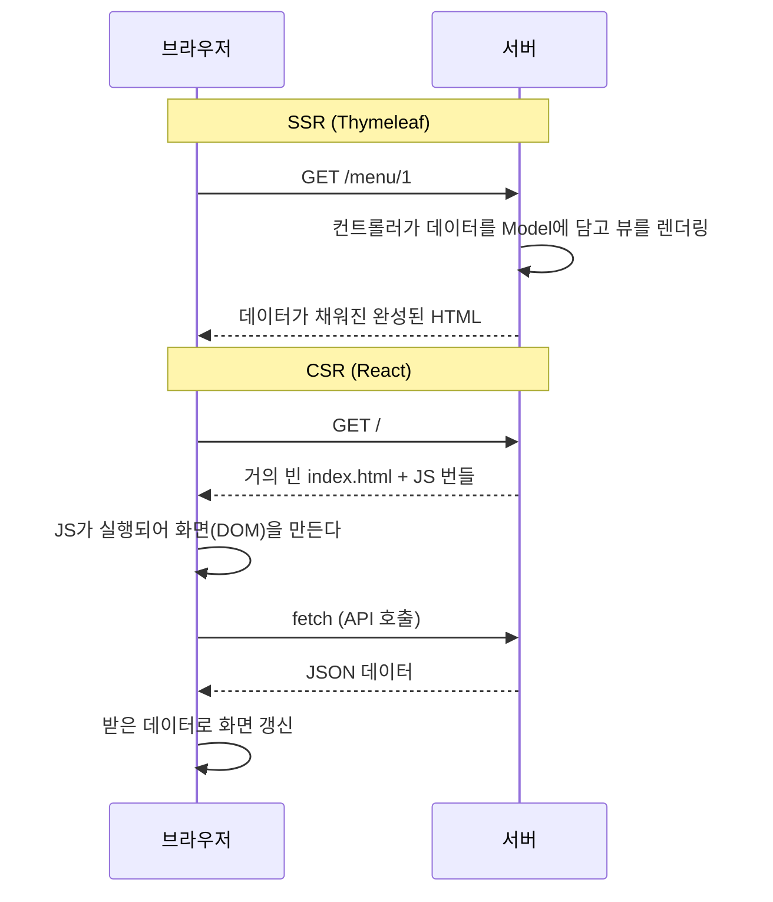
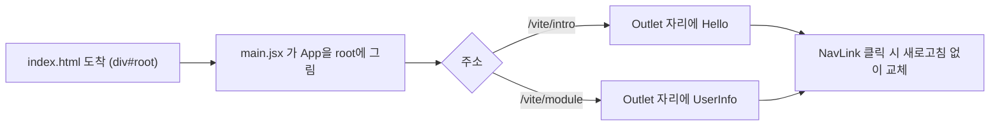
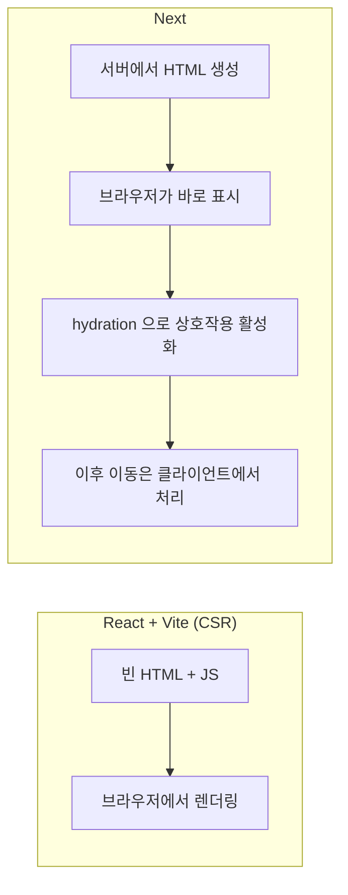

오늘(11/24) 블로그 정리 키워드는 세 가지였다. **1) SSR/CSR 방식의 렌더링 차이**(Thymeleaf는 SSR, React는 CSR), **2) React의 특징인 SPA(Single Page Application)의 동작 방식**, **3) (심화) React와 Next의 렌더링 방식 차이**(React는 CSR, Next는 SSR). 10월에 Thymeleaf로 화면을 만들었고, 오늘 Vite로 React 프로젝트를 만들면서 "같은 화면을 만드는데 왜 방식이 이렇게 다른지"가 한 번에 정리됐다.

> 이 글은 수업 키워드를 공식 문서(MDN, Next.js)와 대조해서 정리한 개념 글이다. 키워드의 "React는 CSR, Next는 SSR"은 큰 방향을 말하는 표현이어서, 공식 문서 기준의 정확한 설명을 3장에 따로 적었다. 직접 Next 프로젝트를 만들어 실행해 본 내용은 이 글에 없다.

## 1. SSR과 CSR: HTML을 어디서 만드는가

핵심 질문은 하나다. **브라우저가 보는 HTML을 누가 완성하는가.**

다섯 살 아이에게 설명한다면 이렇게 말할 수 있다. 식당에서 요리를 받는 방법이 두 가지다. **SSR**은 주방(서버)이 요리를 **접시째 완성해서** 가져다준다. 손님은 받아서 먹기만 하면 된다. **CSR**은 주방이 **빈 접시와 조리 키트**(JavaScript)만 보내고, 손님이 **자기 자리(브라우저)에서 직접 조리**한다. 재료(데이터)만 필요할 때마다 주방에 따로 요청한다.

MDN은 SSR을 "HTML을 서버에서 만드는 것", CSR을 "브라우저가 JavaScript로 마크업을 만드는 것"으로 설명한다. 우리가 직접 겪은 두 방식으로 바꿔 보면 이렇다.

| 항목 | SSR (Thymeleaf) | CSR (React + Vite) |
|---|---|---|
| 우리 경험 | Spring MVC 컨트롤러가 뷰 이름을 돌려주면 서버가 HTML을 완성해서 응답 | `index.html`에 `
`만 있고, 브라우저가 JS로 화면을 그린다 |
| 서버가 보내는 것 | 완성된 HTML | 거의 빈 HTML + JS, 이후에는 JSON(API) |
| 화면 이동 | 링크를 누르면 서버에 새 HTML을 요청해서 페이지 전체가 바뀐다 | 새로 받는 것은 데이터뿐이고, 화면은 브라우저에서 갈아끼운다 |
| 서버 부담 | 화면을 만드는 일을 서버가 한다 | MDN: 이후 갱신은 API로 받을 수 있어서 서버 부담이 적다 |
| 처음 화면 | 서버가 만든 HTML이 도착하면 바로 보인다 | JS를 받아 실행해야 화면이 만들어진다 |

11/20에 `fetch`로 외부 API에서 JSON을 받아 오던 코드가 바로 CSR의 "데이터만 받아와서 브라우저에서 그리는" 부분이다. 반대로 Thymeleaf는 10/30에 `th:` 문법으로 서버에서 HTML을 완성하는 방식을 배웠다. MDN은 이 두 방식의 차이가 **라이브로 바뀌거나 사용자마다 다른 동적 콘텐츠가 있는 사이트에서 더 의미가 크다**고 설명한다.

## 2. SPA: 사용자는 HTML 하나만 본다

수업에서 React의 특징으로 꼽은 SPA는 **하나의 HTML 문서만 불러오고, 이후에는 JavaScript로 내용을 바꿔 끼우는 앱**이다(MDN의 설명). 오늘 만든 프로젝트로 설명하면 이렇다.

| 일반적인 여러 페이지 방식 | SPA |
|---|---|
| 주소마다 서버가 다른 HTML을 보내준다 | 사용자가 받는 HTML은 `index.html` **하나뿐**이다 |
| 링크를 누르면 페이지 전체를 새로 불러온다 | 주소가 바뀌어도 새로 불러오지 않고, 컴포넌트가 교체되며 화면이 갈아끼워진다 |

동작 순서는 이렇게 이어진다.

`main.jsx`가 `App`을 `root`에 그리고, `App.jsx`의 라우팅 규칙이 주소에 맞는 컴포넌트를 `Outlet` 자리에 넣는다. 메뉴(`Navbar`)는 그대로이고 안쪽만 바뀌는 것이 SPA다. 자세한 코드는 [Vite로 React 프로젝트 만들고 라우팅으로 화면 나누기]()에 있다.

MDN은 SPA의 단점도 함께 적는다. **SEO**, 상태 유지(state)와 내비게이션을 직접 구현하는 수고, 성능 모니터링이 어렵다는 점이다. SPA와 CSR이 항상 같은 말도 아니다. MDN은 "SPA가 반드시 CSR을 쓰는 것은 아니며, React, Vue, Svelte 같은 프레임워크로 SSR 기능을 가진 SPA를 만들 수도 있다"고 설명한다. 오늘 배운 방식(Vite + React)이 "SPA이면서 CSR"인 조합이라고 이해하면 된다.

## 3. (심화) React와 Next: 렌더링이 일어나는 위치가 다르다

수업 키워드는 "React는 CSR, Next는 SSR"이다. 오늘 만든 Vite + React 프로젝트가 정확히 CSR이다. `index.html`이 비어 있고 브라우저가 화면을 만든다. 반면 **Next는 React를 기반으로 하는 프레임워크**이고, 서버에서 컴포넌트를 렌더링하는 것을 기본으로 한다. Next 공식 문서는 이렇게 설명한다.

| 단계 | 일어나는 일 (Next.js 공식 문서 기준) |
|---|---|
| 서버 | 서버 컴포넌트를 렌더링한 결과와 클라이언트 컴포넌트 코드로 **HTML을 만든다** |
| 첫 방문 | 브라우저가 서버가 만든 HTML을 **바로 보여주고**, 이어서 클라이언트 컴포넌트를 **hydration**한다 |
| hydration | 서버가 만든 정적 HTML에 이벤트 핸들러를 붙여 **상호작용이 가능하게 만드는 과정** |
| 이후 이동 | 클라이언트 컴포넌트는 서버가 만든 HTML 없이 **클라이언트에서 렌더링**한다 |

그래서 "Next는 SSR"이라는 키워드는 **첫 화면 HTML을 서버가 만든다**는 큰 특징을 말하는 것이다. 정확히는 Next가 SSR 하나만 쓰는 것은 아니다. 공식 문서는 라우트를 **빌드 시점에 미리 렌더링하는 정적 렌더링**과, **요청이 올 때마다 렌더링하는 동적 렌더링**을 구분한다(사용자의 쿠키나 요청 헤더 같은 동적 함수를 쓰면 동적이 된다). 그리고 첫 방문 이후의 이동은 클라이언트에서 처리한다. 즉 Next는 **서버 렌더링을 기본으로 하되 필요에 따라 클라이언트 렌더링도 섞어 쓰는** 도구다.

수업에서 "프로젝트 프론트엔드는 React 외에 Next도 자유롭게 고를 수 있다"고 들었다. 선택 기준은 이렇게 정리할 수 있다.

| 기준 | React (Vite, CSR) | Next |
|---|---|---|
| 처음 화면이 빨리 보여야 하나 | JS를 받아 실행해야 보인다 | 서버가 만든 HTML이 먼저 보인다 |
| 검색 노출(SEO)이 중요한가 | MDN이 SPA의 단점으로 꼽는 영역 | 서버가 완성된 HTML을 주는 쪽이 유리하다 |
| 서버 구성 | 빌드한 정적 파일만 전달하면 된다 | 요청마다 렌더링하는 동적 렌더링을 쓰려면 서버 쪽 실행 환경이 필요하다 |
| 학습 부담 | 오늘 배운 범위 | 서버/클라이언트 컴포넌트, 정적/동적 렌더링 개념이 추가된다 |

마지막 두 행은 위 설명에서 이어서 정리한 것이고, 실제로 Next 프로젝트를 만들어 비교해 본 것은 아니다. 언제 어떤 방식을 고를지는 앞으로 Next를 배우면서 더 구체적으로 채워야 한다.

## 정리

| 키워드 | 한 줄 요약 |
|---|---|
| SSR | HTML을 **서버**가 완성해서 보낸다 (Thymeleaf) |
| CSR | 빈 HTML과 JS를 받아 **브라우저**가 화면을 만든다 (React + Vite) |
| SPA | HTML 하나만 불러오고 컴포넌트를 갈아끼운다. SPA가 꼭 CSR인 것은 아니다 |
| React vs Next | React는 브라우저에서 렌더링, Next는 첫 HTML을 서버가 만들고 이후는 클라이언트가 이어받는다 |

이번에는 실행 결과나 수치를 측정한 내용이 없어서 Before/After 지표는 쓰지 않았다.

## 더 학습하면 좋은 개념

- **Hydration** — 서버가 만든 HTML에 어떻게 이벤트가 붙는지 알면 "서버 HTML과 클라이언트 렌더링 결과가 다를 때 나는 오류(hydration mismatch)"를 이해할 수 있다.
- **SSG와 ISR(정적 생성과 점진적 재생성)** — SSR 말고도 빌드 때 미리 HTML을 만들어 두는 방식이 있다. 어떤 페이지에 어떤 방식이 맞는지 기준이 된다.
- **서버 컴포넌트와 클라이언트 컴포넌트** — Next에서 어떤 코드가 서버에서, 어떤 코드가 브라우저에서 도는지를 나누는 핵심 개념이다.
- **SEO와 메타 태그, 검색 크롤러의 동작** — "SPA는 SEO가 불리하다"는 말이 정확히 무엇을 뜻하는지, 크롤러가 JS를 실행하는 경우와 그렇지 않은 경우를 구분해야 한다.
- **Streaming과 Suspense** — Next가 화면을 한 번에 보내지 않고 준비되는 부분부터 보내는 방식으로, CSR/SSR의 장단점을 절충하는 최신 방법이다.

## 참고 자료

- [MDN — Server-side rendering (SSR)](https://developer.mozilla.org/en-US/docs/Glossary/SSR)
- [MDN — Client-side rendering (CSR)](https://developer.mozilla.org/en-US/docs/Glossary/CSR)
- [MDN — SPA (Single-page application)](https://developer.mozilla.org/en-US/docs/Glossary/SPA)
- [Next.js 공식 문서 — Server and Client Components](https://nextjs.org/docs/app/getting-started/server-and-client-components)
- [Next.js 공식 문서 — Linking and Navigating](https://nextjs.org/docs/app/getting-started/linking-and-navigating)
