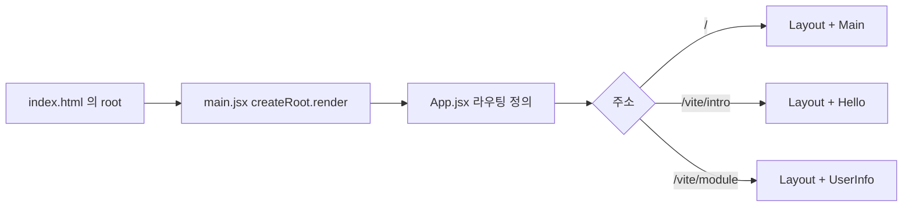

어제(11/23)는 HTML 파일 하나에 CDN으로 React를 불러서 `createElement`, JSX, 컴포넌트 조립을 배웠다. 오늘(11/24)은 같은 컴포넌트를 **진짜 프로젝트 구조**로 옮겼다. Vite로 만든 `component-app`에서 파일을 나눠 `import`/`export`로 연결하고, **react-router-dom으로 주소마다 다른 화면을 보여주고**, CSS 모듈로 스타일 충돌을 막는 것까지 배웠다.

> 이 글의 코드는 오늘 수업 프로젝트(`12_React.js-main/02_component/component-app`)에서 가져왔다. 개념 정리가 목적이라서 문제 해결 과정(STAR)이 아닌 개념 설명 중심으로 썼다. 코드 속 사용자 예시 값은 일반적인 값으로 바꿨고, 프로젝트를 실행해서 화면을 확인한 결과는 이 글에 없다.



## 1. 어제와 무엇이 달라졌나: CDN에서 Vite 프로젝트로

| 항목 | 어제 (CDN) | 오늘 (Vite) |
|---|---|---|
| React 가져오기 | `script` 태그로 CDN | `package.json`의 의존성 (`react`, `react-dom`, `react-router-dom`) |
| JSX 변환 | 브라우저에서 Babel (`type="text/babel"`) | 빌드 도구(Vite)가 미리 변환 |
| 파일 구성 | HTML 하나에 전부 | 컴포넌트마다 `.jsx` 파일 |
| 시작점 | `ReactDOM.createRoot(...).render(...)` | `src/main.jsx`가 같은 일을 하고, `index.html`이 그 파일을 불러온다 |
| 실행 | 파일을 브라우저로 열기 | `package.json`의 스크립트(`dev`, `build`, `preview`) |

`index.html`에는 `<div id="root">`와 `<script type="module" src="/src/main.jsx">`가 있고, `main.jsx`가 어제와 같은 방식으로 화면을 그린다.

```javascript
import { createRoot } from 'react-dom/client'
import App from './App.jsx'

createRoot(document.getElementById('root')).render(<App />)
```

`.jsx` 확장자는 "단순 JS가 아니라 JSX 문법으로 컴포넌트를 쓴 파일"이라는 표시다. 어제는 브라우저가 매번 Babel로 변환했지만, 이제는 변환이 빌드 단계에서 끝나므로 브라우저는 변환된 JS만 받는다.

## 2. import와 export: 파일을 나누려면 꼭 필요한 약속

컴포넌트를 파일마다 나누면 다른 파일에서 쓰려면 **내보내고(export) 가져와야(import)** 한다. 프로젝트 주석이 정리한 규칙은 이렇다.

| 방식 | 내보내기 | 가져오기 | 제한 |
|---|---|---|---|
| `export default` | `export default function AgeCard() {...}` | `import AgeCard from "./AgeCard"` (**중괄호 없이**, 이름은 마음대로) | 파일당 1개 |
| `export` (named) | `export const user = {...}` | `import { user } from "./user"` (**중괄호로**, 이름이 같아야 함) | 한 파일에서 여러 개 가능 |

```javascript
// user.js : 여러 곳에서 쓸 데이터. 이름을 붙여 내보낸다 (예시 값)
export const user = { name : '홍길동', age : 20, email : "user@email.com" };

// NameCard.jsx : 컴포넌트는 default 로 내보낸다
import { user } from "./user";
export default function NameCard() {
    return <h1 style={{color : 'red'}}>{user.name}</h1>
}
```

`UserInfo`는 `NameCard`, `AgeCard`, `EmailCard`를 하나로 묶는 상위 컴포넌트다. 어제 배운 컴포넌트 조합(Composition)을 파일 단위로 한 것이다.

프로젝트 주석은 "import를 했는데 실제로 사용하지 않으면 오류가 발생할 수 있으니, 오류가 나면 import 구문부터 확인하라"고 적고 있다. 정확히는 쓰지 않는 import가 항상 실행 오류가 되는 것은 아니고, 린터(이 프로젝트의 `lint` 스크립트는 `oxlint`)가 경고로 알려주는 경우가 많다. 다만 **import 경로나 이름이 틀렸을 때 가장 먼저 의심할 곳이 import 구문**이라는 팁은 그대로 유용하다.

## 3. 라우팅: 주소에 따라 보여줄 컴포넌트를 정한다

수업에서는 이렇게 시작했다. 지금까지는 App 컴포넌트에 보여줄 컴포넌트를 직접 넣었다. 하지만 현실의 프로젝트는 **여러 페이지가 있고, 페이지마다 보여야 하는 컴포넌트가 다르다.** 그래서 **라우팅**, 즉 요청한 URL 주소에 따라 보여줄 컴포넌트를 정의한다. `react-router-dom` 의존성으로 한다.

| 요소 | 역할 |
|---|---|
| `BrowserRouter` | 라우팅을 쓰는 영역을 감싸는 최상위 요소 |
| `Routes` | `Route`들을 묶는 부모 |
| `Route` | `path`(주소)와 `element`(컴포넌트)를 연결 |

```javascript
<BrowserRouter>
    <Routes>
        <Route path="/" element={<Layout/>}>
            <Route index element={<Main/>}/>
            <Route path="vite/intro" element={<Hello/>}/>
            <Route path="vite/module" element={<UserInfo/>}/>
        </Route>
    </Routes>
</BrowserRouter>
```

`Route` 안에 `Route`를 넣은 **중첩 구조**가 핵심이다. 바깥의 `Layout`이 공통 틀이고, 안쪽 `Route`들이 주소별로 틀 안에 들어갈 내용이다. `index`는 부모의 기본 주소(`/`)에서 보여줄 컴포넌트를 뜻한다.

### Layout과 Outlet: 안내판은 그대로, 방만 바뀐다

다섯 살 아이에게 설명한다면 이렇게 말할 수 있다. 큰 건물 로비에는 **안내판**이 늘 붙어 있다. 어느 방에 가든 안내판은 그대로이고, 오른쪽의 **방**만 바뀐다. `Layout`이 로비 전체이고, `Navbar`가 안내판이고, `Outlet`이 방이 들어오는 자리다.


```javascript
function Layout() {
    return (
        <div className={styles.layout}>
            <Navbar/>
            <main className={styles.content}>
                <Outlet/>     {/* 현재 주소와 일치하는 하위 Route의 컴포넌트가 여기에 렌더링 */}
            </main>
        </div>
    );
}
```

메뉴를 클릭하면 `Navbar`는 그대로 있고 `Outlet` 부분만 바뀐다. 모든 페이지에 같은 메뉴를 복사해서 넣을 필요가 없어진다.

### Link와 NavLink: 새로고침 없이 이동

| | `<a href>` | `<Link>` / `<NavLink>` |
|---|---|---|
| 이동 방식 | 페이지 **전체를 새로 불러온다** | 새로고침 없이 **주소만 바꿔 컴포넌트를 교체** |
| 현재 위치 표시 | 직접 구현 | `NavLink`는 현재 주소와 일치하면 `isActive`가 `true` |

```javascript
const activeStyle = ({isActive}) => isActive ? {backgroundColor: 'orangered', color: 'white'} : undefined;

<NavLink to="/vite/intro" style={activeStyle}>프로젝트 생성</NavLink>
<NavLink to="/vite/module" style={activeStyle}>모듈</NavLink>
```

`style`에 함수를 넘기면 현재 메뉴가 활성 상태일 때만 주황색 배경을 입힐 수 있다. 사용자가 지금 어느 메뉴에 있는지를 알려주는 용도다.

## 4. CSS 모듈: 클래스 이름이 겹치지 않게

일반 CSS(`import './style.css'`)는 페이지 **전체에 적용**돼서, 다른 컴포넌트의 같은 클래스 이름과 충돌할 수 있다. CSS 모듈은 파일명을 `이름.module.css`로 쓰고, **객체로 import해서** `className`에 넣는다.

```javascript
import styles from './Navbar.module.css';

<nav className={styles.nav}> ... </nav>
```

빌드될 때 클래스 이름이 `Navbar-module__nav__xxxxx`처럼 **고유한 이름으로 바뀌므로**, 다른 컴포넌트가 같은 `.nav`를 써도 서로 영향을 주지 않는다. 컴포넌트 단위로 파일을 나누는 React의 방식과 잘 맞는다.

## 5. 프로젝트 구조 한눈에 보기

| 위치 | 역할 |
|---|---|
| `src/main.jsx` | `App`을 `root`에 그리는 진입점 |
| `src/App.jsx` | 라우팅 정의 (주소와 컴포넌트 연결) |
| `src/layouts/Layout.jsx` | 공통 틀 (`Navbar` + `Outlet`) |
| `src/components/Navbar.jsx` | 메뉴 (`NavLink`) |
| `src/pages/Main.jsx` | `/`에서 보이는 첫 화면 |
| `src/module/01_intro/` | `Hello` 컴포넌트 |
| `src/module/02_module/` | `user.js`, `NameCard`, `AgeCard`, `EmailCard`, `UserInfo` |

## 정리

| 개념 | 오늘 배운 것 | 한 줄 요약 |
|---|---|---|
| Vite | 빌드 도구 | JSX 변환을 브라우저가 아니라 빌드 단계에서 한다 |
| export | `export default` vs `export` | default는 파일당 1개, named는 `{}`로 여러 개 |
| 라우팅 | `BrowserRouter`, `Routes`, `Route` | 주소 → 컴포넌트 연결 |
| Layout | 중첩 `Route` + `Outlet` | 공통 틀은 그대로, 안쪽만 교체 |
| 이동 | `Link` / `NavLink` | 새로고침 없이 이동, `isActive`로 현재 위치 표시 |
| 스타일 | CSS 모듈 | 클래스 이름이 자동으로 고유해진다 |

오늘은 프로젝트를 실행해서 확인한 결과나 수치가 없어서 Before/After 지표는 쓰지 않았다.

## 더 학습하면 좋은 개념

- **Props와 State** — 오늘 만든 `NameCard` 등은 `user.js`를 직접 읽었다. 값을 부모가 자식에게 넘기는 props와, 값이 바뀌면 화면이 다시 그려지는 state를 알아야 컴포넌트를 재사용할 수 있다.
- **SPA(Single Page Application)와 서버 설정** — `BrowserRouter`는 새로고침 없이 주소를 바꾸지만, 그 주소로 직접 접속하거나 새로고침하면 서버가 어떻게 응답해야 하는지 알아야 배포할 때 404를 피한다.
- **동적 라우트와 `useParams`** — 오늘은 고정 주소만 다뤘다. `/menu/3`처럼 주소의 일부를 값으로 받는 방식이 실제 서비스에서 가장 자주 쓰인다. Spring MVC의 `@PathVariable`과 닮았다.
- **번들러가 하는 일(Vite, 모듈 시스템)** — `import`/`export`가 파일을 나누는 문법이라면, 번들러는 그 파일들을 브라우저가 받을 수 있게 묶고 변환한다. 개발 서버와 빌드가 다른 이유도 여기에 있다.
- **CSS 모듈 외의 스타일링 방식** — 일반 CSS, CSS 모듈, CSS-in-JS, 유틸리티 CSS(Tailwind)의 장단점을 비교해 두면 프로젝트마다 고를 기준이 생긴다.

## 참고 자료

- [React 공식 문서 — 프로젝트 시작하기](https://ko.react.dev/learn/start-a-new-react-project)
- [React Router 공식 문서 — Declarative Routing](https://reactrouter.com/start/declarative/routing)
- [Vite 공식 문서 — 시작하기](https://ko.vite.dev/guide/)
- [MDN — JavaScript 모듈](https://developer.mozilla.org/ko/docs/Web/JavaScript/Guide/Modules)
- [MDN — export](https://developer.mozilla.org/ko/docs/Web/JavaScript/Reference/Statements/export)
