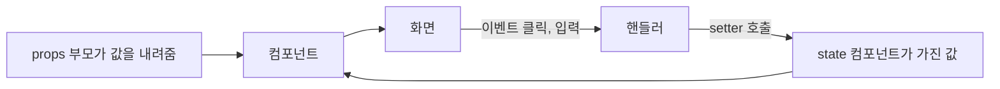
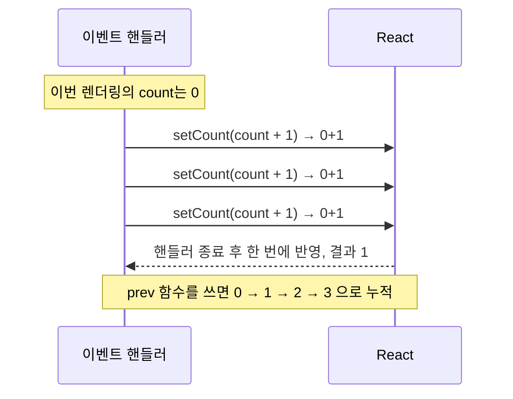

[어제(11/24)]()는 Vite 프로젝트를 만들고 라우터로 화면을 나눴다. 오늘(11/25)은 그 위에서 **컴포넌트에 데이터를 주고(props), 바뀌는 값을 관리하고(state), 사용자 입력에 반응하고(이벤트), 목록을 그리는(반복 렌더링)** 네 가지를 `data-fetch-app-skeleton` 프로젝트의 `src/chap` 파일 01~04로 배웠다.

> 이 글의 코드는 오늘 수업 프로젝트에서 가져왔다. 개념 정리가 목적이라 문제 해결 과정(STAR)이 아닌 개념 설명 중심으로 썼다. 학생 코드에 없는 코드는 "예시 코드"라고 표시했고, 프로젝트를 실행해서 화면을 확인한 결과는 이 글에 없다.

## 쉬운 비유: 선물 상자와 일기장

컴포넌트를 장난감 로봇이라고 생각해 보자. **props**는 엄마(부모)가 로봇에게 준 선물 상자다. 로봇은 열어서 쓸 수만 있고 내용물을 바꿀 수는 없다. **state**는 로봇이 자기 일기장에 적는 값이다. 직접 고쳐 쓸 수 있고, 고쳐 쓰면 로봇이 화면을 다시 그린다.


오늘 배운 네 가지는 서로 이렇게 이어진다.



## 1. props: 부모가 자식에게 주는 읽기 전용 값

`<Title name="이여니"/>`처럼 부모가 속성을 넘기면, 자식 함수는 그 속성들을 **하나의 객체(props)**로 묶어서 매개변수로 받는다. 수업 코드에서 `console.log(props)`로 확인하는 실습이 있었다.

```jsx
function Title(props) {
    return <h1>안녕하세요 {props.name}님 반갑습니다.</h1>;
}

// 구조 분해 할당: 객체의 키를 바로 변수로 꺼낸다 (가장 많이 쓰는 형태)
function Profile({name, age}) {
    return <h3>{name}님은 {age}살입니다.</h3>;
}

<Profile name="이여니" age={25}/>   // 숫자는 {}로 전달
```

| 규칙 | 설명 |
|------|------|
| 읽기 전용 | 자식에서 `props.name = ...`처럼 수정하지 않는다 |
| 문자열 외의 값은 `{}` | `age={20}`, 배열, 함수도 `{}`로 전달한다 |
| 구조 분해 | `function Profile({name, age})`로 받으면 `props.`를 반복해서 쓰지 않아도 된다 |
| `children` | 태그 사이에 쓴 내용이 `props.children`으로 들어온다 |

`children`은 상자 안에 무엇이든 넣을 수 있게 해준다. 수업에서는 주황 테두리를 그리는 `Box`로 연습했다.

```jsx
function Box({children}) {
    return <div style={{border: '1px solid orangered', padding: 10, margin: 5}}>{children}</div>;
}

<Box>텍스트 노드</Box>
<Box><Profile name="강감찬" age={30}/></Box>
```

> 프론트는 컴포넌트들의 집합이고, 컴포넌트는 부모·자식·형제 관계로 구성된다. 부모와 자식 사이의 값 전달 통로가 props다. (수업 주석)

## 2. state: 바뀌는 값은 일반 변수가 아니라 useState로

일반 변수 `let count`를 바꾸면 콘솔의 값은 바뀌지만 **화면은 그대로**다. 컴포넌트 함수가 다시 실행되지 않기 때문이다. `useState`로 만든 값을 **setter로 바꾸면** 컴포넌트 함수가 다시 실행(리렌더링)되어 화면이 갱신된다.

```jsx
const [count, setCount] = useState(0);   // [값, setter함수] = useState(초기값)

const onClickPlusOne = () => {
    setCount(count + 1);
};
```

### 세 번 호출했는데 왜 1만 늘까?

수업에서 가장 흥미로웠던 부분이다. `setCount(count + 1)`을 세 번 부르면 3이 아니라 **1만 증가**한다.

```jsx
// 예시 코드: 1만 증가한다
setCount(count + 1);   // count가 0이면 0 + 1 → 예약
setCount(count + 1);   // 아직 count는 0이므로 0 + 1 → 예약
setCount(count + 1);   // 아직 count는 0이므로 0 + 1 → 예약
```

공식 문서의 설명처럼 setter를 호출해도 state는 **즉시 바뀌지 않는다.** 그 렌더링에서 `count`는 값이 고정된 스냅샷이라서 세 줄 모두 `0 + 1`을 계산한다. 그래서 이전 결과를 받아서 계산하는 **함수형 업데이트**를 쓴다. 수업 코드에 있던 방식이다.

```jsx
setCount(prev => prev + 1);
setCount(prev => prev + 1);
setCount(prev => prev + 1);   // 3 증가
```



| 방식 | 결과 | 이유 |
|------|------|------|
| `setCount(count + 1)` ×3 | 1 증가 | 세 번 모두 같은 스냅샷 `count`를 사용 |
| `setCount(prev => prev + 1)` ×3 | 3 증가 | 큐에 쌓인 함수가 이전 결과를 이어받음 |

핸들러 안의 `console.log(count)`가 바뀌기 전 값을 찍는 것도 같은 이유다.

## 3. 이벤트와 제어 컴포넌트

이벤트를 연결할 때 지킬 규칙이 세 가지 있었다.

1. 이름은 **카멜 표기법**이다. `onclick` → `onClick`, `onchange` → `onChange`
2. 실행할 코드를 문자열로 주지 않고 **함수를 전달**한다. `onClick={() => ...}`
3. 이벤트는 **DOM 요소(`button`, `input` 등)**에만 연결된다. 컴포넌트에 `onClick`을 주면 그냥 props로 전달될 뿐이라서, 내부의 DOM 요소에 다시 연결해야 한다.

```jsx
<button onClick={onClickPlusOne}>+ 1</button>          // 함수를 전달 (O)
<button onClick={onClickPlusOne()}>+ 1</button>        // 예시 코드: 렌더링 중에 바로 실행됨 (X)
```

### 입력값 관리: 제어 컴포넌트

`input`의 `value`를 state에 두고 `onChange`에서 state를 바꾸면, 입력창의 값을 React가 관리한다. 입력값이 여러 개일 때는 **객체 state 하나와 핸들러 하나**로 처리했다.

```jsx
const [form, setForm] = useState({ username: '', email: '' });

const onChangeHandler = e => {
    setForm({
        ...form,                        // 기존 값 복사
        [e.target.name]: e.target.value // 이벤트가 난 input의 name만 덮어쓴다
    });
};

<input name="username" value={form.username} onChange={onChangeHandler}/>
<input name="email"    value={form.email}    onChange={onChangeHandler}/>
```

- `[e.target.name]`처럼 키에 `[]`를 쓰면 **변수의 값이 곧 키**가 된다. `name`이 `"username"`이면 `{ username: 입력값 }`이다.
- `...form`을 빼면 `setForm`이 객체를 **통째로 교체**하기 때문에, 이름을 입력하는 순간 `email`이 사라진다(수업 주석: "다른 값을 수정하면 기존 값이 초기화된다"). state 객체는 병합되지 않고 새 객체로 바뀐다는 점이 핵심이다.
- `value={form.username}`을 연결해야 초기화 버튼이 input의 글자까지 비운다.

## 4. 반복 렌더링: map과 key, 그리고 불변성

배열은 `map()`으로 엘리먼트 배열로 바꿔서 렌더링한다.

```jsx
{names.map(name =>
    <li key={name.id} onDoubleClick={() => onRemove(name.id)}>{name.id} 번{name.name}</li>
)}
```

**key**는 목록에서 어떤 항목이 추가·삭제·이동했는지 React가 구분하는 식별자다. 형제 사이에서 고유해야 하고, 없으면 콘솔에 경고가 나온다. 수업에서는 key 없이 먼저 경고를 확인한 뒤 `key={name.id}`를 붙였다.

| key 후보 | 평가 |
|----------|------|
| DB의 pk(`id`) | 좋음. 항목이 바뀌어도 값이 그대로다 |
| 배열 index | 지양. 항목이 추가·삭제되면 번호가 밀려 다른 항목으로 오해한다 |

### state 배열은 복사해서 새 배열로

`push`나 `splice`로 원본 배열을 고치면 React가 변경을 알아차리지 못한다. **새 배열을 만들어 setter에 전달**한다.

```jsx
// 추가: 기존 배열 복사 + 새 값
setNames([...names, {id: nextId, name: inputText}]);
setNextId(nextId + 1);   // 다음 추가 때 id가 겹치지 않게 +1
setInputText('');        // 입력창 비우기

// 삭제: 전달받은 id와 다른 항목만 남긴다
setNames(names.filter(name => name.id !== id));
```

`nextId`를 별도 state로 둔 이유는 삭제해도 id가 겹치지 않게 하려는 것이다. 목록 길이로 id를 만들면 중간 항목을 지운 뒤 같은 id가 생길 수 있다(예시로 든 설명이며 수업 코드는 `nextId` state 방식이다).

## 정리

| 주제 | 핵심 |
|------|------|
| props | 부모→자식, 읽기 전용, 구조 분해, `children` |
| state | `useState`, setter로 바꿔야 리렌더링, 연속 변경은 `prev =>` |
| 이벤트 | 카멜 표기법, 함수 전달, DOM 요소에만 연결, `[e.target.name]` + 스프레드 |
| 반복 | `map` + 고유한 `key`, 복사 후 새 배열(스프레드/`filter`) |

## 더 학습하면 좋은 개념

- **불변성(Immutability)과 얕은 비교** — React는 이전 값과 새 값이 같은 참조인지로 변경을 판단한다. 스프레드·`filter`로 새 객체를 만드는 이유가 여기에 있고, 중첩 객체를 다룰 때 가장 많이 실수하는 지점이다.
- **State 끌어올리기(Lifting State Up)** — 두 컴포넌트가 같은 값을 쓰면 가장 가까운 공통 부모가 state를 가진다. props와 state를 구분한 다음 단계로, 컴포넌트 설계의 기본이 된다.
- **렌더링과 커밋, 배칭(Batching)** — setter가 "예약"인 이유와 여러 state 변경이 한 번에 반영되는 과정이다. 오늘 `setCount` 3번 문제를 정확히 설명해 준다.
- **비제어 컴포넌트와 `useRef`** — 입력값을 state가 아니라 DOM에서 직접 읽는 방식이다. 제어 컴포넌트와 비교하면 언제 어떤 방식이 적합한지 판단할 수 있다.
- **key와 재조정(Reconciliation)** — React가 이전 트리와 새 트리를 비교하는 방식이다. key가 상태 유지와 DOM 재사용에 어떤 영향을 주는지 알 수 있다.

## 참고 자료

- [React 공식 문서 — 컴포넌트에 props 전달하기](https://ko.react.dev/learn/passing-props-to-a-component)
- [React 공식 문서 — state: 컴포넌트의 기억 저장소](https://ko.react.dev/learn/state-a-components-memory)
- [React 공식 문서 — 시간에 따라 state 변경하기(스냅샷과 업데이터 함수)](https://ko.react.dev/learn/queueing-a-series-of-state-updates)
- [React 공식 문서 — 이벤트에 응답하기](https://ko.react.dev/learn/responding-to-events)
- [React 공식 문서 — 객체 state 업데이트하기](https://ko.react.dev/learn/updating-objects-in-state)
- [React 공식 문서 — 배열 state 업데이트하기](https://ko.react.dev/learn/updating-arrays-in-state)
- [React 공식 문서 — 리스트 렌더링하기](https://ko.react.dev/learn/rendering-lists)
