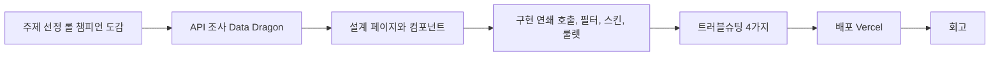
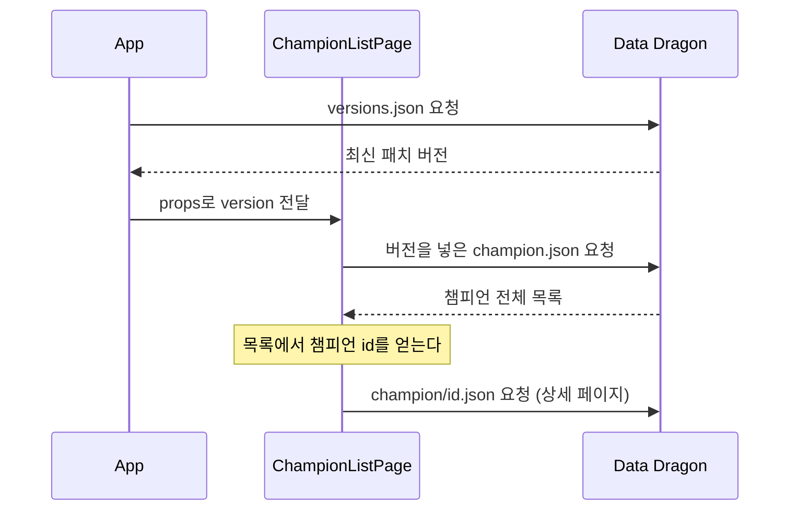
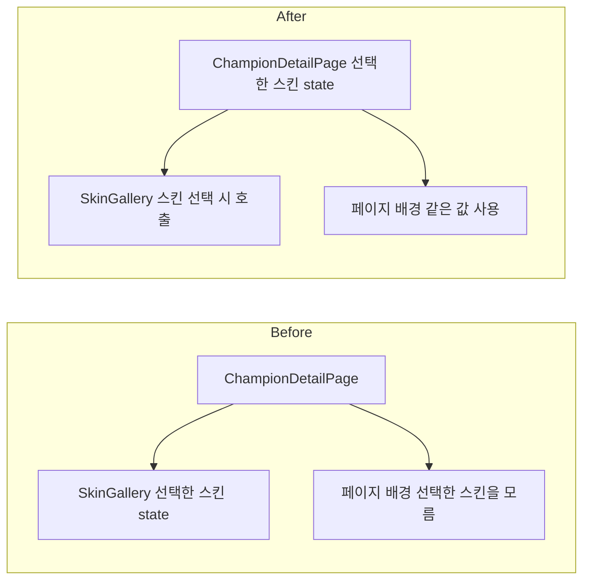

> **배포 링크**: [나만의 롤 도감](https://lol-dex-ruddy.vercel.app)


## 1. 과제 소개

오전 API 호출 실습 과제로 **Open API를 활용한 나만의 도감 앱**을 만들었다.
원래 주제는 PokeAPI로 포켓몬 도감을 만드는 것이었는데, 다른 API를 골라도 된다고 해서
여러 후보(지브리, 디즈니, 드래곤볼…)를 고민하다가 결국 **롤(League of Legends)**로 정했다.

**과제 목적**
- API 호출 방법 숙지
- 응답 JSON 데이터 접근 방법 숙지
- 컴포넌트 / 반복 렌더링 / state / props 개념 복습

**사용 기술**: React, Vite, React Router, Vercel

이 글은 만든 순서대로 따라간다. 전체 과정은 이렇다.



## 2. 사용한 API: Riot Data Dragon

라이엇 게임즈가 공식으로 제공하는 정적 데이터 CDN이다.
**API 키가 필요 없고**, 한국어(`ko_KR`)를 지원해서 도감 만들기에 딱이었다.

| 용도 | 주소 |
|---|---|
| 최신 패치 버전 | `/api/versions.json` |
| 챔피언 전체 목록 | `/cdn/{버전}/data/ko_KR/champion.json` |
| 챔피언 상세 | `/cdn/{버전}/data/ko_KR/champion/{id}.json` |
| 일러스트 | `/cdn/img/champion/splash/{id}_{스킨번호}.jpg` |

> 참고로 전적, 랭크 같은 플레이어 정보는 별도의 Riot API(키 필요)를 써야 한다.
> 이번에는 챔피언 정보만 다루므로 Data Dragon으로 충분했다.

## 3. 설계

### 페이지

| 페이지 | 경로 | 내용 |
|---|---|---|
| 챔피언 목록 | `/` | 일러스트 카드, 검색, 역할군 필터, 랜덤 뽑기 |
| 챔피언 상세 | `/champion/:id` | 스플래시 배경, 능력치, 스킬, 배경 이야기, 스킨 |

### 컴포넌트 구조

```text
App                         최신 버전 fetch → props로 전달
├─ ChampionListPage         챔피언 목록 fetch, 검색어·역할군 state
│   ├─ SearchBar
│   ├─ RoleFilter
│   ├─ ChampionCard ×N
│   └─ RandomPicker         룰렛 뽑기 모달
└─ ChampionDetailPage       챔피언 상세 fetch, 선택한 스킨 state
    ├─ ChampionHeader       이름, 칭호, 능력치 막대
    ├─ SkillTabs            P/Q/W/E/R 아이콘 탭
    └─ SkinGallery
```

## 4. 구현 포인트

### ① 연쇄 API 호출: 버전을 알아야 다음 호출이 가능하다

Data Dragon은 주소에 패치 버전이 들어가서, **버전 → 목록 → 상세** 순서로 호출해야 한다.
버전은 App에서 한 번만 받아 props로 내려주고, 자식은 버전이 생긴 뒤에만 호출하게 했다.



```jsx
useEffect(() => {
  if (!version) return   // 버전이 아직 없으면 호출하지 않기
  fetch(`https://ddragon.leagueoflegends.com/cdn/${version}/data/ko_KR/champion.json`)
    .then(res => res.json())
    .then(json => setChampions(Object.values(json.data)))
}, [version])            // 버전이 생기면 다시 실행
```

### ② JSON 구조: data가 배열이 아니라 객체였다

```text
{ data: { Aatrox: {...}, Ahri: {...}, ... } }
```

객체에는 `map`을 쓸 수 없어서 `Object.values()`로 배열로 바꿔서 반복 렌더링했다.
상세 데이터도 `json.data[id]`처럼 키로 꺼내야 했다.

또 하나 주의할 점이 있다. 주소에는 한글 이름이 아니라 **id**를 써야 한다.
예를 들어 오공의 id는 `MonkeyKing`이다.

### ③ 검색과 필터는 state가 아니라 계산값으로

원본 데이터는 그대로 두고, 렌더링할 때마다 걸러서 보여준다.
그래서 필터를 "전체"로 돌리면 원래 목록이 그대로 다시 나온다.

```jsx
const filtered = champions.filter(c =>
  c.name.includes(keyword) && (role === 'All' || c.tags.includes(role))
)
```

### ④ state 끌어올리기: 스킨을 고르면 배경도 바뀌게

처음에는 SkinGallery가 선택한 스킨을 직접 들고 있었다.
그런데 페이지 전체 배경도 선택한 스킨으로 바꾸고 싶어서,
**두 곳에서 같이 쓰는 값은 공통 부모가 가져야 한다**는 원칙대로 state를 부모로 올렸다.




### ⑤ 랜덤 뽑기: 점점 느려지는 룰렛

`setTimeout`을 연쇄로 걸고 대기 시간을 1.15배씩 늘려서 룰렛처럼 멈추게 했다.
타이머 번호는 화면에 보여줄 값이 아니라서 state 대신 `useRef`에 저장했고,
창을 닫으면 useEffect의 cleanup 함수로 타이머를 정리했다.

```jsx
let index = 0
let delay = 60

const step = () => {
  setCurrent(sequence[index])
  if (index === sequence.length - 1) {
    setDone(true)
    return
  }
  index++
  delay *= 1.15          // 점점 느려지게
  timer.current = setTimeout(step, delay)
}
```


## 5. 트러블슈팅

### 하얀 화면만 나옴

힌트용 빈칸 `___`을 그대로 코드에 넣었다.
JS는 `___`을 변수로 인식해서 `ReferenceError`가 나고 앱 전체가 멈췄다.
**교훈: 화면이 하얘지면 F12 → Console부터 확인하자.**

### Failed to resolve import "react-router-dom"

처음에 명령어 여러 줄을 한 번에 붙여넣었는데, 중간에 설치가 빠져 있었다.
`npm install react-router-dom`으로 해결. 설치한 뒤에는 **dev 서버를 재시작**해야 했다.

### git push 시 Repository not found

예시 주소의 `내아이디`를 그대로 넣어서 잘못된 remote가 등록됐다.
`git remote set-url origin 올바른주소`로 수정해서 해결.
**교훈: git 명령어는 한 줄씩 입력하고 결과를 확인하자.**

### 배포 후 상세 페이지에서 새로고침하면 404

SPA는 서버에 `/champion/Ahri` 같은 파일이 실제로 없다.
`vercel.json`에 모든 주소를 index.html로 보내는 rewrite 설정을 추가해서 해결.

```json
{ "rewrites": [{ "source": "/(.*)", "destination": "/" }] }
```

## 6. 배포

GitHub에 올리고 Vercel에서 Import하면 끝이다.
이후에는 `git push`만 하면 자동으로 다시 배포된다.

## 7. 회고

- 처음엔 API를 "그냥 fetch하면 되는 것"이라고 생각했는데,
  **응답 구조를 먼저 브라우저로 확인하는 것**이 제일 중요했다.
- state를 **누가 가져야 하는지** 고민하면서 props와 state의 차이를 확실히 이해했다.
- 에러 메시지를 읽는 습관이 생겼다. 대부분 답이 거기 적혀 있었다.

**다음에 해보고 싶은 것**: 아이템 도감, 즐겨찾기, 챔피언 비교 기능

## 더 학습하면 좋은 개념

- **fetch의 로딩·에러 상태 처리** — 이번 앱은 성공했을 때의 흐름만 다뤘다. `fetch`는 서버가 404나 500을 응답해도 `reject`하지 않으므로, 응답 상태(`res.ok`)와 로딩·에러 화면을 따로 처리해야 실제 서비스에서 하얀 화면을 막을 수 있다.
- **useEffect의 의존성 배열과 cleanup(정리 함수)** — 버전이 생긴 뒤에만 호출하고(`[version]`), 룰렛 타이머를 정리한 것이 모두 이 개념이다. 의존성을 어떻게 적는지에 따라 호출 횟수가 달라져서, 이해하면 불필요한 요청과 타이머 누수를 막을 수 있다.
- **파생 값(계산값)과 state의 구분** — 검색·필터 결과를 state로 따로 저장하지 않고 렌더링할 때 계산한 것이 이 원칙이다. 같은 사실을 두 군데에 저장하지 않으면 값이 서로 어긋나는 버그를 줄일 수 있다.
- **SPA 라우팅과 서버의 fallback 설정** — 새로고침 404는 브라우저가 서버에 실제로 없는 경로를 요청해서 생긴 일이다. 어떤 호스팅이든 SPA를 배포할 때 같은 문제를 만나므로, 원리를 알아두면 배포 환경이 바뀌어도 대응할 수 있다.

## 참고 자료

- [Riot Developer Portal — Data Dragon](https://developer.riotgames.com/docs/lol)
- [React 공식 문서 — useEffect](https://ko.react.dev/reference/react/useEffect)
- [React 공식 문서 — 컴포넌트 간 State 공유하기](https://ko.react.dev/learn/sharing-state-between-components)
- [MDN — Fetch API 사용하기](https://developer.mozilla.org/ko/docs/Web/API/Fetch_API/Using_Fetch)
- [Vercel 공식 문서 — vercel.json](https://vercel.com/docs/project-configuration/vercel-json)

---

<sub>나만의 롤 도감 isn't endorsed by Riot Games and doesn't reflect the views or opinions of Riot Games or anyone officially involved in producing or managing Riot Games properties. Riot Games, and all associated properties are trademarks or registered trademarks of Riot Games, Inc.</sub>
