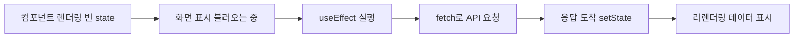
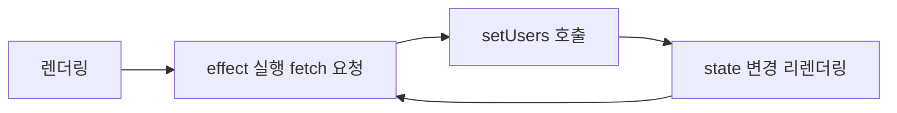
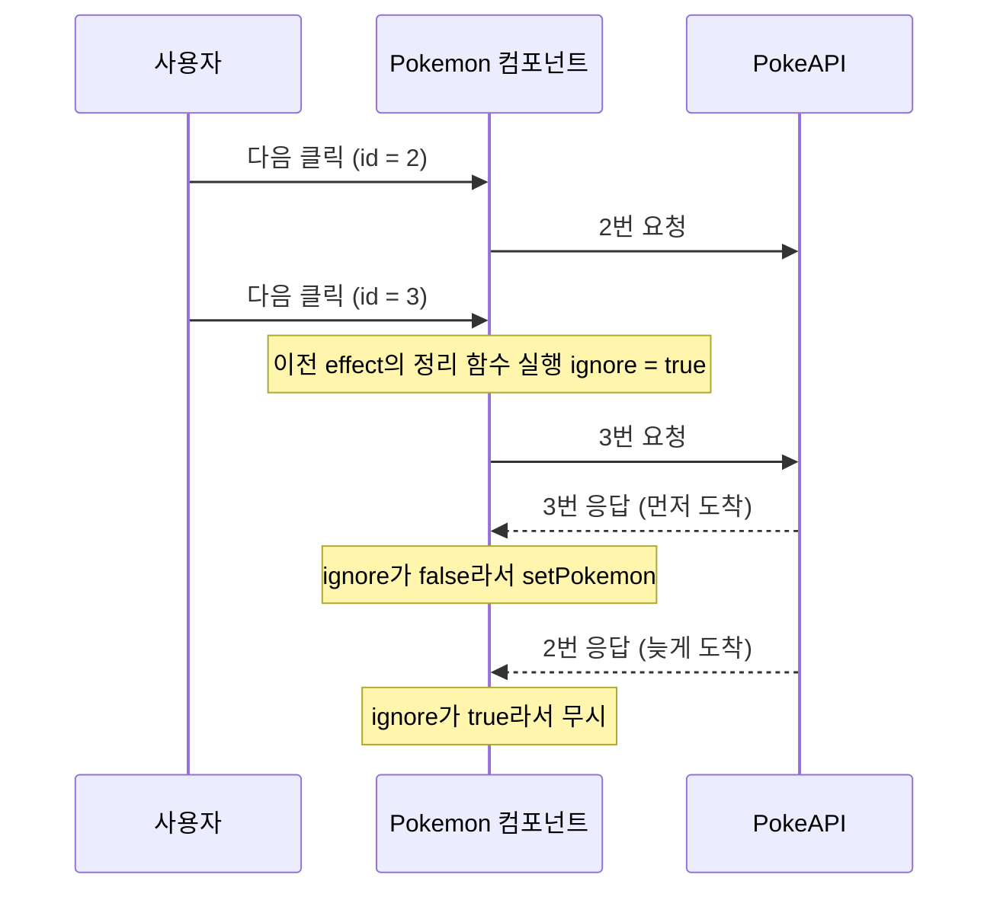

어제까지 props, state, 이벤트, 반복 렌더링을 배웠다. 오늘(11/26)은 React의 마지막 파트인 **useEffect**와 **비동기 요청(fetch)**을 배웠고, `05_useEffect.jsx`, `06_fetch.jsx`, `07_pokemon.jsx` 세 파일로 실습했다. 이 글은 실습 코드를 따라가면서 "왜 이렇게 써야 하는지"를 정리한 글이다.

> 코드는 수업 실습 파일(`data-fetch-app-skeleton/src/chap`)의 내용이다. `05_useEffect.jsx`의 타이머 컴포넌트(`Timer`)는 수업에서 TODO로 남겨진 부분이라 내가 아직 구현하지 않았다. 그래서 타이머 코드는 4장에서 "예시 코드"로만 보여준다.

## 1. 쉽게 말하면: 가게 문부터 열고, 재료는 배달 오는 대로

식당 주인이 장사를 시작하려는데, 재료가 언제 도착할지 모른다고 하자. 재료가 올 때까지 문을 닫고 기다리면 손님은 계속 밖에서 기다린다. 그래서 **먼저 문을 열고 "준비 중" 팻말을 걸어 둔 뒤**, 재료가 도착하는 대로 채워 넣는다.

React도 같다. API 응답이 언제 올지 알 수 없으므로 컴포넌트를 먼저 화면에 그리고, 그 **이후에** 데이터를 요청한다. 응답이 오면 state에 넣고, state가 바뀌면 다시 렌더링되면서 목록이 나타난다. 이 "화면이 그려진 이후에 할 일"을 등록하는 곳이 `useEffect`다.




## 2. useEffect의 의존성 배열 3가지

`useEffect(() => { 실행할 코드 }, [의존성 배열])`에서 두 번째 인자에 무엇을 넣느냐에 따라 **실행 시점**이 달라진다. 실습에서는 `console.log`를 넣고 버튼을 누르거나 글자를 입력하면서 콘솔을 비교했다.

| 의존성 배열 | 실행 시점 | 실습 코드에서의 쓰임 |
|---|---|---|
| 생략 | 렌더링될 때마다 | state가 바뀔 때마다 계속 실행되므로 API 호출에는 부적합하다 |
| `[]` (빈 배열) | 처음 화면에 나타날 때(마운트) 한 번만 | 대부분의 API 호출. 실시간성이 중요하지 않을 때 |
| `[count]`, `[id]` | 마운트 + 배열 안의 값이 바뀔 때마다 | 실시간 검색 동기화, 포켓몬 번호가 바뀔 때마다 다시 요청 |

실습에서 확인한 포인트는 두 가지였다. 의존성 배열이 `[count]`인 effect는 입력창에 글자를 쳐도 실행되지 않고, 버튼으로 `count`를 바꿀 때만 실행된다. 반대로 배열을 생략한 effect는 글자를 칠 때마다(`text` state가 바뀌어 리렌더링될 때마다) 실행된다.

## 3. 목록 불러오기: fetch는 Promise가 두 번 나온다

`06_fetch.jsx`는 `jsonplaceholder`의 회원 목록을 불러와 카드로 보여준다. 마운트 시 한 번만 요청해야 하니 의존성 배열은 `[]`다.

```jsx
const [users, setUsers] = useState([]);   // 1. 빈 값으로 시작

useEffect(() => {
    async function loadUsers() {
        const res = await fetch("https://jsonplaceholder.typicode.com/users");
        const json = await res.json();    // 문자열 JSON을 진짜 객체로 변환
        setUsers(json);                   // 3. state에 저장 -> 리렌더링
    }
    loadUsers();
}, []);                                   // 2. 마운트 시 한 번만

if (users.length === 0) return <h3>불러오는 중...</h3>;
```

여기서 헷갈렸던 점이 세 가지 있었다.

**① `await`가 두 번인 이유.** `fetch(url)`은 Promise를 반환하는데, 이 Promise는 **응답이 도착했다**는 뜻이지 본문을 다 읽었다는 뜻이 아니다. 본문을 JSON으로 바꾸는 `res.json()`도 시간이 걸리는 작업이라서 또 Promise를 반환한다. 그래서 `await fetch(...)`와 `await res.json()`이 각각 필요하다.

**② 왜 `useEffect(async () => {...})`로 쓰지 않고 안에 함수를 따로 만드는가.** `async` 함수는 항상 Promise를 반환한다. 그런데 useEffect의 콜백은 아무것도 반환하지 않거나 **정리 함수만** 반환할 수 있다. React 공식 문서도 effect 함수가 Promise를 반환하는 것을 허용하지 않는다. 그래서 effect 안에 `async function`을 만들고 바로 호출하는 패턴을 쓴다.

**③ `users.length === 0`일 때 로딩 문구를 보여주는 이유.** `useState([])`로 시작했기 때문에 응답이 오기 전 첫 렌더링에서는 빈 배열이다. 이때 `users.map(...)`을 그대로 그리면 아무것도 없는 화면이 되고, `user.address.city`처럼 데이터에 접근하는 컴포넌트가 있다면 에러가 날 수 있다. 데이터가 없는 구간을 먼저 처리하는 것이 안전하다.

### 의존성 배열을 빼면 무한 요청이 일어난다

수업 주석에서 강조한 부분이다. `[]`를 빼먹으면 이런 일이 벌어진다.



응답을 `setUsers`로 저장하면 state가 바뀌어 리렌더링되고, 의존성 배열이 없으니 effect가 또 실행되어 다시 요청하고, 다시 state를 바꾼다. 서버에 요청이 끝없이 쌓인다. "마운트 시 한 번만"이 목적이면 `[]`를 반드시 써야 한다.

## 4. 정리(clean-up) 함수

effect에서 함수를 `return`하면 그 함수는 **컴포넌트가 사라질 때(언마운트)** 또는 **effect가 다시 실행되기 직전**에 실행된다. 타이머처럼 effect에서 시작한 작업은 정리 함수에서 끝내지 않으면 컴포넌트가 사라진 뒤에도 계속 돈다.

실습의 `Timer` 컴포넌트가 이 개념을 확인하기 위한 TODO였다. 아래는 수업 주석의 설명을 바탕으로 쓴 **예시 코드**다. 내가 실습에서 직접 구현해서 실행한 코드가 아니다.

```jsx
// 예시 코드 (수업 TODO 4의 설명을 바탕으로 작성, 직접 실행해 보지 않음)
useEffect(() => {
    const timerId = setInterval(() => {
        setTime(new Date().toLocaleTimeString());
        console.log('tick');
    }, 1000);

    return () => clearInterval(timerId);   // 정리 함수: 숨겨질 때 타이머를 멈춘다
}, []);
```

수업 주석이 알려주는 확인 방법은 이렇다. 먼저 정리 함수 없이 토글 버튼으로 타이머를 숨겨 보고, 숨긴 뒤에도 콘솔에 `tick`이 계속 찍히는지 본다. 그다음 정리 함수를 추가해서 숨기는 순간 멈추는 것을 비교한다.

## 5. 종합 실습: 포켓몬 도감과 race condition

`07_pokemon.jsx`는 지금까지 배운 것을 모두 쓰는 종합 예제다. state(번호, 받아온 데이터), 이벤트(이전/다음 버튼), useEffect(`[id]`), props(`PokemonCard`), 반복 렌더링(타입 목록)이 한 파일에 들어 있다.

요구사항은 "이전·다음 버튼을 누를 때마다 해당 ID의 포켓몬 API를 다시 호출"하는 것이었다. 그래서 의존성 배열에 `id`를 넣었다.

### 문제: 빠르게 누르면 옛날 응답이 화면을 덮어쓴다

버튼을 빠르게 두 번 누르면 요청이 두 개 나간다. 네트워크 사정에 따라 **먼저 보낸 요청의 응답이 나중에 도착**할 수 있다. 그러면 현재 번호는 3번인데 화면에는 2번 포켓몬이 나온다.



### 해결: ignore 플래그와 정리 함수

```jsx
useEffect(() => {
    let ignore = false;

    async function loadPokemon() {
        const res = await fetch(`https://pokeapi.co/api/v2/pokemon/${id}`);
        const json = await res.json();
        if (!ignore) {            // 이 effect가 아직 유효할 때만 저장
            setPokemon(json);
        }
    }

    loadPokemon();

    return () => {
        ignore = true;            // id가 바뀌어 effect가 다시 실행되기 직전에 호출됨
    };
}, [id]);
```

핵심은 effect가 실행될 때마다 `ignore`가 **새로 만들어진다**는 점이다. 2번 요청을 보낸 effect의 `ignore`와 3번을 보낸 effect의 `ignore`는 서로 다른 변수다. 3번 effect가 시작되기 직전에 정리 함수가 2번 effect의 `ignore`를 `true`로 바꾸기 때문에, 2번 응답이 늦게 와도 `setPokemon`이 호출되지 않는다.

### 하나 더: 이전 데이터가 잠깐 보이는 문제

```jsx
{pokemon?.id === id ? <PokemonCard pokemon={pokemon} /> : <h3>불러오는 중...</h3>}
```

`pokemon`의 초기값은 `null`이라서 `pokemon?.id`처럼 옵셔널 체이닝으로 안전하게 읽는다. 또 번호를 바꾼 직후에는 아직 **이전 번호의 데이터**가 state에 남아 있다. `pokemon.id`와 현재 `id`가 같을 때만 카드를 보여주면 "번호는 3인데 2번 포켓몬이 보이는" 깜빡임을 막을 수 있다. 이전 버튼에는 `disabled={id === 1}`을 걸어 0번 이하로 내려가지 않게 했다.

이 개념을 실제 프로젝트에 적용한 사례는 [Riot Data Dragon API로 나만의 롤 챔피언 도감 만들기]()에 있다. 거기서는 버전을 먼저 받아야 다음 호출이 가능해서 `if (!version) return`과 `[version]`을 함께 썼다.

## 6. 정리

| 상황 | 쓰는 방법 | 이유 |
|---|---|---|
| 처음 한 번만 API 호출 | `useEffect(..., [])` | 의존성 배열을 빼면 무한 요청이 일어난다 |
| 값이 바뀔 때마다 다시 호출 | `useEffect(..., [id])` | 마운트 + 값이 바뀔 때 실행된다 |
| effect 안에서 await 사용 | 안에 `async function`을 만들어 호출 | effect 콜백은 Promise를 반환하면 안 된다 |
| 응답 오기 전 화면 | `users.length === 0` 등으로 로딩 표시 | 빈 state로 시작하기 때문이다 |
| 오래된 응답 무시 | `ignore` 플래그 + 정리 함수 | 요청 순서와 응답 순서는 다를 수 있다 |

## 더 학습하면 좋은 개념

- **fetch의 에러 처리 (`res.ok`, try/catch)** — 이번 실습은 요청이 성공하는 경우만 다뤘다. `fetch`는 서버가 404나 500을 응답해도 reject하지 않고 네트워크 자체가 실패할 때만 reject하므로, `res.ok`를 확인하고 에러 화면을 따로 만들어야 실제 서비스에서 하얀 화면을 막을 수 있다.
- **AbortController로 요청 취소하기** — `ignore` 플래그는 응답을 "받은 뒤 무시"하는 방법이고, `AbortController`는 요청 자체를 취소한다. 불필요한 네트워크 사용까지 줄일 수 있어서 race condition 해결의 다음 단계다.
- **React StrictMode와 effect의 이중 실행** — 개발 모드에서 StrictMode를 쓰면 React가 effect를 한 번 더 실행해서 정리 함수가 제대로 짝을 이루는지 검사해 준다. 정리 함수를 왜 꼭 써야 하는지 이해할 수 있다.
- **데이터 요청 라이브러리 (React Query 등)** — 로딩, 에러, 캐싱, 중복 요청 제거를 직접 `useEffect`로 짜면 코드가 길어진다. 이번에 손으로 만든 문제들(race condition, 로딩 상태)이 라이브러리가 대신 처리하는 일이므로, 원리를 알고 나면 도입 이유가 분명해진다.
- **axios** — 수업 주석에서 실무에서 많이 쓴다고 언급한 라이브러리다. 응답 본문이 `res.data`에 이미 객체로 들어 있어서 `res.json()` 단계가 없다. fetch와의 차이를 비교해 보면 두 번의 Promise를 더 잘 이해할 수 있다.

## 참고 자료

- [React 공식 문서 — useEffect](https://ko.react.dev/reference/react/useEffect)
- [React 공식 문서 — Effect로 동기화하기](https://ko.react.dev/learn/synchronizing-with-effects)
- [React 공식 문서 — Effect가 필요하지 않을 수도 있습니다 (데이터 가져오기와 race condition)](https://ko.react.dev/learn/you-might-not-need-an-effect#fetching-data)
- [MDN — Fetch API 사용하기](https://developer.mozilla.org/ko/docs/Web/API/Fetch_API/Using_Fetch)
- [MDN — async function](https://developer.mozilla.org/ko/docs/Web/JavaScript/Reference/Statements/async_function)
- [PokeAPI 공식 사이트](https://pokeapi.co)
